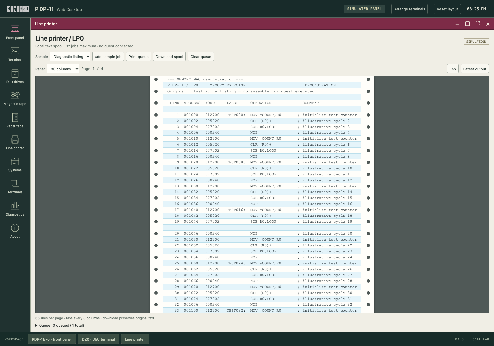
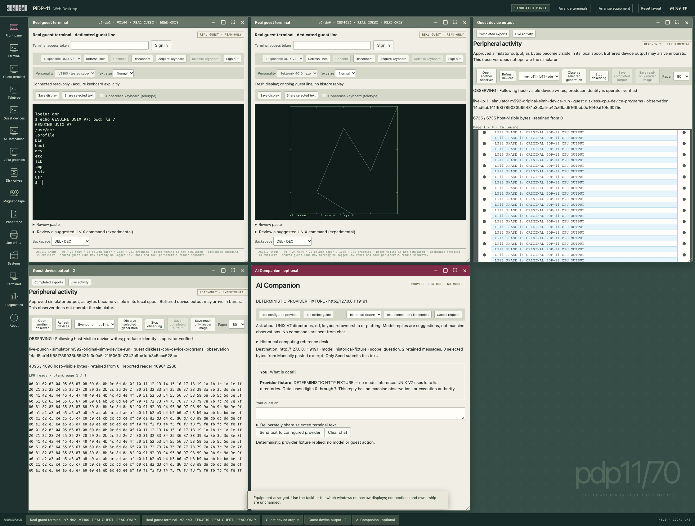

# PiDP-11 Web Desktop

**Craig Daters · [RetroRealm.org](https://retrorealm.org/)**

**Experimental · Active Development · [MIT original project code](LICENSE)**

A modern browser as a desk full of vintage terminals and peripherals, connected to a real PDP-11 operating system. PiDP-11 Web Desktop is an independent companion for [Oscar Vermeulen's PiDP-11/70](https://github.com/obsolescence/pidp11), built for exploration, preservation and the pleasure of using these machines.

The goal is simple: turn on your PiDP-11, select an operating system with its physical switches, then open a browser terminal from your Mac, Windows PC, Linux computer or tablet. The Raspberry Pi stays headless; the browser draws the interface. The original panel, console, SSH, GNU Screen and serial terminals remain independent.

**Genuine UNIX V7 browser sessions now work on the actual Raspberry Pi 3B+ in a controlled terminal-only pilot.** The pilot used the original installed simulator, preserved its installation, and was shut down after testing. You can explore the local desktop today without a Pi or guest disk.

The optional [historical tutor](docs/technical/historical-reference-library.md) now includes 29 reference notes, 13 source-identified facts, limited fragment review and exact local octal calculations. [Phase D](docs/lab/M5.9.3-D.md) records genuine Gemma qualification and an independently authenticated optional Hacker Replicant mode. Model explanations remain experimental.

[Start exploring](docs/getting-started/README.md) · [Technical documentation](docs/technical/README.md) · [Philosophy](PHILOSOPHY.md) · [Roadmap](ROADMAP.md) · [Changelog](CHANGELOG.md) · [Contribute](CONTRIBUTING.md)


*Actual M4.3 desktop: the SVG panel and these mock terminals are local demonstrations. Windows can be moved, resized and arranged without a graphical desktop on the Pi.*

## From a browser to UNIX V7

M5.0 connected xterm.js in the browser to a genuine Research UNIX Seventh Edition guest running under original SIMH/REALCONS. A small Go bridge carries terminal bytes over authenticated WebSockets to dedicated DC11 guest lines. The guest runs the commands; the browser displays their output.

Chromium, Firefox and WebKit passed the lab demonstration, including multiple observers, exclusive keyboard ownership, independent terminal lines and reconnects. The conventional operator console continued working when browsers closed and while the bridge was stopped. A fresh disposable disk repeated the demonstration.

M5.3 repeated the genuine terminal demonstration on the actual Pi using one disposable V7 disk, an independent Screen console and an SSH tunnel. All three browser engines passed. [Read the Pi pilot results](docs/lab/M5.3.md).


*Actual M5.3 Pi-hosted guest session through the SSH tunnel. The background panel remains simulated. Later [M5.5 physical-pilot findings](docs/lab/M5.5-physical-pilot.md) distinguish successful V7 coexistence checks from a failed fallback selection.*

[Read the demonstration report](docs/lab/M5.0.md) · [Reproduce the lab](docs/lab/M5.0-runbook.md)

## Choose a setup path

- **Already own a working PiDP-11?** Use [Path A: optional companion](docs/getting-started/installation-paths.md#path-a-you-already-have-a-working-pidp-11), with read-only preflight, private setup, rollback and removal. The ARM64 package is a laboratory candidate; hardware and memory-protection gates still apply.
- **Starting with Raspberry Pi OS Lite?** Use [Path B: original software first](docs/getting-started/installation-paths.md#path-b-start-with-raspberry-pi-os-lite). Verify independent physical operation before considering the companion. A fresh-card installation was not replayed in M5.9.

## What works today

| Part of the desktop | Current status |
|---|---|
| PDP-11/70 panel | Interactive SVG reconstruction with simulated lamps, switches and selectors |
| Desktop | Movable/resizable windows, taskbar, keyboard controls, layout preferences and touch-friendly controls |
| Mock terminals | Four independent local demonstration sessions with a tested DEC-style renderer |
| Genuine guest terminal | UNIX V7/DC11 demonstrated in the isolated lab **and on the actual Pi**; M5.9 tests VT100, initial VT52/VT220 and teletype presentations in genuine disposable V7 |
| 4010 graphics | Bounded Tektronix parser now displays genuine V7 `graph` / `plot -Ttek` output in three browser engines; VT11 remains separate future work |
| Disk, tape, paper tape and OS profiles | Working **simulated** workflows; no real guest media is changed |
| Continuous-form line printer | Simulated spool preserved; new authenticated Guest devices view receives verified completed LP11 exports from genuine PDP-11 CPU/device tests, with exact downloads. M5.9.2 also adds bounded live observation; no verified OS printer driver yet |
| AI Companion | Offline historical search and exact PDP-11 values; optional source-assisted local model, qualified through real three-engine conversations. Models still make factual errors. Explicit sharing and separate, disabled-by-default command review. [Phase B findings](docs/lab/M5.9.3-B.md) |
| Passive panel observation | Laboratory experiments; no production Pi observation service installed |
| Optional installation candidate | Detached Go service and ARM64 package tested in disposable Linux; not deployed to the Pi. [M5.9 results](docs/lab/M5.9.md) · [setup candidate](docs/getting-started/optional-service.md) |
| Physical Pi integration | V7/browser/physical checks passed in M5.5, but fallback selected the wrong guest; acceptance blocked, temporary changes rolled back, machine left stopped |
| Remote front-panel control | Separate unresolved safety work; not a production feature |



*Actual M4.3.2 simulated line printer. Paper presentation is independent of the downloadable text spool; it is not yet connected to guest LP0.*

See the [gallery](docs/screenshots/README.md) for the full panel, disk and tape applications. [Known limitations](docs/known-limitations.md) explains the boundaries without requiring you to read every engineering report.


*Actual M5.9 disposable V7 plotting output through unmodified SIMH. [Evidence, limits and remaining work](docs/lab/M5.9.md).*

## M5.9.3 Phase A: genuine local companion

The optional companion now has real local-model acceptance in Chromium, Firefox and WebKit, including deliberate excerpt sharing, follow-up conversation and cancellation. Qwen 3 14B through Ollama works with optional reasoning disabled. Both tested Qwen models made factual errors, so the sourced offline guide remains the recommended default. No model was downloaded, no hosted inference was contacted and the Pi was untouched.

[Inventory, model results and free-provider comparison](docs/lab/M5.9.3-A.md) · [Tested configuration](docs/getting-started/configured-companion.md) · [Private model-host design](docs/technical/hosted-local-companion.md)

## M5.9.2 live equipment workspace

The optional desktop now follows approved LP11/PC11 output while original SIMH devices are active. Two read-only device windows can sit beside genuine UNIX V7 text, Tektronix graphics and the optional companion. **Arrange equipment** organizes the windows; terminal titles and the taskbar show connection and keyboard ownership. Tablet layouts use task switching.



*Actual disposable V7 and original CPU-driven LP11/PC11, with a clearly labeled deterministic companion fixture. No physical Pi connection or real-model inference is shown.*

Fresh 2.11BSD VT220 vi/more checks passed in all three browser engines, including the previously missing WebKit case, observer redraw and keyboard handoff. The companion adds sourced historical notes and a visible summary of text being shared. Real-model acceptance and production peripheral supervision remain pending.

[Development report](docs/lab/M5.9.2.md) · [Live observation](docs/technical/observed-peripherals.md) · [Candidate record](docs/lab/M5.9.2-package.md)

## M5.9.1 equipment and applications

Completed LP11/PC11 output, configured companion requests and eight retained genuine 2.11BSD `vi` cases now have working code and laboratory evidence. Twelve fresh V7 terminal cases and the combined equipment workflow passed across Chromium, Firefox and WebKit. The physical Pi was not contacted.


*Actual laboratory application. V7 text/graphics are live guest streams; paper is a completed CPU-device export; the companion response is a deterministic fixture, not a real model.*

[Results and limits](docs/lab/M5.9.1.md) · [Observe device output](docs/technical/observed-peripherals.md) · [Configure the companion](docs/getting-started/configured-companion.md)

## Try the local desktop

You need Git and Node.js **22.18 or newer** with npm. In a terminal on your development computer:

```sh
git clone https://github.com/cdaters/pidp11-webdesktop.git
cd pidp11-webdesktop
npm ci
npm run dev
```

Open the loopback address printed by Vite, normally `http://127.0.0.1:5173`. This starts the browser-only demonstration; it does not connect to your Pi. Open **Terminal**, acquire its keyboard and type `HELP`, or open **Line printer** and add a sample listing. Stop the preview with Ctrl-C.

The separate **Guest terminal** needs an explicitly prepared real-guest service. The repeatable local route is the M5.0/M5.3 lab; the completed Pi pilot is not left running. The companion installer is a **laboratory candidate**, not production deployment acceptance. For the embedded Go mock server, offline HTML build and tests, use the [developer setup](docs/technical/development.md).

## Find your way around

| If you want to… | Start here |
|---|---|
| Understand the desktop and guest terminals | [Beginner guide](docs/getting-started/README.md) |
| See how the project evolved | [Development timeline](docs/timeline.md) and [changelog](CHANGELOG.md) |
| Inspect the implementation | [Technical guide](docs/technical/README.md), [coding standards](docs/technical/CODING-STANDARDS.md) and [architecture decisions](docs/development/DECISIONS.md) |
| Prepare Oscar's original software on Trixie Lite | [Headless installation guide](docs/installation/README.md) — **not a Web Desktop installer** |
| Review coexistence results and the unresolved fallback | [M5.5 physical pilot](docs/lab/M5.5-physical-pilot.md) · [Mac preparation](docs/lab/M5.5.md) · [M5.5.1 diagnostics and service work](docs/lab/M5.5.1.md) · [M5.6 implementation](docs/lab/M5.6-implementation.md) |
| Plan original-launcher coexistence | [M5.4 Mac-only design and lifecycle safeguards](docs/lab/M5.4.md) · [proposed supervised pilot](docs/lab/M5.4-pilot-plan.md) |
| Review the actual Pi findings | [M5.1 assessment](docs/lab/M5.1.md) and [M5.3 completed terminal pilot](docs/lab/M5.3.md) |
| Suggest an idea, report a bug or help | [Contributing](CONTRIBUTING.md), [Issues](https://github.com/cdaters/pidp11-webdesktop/issues) and [Discussions](https://github.com/cdaters/pidp11-webdesktop/discussions) |

## Built with the community's work

Thank you to Oscar and the PiDP contributors, Bob Supnik and the SIMH contributors, Jörg Hoppe and BlinkenBone/REALCONS, xterm.js, and the people preserving historical hardware and software. The High Nibble's IMSAI 8080 desktop inspired this project. [Full acknowledgments](ACKNOWLEDGMENTS.md) include the development tools and AI assistance used along the way.

Original RetroRealm code and appropriate original software documentation are [MIT licensed](LICENSE), copyright 2026 Craig Daters. Separately identified materials retain their [existing notices](THIRD_PARTY_NOTICES.md). This is an independent hobby project, not an official DEC product or an endorsement by Obsolescence Guaranteed.

## Explore with references and exact values

The [historical reference desk](docs/technical/historical-reference-library.md) works offline and separates curated facts from generated explanations. Convert octal, decimal, hexadecimal and binary exactly; inspect signed words, masks and virtual/physical widths without asking a model. The optional [configured companion](docs/getting-started/configured-companion.md) can use retrieved notes and a capable local model host. No inference runtime belongs on the Pi. [Optional Hacker Replicant integration](integrations/hacker-replicant/README.md) runs the pinned application in a modified read-only mode with deliberate text sharing. Synthetic selected-text compatibility passed; live-guest acceptance remains open.
