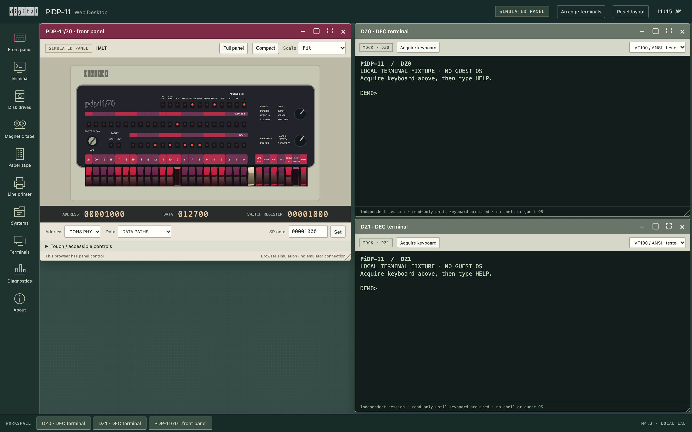

# PiDP-11 Web Desktop

**Craig Daters · [RetroRealm.org](https://retrorealm.org/)**

**Experimental · Active Development · [MIT original project code](LICENSE)**

A modern browser as a desk full of vintage terminals and peripherals, connected to a real PDP-11 operating system. PiDP-11 Web Desktop is an independent companion for [Oscar Vermeulen's PiDP-11/70](https://github.com/obsolescence/pidp11), built for exploration, preservation and the pleasure of using these machines.

The goal is simple: turn on your PiDP-11, select an operating system with its physical switches, then open a browser terminal from your Mac, Windows PC, Linux computer or tablet. The Raspberry Pi stays headless; the browser draws the interface. The original panel, console, SSH, GNU Screen and serial terminals remain independent.

**Genuine UNIX V7 browser sessions now work on the actual Raspberry Pi 3B+ in a controlled terminal-only pilot.** The pilot used the original installed simulator, preserved its installation, and was shut down after testing. You can explore the local desktop today without a Pi or guest disk.

[Start exploring](docs/getting-started/README.md) · [Technical documentation](docs/technical/README.md) · [Philosophy](PHILOSOPHY.md) · [Roadmap](ROADMAP.md) · [Changelog](CHANGELOG.md) · [Contribute](CONTRIBUTING.md)



*Actual M4.3 desktop: the SVG panel and these mock terminals are local demonstrations. Windows can be moved, resized and arranged without a graphical desktop on the Pi.*

## From a browser to UNIX V7

M5.0 connected xterm.js in the browser to a genuine Research UNIX Seventh Edition guest running under original SIMH/REALCONS. A small Go bridge carries terminal bytes over authenticated WebSockets to dedicated DC11 guest lines. The guest runs the commands; the browser displays their output.

Chromium, Firefox and WebKit passed the lab demonstration, including multiple observers, exclusive keyboard ownership, independent terminal lines and reconnects. The conventional operator console continued working when browsers closed and while the bridge was stopped. A fresh disposable disk repeated the demonstration.

M5.3 repeated the genuine terminal demonstration on the actual Pi using one disposable V7 disk, an independent Screen console and an SSH tunnel. All three browser engines passed. [Read the Pi pilot results](docs/lab/M5.3.md).


*Actual M5.3 Pi-hosted guest session through the SSH tunnel. The background panel remains simulated; physical-panel and original-launcher coexistence are separate future tests.*

[Read the demonstration report](docs/lab/M5.0.md) · [Reproduce the lab](docs/lab/M5.0-runbook.md)

## What works today

| Part of the desktop | Current status |
|---|---|
| PDP-11/70 panel | Interactive SVG reconstruction with simulated lamps, switches and selectors |
| Desktop | Movable/resizable windows, taskbar, keyboard controls, layout preferences and touch-friendly controls |
| Mock terminals | Four independent local demonstration sessions with a tested DEC-style renderer |
| Genuine guest terminal | UNIX V7/DC11 demonstrated in the isolated lab **and on the actual Pi** |
| Disk, tape, paper tape and OS profiles | Working **simulated** workflows; no real guest media is changed |
| Continuous-form line printer | Simulated LP0 spool, 80/132-column paper, perforations, tractor-feed holes and original-text download |
| Passive panel observation | Laboratory experiments; no production Pi observation service installed |
| Physical Pi integration | Terminal-only standalone pilot passed and cleaned up; no permanent service or physical-panel integration |
| Remote front-panel control | Separate unresolved safety work; not a production feature |


*Actual M4.3.2 simulated line printer. Paper presentation is independent of the downloadable text spool; it is not yet connected to guest LP0.*

See the [gallery](docs/screenshots/README.md) for the full panel, disk and tape applications. [Known limitations](docs/known-limitations.md) explains the boundaries without requiring you to read every engineering report.

## Try the local desktop

You need Git and Node.js **22.18 or newer** with npm. In a terminal on your development computer:

```sh
git clone https://github.com/cdaters/pidp11-webdesktop.git
cd pidp11-webdesktop
npm ci
npm run dev
```

Open the loopback address printed by Vite, normally `http://127.0.0.1:5173`. This starts the browser-only demonstration; it does not connect to your Pi. Open **Terminal**, acquire its keyboard and type `HELP`, or open **Line printer** and add a sample listing. Stop the preview with Ctrl-C.

The separate **Guest terminal** needs an explicitly prepared real-guest service. The repeatable local route is the M5.0/M5.3 lab; the completed Pi pilot is not left running. There is **no production Pi installer**. For the embedded Go mock server, offline HTML build and tests, use the [developer setup](docs/technical/development.md).

## Find your way around

| If you want to… | Start here |
|---|---|
| Understand the desktop and guest terminals | [Beginner guide](docs/getting-started/README.md) |
| See how the project evolved | [Development timeline](docs/timeline.md) and [changelog](CHANGELOG.md) |
| Inspect the implementation | [Technical guide](docs/technical/README.md), [coding standards](docs/technical/CODING-STANDARDS.md) and [architecture decisions](docs/development/DECISIONS.md) |
| Prepare Oscar's original software on Trixie Lite | [Headless installation guide](docs/installation/README.md) — **not a Web Desktop installer** |
| Review the actual Pi findings | [M5.1 assessment](docs/lab/M5.1.md) and [M5.3 completed terminal pilot](docs/lab/M5.3.md) |
| Suggest an idea, report a bug or help | [Contributing](CONTRIBUTING.md), [Issues](https://github.com/cdaters/pidp11-webdesktop/issues) and [Discussions](https://github.com/cdaters/pidp11-webdesktop/discussions) |

## Built with the community's work

Thank you to Oscar and the PiDP contributors, Bob Supnik and the SIMH contributors, Jörg Hoppe and BlinkenBone/REALCONS, xterm.js, and the people preserving historical hardware and software. The High Nibble's IMSAI 8080 desktop inspired this project. [Full acknowledgments](ACKNOWLEDGMENTS.md) include the development tools and AI assistance used along the way.

Original RetroRealm code and appropriate original software documentation are [MIT licensed](LICENSE), copyright 2026 Craig Daters. Separately identified materials retain their [existing notices](THIRD_PARTY_NOTICES.md). This is an independent hobby project, not an official DEC product or an endorsement by Obsolescence Guaranteed.
