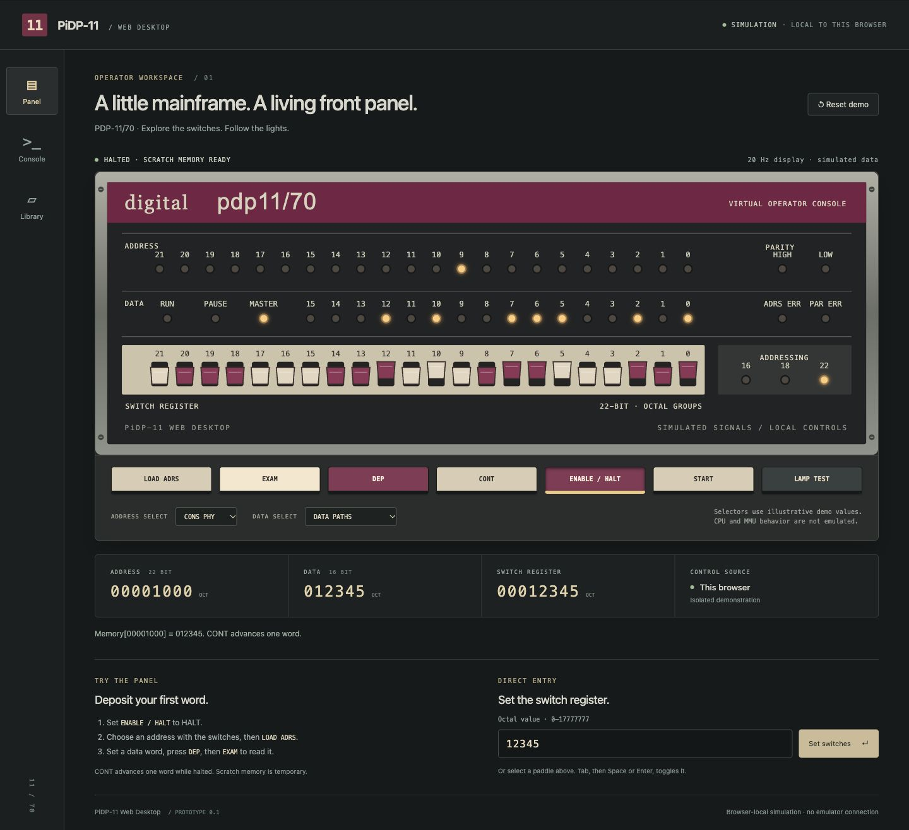

# PiDP-11 Web Desktop

A lightweight companion-interface research project for Oscar Vermeulen's PiDP-11/70, inspired by The High Nibble's browser desktop. Current milestone: **architecture research and an isolated browser prototype**.

The Raspberry Pi was not contacted or modified. No emulator, RPC adapter, GPIO driver, shell, disk image or operating system is started by this project. All prototype controls affect only temporary state in the current browser tab.

## Open the prototype

The generated self-contained artifact is [`dist/prototype.html`](dist/prototype.html). It contains the application, original SVG panel and stylesheet in one approximately 33 KB file. Its CSP permits the bundled scripts/styles by hash and sets `connect-src 'none'`. Direct `file:` opening was not testable through the browser tool; the identical built file was tested over loopback HTTP.

For a reproducible local preview on the Mac, with Node.js 22.18 or newer:

```sh
cd /Volumes/TheBench/Projects/PiDP11/WebDesktop
npm ci
npm run build
npm run preview -- --port 4173 --strictPort
```

Open [the built prototype](http://127.0.0.1:4173/prototype.html). Stop with Ctrl-C. All servers bind to `127.0.0.1`. No Pi hostname, network discovery or live connection option exists.

For source development, `npm run dev` starts Vite on loopback. Node/Vite/TypeScript are Mac development tools; the proposed Pi backend is a compiled Go service. There are **zero production npm dependencies**.

## Try it

- The address and data lamps show deterministic synthetic activity at a nominal 20 Hz.
- Click **ENABLE / HALT** to halt. Set the switch register to octal `1000`, then **LOAD ADRS**.
- Set the register to `12345`, then **DEP** and **EXAM**. DATA reads `012345` at ADDRESS `00001000`.
- **CONT** advances one demonstration word while halted. **START** initializes at the switch-register address, preserving HALT. Releasing HALT resumes synthetic activity.
- Toggle any of the 22 SVG paddles by click, or Tab then Space/Enter. Direct entry validates octal digits and the 22-bit range.
- **LAMP TEST** toggles all 48 rendered lamps. The selectors choose illustrative display modes.
- **Console** offers a bounded local command demo (`help`, `status`, `halt`, `run`, `step`, `sr`, `load`, `examine`, `deposit`, `start`, `lamps`, `clear`) sharing panel state. It is not a VT emulator, shell or guest OS.
- **Library** presents planning profiles and notes. It does not inspect or manage installed systems.

At narrow widths, swipe the SVG panel sideways; controls and readouts adapt below it. Synthetic activity pauses while the document is hidden. A reduced-motion preference starts the model halted; explicit controls can resume it. Reset/reload discards scratch memory. The model stores at most 1,024 deposited words; console history/output are bounded.

This is an original, simplified visual interpretation, not a pixel-perfect DEC panel. It implements a subset of the upstream control/indicator model. LOAD/EXAM/DEP/START and selector behavior are documented demo interactions, not REALCONS compatibility claims. The physical/virtual ownership policy is proposed, not implemented.



## Research and decisions

- [Architecture proposal and diagrams](docs/architecture.md): modules, RPC direction, coexistence, ownership, terminal and media boundaries.
- [Go versus Rust](docs/backend-decision.md): complexity, resource tradeoffs, cross-compilation, licensing and provisional Go recommendation.
- [Protocol compatibility analysis](docs/protocol.md): original C/Java behavior, procedure map, XDR encoding, version differences and test plan.
- [Roadmap, resource targets and risks](docs/roadmap.md): milestones M0–M7 with explicit authorization boundaries.
- [Sources](docs/sources.md) and [pinned source manifest](docs/source-manifest.json): upstream revisions and downloaded-source SHA-256 hashes.
- [Validation record](docs/validation.md): checks actually performed and their limits.

Key finding: SIMH/REALCONS is the RPC **client**, and the panel is the **server**. The API reads switches and writes lamps; it does not supply a second client's complete virtual-panel interface or control ownership. A future broker must mediate both directions. Another wire-level trap: the IDL's char vector encodes each logical byte as a four-byte XDR integer. Reuse the protocol and emulator semantics, then prove compatibility with offline C/Java fixtures.

## Repository layout

```text
src/model.ts       PanelAdapter contract and deterministic simulation
src/panel.ts       Original SVG and control rendering
src/main.ts        Workspace, demo console, catalog and input handling
src/style.css      Responsive layout and panel styling
scripts/standalone.mjs  Self-contained artifact packaging and CSP hashes
tests/model.test.ts     Simulation behavior tests
docs/                  Research, decisions, screenshots and validation
.research/             Ignored local upstream-source cache (not executed)
dist/                  Ignored generated browser artifacts
```

Run `npm run check`, `npm test`, and `npm run build`. Build and test need no Pi or emulator. Upstream source is research evidence and is not linked into the prototype. Licensing for original project code remains an owner decision before publication; see the dependency and upstream license discussion in the backend decision.
