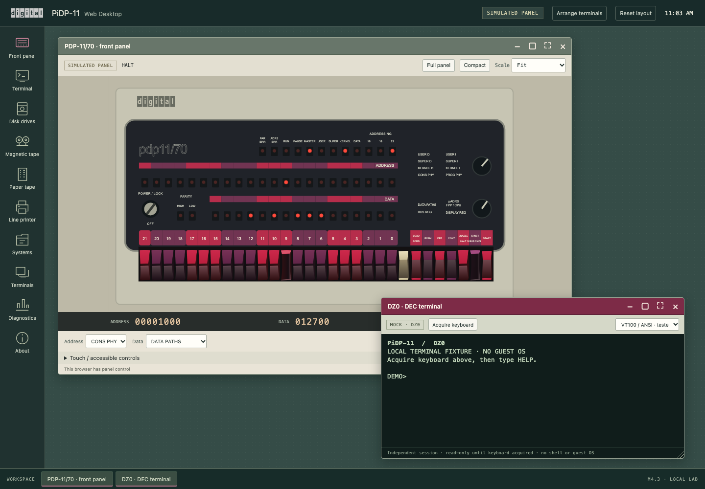

# PiDP-11 Web Desktop

A compact HTML5/TypeScript/SVG companion-interface project for Oscar Vermeulen's PiDP-11/70. **Milestone M4.3: historical paddles, offline security and recovery hardening, terminal fixtures and extended stability testing.** The normal Mac executable remains mock-only; the separate Linux fixture exercises actual REALCONS.

Web Desktop development and testing remain local to the Mac. During the separate pre-Oscar documentation review, original installation records were retrieved from the Pi read-only with the owner’s authorization; no Pi tests, installation changes, or Web Desktop deployment were performed. Actual emulator/RPC control exists only in the disposable Linux laboratory. The normal desktop remains simulated. No physical GPIO, production installation or guest OS images are used. Peripheral and system-management workflows are clearly labeled RAM-only prototypes.

## M4.3.1 presentation checkpoint

The presentation revision refines the existing shared SVG paddle curves, depth, spacing, and highlights. About and the footer now derive **M4.3** from the same `package.json` version (`0.4.3`); the checkpoint suffix identifies polish, not a new integration milestone. Contributor credits and truthful mock/observer labels remain visible. No control-policy or transport changes were made.

See the [presentation review and checks](docs/review-m431.md), [before/after switches](docs/screenshots/m431-before-after-switches.png), and [corrected About window](docs/screenshots/m431-about.png). Earlier screenshots and `checkpoint/m4.3` remain unchanged.

## M4.3 delivered

- Photograph-based raised/lowered/rest paddle geometry, fixed hardware pigments, shared SVG definitions and authentic cream lamp-test control; actual photo comparisons retained.
- Fit/reference/50–200% scaling, compact panel and terminal arrangement; unchanged independent mock device workflows.
- Kernel-pinned passive publishers, TLS/WSS, private credential files, secure sessions, CSRF logout and local credential rotation/revocation.
- DEC renderer/keypad/encoding/Telnet/flow-control fixtures, bounded mock input/output and no replay across keyboard handoff.
- Separate optional C operation-budget experiment, all prior safety checkpoints preserved, and 30-minute laboratory/browser workloads.

See the [M4.3 technical report](docs/lab/M4.3.md), [terminal matrix](docs/lab/M4.3-terminals.md), [security contract](docs/lab/M4.3-security.md), [recovery report](docs/lab/M4.3-recovery.md), [performance record](docs/lab/M4.3-performance.md) and [proposed, unexecuted pilot/rollback](docs/lab/M4.3-pilot.md). Production access remains separately gated.

## M4.2 delivered

- Movable/resizable/minimizable windows, taskbar, fullscreen, keyboard/touch controls and geometry-only preferences.
- Calibrated 1200×688 SVG PDP-11/70 panel with shared desktop/full-panel modes and supplied DIGITAL logos.
- Four independent xterm-based mock terminals; working disk, magnetic tape, paper tape, printer, OS-profile and diagnostics applications.
- Passive C publisher and authenticated Go read-only observation service, isolated from RPC/control/terminal input.
- Original M4/M4.1 regressions retained; optional bounded-RPC recovery experiment and five-minute observer/browser workloads.

See the [M4.2 findings and risks](docs/lab/M4.2.md), [desktop architecture](docs/frontend-m42.md), [observation/security contract](docs/lab/M4.2-observation.md), [IMSAI inventory](docs/research/imsai-inventory.md) and [parity matrix](docs/research/imsai-parity.md). No production integration is authorized or implied.

## M4.1 findings

The optional consumer interlock rejects the M4 delayed START-release response and queued stale panel commands at SIMH consumption. Its independent watchdog can stop managed execution while RPC remains responsive. **Unconditional crash-safe halting is not established:** a blocked original RPC can delay quiescence, and committed commands cannot be undone. Original physical-only operation remains the default design; rollback and two independent DZ11 terminal transports are exercised in the lab.

See the [M4.1 report and risk register](docs/lab/M4.1.md), [access-independence architecture](docs/decisions/0004-independent-access.md), [minimal upstream hooks](lab/interlock/upstream.patch), and [rollback procedure](docs/lab/M4.1-rollback.md). Run `sh lab/verify-m41.sh` after building the lab image. Production integration still needs separate authorization.

## Laboratory findings and reproduction

M3 passed actual original-C UDP/TCP interoperability, rpcbind discovery, lamp/switch exchange, and REALCONS START/HALT/CONT/EXAM/DEP/selector checks. M4 implements a separate physical-panel stand-in, control broker, observers and explicit handoffs, with delay/loss/disconnect/crash tests.

**Production safety is not established.** The lab reproduces a delayed START-release reply that can cause RUN after ownership has been revoked. Newly generated handoff frames assert HALT before releasing START, but cannot retract an earlier reply or queued command. Broker crash recovery also has no guaranteed halt deadline. See [M3 findings](docs/lab/M3.md), [M4 safety limits and diagram](docs/lab/M4.md), and [actual fault/measurement report](docs/lab/m4-report.json).

With the existing **local OrbStack Docker context** on this Mac:

```sh
sh lab/build-image.sh
sh lab/run.sh
python3 lab/save-results.py
```

The first command fetches the pinned public source and Debian build packages. Runtime tests have **only loopback networking**, no published ports, no privileged container and no physical devices. They do not contact the Pi. Containers are test infrastructure, not deployment dependencies. Test results go to `.research/lab-results`; the last command records a successful run in `docs/lab`. Use `--m3-only` or `--m4-only` with `lab/run.sh` for focused runs; save the combined results only after a complete successful run.

Preserved source checkpoints: `checkpoint/m0`, `checkpoint/m02`, `checkpoint/m3`, `checkpoint/m4`, `checkpoint/m4.1`, `checkpoint/m4.2`, `checkpoint/m4.3`, and `checkpoint/m4.3.1`. Golden-backup completion does not authorize production integration.

## Build and run on the Mac

Requires Node.js 22.18+ and Go 1.25+; tested with Node 26.9.0 and Go 1.26.0. From the project directory:

```sh
npm ci
sh scripts/build.sh
./bin/webdesktop-macos
```

Open [the shared mock desktop](http://127.0.0.1:8080/?backend=mock). Click **Acquire panel**. A second browser tab observes the same state; only one can own controls. Closing the owner halts/disarms the mock. Reconnecting never automatically acquires control or replays commands. Stop the service with Ctrl-C.

The build creates a native Mac executable and `bin/webdesktop-linux-arm64`, a statically linked ARM64 ELF executable with embedded browser assets. The ARM64 build has **not** been deployed or executed on the Pi. No Node runtime, container, database or asset directory is required by the executable. It permits only literal loopback IP listeners, with no DNS lookup or remote connection setting.

For an independent browser-only demo, open the desktop without `?backend=mock` or use generated `dist/prototype.html`. The standalone file embeds JS/CSS/SVG and prohibits network connections through CSP. The original accepted prototype is preserved unchanged at [`checkpoints/m0/prototype.html`](checkpoints/m0/prototype.html), with Git tag `checkpoint/m0` identifying its source. Current `dist/` artifacts are regenerable and ignored by Git.

For frontend development: `npm run dev` starts loopback Vite. Two pinned, lazy-loaded browser runtime packages provide xterm.js and its fit addon. Go uses its standard library plus the small ISC-licensed `coder/websocket` package.

## Try the panel

1. Acquire panel; the panel starts halted.
2. Set SR to octal `1000`, then press **LOAD ADRS**.
3. Set SR to `12345`, press **DEP**, then **EXAM**. ADDRESS stays `00001000`, DATA is `012345`.
4. Consecutive EXAM or DEP operations advance one word; changing from EXAM to DEP or back keeps the address.
5. Select **ENABLE**, then **CONT** to animate. ENABLE alone leaves the model stopped. HALT stops; CONT while halted advances one demonstration word.
6. START uses the previously loaded address, rather than the current SR. Lamp test is an automatically returning pulse. DEP/lamp test raise their paddles; other momentaries depress them.

All 22 SR switches support click, Tab and Space/Enter. Direct entry accepts 22-bit octal values. Selector ordinals follow the inspected original interface; their displayed values remain illustrative. CPU/MMU, bus-cycle execution, special address boundaries and operating systems are not emulated. POWER/LOCK is inert. Each terminal has its own bounded mock command/session model and mature ANSI renderer; its keyboard never controls the panel. Device and system profiles have working simulated workflows, with no guest OS or host shell.

On narrow screens, swipe the SVG sideways; the rest of the page fits the viewport. Browser-local animation pauses when hidden. Remote state comes from the server, and background timer throttling can safely expire a control lease.



## Architecture, findings and validation

- [Implemented backend and API](docs/backend-milestone.md): component diagram, ownership/revisions, stream limits, wire support and remaining questions.
- [Physical/virtual broker safety design](docs/broker-safety.md): single arbitration point, latches, momentaries, START recovery, rpcbind and failure limitations.
- [Historical panel evidence](docs/panel-reference-notes.md): DEC handbook, authentic photograph, original Java and REALCONS source.
- [Validation record](docs/validation.md): tests, browser verification, Mac measurements and limitations.
- [Roadmap and Pi resource targets](docs/roadmap.md): measurable acceptance budgets and integration gates.
- [Original architecture](docs/architecture.md), [Go versus Rust decision](docs/backend-decision.md), [protocol analysis](docs/protocol.md), [sources](docs/sources.md) and [source manifest](docs/source-manifest.json).
- [Third-party notices](THIRD_PARTY_NOTICES.md) and [offline C oracle provenance](scripts/fixtures/README.md).

The key protocol finding remains: SIMH/REALCONS is the RPC **client**; the panel is the **server**. GET reads switches and SET writes lamps. Multiple callers do not establish ownership or supply a complete virtual-panel interface. Original C/REALCONS interoperability and simulated coexistence now run in the isolated lab. Physical hardware coexistence and unconditional failure safety remain unproven.

## Tests and measurements

```sh
npm run check
npm test
npm run test:integration
# Browser suite requires Vite on 5173 and the built mock service on 8080:
npm run test:browser
go test -race ./...
go test ./internal/blinkenbone -run='^$' -fuzz=FuzzDecode -fuzztime=10s -parallel=2
```

Optional offline fixture regeneration on macOS with Xcode command-line tools:

```sh
python3 scripts/fixtures/generate.py
git diff -- internal/blinkenbone/testdata/original.json scripts/fixtures/provenance.json
```

For the fixed-loopback Mac workload, build the web service first, then run:

```sh
CGO_ENABLED=0 go build -trimpath -o bin/mockbench-macos ./cmd/mockbench
python3 scripts/measure-mac.py
```

The measurement script starts/stops its own child service on `127.0.0.1:18770`. It records ten seconds idle and approximately fifteen seconds with two viewers and 300 control updates at 20 Hz. [Raw measurements](docs/performance-mac.json) include binary hashes. These short Mac samples do not establish Raspberry Pi performance or a long-duration memory bound. Pi targets remain ≤24 MiB idle RSS, ≤48 MiB active RSS, <5% mean active CPU of one core, and <100 ms p95 LAN acknowledgment/freshness under the defined workload.

## Repository layout

```text
cmd/webdesktop/        Mock HTTP/WebSocket executable
cmd/mockbench/         Fixed-loopback Mac measurement workload
internal/panel/        Simulated state and ownership arbiter
internal/server/       HTTP/WS transport and real-socket tests
internal/blinkenbone/  Bounded XDR/RPC codecs and golden vectors
internal/labrpc/       Experimental loopback RPC transport and panel profile
internal/broker/       Poll-fenced laboratory arbitration
internal/observe/      Passive snapshot receiver and read-only streaming
internal/access/       Independent capabilities and bounded lab sessions
lab/                   Isolated Linux build, C/PTY fixtures and test harness
internal/web/          Embedded compiled assets
src/                   TypeScript local/remote adapters and original SVG
scripts/               Build, packaging, C fixture oracle and measurement
tests/, integration/   Model/transport mapping and reconnect fixture tests
checkpoints/m0/        Preserved accepted standalone prototype
docs/                  Architecture, evidence, validation and screenshots
```

The temporary mock backend used for verification was stopped after testing; the local frontend preview may remain open for screenshots. Live integration remains a separate milestone after the complete microSD backup and explicit authorization. Licensing of original project code remains an owner decision before publication.
