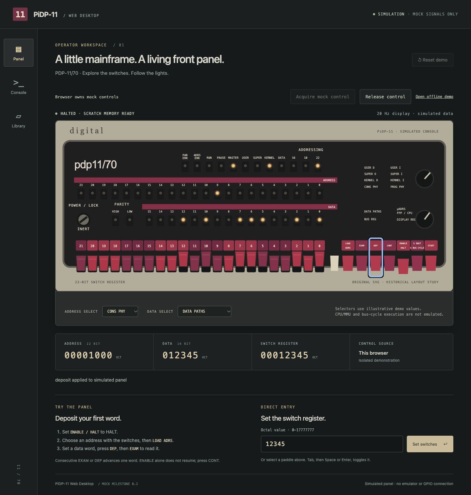

# PiDP-11 Web Desktop

A compact HTML5/TypeScript/SVG companion-interface project for Oscar Vermeulen's PiDP-11/70. **Milestones M3/M4: original REALCONS interoperability and physical/virtual broker laboratory.** The normal Mac executable remains mock-only; the separate Linux fixture exercises actual REALCONS.

All development and testing is local to the Mac. The Raspberry Pi was not contacted or modified. Actual emulator/RPC control exists only in the disposable Linux laboratory. The normal desktop remains simulated. No physical GPIO, production installation, guest OS images or media management is used.

## Laboratory findings and reproduction

M3 passed actual original-C UDP/TCP interoperability, rpcbind discovery, lamp/switch exchange, and REALCONS START/HALT/CONT/EXAM/DEP/selector checks. M4 implements a separate physical-panel stand-in, control broker, observers and explicit handoffs, with delay/loss/disconnect/crash tests.

**Production safety is not established.** The lab reproduces a delayed START-release reply that can cause RUN after ownership has been revoked. Newly generated handoff frames assert HALT before releasing START, but cannot retract an earlier reply or queued command. Broker crash recovery also has no guaranteed halt deadline. See [M3 findings](docs/lab/M3.md), [M4 safety limits and diagram](docs/lab/M4.md), and [actual fault/measurement report](docs/lab/m4-report.json).

With the existing **local OrbStack Docker context** on this Mac:

```sh
sh lab/build-image.sh
sh lab/run.sh
python3 lab/save-results.py
```

The first command fetches the pinned public source and Debian build packages. Runtime tests have **only loopback networking**, no published ports, no privileged container and no physical devices. They do not contact the Pi. Containers are test infrastructure, not deployment dependencies. Test results go to `.research/lab-results`; the last command records a successful run in `docs/lab`. Use `--m3-only` or `--m4-only` with `lab/run.sh` for focused runs; save the combined results only after a complete successful run.

Preserved source checkpoints: `checkpoint/m0`, `checkpoint/m02`, `checkpoint/m3`, and `checkpoint/m4`. Golden-backup completion does not authorize production integration.

## Build and run on the Mac

Requires Node.js 22.18+ and Go 1.25+; tested with Node 26.9.0 and Go 1.26.0. From the project directory:

```sh
npm ci
sh scripts/build.sh
./bin/webdesktop-macos
```

Open [the shared mock desktop](http://127.0.0.1:8080/?backend=mock). Click **Acquire mock control**. A second browser tab observes the same state; only one can own controls. Closing the owner halts/disarms the mock. Reconnecting never automatically acquires control or replays commands. Stop the service with Ctrl-C.

The build creates a native Mac executable and `bin/webdesktop-linux-arm64`, a statically linked ARM64 ELF executable with embedded browser assets. The ARM64 build has **not** been deployed or executed on the Pi. No Node runtime, container, database or asset directory is required by the executable. It permits only literal loopback IP listeners, with no DNS lookup or remote connection setting.

For an independent browser-only demo, use the **Open offline demo** link or generated `dist/prototype.html`. The standalone file embeds JS/CSS/SVG and prohibits network connections through CSP. The original accepted prototype is preserved unchanged at [`checkpoints/m0/prototype.html`](checkpoints/m0/prototype.html), with Git tag `checkpoint/m0` identifying its source. Current `dist/` artifacts are regenerable and ignored by Git.

For frontend development: `npm run dev` starts loopback Vite. There are zero production npm dependencies. Go uses its standard library plus the small ISC-licensed `coder/websocket` package.

## Try the panel

1. Acquire mock control; the panel starts halted.
2. Set SR to octal `1000`, then press **LOAD ADRS**.
3. Set SR to `12345`, press **DEP**, then **EXAM**. ADDRESS stays `00001000`, DATA is `012345`.
4. Consecutive EXAM or DEP operations advance one word; changing from EXAM to DEP or back keeps the address.
5. Select **ENABLE**, then **CONT** to animate. ENABLE alone leaves the model stopped. HALT stops; CONT while halted advances one demonstration word.
6. START uses the previously loaded address, rather than the current SR. Lamp test is an automatically returning pulse. DEP/lamp test raise their paddles; other momentaries depress them.

All 22 SR switches support click, Tab and Space/Enter. Direct entry accepts 22-bit octal values. Selector ordinals follow the inspected original interface; their displayed values remain illustrative. CPU/MMU, bus-cycle execution, special address boundaries and operating systems are not emulated. POWER/LOCK is inert. The console provides bounded demonstration commands against the same mock state, not a shell or VT terminal. Library profiles remain planning notes.

On narrow screens, swipe the SVG sideways; the rest of the page fits the viewport. Browser-local animation pauses when hidden. Remote state comes from the server, and background timer throttling can safely expire a control lease.



## Architecture, findings and validation

- [Implemented backend and API](docs/backend-milestone.md): component diagram, ownership/revisions, stream limits, wire support and remaining questions.
- [Physical/virtual broker safety design](docs/broker-safety.md): single arbitration point, latches, momentaries, START recovery, rpcbind and failure limitations.
- [Historical panel evidence](docs/panel-reference-notes.md): DEC handbook, authentic photograph, original Java and REALCONS source.
- [Validation record](docs/validation.md): tests, browser verification, Mac measurements and limitations.
- [Roadmap and Pi resource targets](docs/roadmap.md): measurable acceptance budgets and integration gates.
- [Original architecture](docs/architecture.md), [Go versus Rust decision](docs/backend-decision.md), [protocol analysis](docs/protocol.md), [sources](docs/sources.md) and [source manifest](docs/source-manifest.json).
- [Third-party notices](THIRD_PARTY_NOTICES.md) and [offline C oracle provenance](scripts/fixtures/README.md).

The key protocol finding remains: SIMH/REALCONS is the RPC **client**; the panel is the **server**. GET reads switches and SET writes lamps. Multiple callers do not establish ownership or supply a complete virtual-panel interface. Original C/REALCONS interoperability and simulated coexistence now run in the isolated lab. Physical hardware coexistence and unconditional failure safety remain unproven.

## Tests and measurements

```sh
npm run check
npm test
npm run test:integration
go test -race ./...
go test ./internal/blinkenbone -run='^$' -fuzz=FuzzDecode -fuzztime=10s -parallel=2
```

Optional offline fixture regeneration on macOS with Xcode command-line tools:

```sh
python3 scripts/fixtures/generate.py
git diff -- internal/blinkenbone/testdata/original.json scripts/fixtures/provenance.json
```

For the fixed-loopback Mac workload, build the web service first, then run:

```sh
CGO_ENABLED=0 go build -trimpath -o bin/mockbench-macos ./cmd/mockbench
python3 scripts/measure-mac.py
```

The measurement script starts/stops its own child service on `127.0.0.1:18770`. It records ten seconds idle and approximately fifteen seconds with two viewers and 300 control updates at 20 Hz. [Raw measurements](docs/performance-mac.json) include binary hashes. These short Mac samples do not establish Raspberry Pi performance or a long-duration memory bound. Pi targets remain ≤24 MiB idle RSS, ≤48 MiB active RSS, <5% mean active CPU of one core, and <100 ms p95 LAN acknowledgment/freshness under the defined workload.

## Repository layout

```text
cmd/webdesktop/        Mock HTTP/WebSocket executable
cmd/mockbench/         Fixed-loopback Mac measurement workload
internal/panel/        Simulated state and ownership arbiter
internal/server/       HTTP/WS transport and real-socket tests
internal/blinkenbone/  Bounded XDR/RPC codecs and golden vectors
internal/labrpc/       Experimental loopback RPC transport and panel profile
internal/broker/       Poll-fenced laboratory arbitration
lab/                   Isolated Linux build, C/PTY fixtures and test harness
internal/web/          Embedded compiled assets
src/                   TypeScript local/remote adapters and original SVG
scripts/               Build, packaging, C fixture oracle and measurement
tests/, integration/   Model/transport mapping and reconnect fixture tests
checkpoints/m0/        Preserved accepted standalone prototype
docs/                  Architecture, evidence, validation and screenshots
```

Preview processes used for verification were stopped after testing. Live integration remains a separate milestone after the complete microSD backup and explicit authorization. Licensing of original project code remains an owner decision before publication.
