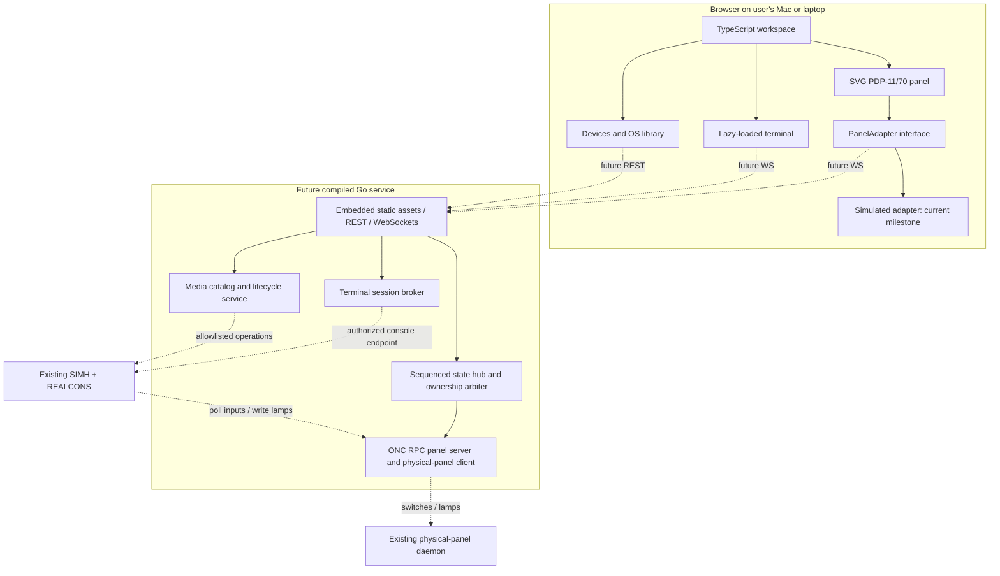
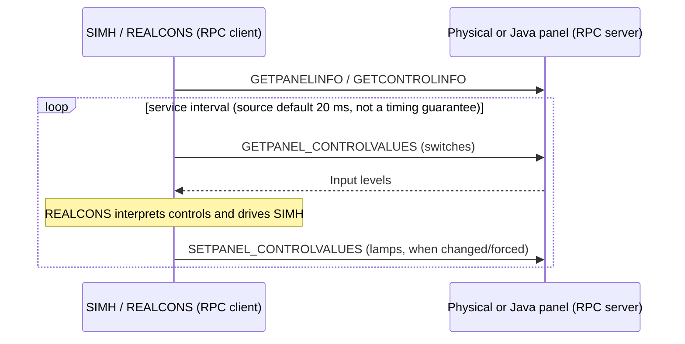

# Architecture proposal

Original M0 proposal, 2026-11-16, retained as design context. **Current implementation:** the Go mock service and WebSocket adapter are described in [backend milestone 0.2](backend-milestone.md); the updated coexistence decision is in [broker safety](broker-safety.md). M3/M4 now implement original REALCONS and RPC/broker integration solely in a disposable Linux lab; see [M4 architecture and safety limits](lab/M4.md). No Pi access, installed-software inspection, GPIO integration or production deployment has occurred. The broader terminal/media/deployment modules below remain proposals.

## Recommendation

Use a small TypeScript application with an original SVG panel and a future Go service. Keep SIMH, REALCONS, the official GPIO driver, and existing guest systems authoritative. Build an adapter around the Blinkenlight API, not a new PDP-11 simulator. Prefer browser-side rendering and a single shared panel state stream over server-side graphics or a full desktop framework.

Go is the provisional backend choice because the service is mostly bounded network I/O, state coordination, and static file delivery. Revisit it only if equivalent measured workloads fail the resource budget or the maintained ONC RPC implementation is materially better in Rust. See [language decision](backend-decision.md).

The High Nibble demonstrates that terminal, panel, media library, and device windows can form a useful browser desktop: terminal/display activity uses WebSockets and disk operations use REST. Adopt this functional separation, with a responsive workspace rather than a draggable-window framework in the first milestone. Its z80pack/ESP32 implementation and imagery are not reused. [Source: High Nibble](https://thehighnibble.com/imsai8080/#features).

## Modules and boundaries

| Module | Responsibility | Explicit boundary |
|---|---|---|
| Frontend | Render named controls, octal values, status and terminal; keyboard/touch input | No raw RPC, GPIO or shell commands |
| State hub | Authoritative snapshots, revisions, leases, acknowledgements, bounded subscribers | No emulator instruction execution |
| Protocol adapter | Discover schema, validate messages, translate ONC RPC/XDR, cache lamp writes | No assumptions about fixed control offsets |
| Terminal broker | Preserve byte stream, resize, flow control and session lifecycle | Guest console and SIMH monitor are distinct capabilities |
| Device/OS service | Catalog images, check hashes, attach/detach via validated profiles | No arbitrary host path or command execution |
| Simulation adapter | Deterministic demonstration state, sparse scratch memory and fixtures | No claim of CPU, MMU or OS emulation |

Frontend `PanelAdapter` supplies snapshots and accepts typed commands. The current `SimulatedPanelAdapter` runs entirely in the browser. A later remote adapter implements the same UI-facing contract; the service owns command validation and leases regardless of browser state. Protocol states should eventually retain raw named controls alongside presentation fields, with explicit validity and freshness.

## Actual existing topology

The browser cannot simply become another client and get a complete panel. GET reads switches; SET writes lamps. There is neither a lamp-read RPC nor a switch-write RPC. The C and Java handlers operate on shared panel state and expose no ownership/lease contract. Transport support for more than one caller is not safe multi-controller support. [Protocol evidence](protocol.md).

## Coexisting panels: proposed broker topology

Make the broker a BlinkenBone-compatible **server to REALCONS** and a **single client of the physical panel daemon**. Browser connections subscribe to the broker. Forward lamp updates to the physical daemon and publish a decimated copy to browsers; read physical switch levels and choose effective input levels using explicit ownership. Retain REALCONS control semantics.

This requires future configuration changes. Both original servers register program 99/version 1 through portmapper; the physical daemon calls `pmap_unset` during startup. Two independently registered servers on the same host/program/version can disrupt discovery. Do not launch a second server on the production Pi. Validate in separate network namespaces/hosts or use a deliberately configured endpoint/registration strategy in an isolated Linux fixture. A direct-port design may require an upstream client change; do not claim drop-in same-host deployment.

The broker adds a failure point. Physical-only operation must remain available through a documented rollback to the original startup/configuration. “Browser disconnected” and “broker crashed” are different cases: an in-process lease can handle the first, but cannot repair RPC routing after its own death. No automatic failover promise before crash/restart tests.

An alternative is a small read-only publication hook in the original daemon, followed by a carefully reviewed input-arbitration extension. It avoids a second RPC hop and discovery collision but creates an upstream patch to maintain. Keep this as a fallback, not initial implementation. Passive packet capture is unsuitable as the main API: incomplete initial state, privileges, and no ownership control.

## Control ownership and synchronization

Default future mode is physical owner with browser spectators. A deliberate transfer grants one authenticated browser a short renewable lease, bound to session and monotonically increasing ownership epoch. Other browsers remain read-only. Physical HALT asserted prevents transfer/resume; movement of physical controls while leased revokes the lease and blocks virtual writes. Never OR two switch registers or mix simultaneous momentary actions.

On transfer: stop accepting commands, publish ownership change, release virtual momentaries, sample stable physical levels, synchronize input baselines, and require explicit re-arming before RUN/START. A stale pressed START must not turn into a release-triggered start. Validate this against REALCONS' rising/falling-edge behavior before choosing a takeover algorithm. Distinguish actual physical knob/switch positions from effective virtual values in the UI; physical switches cannot move to match the browser.

Use a serialized state owner in Go. Commands carry ID, lease epoch and expected state revision; accept once, reject stale/conflicting commands, acknowledge applied revision. Snapshots carry monotonic sequence, source, validity, age and owner. Coalesce lamp states for slow readers, but never coalesce command press/release edges. On reconnect discard pending commands, obtain a full snapshot and reacquire control; do not replay START/DEPOSIT automatically. A server-side bounded pulse scheduler must expose each edge across actual REALCONS polls. A fixed short browser click timeout alone is insufficient.

Switch polling may have side effects: the inspected Pi daemon's POWER callback invokes reboot/shutdown scripts when physical conditions match. “Read-only RPC” is not automatically operationally harmless. Later hardware work needs source/binary/configuration reconciliation first.

## Terminal and devices

Use xterm.js, loaded only when needed, for a real terminal milestone; it is a terminal renderer, not a shell or PDP-11 emulator. Preserve binary bytes and Telnet IAC negotiation if the authorized SIMH console is Telnet. Test CR/LF, DEL/backspace, Ctrl-C, resize, encoding and reconnect. Bound scrollback and output queues. One input owner, optional read-only observers; separate monitor access from guest terminal input. [xterm.js](https://xtermjs.org/).

Oscar's scripts manage `client11` and `server11` inside a persistent `screen` session. The documented `pdp11` entry point can take over that terminal. Do not attach using a takeover command as a browser integration shortcut. Determine whether an existing console socket or a deliberately introduced PTY broker preserves current sessions in a later authorized audit. [Official overview](https://github.com/obsolescence/pidp11#operating-the-pidp-11).

Media service: immutable base images plus per-session working copies where supported; catalog by opaque ID, guest compatibility, size, checksum, source and redistribution rights. Never write to an image concurrently from multiple emulators. Attach/detach only in a defined safe guest/emulator state. OS profiles reference validated SIMH configuration and disk IDs. Shutdown the guest cleanly before stopping a session. Uploads stream to a bounded staging area, validate type/size/hash, then commit atomically. Never accept a browser-supplied host path. Printer/paper-tape output becomes bounded downloadable artifacts. Current prototype shows illustrative catalog entries only.

## Deployment direction, deferred

One unprivileged Go process, embedded assets, loopback RPC/console endpoints, no GPIO access, no root web server, no build toolchain on the Pi. Authenticate browser sessions before any eventual remote control; validate WebSocket Origin, protect REST mutations against CSRF, and restrict RPC to the private integration boundary. No arbitrary shell, remote reboot endpoint, or generalized configuration editor. TLS/access policy is a later deployment decision. These are architectural requirements, not features of this static prototype.

## M4.1 update

See [ADR 0004](decisions/0004-independent-access.md) and the [M4.1 consumer interlock](lab/M4.1-interlock.md). The optional lab hook keeps the original BlinkenBone wire protocol unchanged and validates consumer-owned generations before controller service and command dispatch. Mode A remains independent; passive Mode B is the first future live target. Broker-only M4 safety claims are not strengthened retroactively. No production authorization is implied.
