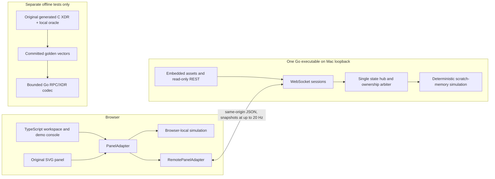

# Mock backend milestone — 0.2

2026-11-16. Implemented and tested entirely on the Mac. The executable accepts literal loopback listeners only. It contains no RPC listener/client, rpcbind registration, GPIO interface, emulator control, remote endpoint setting, terminal attachment or media management. The offline codec is a separate package and is not linked into the web executable. Go remains the selected backend; no comparative Rust benchmark is claimed.

## Implemented architecture



`internal/panel` has no network or hardware access. One mutex serializes domain operations; state snapshots are values. `internal/server` owns HTTP and WebSocket connections. `internal/web` embeds generated browser assets. `cmd/webdesktop` validates the listen address and starts those components. `src/remote.ts` adapts the same frontend contract to WebSocket events. No server-side HTML framework or frontend runtime dependency was added. The sole non-standard-library Go runtime dependency is [coder/websocket v1.8.15](https://github.com/coder/websocket/tree/v1.8.15), ISC licensed; it supplies tested WebSocket framing and cancellation instead of a bespoke RFC 6455 implementation.

The Go model polls every 20 ms and publishes snapshots at up to 20 Hz, plus a one-second heartbeat. Browser-local mode ticks at 20 Hz while visible. These are presentation simulations, not instruction-accurate CPUs; their synthetic time progression need not be identical. Hidden remote tabs remain driven by server state and may lose ownership if browser timer throttling prevents lease renewal.

## HTTP and WebSocket contract

| Interface | Behavior |
|---|---|
| `/` and assets | Embedded browser files; default is local/offline adapter |
| `/?backend=mock` | Browser opts into this server's simulated shared state |
| `GET /api/v1/status` | Read-only full simulated snapshot |
| `GET /api/v1/ws` | Same-origin WebSocket upgrade, then `hello`, `state`, `ack` JSON events |

A `hello` supplies an unpredictable per-connection session ID and full state. State includes `source: "simulation"`, monotonically increasing `revision`, separate `controlRevision`, ownership `epoch`, `owner`, `blocked`, register/selector/latch values, `running`, `momentary`, and a human-readable reason. `revision` can restart after a server restart: the new `hello` explicitly resets the client's baseline. There is no persistent session or persisted memory.

Requests contain `id`, `type`, `epoch`, and `expected` (the last observed control revision). Types are `acquire`, `renew`, `release`, `set`, `pulse`. `set` also includes `control` and an explicit `value`; supported latches are `sr`, `halt`, `bus-cycle`, `address-select`, `data-select`. `pulse` names `load`, `examine`, `deposit`, `continue`, `start`, or `lamp-test`. Example after acquiring ownership:

```json
{"id":2,"type":"set","epoch":1,"expected":1,"control":"sr","value":5349}
```

An `ack` includes request ID, acceptance/message and full current state. Acceptance means applied to the **mock domain model**, not completed by a guest CPU. A pulse acknowledgment precedes its eventual release. Clients must resynchronize after a conflict and must not blindly retry mutations after uncertain results.

## Ownership and bounds

- Every connection starts as a spectator. Explicit acquisition succeeds only if nobody owns control and no fixture interlock is active. Maximum eight connections.
- Lease duration is five seconds; browser renews every second. Expiry, owner disconnect or release halts the mock, cancels momentaries, resets memory-action sequencing, increments epoch, and revokes ownership. A domain-only interlock persists until explicit fixture re-arm; neither function has an HTTP endpoint.
- A `set` or `pulse` requires owner, current epoch and current control revision. Lamp-only revisions do not cause write conflicts. HALT assertion from the current owner/current epoch bypasses stale control revision and pending-pulse checks, so a stop cannot be delayed by START completion.
- IDs must increase within a connection. Repeating the immediately preceding identical request returns its cached result without mutation. Reusing that ID for a different request is rejected; older IDs are rejected. This is bounded duplicate suppression, not durable exactly-once delivery.
- Pulses are serialized across two simulated polling opportunities (nominally about 40 ms). START runs on completion only when ENABLE is selected. Lamp test is a bounded 500 ms pulse. The SVG adds a 150 ms visual response so a click is perceptible. Neither timer constitutes evidence that a real REALCONS poll consumed an edge.
- WebSocket inputs: text JSON only, 2 KiB message maximum, unknown fields/trailing data rejected, 40 requests/second/connection. Replies have a 16-entry queue; writes time out after one second. Lamp snapshots are read on demand from the latest shared state, never accumulated in a frame queue. Compression is off.
- Browser: at most eight outstanding requests, two-second acknowledgment timeout, three-second stale-stream timeout, reconnect backoff 250 ms to four seconds. Pending writes are discarded, never replayed; reconnected clients remain spectators. UI retains last lamps with a disconnected notice, never extrapolates remote state.
- Scratch memory is capped at 1,024 words. Console history/output remains bounded. Console commands operate the mock panel only.

HTTP verifies a literal loopback Host and requires a matching HTTP Origin for WebSockets, mitigating cross-site local-browser access and DNS rebinding. This is a local-development boundary, **not LAN authentication**. Before any LAN deployment, add separately designed authentication/authorization and TLS/origin policy. No such deployment is included here.

## Offline RPC compatibility implemented

`internal/blinkenbone` implements request/response payloads for procedures 0, 1–5, 100/101 and 1000/1001, AUTH_NONE call envelopes, successful accepted reply envelopes, XID checking, and bounded TCP record reassembly. It does not open sockets. Application `error_code` fields remain part of their complete structs; they are not XDR discriminated unions.

The wire-format tests use 14 vectors emitted by the **original pinned generated C implementation** plus one Java-source-derived sign-extension example. The original IDL/header/generated C and hashes are committed under `scripts/fixtures/`; regeneration needs macOS clang/libRPC but normal Go tests do not. See [oracle provenance and limitations](../scripts/fixtures/README.md).

Key compatibility properties:

- Program 99, application version 1, ONC RPC message version 2.
- Logical control bytes are little-endian; each byte in the IDL char vector occupies a four-byte big-endian XDR word. C zero extension and observed Java negative-byte sign extension both decode; unrelated high bits are rejected.
- Limits: 64 KiB message/record, 4,096 logical vector bytes, 32 record fragments, 80-byte names, 1,024-byte info strings, at most 256 controls per validated schema. Bounds are checked before allocating declared sizes.
- Schema validation rejects duplicate name/direction pairs, invalid direction, zero/over-64 bit widths and inconsistent byte widths. Packing/unpacking checks unused high bits and exact lengths. Callers must select inputs or outputs in descriptor order before packing.
- Strings require zero XDR padding; trailing data is rejected. Empty final TCP fragments are valid framing; an empty RPC message is still invalid.

This is **codec compatibility evidence**, not interoperability certification. Outstanding work: run an actual Java encoding oracle; test original C/Java server/client sequences in a disposable environment; enumerate complete schema profiles and sentinel error descriptors; handle RPC-level denied/non-success replies and authentication variants if required; implement and test transport deadlines, UDP duplicate XIDs/retry policy, peer validation, rpcbind lifecycle and all REALCONS mode/parameter behavior. `ReadRecord` has size/fragment limits but no I/O deadline itself; a future transport must supply one. Existing upstream quirks and safety risks remain in [protocol analysis](protocol.md) and [broker design](broker-safety.md).

## Historical panel refinements

The original SVG now uses a reference-informed status row above ADDRESS, aligned 22-address/16-data banks, left parity lamps, right selector legends, magenta/red SR and seven function paddles, and an inert power/lock key. DEP and lamp test animate upward; other momentaries downward; HALT and S BUS CYCLE latch. All 22 SR switches support keyboard input. Dropdowns expose the authentic semantic-to-wire selector mapping.

The model separates HALT from RUN, preserves the loaded START address, and advances consecutive EXAM/DEP operations by one word. It does not emulate MMU mapping, CPU registers, bus cycles, special memory boundaries/errors, power or guest operating systems. KERNEL and 22-bit mapping lamps are illustrative fixed mock values, not inferred CPU status. Accessible dropdowns operate the visual knobs; the knobs are not draggable. The full rationale and primary references are in [panel notes](panel-reference-notes.md).

## Reproduction and acceptance

See [README](../README.md) for build/run commands, [validation](validation.md) for actual test results and browser evidence, and [roadmap](roadmap.md) for Pi targets. The initial accepted artifact is preserved in `checkpoints/m0/prototype.html` and the `checkpoint/m0` Git tag. No backup of, deployment to, or access to the Raspberry Pi is needed to reproduce this milestone.
