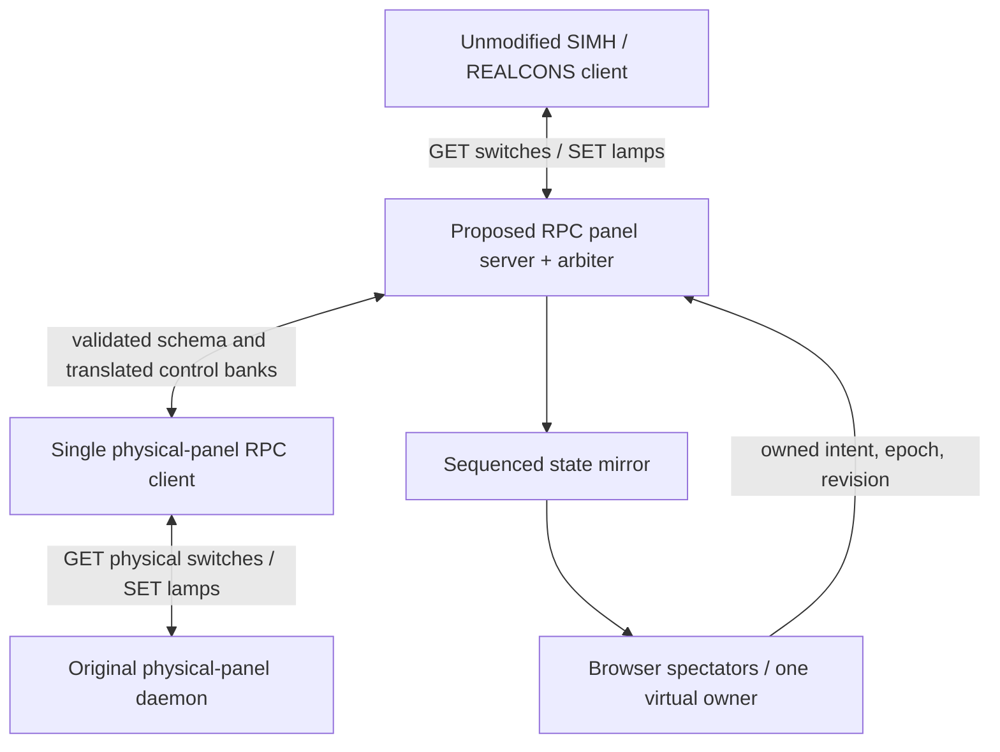
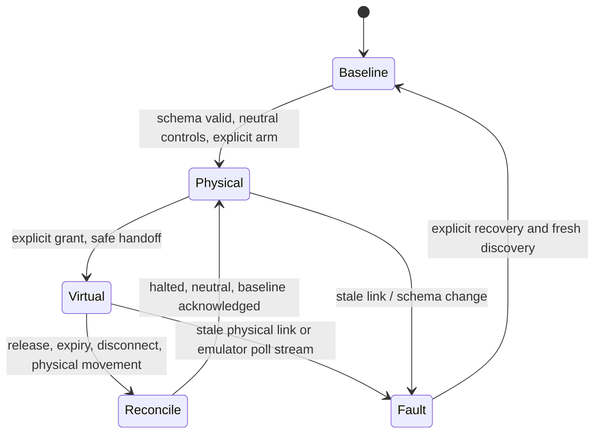

# Physical and virtual panel broker — design decision

2026-11-16 original design, retained as rationale. **Update:** [M4](lab/M4.md) implements this in an isolated lab and demonstrates the in-flight START-release counterexample. The original-source PTY adaptation and M3 results are [documented separately](lab/M3.md). This is not implemented physical-hardware integration. The mock exercises ownership/recovery policy; it cannot establish that a running emulator will halt after a broker failure.

## Recommended progression

Start with a passive observation hook in a disposable copy of the existing service path. If practical, expose already-observed input and output snapshots without issuing additional physical GET calls. Keep physical control authoritative while validating descriptor maps and timings. Compare the maintenance burden of this small upstream hook with a transparent broker in the same laboratory before choosing the production topology.

For eventual interactive coexistence, prefer **one logical arbitration point, one emulator input source, and one writer to physical lamps**. Do not attach a second ordinary RPC client and assume it becomes a virtual panel. SIMH/REALCONS is the client; the physical/Java panel is the server. Original calls read switches and write lamps, and provide no ownership or read-lamps/write-switches API. A viewer needs a copy of the existing lamp-write stream.

The two RPC server endpoints cannot casually register the same program/version in one rpcbind namespace. The inspected physical startup calls `pmap_unset(99,1)`, so a restart can remove another service's registration. Isolated namespaces/addresses, explicit endpoint configuration or a small audited upstream routing change need laboratory verification. No portmapper or networking change has been made on the Pi.

Even physical input reads can have host effects: the pinned physical daemon's POWER callback invokes reboot/shutdown scripts. A second “read-only monitor” poll is therefore not inherently safe. Begin from local source fixtures and event replay, not live exploratory polling. See [pinned protocol findings](protocol.md).

## Ownership and switch reconciliation

The arbiter must track **physical level**, **virtual desired level**, **effective emulator input**, **last-consumed level**, and **owner/epoch** separately. These are not interchangeable. Show physical/effective mismatches explicitly; browser lamps always mirror emulator output independently of control ownership.

| Situation | Proposed policy |
|---|---|
| Initial startup | Physical authority only after a fresh schema and stable level baseline; browsers are spectators. Never synthesize edges from stale saved state. |
| Request virtual ownership | Explicit request; deny while physical HALT/LOCK or a fault inhibits operation, any momentary is held, or handoff baseline is uncertain. Start halted/disarmed with a fresh epoch. |
| SR and selector latches | Owner's explicit levels are effective. Preserve other panel's observed levels separately. Never OR SR bits or continuously merge selector values. |
| Physical movement during virtual ownership | Conservative first policy: revoke virtual control, inhibit resume and require reconciliation. Physical HALT assertion always has priority. Do not interpret movement as an implicit acquisition that can run the machine. |
| Return to physical control | Remain halted. Require momentaries released and explicit handoff; reconcile SR/selectors by matching/pickup or visible acknowledgment of the physical baseline. ENABLE alone never resumes. |
| Held physical momentary at handoff | Ignore as an action until a neutral baseline is observed and a subsequent fresh press occurs. No queued press crosses epochs. |
| Virtual momentary | Serialize one action at a time; expose asserted and released levels across confirmed consumer polls. Bound hold time; do not rely on browser pointerup. |
| Physical POWER/LOCK | Separate host-management and panel-lock semantics from browser ownership. Do not expose power as an ordinary virtual toggle. Preserve original host behavior only after explicit design and fixture review. |

A hybrid policy where physical SR bits quietly override some virtual SR bits is deliberately excluded: it makes the effective input unpredictable. Matching/pickup means each physical latch becomes eligible only after it matches the retained effective level; for the complete SR bank, prefer one explicit coherent baseline rather than piecemeal bit pickup. Which handoff UI is acceptable remains an operator decision before live controls.

## Edge and failure state machine

The pinned REALCONS START handling makes naive cleanup dangerous: a falling START edge with ENABLE may start execution. A future broker must inhibit start/resume, assert effective HALT first and verify consumption, then neutralize START and other momentaries, then demand re-arm. Do not clear START and HALT together and assume the consumer will observe them in the intended order. A nominal 40 ms pulse is insufficient proof when polling stalls or UDP packets are lost.

Possible fixture outcomes must include “unknown whether consumed.” RPC reply reception and browser acknowledgment are not evidence that a guest instruction or reset completed. Track input GET consumption and lamp SET progress separately; ignore stale callbacks/results from previous epochs. Duplicate UDP XIDs require bounded response caching tied to peer and request contents, without repeating a mutation. Do not automatically retry an uncertain START, reset or power action.

If the broker is dead, it cannot deliver HALT. Original REALCONS may retain its last input levels or continue executing. Therefore no crash-safe halt or instant physical failover is promised by this architecture. A validated consumer-side watchdog/interlock or upstream fail-safe hook may be necessary; that changes the integration scope and must be reviewed separately. A persistent broker fault is preferable to silently reconnecting and resuming old virtual levels.

Rollback means a tested, operator-controlled return to the original physical-only path, with correct RPC registrations and emulator connection settings. It is not an automatic service restart race. Preserve the complete microSD backup before any authorized pilot.

## What is tested now, and what remains

The Go mock proves one-owner arbitration, revisions independent of lamp frames, stale-epoch rejection, bounded duplicate handling, fresh spectator sessions on reconnect, priority HALT, persistent fixture interlocks, and cancellation of a pending START under disconnect/release/lease-expiry/interlock. In that model HALT and cancellation are atomic domain operations. **Those tests do not prove the multi-poll HALT-before-release sequence against REALCONS.**

Next safe work is a disposable physical-panel stand-in and poll-consumption scheduler using the committed wire fixtures: delayed/skipped/duplicate polls, simultaneous physical changes, every latch mismatch, held-key handoff, START loss at each edge, physical/consumer restart, partial schema enumeration, stale outputs and recovery. Then test an isolated original REALCONS build, with no GPIO and no access to the production Pi. Live work remains gated on the backup and explicit authorization.
