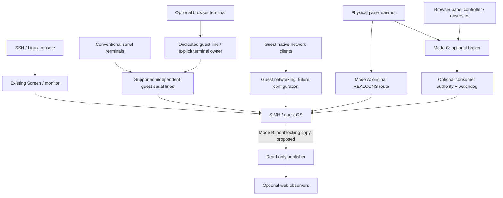

# ADR 0004 — Optional integration and independent access

Status: accepted for the **M4.1 isolated laboratory**, not approved for installation. Original M0–M4 checkpoints remain authoritative historical evidence. Public upstream pin: `26d20beda0c6b5a1d3a5cb3d7a4dd494e02bff75`. No production inventory, network probe, GPIO operation, service modification or guest-image write was performed.

## Decision

The PiDP-11 is independently operable. The browser and its Go backend are optional clients. Retain Go and TypeScript/SVG. Do not put SSH, the Linux console, GNU Screen, physical-only startup, real serial terminals or guest networking behind a Web Desktop service.

Three explicitly selected configurations replace any assumption that the broker must always be running:

* **A / physical-only, default:** unchanged SIMH/REALCONS → original panel daemon. No broker, consumer hook, browser, web authentication or web watchdog required. Preserve POWER/LOCK, OS selection and startup/shutdown behavior on this original path.
* **B / observe, first future live target:** publish copies from an existing control path, without making extra input RPC calls. A future optional hook copies inputs after the existing read and lamps after the existing write into a bounded, nonblocking publication channel. Loss/full queues drop observation frames, never stall control. Backend reads the copy; no control/grant API is exposed. This passive publisher is a design, not yet an implementation validated on hardware. Current lab observers use the existing broker snapshot and were tested for nonmutation; that is not equivalent to passive Mode B.
* **C / optional remote control:** one broker mediates physical and virtual levels, with a consumer-owned interlock. Browser lease, consumer execution authority and terminal keyboard ownership are distinct. Mode C adds failure points and changes the control route, so entering it requires an intentional halted transition. Never start it automatically because a browser connected or an SD backup completed.

The diagram's A/B/C control paths are alternatives, not simultaneous RPC servers registered under program 99. Physical GPIO hardware is absent from the laboratory; its stand-in implements the descriptor/input/output contract only.

## Access-independence matrix

| Access / feature | Required components | Requires Web Desktop? | Requires panel lease? | M4.1 evidence / limit |
|---|---|---|---|---|
| Physical-only controls | Original SIMH/REALCONS, original daemon, assembled hardware | No | No web lease | Original binary + stand-in rollback exercised; GPIO, POWER scripts and OS selection not executed |
| SSH / Linux administration | OS networking + sshd + user credentials | No | No | Architectural independence; no Pi access or SSH test |
| Local Linux console | Host console and credentials | No | No | Architecture; no host login reconfiguration |
| Existing Screen + SIMH monitor | Original launcher/Screen/PTY | No | No | Independent PTY monitor used during integration and rollback; Screen takeover deliberately not attempted |
| Real serial terminal | Supported host adapter, SIMH/guest line configuration | No | No | Upstream TMXR/serial source inspected; no physical serial hardware tested |
| Independent guest serial/Telnet lines | SIMH multiplexer, guest drivers and user configuration | No | No | Transport laboratory test where supported; no guest OS login or RSX driver validation |
| Guest-native Telnet/network services | Guest network configuration and supported emulated NIC | No | No | Future requirement, not configured or validated on Pi |
| Panel observer | Passive publisher (proposed B) or current lab broker + Go + browser | Yes for browser | No | Multiple lab spectators, rejected mutations, bounded snapshots; passive B remains future work |
| Virtual panel controller | Optional integration, authenticated owner, consumer grant | Yes | Yes | Isolated lab only; remote authentication not implemented |
| Browser guest terminal | Dedicated line or explicit terminal broker, browser renderer | Yes for browser | No | Design only; never attach with Screen takeover flags |
| Read-only terminal spectator | Optional tee with bounded output | Yes for browser | No keyboard lease | Design only, no ownership acquisition through observation |
| Media/OS management | Existing utilities; future optional validated service | No for original utilities | Separate lifecycle authorization | No OS-image modifications or web media implementation |

## Terminal domains

Prefer independent SIMH DZ/DHU lines, where guest drivers permit, over competing for the existing console. A browser can own keyboard input to one dedicated line without owning the front panel. Another line or guest network login can be used simultaneously by a conventional terminal. For a shared line, explicitly choose one input owner and read-only observers; cap per-viewer output at 256 KiB and disconnect/drop slow observers without blocking the guest. The browser must never silently detach a Screen user. Privileged SIMH monitor commands are a separate capability from guest terminal bytes.

Independent console operators are trusted operators, not an adversarial source of commands. They can still alter/stop the emulator or invalidate a web operation. The interlock does not purport to fence arbitrary monitor commands, scripts, device callbacks, host signals or guest instructions. Concurrent monitor administration and a virtual control session require operator coordination; no new mandatory console gateway is introduced to solve that conflict.

Official launcher source uses Screen and a command-file restart workflow. The manual describes console and physical boot selection, including non-browser operation. Preserve those workflows rather than making web startup their dependency. [Official manual, July 2024](https://obsolescence.dev/pidp11/PiDP-11_Manual.pdf), [pinned launcher](https://github.com/obsolescence/pidp11/blob/26d20beda0c6b5a1d3a5cb3d7a4dd494e02bff75/bin/pdp11control.sh), [DZ11 implementation and attach help](https://github.com/obsolescence/pidp11/blob/26d20beda0c6b5a1d3a5cb3d7a4dd494e02bff75/src/02.3_simh/4.x%2Brealcons/src/PDP11/pdp11_dz.c).

## Production implications

Do not install another program-99 server beside the original server without a verified routing plan: upstream startup can unregister both transports. Do not treat GET inputs as passive observation: the original daemon's POWER path can invoke host actions. The optional C interlock is deliberately lab-only and forces POWER on/PANEL_LOCK off while disarmed. That is appropriate for a fixture, **not preservation of physical POWER/OS selection in Mode C**. These remain production blockers. Mode A avoids that semantic change by using the original binary and original daemon.

Future remote access needs authentication, TLS/transport policy, per-capability authorization, session revocation and audit records. Current loopback origin/host checks are not authentication. The consumer socket is owner-only and within a network-none container; it is not a public API or a defence against a compromised broker/host account. No production systemd units, autostart or routing changes are supplied.
