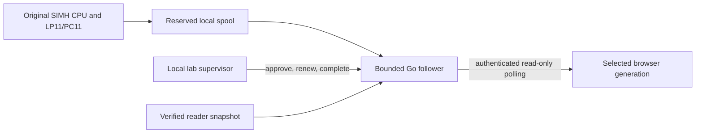

# Decision 0008: bounded live device observation

Status: implemented for isolated laboratory use in M5.9.2. This supplements the completed exports in [decision 0007](0007-completed-devices-and-companion.md). It does not authorize production integration.

Original SIMH owns peripheral execution, media attachment and guest lifecycle. The companion reads explicitly configured local spool files. A separate trusted local supervisor attests producer identity through the existing private Unix socket. Neither the browser nor the companion receives a monitor or file-attachment interface.

An approval binds service instance, device revision, simulator label and guest label. Following starts only on an empty regular file; each new approval creates an unpredictable generation. The supervisor renews a five-second lease. Browser traffic cannot renew it. Replacing the simulator, changing a guest or losing confidence requires stopping renewals and explicitly retiring observation. Restarted services start detached and do not replay old files.

The follower reads at most 8 KiB per device every 200 ms, retains 64 KiB per device, and permits four devices and a 1 MiB job. A paired read-only reader snapshot is limited to 64 KiB. Slow viewers receive an explicit lost-offset result rather than a hidden gap. There is one poller, no per-viewer subscription queue, and no callback into the emulator. Files are opened read-only with final-component symlink and nonregular-file rejection. Operators must protect parent directories and use local storage; arbitrary paths and network filesystems are outside this contract.

Completion requires an explicit assertion after producer flush/close and an independently computed full-file SHA-256 matching the follower's accumulated digest. File inactivity is not completion. A browser can save the full completed job if it retained every byte; otherwise it offers a conspicuously named partial tail. A cached faulted/disconnected view never becomes a claim of current activity.

File identity, size and modification-time checks catch observed removal, rotation, truncation and same-size rewrites. They cannot prove that a file was not truncated and regrown between polls, or that a still-running process did not change guests. The lease is an operator attestation, not a CPU identity oracle. A supervisor that renews incorrectly defeats that assurance. The laboratory supervisor is deliberately separate from the application and is not a qualified production collector. Local storage faults can block file reads; the emulator has no dependency on those reads, but the observer can become unavailable.

Reader progress and EOF are reports from the local supervisor, not inferred from punch size. M5.9.2 reads original PC11 POS/CSR through a private laboratory harness; no such monitor endpoint is exposed to browsers. The original simulator and sources remain unchanged.

The browser updates the existing bounded paper viewer on arriving chunks. It reparses its retained 64-KiB tail rather than maintaining an unbounded document. Earlier omitted bytes make paper origin approximate, which the UI identifies. SIMH stdio buffering means visible updates can arrive in bursts; a 200-ms poll does not promise 200-ms physical-print latency.

For the optional companion, a single curated JSON reference catalog is shared by the browser and Go service. Selected reference IDs are allowlisted. Reference-backed notes and model replies remain distinct. Explicit sharing, the existing three-command proposal allowlist, keyboard ownership, expiration and generation checks remain separate authorities. No provider response can grant itself machine access.
