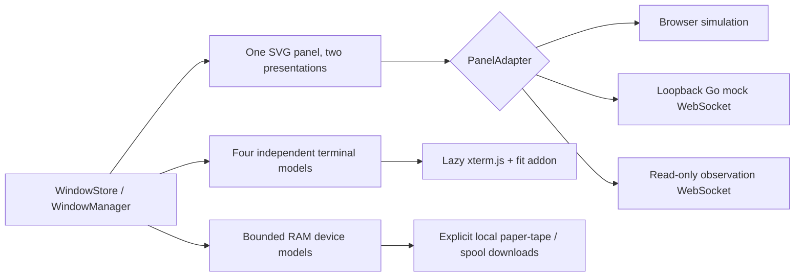

# M4.2 desktop architecture and interaction contract

The desktop now provides a purpose-built window manager, one shared PDP-11/70 panel renderer, up to four independent mock terminals, and functional RAM-only peripheral applications. It does not emulate a PDP-11 CPU or connect terminal input to a host shell. The [reference inventory](research/imsai-inventory.md) distinguishes inspected IMSAI resources from documentation and inference; the [parity matrix](research/imsai-parity.md) records the accepted baseline and delivered scope.

## Window and application lifecycle

`src/windows.ts` separates geometry/focus state from DOM operations. Windows move and resize with pointer capture, minimize to a taskbar, maximize/restore, request native fullscreen, close and reopen. Resize handles support arrow keys (Shift increases the step). Alt+1 opens the panel, Alt+2 a terminal, Alt+backtick cycles windows. Pointer and keyboard focus raise the window. The maximum is 14 windows; the terminal maximum is four. Closing a terminal disposes the renderer, observer and input handler; reopening creates a fresh read-only mock session.

Only versioned window IDs and bounded geometry are persisted in localStorage. Unknown IDs, corrupt JSON, oversized input, nonfinite values and additional properties are discarded. Credentials, capabilities, owner leases, terminal history, media contents and machine state are never persisted. Reopening a panel uses the current adapter; presentation changes do not acquire a lease.

Small screens retain a scrollable authentic panel plus a disclosure containing 44-pixel touch controls, backed by the same commands and state. Utility applications reflow for mobile/tablet. Full-panel mode hides companion controls/readouts; it shares the same SVG, adapter, selector ordinals and switch semantics. It is not a second simulated machine.

## Functional prototypes

| Application | Implemented interaction | Boundary |
|---|---|---|
| Front panel | All 22 SR switches, LOAD/EXAM/DEP/START/CONT, HALT/ENABLE, bus-cycle and selector controls, lamp test, source/freshness/owner status | Browser/Go mock or explicitly read-only lab observations; no production connection |
| Disk drives | RK05/RL02 catalog metadata, mount/eject, compatible-device checks, write-protection state | Synthetic catalog; no disk-image upload or actual image attachment |
| Magnetic tape | TU10 mock mount/eject/protection, advance/rewind, position display | Synthetic block counter, not physical tape position |
| Paper tape | Load up to 8 KiB local bytes, read progress/hex display, text punching and binary download | RAM-only bytes; text uses UTF-8, not a claim about guest encodings |
| Line printer | Queue, print, preview, download spool, clear | At most 32 jobs of 16 KiB each; no host printer |
| Systems | UNIX V6, RT-11 and RSX-11M+ profile descriptions, required media checks, simulated start/stop | No guest OS files, real boot or shutdown; catalog state is separate from the demonstration panel |
| Terminal manager | Open/focus four sessions; independent keyboard acquisition/release and profile labels | Keyboard state belongs to its terminal, never to panel ownership |
| Diagnostics | Data source, connection, ownership, terminal/window counts, bounded local log | CPU/memory/temperature/throttling are explicitly unavailable, not fabricated |

Media mutations require the mock system to be stopped. Mount/eject/protect do not modify files. This is useful interaction scaffolding for later allowlisted service contracts, not evidence of SIMH media integration.

## Terminal compatibility and security

The pinned renderer is xterm.js 6.0.0 with the fit addon 0.11.0, both MIT. Only these two browser runtime packages were added. The normal bundle lazy-loads them when a terminal opens; the desktop default opens one terminal, so that workload loads the chunk immediately. Mobile opens the panel alone. Scrollback is 300 lines, editable input is 256 ASCII characters, and each mock history retains 50 commands. HELP, DIR, TYPE, SHOW USERS, ANSI and CLEAR exercise local output; terminal commands never dispatch panel controls.

The active label is **VT100 / ANSI**, describing the rendering family, not full historical conformance. VT52 and VT220 choices are disabled and explicitly unvalidated. Upstream's [supported-sequence table](https://xtermjs.org/docs/api/vtfeatures/) is versioned 6.0.0 and records individual supported/partial/unsupported sequences; it does not certify every DEC terminal model. Before a real guest profile: test VT52 cursor/addressing mode, VT100 keypad/line drawing/scroll regions, VT220 national character sets and keyboard mappings, 7/8-bit controls, answerback, dimensions, flow control and the intended OS's terminal driver. No automatic TERM or guest-terminal setting is made.

The [upstream security guidance](https://xtermjs.org/docs/guides/security/) treats real terminal access as a separate privilege. Here there is no shell/PTY/SSH/Screen transport in the browser app. M4.1's two DZ11 transport fixtures remain independent. Clipboard/link/shell addons and automatic URL opening are absent.

Strict CSP is retained. Go supplies a fresh **style-only** nonce per HTML response; a document facade gives that nonce only to xterm-created theme/dimension style elements. xterm 6.0.0's viewport uses the global document despite `documentOverride`, so its fixed three-rule scrollbar stylesheet has a specific SHA-256 allowlist entry, plus the SHA-256 of the empty bootstrap stylesheet. Changes to the pinned theme/version require updating and testing those hashes. There is no `unsafe-inline`, `unsafe-eval`, global DOM monkey-patch or guest-derived stylesheet. Standalone packaging hashes script/CSS, includes a build-specific style nonce and prohibits network connections. Browser tests fail on CSP violations. Vite ignores research/build artifacts to prevent test traces from triggering accidental page reloads.

## Visual provenance and calibration

Both supplied DIGITAL SVGs are retained unchanged; optimized off-white/red derivatives preserve paths, aspect ratio and colors. A gray derivative is used for the embossed bezel treatment. The red mark appears in About; the desktop header uses off-white. About identifies this as an independent project. The [provenance manifest](../src/assets/logo-provenance.json) records hashes and outstanding distribution review.

The panel uses a 1200×688 photographic calibration from PANELSIM, corrected red/purple octal groups and red indicators, measured lamp/SR positions, authentic selector group labels and a modeled power key. The ratio is a photographic reference, not a verified mechanical drawing. Typography, paddle depth, key shape and rotary pointers remain approximations documented in [panel calibration](research/panel-m42-calibration.md). POWER remains intentionally inert. REALCONS ADDRESS/DATA outputs remain authoritative in observation mode, regardless of selector position.

Actual screenshots: [desktop](screenshots/m42-desktop.png), [full panel](screenshots/m42-full-panel.png), [mobile](screenshots/m42-mobile.png). They show this implementation, not a mockup or physical hardware.
