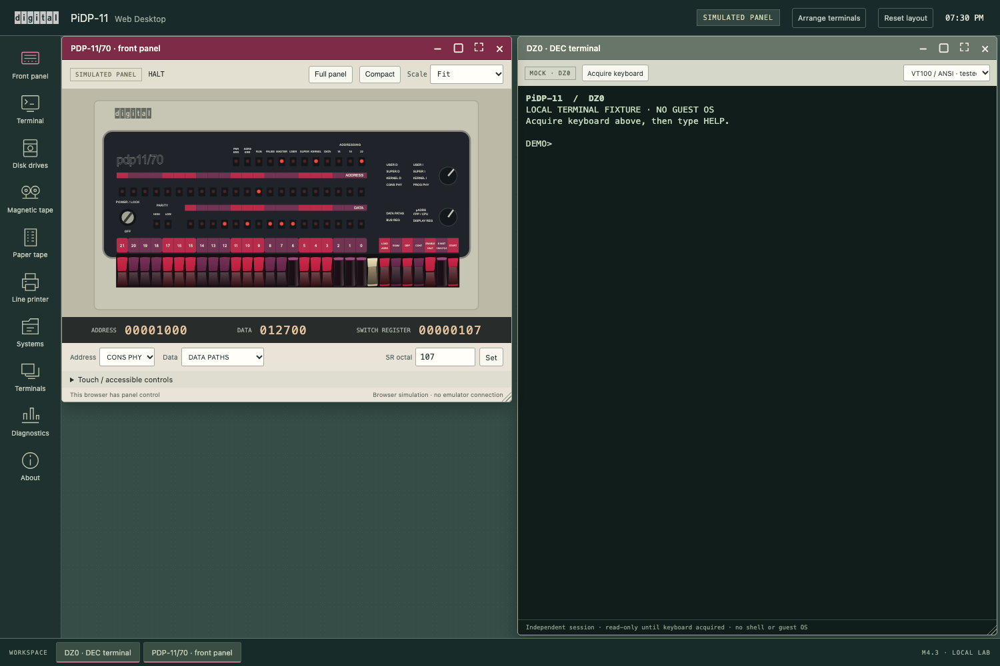

# Welcome to the PiDP-11 Web Desktop

A browser can be a window into a very different kind of computer. This project brings a PDP-11/70 panel, DEC-style terminals and peripheral windows together on a modern desktop, while keeping the original PiDP-11 independent.

The [PiDP-11](https://github.com/obsolescence/pidp11) is Oscar Vermeulen's replica front panel. A Raspberry Pi inside runs **SIMH**, a program that emulates the PDP-11 processor and devices. A historical operating system, such as UNIX V7, runs inside that emulated computer. We call it the **guest**.

The long-term aim is to turn on a PiDP-11, select a guest using the physical switches, and open a browser terminal connected to that guest. Today you can explore the local desktop, and developers can reproduce a genuine UNIX V7 terminal in an isolated lab. A [controlled terminal-only pilot on the actual Pi](../lab/M5.3.md) also passed and was shut down afterward. It is not a permanent installation or a physical-panel demonstration.

*Actual M4.3 desktop capture. These panel/terminal windows are demonstrations; the genuine guest uses a separate Guest terminal window.*

## Choose a starting point

- [Choose an installation path](installation-paths.md): existing PiDP-11 owners or original software first on fresh Raspberry Pi OS Lite. The companion package remains a lab candidate.
- [Explore the desktop](explore.md): open windows, try controls and print a sample listing.
- [Understand the terminals](terminals.md): what a VT100 is, where commands go and what keyboard ownership means.
- [Questions and troubleshooting](questions.md): simulation labels, disconnected guests and other common questions.
- [Current limitations](../known-limitations.md): what still needs work.
- [Development timeline](../timeline.md): how the project reached genuine guest terminals.

To run the local demonstration, follow the short [README setup](../../README.md#try-the-local-desktop). You need a recent Node.js installation, but no Pi, guest disk or hardware connection. If you would rather browse first, the [screenshot gallery](../screenshots/README.md) and [M5.0 demonstration](../lab/M5.0.md) show the real application.

The [headless Trixie guide](../installation/README.md) is a separate guide to installing Oscar's original software. It does not install this Web Desktop.

For the optional new equipment, see [configured companion setup](configured-companion.md) and [completed device output](../technical/observed-peripherals.md). Both require the separate authenticated service; the local demonstration keeps working without either.
