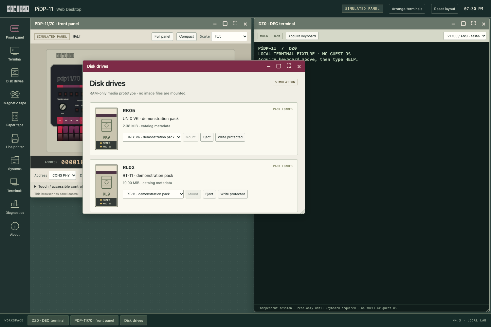
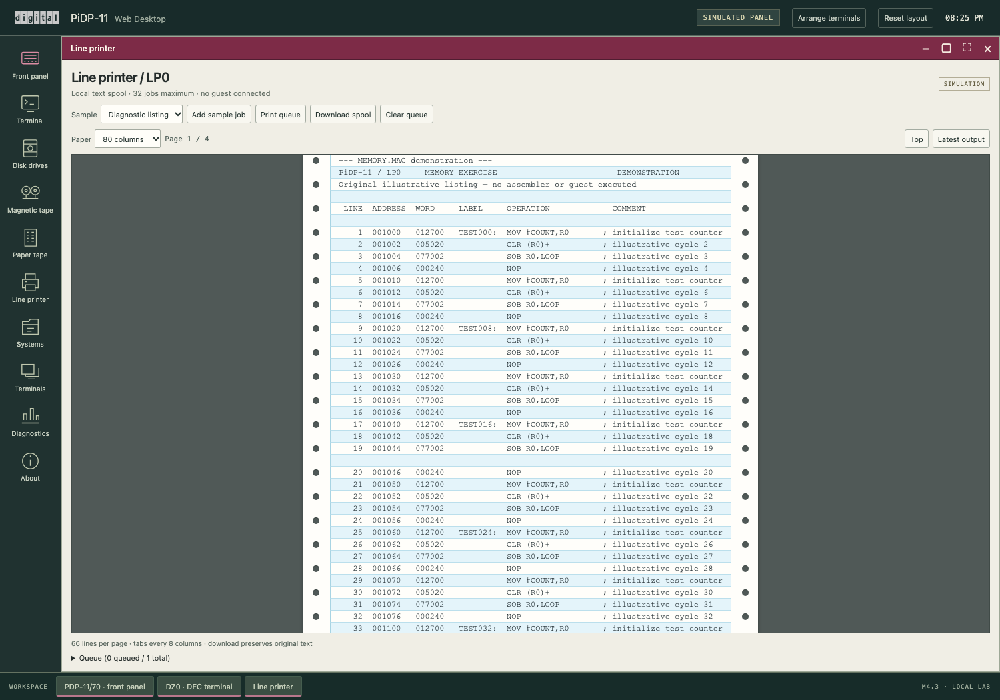

# Explore the desktop

Start the [local preview](../../README.md#try-the-local-desktop), then open the address printed in your terminal. Everything in this ordinary preview stays in the browser unless you deliberately use the separate mock backend. It does not connect to a Pi.

## Make room on the desk

Use the launcher on the left to open applications. Drag a title bar to move a window, double-click it to maximize, and use the lower-right corner to resize. The taskbar brings minimized windows back. **Arrange terminals** and **Reset layout** help if the desk becomes crowded. Window geometry is saved locally; tokens, media and control leases are not.

## Try the panel

The normal preview says **SIMULATED PANEL**. Its switches and lamps help explore the interface, but it is not a replacement PDP-11 emulator.

1. Acquire panel control if the interface asks for it.
2. Set the switch register to octal `1000` and press **LOAD ADRS**.
3. Set it to `12345`, press **DEP**, then **EXAM**. The demonstration stores and displays that word.
4. Select **ENABLE**, then **CONT** to see simulated activity. **HALT** stops it.

Octal is base eight: its digits run from 0 to 7. It was a convenient way to write PDP-11 bit patterns. The controls can also be reached with Tab and activated with Space or Enter. POWER/LOCK does not switch physical power.

## Open a terminal

**Terminal** opens a mock session. Acquire its keyboard and type `HELP` to see the demonstration commands. These are not Linux or guest OS commands. Several mock terminals can be arranged side by side.

**Guest terminal** is different: it needs the separately configured, authenticated lab service and a real running guest. It cannot connect merely because the ordinary preview is open. See [how terminals work](terminals.md).

## Load demonstration media

Disk drives, magnetic tape and paper tape are simulated workflows. You can explore mounting, ejecting, write protection and transport controls without attaching a real guest image. System profiles describe guest choices; selecting one does not boot an operating system.

## Print a listing

Open **Line printer**, add a sample job and print the queue. The listing appears on continuous paper with tractor-feed holes and perforations. Change between 80 and 132 columns and use the page controls to browse it. When reading earlier output, new output does not pull you away from your place.

**Download spool** saves the original text. The paper styling does not alter the spool. This printer is a local demonstration, not guest LP0 output, and ordinary browser printing is not a supported whole-listing export. Save anything you want to keep before closing/reloading the browser.

