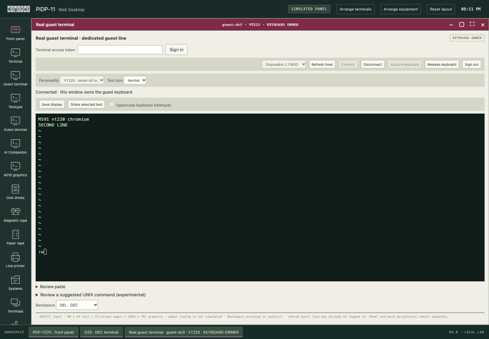

# A terminal is a conversation with a computer

A DEC VT100 exchanges characters with another computer. The computer can also send instructions that move the cursor or clear the screen. Web Desktop interprets tested subsets of these instructions; selecting a familiar faceplate does not establish complete historical conformance.

## Know where commands go

| Window or prompt | What commands affect |
|---|---|
| Mac or Raspberry Pi Linux shell | The host’s files, programs and services |
| SIMH `sim>` monitor | The emulated machine, disks and execution |
| PDP-11 guest terminal | The historical operating system inside SIMH |
| Desktop **Terminal** demonstration | A bounded mock command model; try `HELP` |

Read the source/status label as well as the prompt. Never paste a host installation command into a guest or an emulator command into a guest shell.

## Choose a personality

Select the personality before connecting. Set the guest application’s terminal type separately; the menu does not configure the operating system.

| Choice | Current evidence |
|---|---|
| VT100, VT52, VT220 subset | Genuine V7 commands and scoped 2.11BSD `vi` tests; see the detailed compatibility guide |
| ASR-33-inspired | Genuine V7 text on 72-column uppercase paper; mechanical timing is not emulated |
| Tektronix 4010 | Genuine V7 vector plots; not complete 4014 or genuine GIN acceptance |

DEC text uses 80 × 24 cells; smaller windows scroll instead of changing guest geometry. VT220 extensions remain limited, and input remains ASCII7. [Detailed personalities and exclusions](../technical/terminal-personalities.md).

*Actual disposable guest, captured in Chromium. This establishes scoped editor behavior, not a physical Pi connection.*

## Connect and share a guest line

A real guest needs the [optional service](optional-service.md), an independently running guest and a locally approved guest-only serial line. Sign in, refresh the available lines, select the intended one and connect. Connection starts **read-only**. **Acquire keyboard** requests the single keyboard lease; **Release keyboard** returns it. Different configured lines can have different owners. Observer credentials never acquire control.

Disconnecting closes your browser view, not the guest. Reconnecting is explicit, gives a fresh display and does not replay input or automatically acquire control. The guest may still have a login or unfinished command on that line. Stopping the bridge can hang up the line even though the independent operator console and CPU keep running.

Before changing guests or restarting SIMH, the administrator must stop the actual bridge process. Reusing a port is not evidence of guest identity. A guest change that leaves the same stream open may be undetectable; independent verification and fresh approval remain necessary.

## Type deliberately

Choose the Backspace encoding that your guest expects: DEL, BS or V7’s `#` erase character. Reviewed paste accepts one bounded ASCII line without Return; sending the reviewed line does not execute it automatically.

Selected text can be shared deliberately with the optional companion. Ordinary chat cannot type into the guest. The separately enabled command-proposal experiment has narrow allowlisted UNIX suggestions, attachment checks and human approval; it is not general AI console control.

[Current guest evidence](../capabilities.md#terminals-and-operating-systems) · [Questions](questions.md) · [Original Pi pilot](../lab/M5.3.md)
