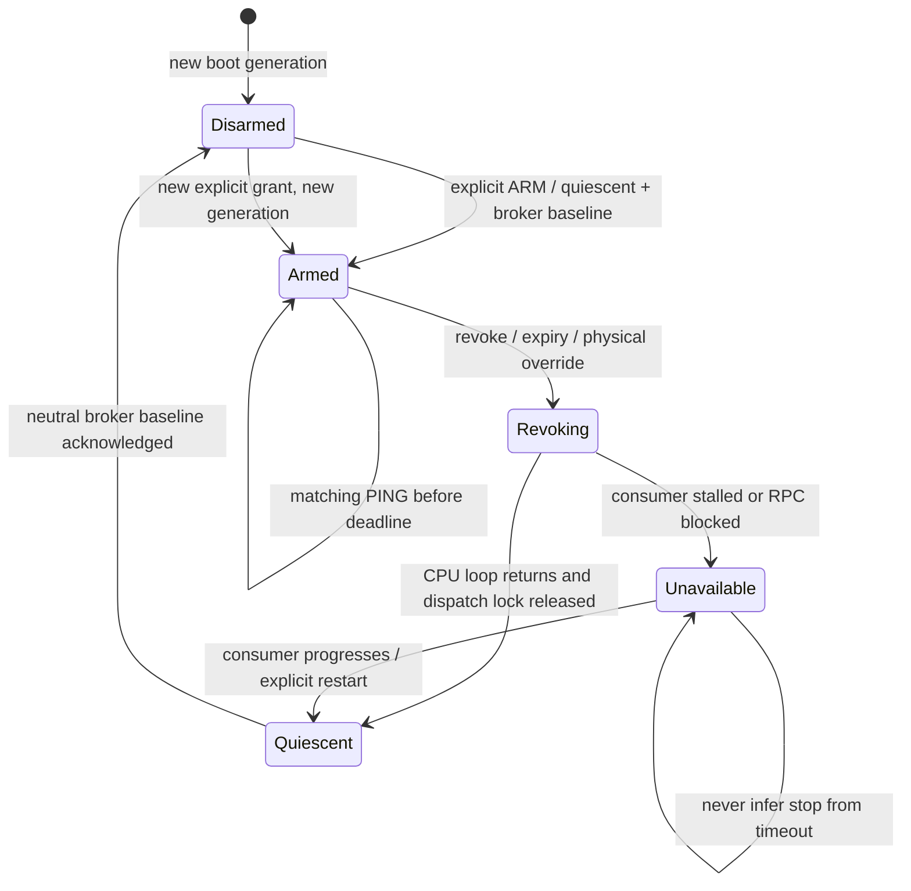

# Consumer-owned execution fencing

M4.1 adds an optional POSIX C compatibility module and hooks in three upstream source files. Original sources under `/upstream` and the original executable remain unchanged. A disposable `/fenced` copy produces a second executable; an unset `PIDP11_FENCE_SOCKET` disables the module. The ordinary Go desktop stays simulated and does not link the RPC/broker/consumer packages.

## Authority and ordering

The SIMH process, not the broker, owns a random boot generation and increments it on grant/revoke. The generation is never derived from browser state or restored from disk. The broker requests an arm only after its own fresh, neutral physical baseline and the consumer's **quiescent/disarmed** acknowledgment. It sends a heartbeat approximately every 100 ms. Consumer authorization expires after 350 ms using `CLOCK_MONOTONIC`; a separate consumer thread detects expiry, independently of the Go process and REALCONS polling. Dispatch also checks the deadline synchronously.

There is no new XDR field and no alteration to the original generated C stubs. At the start of an input RPC the consumer records its own generation. After receipt it locks its authority mutex and validates that generation before calling the original PDP-11/70 controller. Unauthorized samples are neutralized under HALT, with previous switch levels reset to prevent a fabricated START falling edge. The original controller remains the source of PDP-11 semantics. LOAD ADRS and HALT affect controller/CPU signals at this service boundary; commands such as RUN, CONT, STEP, RESET, DEP and EXAM also cross the later dispatch boundary.

Raw commands are retained in a bounded 16-slot consumer queue. Only an opaque `@WD generation sequence` ticket is injected into the existing console path. The raw command never travels through the PTY. At SIMH command dispatch the ticket must match the current armed generation, an unexpired lease, an occupied slot and a sequence greater than the last consumed sequence. Consumption invalidates the slot. Unknown, duplicate, reordered, stale, overflowed and old-boot tickets fail closed. Pending raw REALCONS buffers are cleared on generation changes before they can be retagged. The existing lab PTY portability shim is still needed for the unchanged TIOCSTI path.

A mutex serializes dispatch with revocation. It stays held through a synchronous action, or until SIMH reaches the start of a RUN/CONT/STEP action. At that point the action is classified as managed execution and releases the mutex. Atomic inhibit checks before/after REALCONS service in the PDP-11 instruction loop stop managed execution after revocation. `quiescent` is acknowledged only when the CPU run loop has returned (or no run is active), not merely because a lamp says RUN=0. An RPC callback, device operation, long synchronous command, descheduled process or stopped host can delay that acknowledgment. No hard realtime deadline is promised.



```mermaid
sequenceDiagram
  participant B as Broker
  participant C as Consumer authority
  participant R as REALCONS / SIMH dispatch
  B-->>R: old START=0 / HALT=0 RPC reply held in transport
  B->>C: REVOKE
  C->>C: invalidate generation + tickets; set CPU inhibit
  C-->>B: revoked; quiescence reported separately
  B-->>R: release old RPC reply
  R->>C: validate pre-RPC generation
  C-->>R: reject; HALT + neutral input baseline
  Note over R: queued tickets must also pass dispatch validation
  B->>C: STATUS
  C-->>B: quiescent only after CPU run boundary
  Note over B: neutral samples + explicit new owner required
```

## Exact safety scope

**Established by implementation invariants and the listed finite tests:** an old-generation input sample cannot generate an effective panel action after the consumer has committed revoke; a pending ticket cannot dispatch after that revoke; the same ticket cannot execute twice; older queued tickets cannot overtake newer consumed tickets; a new boot does not accept the prior boot's lease; working-RPC managed execution stops on independent heartbeat expiry; restart never arms by itself.

**Not established:** absence of execution between a browser's release click and consumer revoke commitment; cancellation of an action that already committed before revoke; a fixed stop latency with blocked upstream RPC, arbitrary device operations or host scheduling; halting a physically failed/frozen CPU; safety against malicious privileged local code; correctness on unassembled hardware; preservation of all physical POWER/LOCK/OS-selection semantics on the optional route. A console-authorized RUN is outside the ticket domain. Broker/client acknowledgments mean accepted/revoked authority, not rollback of guest instructions.

The original M4 counterexample remains required and must still demonstrate RUN using the original binary and unfenced broker. The fenced variant repeats the same held reply and expects zero new command dispatches and zero RUN transitions. Tests that deliberately commit a DEP before revocation must retain that memory change. SIGSTOP tests must not manufacture a quiescent acknowledgment while the consumer cannot respond.

## Watchdog versus recovery

1. **Stale-command prevention:** generation + sequence + dispatch/service mutex boundaries.
2. **Stopping managed CPU execution:** independent consumer watchdog sets an atomic inhibit; the CPU must reach its check. A dead broker cannot deliver HALT, but it also cannot refresh the consumer lease.
3. **Restoring communication:** explicit broker/consumer restart, new boot generation, descriptor discovery and neutral baseline. Stale ownership is never restored. A stale socket is removed only after its previous consumer has been stopped; the module refuses to unlink an existing endpoint automatically.
4. **Returning physical controls:** explicit browserless rollback to the original route, not auto-restarting competing RPC servers. Restarting the Go broker alone is insufficient.

A future independent supervisor may terminate a stalled consumer after an operator-approved deadline. That is crash containment, not a graceful guest shutdown or preservation of guest disk consistency. M4.1 uses an explicit test-harness kill to clean up the blocked consumer, records that limitation, and does not install an automatic kill/restart service.

## Maintenance boundary

`lab/interlock/apply.py` requires exact unique source anchors and applies only to the pinned disposable copy. `lab/interlock/upstream.patch` is the reviewable generated diff. `wd_fence.c/.h` supply the module; no upstream release files are replaced. Hooks touch command intake/dispatch, run entry/exit, REALCONS service and the PDP-11 CPU loop. No CPU instruction implementation, generated RPC/XDR source or GPIO source is rewritten. The module is Linux/POSIX-specific, not a portable SIMH proposal ready for upstream submission.

Before an upstream update: regenerate against the new pin, inspect every hook, run original and fenced semantic oracles, sanitizer tests, stale-buffer and ticket tests, fault injection and rollback. Mere successful compilation is insufficient. Event-loop/socket security, console editing/provenance, all other SIMH architectures, signal interactions and non-PDP11 controllers remain outside current certification. The recursive mutex accommodates original nested controller service; blocking calls while a dispatch holds it remain a reason not to claim a universal watchdog bound.
