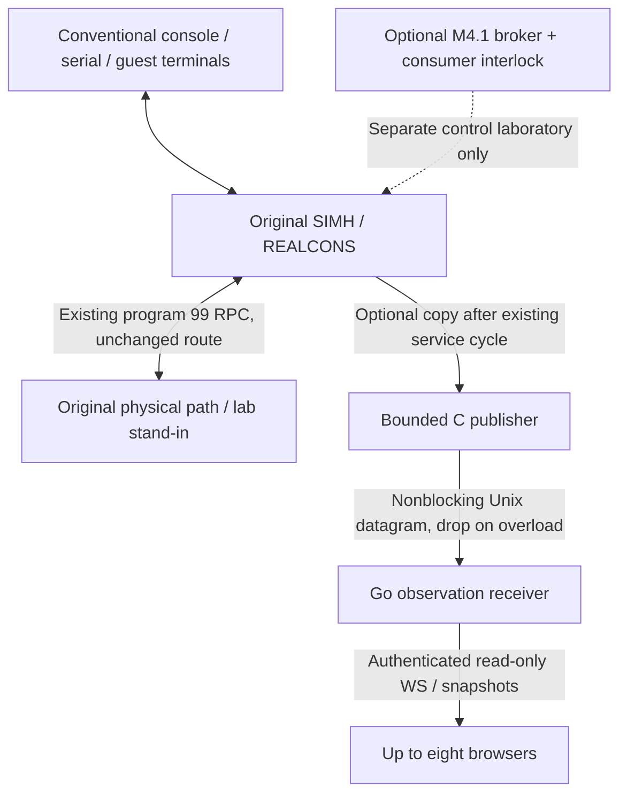

# M4.2 passive observation, authorization and recovery

All results are from the Mac or its disposable **network-none Linux ARM64** lab. No Pi connection, discovery, GPIO access, deployment, guest-image modification or production integration occurred. The ordinary desktop binary remains mock-only. Remote control is blocked for production.

## Independent access topology



Mode A does not require any new process, publisher or browser. Mode B adds an optional observer copy and does not interpose the web service in RPC routing. Mode C remains a separate, explicitly armed laboratory configuration. Observation cannot grant control or terminal input. The original physical-only rollback fixture still removes the broker, registers the stand-in directly and exercises unchanged SIMH RUN/HALT and independent DZ/monitor access.

The new C file is included only in `/opt/observed/pdp11_realcons`, built from a disposable copy of pinned upstream source. `/opt/lab/pdp11_realcons` remains original; `/opt/fenced/pdp11_realcons` remains the M4.1 optional interlock. Neither source tree nor accepted patch is overwritten. No instruction-loop hook is added to the observation binary.

## Snapshot and overload contract

`lab/observe/publisher.c` captures a timestamp before an already scheduled REALCONS service cycle, then copies its existing input and output values after the original controller/output work. It does not call RPC, read switches again, modify outputs, change ownership, inject commands or touch terminal input. Disconnected cycles do not publish. The copied values describe the controller's logical bank, not sampled GPIO voltages or physical lamp brightness; hardware panel-mode/POWER effects still need validation.

One stack buffer (4096 bytes) and one nonblocking Unix datagram send are used. There is no queue, retry, allocation or backpressure into REALCONS. A full/absent receiver increments the drop count. Publication is capped by a 50 ms interval; a nominal 20 ms consumer poll produces roughly 15–17 Hz in this lab, not a promised 20 Hz. Existing physical polling is independent of browser count.

The version-1 record includes a random 64-bit boot ID, increasing sequence, capture time, drop count, exactly 13 named input values and 16 output values. The Go receiver bounds message size and banks, rejects unknown/trailing JSON, missing controls, out-of-range values, old/reordered frames and previously retired boot IDs. Address/data feedback fields are one-hot bitmaps (8/4 bits), not selector ordinals. Initial state is **unavailable**, not invented zeros presented as live data.

Freshness is at most 350 ms since both capture and receipt. Frames older than 2 seconds or more than 1 second into the future are rejected. Last known values remain visible when stale; no stale frame generates actions. Sixteen retired boot IDs are retained; the receiver then fails closed on a new boot until explicitly restarted. Wall-clock changes can cause conservative stale/reject behavior; a future cross-host transport needs a different clock contract. Browser validation also requires complete bounded banks and a safe sequence integer; disconnection or missing updates marks the display stale without reacquiring anything.

The Unix socket is owner-only (`0600`), intended inside a private runtime directory. This is a trusted local producer boundary, not authentication against root or another process under the same UID. A production design still needs service identities, socket ownership/path lifecycle and peer/provenance review. The lab requires Linux, the explicit isolation environment variable and no nonloopback network interface. It binds HTTP only to `127.0.0.1:8083` and exposes no RPC client/server.

WebSockets carry complete latest snapshots, capped at 20 Hz, with a one-second heartbeat and no replay queue. There are at most eight streams, a 512-byte inbound limit and 500 ms write deadline. Any application data received from an observer closes the stream. Every iteration rechecks the session; expiry or logout terminates access. Unit tests deterministically stall a transport after 4 KiB and verify deadline eviction without stalling the store. The five-minute eight-client lab test uses real loopback TCP; it is distinct from that deterministic stall fixture.

## Capability and authentication boundaries

| Capability | M4.2 enforcement / implementation |
|---|---|
| `observe` | Required for snapshot GET and read-only WebSocket |
| `terminal.observe` | Separate capability, checked by authorization matrix; real terminal route absent |
| `terminal.input` | Separate capability; no implication from panel ownership; real route absent |
| `panel.control` | Separate capability; no route in observer service; original control lab remains isolated |
| `media` | Separate capability; real mutation routes absent, UI is RAM-only |
| `admin` | Separate capability; does not imply other capabilities; administrative routes absent |

The isolated service accepts a locally provisioned high-entropy token in an owner-only file, never a command-line argument or URL. Same-origin login exchanges it for a random 256-bit session cookie: HttpOnly, SameSite=Strict, 15-minute expiry, at most 16 sessions. Only `observe` is provisioned by the executable. Login accepts at most 1024 bytes and 20 attempts/minute, with strict JSON and constant-time hashed-token comparison. Password input is cleared and no credential is saved in browser storage. Sessions are memory-only; service restart requires login again.

Literal loopback Host validation, exact Origin checking on login/WebSockets/logout, no CORS allowance, CSP and no-store responses form the lab browser boundary. Logout additionally requires the independent CSRF token returned by login. Other `/api/` routes return 403. There is no arbitrary host path or shell endpoint. Tests cover all six independent capabilities, no admin wildcard, expired/unknown sessions, CSRF failures, hostile Origin/Host, malformed credentials, limits, reconnects and observer write rejection.

**Not a LAN-ready authentication system:** this lab uses HTTP loopback and therefore has no Secure cookie/TLS listener. Production needs TLS/WSS, Secure host-scoped cookies, provisioning/rotation/revocation, explicit authorization for each terminal/media operation, session/UI logout integration and audit policy. Generic capability checks alone do not implement these future services. The existing mock executable and M3/M4 control lab are not converted into authenticated production interfaces. BlinkenBone RPC stays inside network-none and must never be exposed to untrusted clients.

## Bounded-RPC recovery experiment

Original rpcgen C stubs pass a 25-second timeout. M4.1's independent watchdog can disarm its lease while the main consumer remains blocked inside RPC, so confirmed quiescence can lag. M4.2 adds a **fourth, separate** `/opt/bounded/pdp11_realcons` experiment, copying the fenced tree and setting libtirpc `CLSET_TIMEOUT=200 ms`, `CLSET_RETRY_TIMEOUT=50 ms` on the existing UDP client handle. No original source, accepted interlock or generated wire stub is replaced.

The test runs the actual fenced C consumer, holds an input reply during RUN, kills the broker and observes the independent authority socket. This run confirmed disarmed/quiescent state about 309 ms after killing the broker. Broker restart did not rearm or resume. See the [raw recovery report](m42/recovery.json).

This establishes a useful **per-call timeout mechanism**, not a general stop guarantee. Discovery (`clnt_create`/rpcbind), DNS in a future configuration, multiple sequential RPC calls, scheduling pauses, process stalls and other blocking I/O remain outside a single deadline. TCP recovery has not been validated by this experiment. A consumer blocked before reaching its instruction-loop check may still delay stopping. Already committed actions cannot be reversed. Do not recover by replaying START/CONT or by automatically reconnecting/rearming. The reversible M4.1 patch remains optional, and the permanent original M4 counterexample is still tested.

A production recovery design requires an independently bounded discovery/call budget, a supervisor that distinguishes `disarmed` from `quiescent`, explicit operator recovery after uncertainty, and a validated physical-only rollback. An independent kill can end the emulator process in the lab; it is not proven guest-safe shutdown and is not used automatically in production.

## Reproduce safely

```sh
sh lab/build-image.sh
sh lab/run.sh --m42
sh lab/run.sh --recovery
sh lab/verify-m41.sh
sh lab/run.sh --instruction-bench
```

The first command obtains only pinned public source/build packages. Runtime containers have no external network, published ports or hardware devices. Results go to ignored `.research/lab-results`. Do not use old save scripts to replace accepted M3/M4/M4.1 evidence; M4.2 copies are stored separately under `docs/lab/m42`. The browser fixture's observation transport tests simulate the authenticated stream on the Mac; real C publisher interoperability is tested inside Linux, without exporting its port to the Mac.
