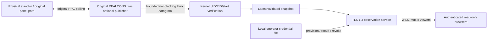

# M4.3 passive observation and LAN security contract

2026-11-17. Implemented and tested on the Mac and network-none Linux ARM64 lab. **No production listener or Pi access is enabled.** The normal executable remains a loopback mock. The separate `observe-lab` executable refuses non-Linux/non-isolated environments and any non-loopback interface.

The receiver has no RPC client, control mutation, terminal keyboard, media or shell interface. The publisher copies state already obtained by the original consumer; observers cause no additional GET calls or RPC registrations. A full/stalled Unix socket drops a publication rather than blocking REALCONS. Earlier original/fenced/observed binaries and the original physical route remain intact.

## Publisher identity and process separation

`SO_PASSCRED`/`SCM_CREDENTIALS` supplies kernel UID/PID. The service pins an explicitly configured process's `/proc/PID/stat` start time, rejecting ordinary PID reuse, and verifies its executable inode where `/proc` permissions allow it. Same-UID executable lookup is required. Across UIDs, Linux can deny executable lookup without ptrace privileges; that fixture then relies on **UID + PID + start time**, not an executable guarantee. A same-UID, different-PID injection test and a separate-UID publisher/helper test run in the network-none container. Actual REALCONS remains root in the primary lab workload; a full production service-account lifecycle is not established.

The immediate runtime directory must be receiver-owned, not a symlink, and not group/world writable. The socket is 0600 by default; optional 0660 plus an explicit group permits a separate publisher UID to traverse a receiver-owned 0750 directory. Its parent hierarchy must be managed by the operator. The check does not attest arbitrary ancestor directories. Socket credentials reject other ordinary processes even if their group permits sending. Root/CAP_SYS_ADMIN compromise, a compromised authorized publisher, same-process code injection, and PID/start-time collisions beyond the tested lifecycle are outside this guarantee. Linux `/proc` and Unix credentials are new **OS dependencies**, not libraries or mandatory services. See [Linux unix(7)](https://man7.org/linux/man-pages/man7/unix.7.html).

Publisher restart requires an operator/supervisor to repin the new process. The service never discovers a replacement by name, launches SIMH, or changes physical operation. Loss leaves unavailable/stale observation; it does not assert machine HALT.

## Authentication, authorization and provisioning

The TLS fixture listens only at `https://127.0.0.1:8443`. TLS 1.3 is the minimum. Tests explicitly trust a two-hour ephemeral fixture certificate without installing a CA or disabling verification. TLS 1.2 is rejected. A future LAN build must choose a fixed operator-managed HTTPS origin/certificate and firewall boundary explicitly; changing a fixture flag is not a deployment plan. The standard [Go TLS implementation](https://pkg.go.dev/crypto/tls) supplies encryption.

Random provisioned tokens contain at least 32 characters and at most 128. The local file must be a receiver-owned private regular file; `O_NOFOLLOW`, descriptor-based permission/owner checks, nonblocking open and a bounded read reject symlink, FIFO, directory, oversized and permissive files. The containing directory remains an operator trust boundary. No tokens are compiled in, placed in URLs, persisted in browser storage or written into reports.

Successful login creates a random 15-minute session, with a separate random CSRF value, in a bounded 16-session table. Login rate is globally limited to 20 attempts/minute. Request-body decoding does not hold the session mutex; a stalled login cannot prevent local revocation. A concurrent slow-body/rotation regression verifies that the revoked in-flight credential is rejected. Global rate limiting can permit a local denial of login; production deployment needs an operator recovery path and possibly per-source limits. Sessions use `__Host-pidp11`, Secure, HttpOnly, SameSite=Strict, Path=/ and no Domain. Exact Host and Origin validation ignores forwarding headers. TLS and Host checks apply to authenticated reads; login/logout and WSS additionally require the exact Origin. APIs are no-store. Logout needs the CSRF header. No permissive CORS is enabled.

Capabilities are separate: `observe`, `terminal.observe`, `terminal.input`, `panel.control`, `media`, `admin`. Tests grant each independently and reject escalation. The observer executable provisions **observe only**; other capabilities do not magically create routes. Browser panel ownership is not authentication. No browser administration or credential-writing endpoint is implemented. `GET /api/v1/session` reads the current session; `GET /api/v1/audit` requires admin and exposes only bounded metadata.

Local SIGHUP rotation replaces credentials and revokes all existing sessions. Invalid replacement files revoke credentials and sessions rather than keeping the old token active. The secure service test validates old-cookie rejection, old-token rejection, new-token login and fail-closed invalid file reload. WSS rechecks authorization on each loop; unit tests exercise active-stream revocation. Revocation is observed after the current bounded write finishes, not instantly at the remote browser. A 128-entry in-memory audit records login/denial, logout, rotation and revocation with time and a SHA-256-derived identity, never raw credentials/cookies. This is diagnostic history, **not durable or tamper-resistant auditing**. Expiration currently denies requests rather than emitting a separate audit event.

## Streaming, freshness and reconnect

Eight viewer slots, 20 Hz maximum, one latest snapshot, one-second unchanged heartbeat, 500 ms write timeout and 512-byte incoming-message limit bound service work. Any incoming WebSocket application message closes the read-only stream. TCP/kernel/browser buffers can retain already-sent snapshots even without an application queue. The browser compares capture time with its wall clock: age over 350 ms or future skew over 100 ms fails closed as stale; the watchdog reevaluates elapsed age every 100 ms. Clock disagreement can therefore make valid state appear stale. Neither a server `fresh:true` bit nor recently receiving a queued frame establishes current state. A stream carrying allegedly-fresh frames over one second old is closed and reconnected to discard its backlog; reconnection remains read-only.

Disconnect retains last state with an explicit stale/disconnected indication, never gains ownership and never sends a control. Sign-out closes the local stream immediately and requests CSRF-protected server logout. Failed logout reports that server expiration/revocation still applies. Cookies can expire during reconnection; the service rejects the connection. The UI does not cache the provisioning token or silently reacquire authority.

## Remaining production gates

Installed source/ABI and launcher identity, service-account permissions, credential delivery, certificate issuance/renewal, DNS/firewall policy, clock discipline, durable logging requirements, operator recovery, resource contention and unchanged conventional access require a separately authorized audit. The fixture applies header/body/idle deadlines, but pre-authentication connection counts are not globally capped; connection-level denial-of-service hardening remains required before LAN deployment. RPC program 99 remains loopback-only within the isolated lab; this milestone does not secure or expose a production RPC daemon. Remote access should use an independently operated secure tunnel/VPN after its own authorization, not public forwarding of RPC or the mock service.
