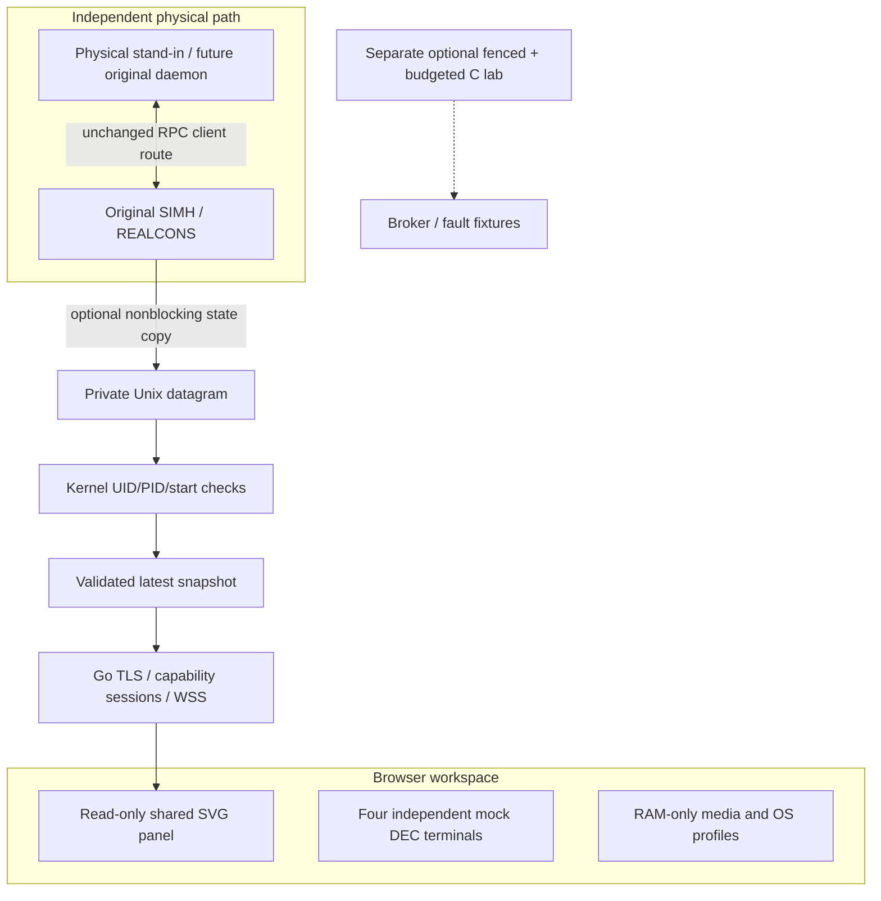

# M4.3 — historical desktop and offline integration hardening

2026-11-17. The project remains an optional companion to the physical PDP-11. **No Raspberry Pi access, discovery, deployment, GPIO operation, guest image changes or production startup changes occurred.** The accepted M4.2 checkpoint and all earlier history remain intact. M4.3 uses the same compact Go + TypeScript/HTML5/SVG architecture, with no new runtime library, framework, database or service dependency.

## Delivered interface

The 22-bit switch register now uses shared molded-face SVG definitions with distinct UP and DOWN geometry, shaded sides, a pivot crease and projecting lower lip. The seven function paddles and cream lamp-test paddle share the same primitives, adding a spring-rest position. Hardware pigment never follows logical state. Number labels remain fixed, in the 21→0 order and alternating historical color groups. The primary `bottom-switches.png` is preserved unchanged; the later user-identified IMSAI image informs shading only. It supplies no PDP-11 labels, colors or control semantics.

The photograph's bits 6, 2, 1 and 0 are raised. Actual application SVG captures reproduce that pattern, all-down/all-up states, close-ups and the complete panel. Comparable-scale review corrected exposed light gaps behind the paddles, lower-face contrast, pivot highlights and grouped label-strip corners. Local geometry is 32×90 reference units at roughly 34-unit pitch, following the photo's approximately 50×136 paddles/52.4-pixel pitch. This is original vector artwork; hidden pivot curvature and uncalibrated pigment/lighting remain documented approximations, not dimensional metrology or exact material reproduction.

- [Side-by-side photo and application SVG](../screenshots/m43-switch-side-by-side.png)
- [Matching pattern, all DOWN and all UP](../screenshots/m43-switch-comparison.png)
- [Paddle and function-control details](../screenshots/m43-paddle-details.png)
- [Full panel](../screenshots/m43-full-panel.png), [desktop](../screenshots/m43-desktop.png), [arranged Retina workspace](../screenshots/m43-arranged-retina.png), [mobile panel](../screenshots/m43-mobile-panel.png), [device applications](../screenshots/m43-devices.png)
- [Primary geometry/behavior research](../research/panel-m43-geometry.md) and [reference provenance](../references/README.md)

Fit, reference-size and 50–200% scaling preserve the 1200:688 panel proportions and permit scrolling. Compact/full modes retain one panel-state model. Terminal arrangement, existing window lifecycle/taskbar/focus controls and geometry-only preferences remain. DEC-inspired drive fascias and READY/PROTECT indicators reflect the existing RAM-only device models; disk/tape/paper/printer/system workflows remain functional and explicitly simulated.

All SR mapping, octal entry, selectors, HALT/ENABLE, START/CONT, LOAD/EXAM/DEP, keyboard/mouse/touch and ARIA states are preserved. Tests caught and fixed lost momentary animation after the SVG replacement; local pulses now live in the shared model for three 50 ms ticks. Native HTML touch buttons use their native keyboard activation rather than firing twice. Passive snapshots preserve simultaneous physical momentary positions instead of forcing them into a single virtual pulse field.

## Architecture and security

The observation path adds no RPC reads or control writes. It pins publisher identity, uses private runtime/socket permissions, and supports a tested separate-UID transport helper. TLS1.3/WSS, exact Host/Origin validation, secure strict cookies, independent capabilities, CSRF logout, expiration, bounded sessions/audit and local credential rotation/revocation are tested in isolation. No unrestricted shell or production terminal/control endpoint exists. See the [security contract](M4.3-security.md), including cross-UID executable-verification limitations and deployment gates.

The slow observer exposed long-lived transport backlog despite bounded application writes. Browser freshness now checks capture time, not only arrival or the server's freshness flag, and discards a stream carrying old supposedly-fresh frames. Reconnection remains passive. Clock skew can conservatively mark data stale. A lost UI, socket or observer cannot be presented as evidence that a CPU stopped.

## Terminal and recovery findings

[Terminal fixtures/matrix](M4.3-terminals.md) cover DEC graphics, cursor movement, scrolling, wrapping, editing, control characters and split sequences, plus explicit keypad/encoding/Telnet/flow-control contracts. The mock no longer prints escape-sequence tails or replays unfinished input across keyboard handoff. Input, pending renderer output, scrollback and history are bounded. VT52 remains disabled; selected VT220 operations are labeled partial. Offline transport contracts and two original DZ11 lab lines are not a guest OS login or production terminal gateway.

The [optional recovery experiment](M4.3-recovery.md) adds explicit loopback discovery and shared monotonic attach/service/disconnect budgets to a separate C copy. It rejects incomplete discovery, bounds the tested lost-reply paths and leaves restarted brokers unowned. The real lamp-test callback is reached through `set realcons test`; the pinned controller does not consume the LAMPTEST input as the mock does. The lamp callback test starts stopped/armed and must not be reported as a running-CPU halt test.

Original M4's START-release counterexample remains reproduced. M4.1's 19 safety/independence cases pass with their limitations intact. A new failure exposed stale device/timer initialization in the combined DZ11 fixture; a clean RAM-only device reset and actual ENABLE polling corrected the fixture without changing the original three-second socket deadline or safety assertions. Failed-run evidence is retained. This test reset is not a prescription for guest-safe production recovery.

## Validation and evidence

The [performance report](M4.3-performance.md) records the primary 30-minute eight-observer REALCONS soak, complementary 30-minute browser workload, allocation benchmarks, longer instruction samples and exact scope/measurement limitations. The [browser memory investigation](M4.3-browser-memory.md) retains the initial DOM-budget failure, the disproved lazy-loading explanation, native undo-history evidence and the separate warmed-workspace measurement. Raw records are under [m43](m43/). The final build produces a static ARM64 executable with embedded assets; no Node runtime or container is required to deploy the ordinary mock service.

Validation includes Go race tests, bounded XDR/RPC/observation fuzzing, 41 TypeScript tests, transport integration tests, 30 browser cases across Chromium/Firefox/WebKit, original generated-C UDP/TCP interoperability, RPC registration, actual REALCONS operations, M4/M4.1 regressions, physical-only rollback, TLS/session/identity tests, aggregate timeout and callback recovery tests. Native Safari was unavailable because its remote-automation setting is disabled; it was not changed and no native-Safari validation is claimed.

Final incremental fixes were regression-tested after the long workloads began; the report distinguishes those checks from a second complete long soak. The stored primary RSS estimate came from `/proc/PID/stat`; a final confirmation reads RSS/PSS consistently from `smaps_rollup`. Original M0 HTML, DIGITAL originals, the supplied photos and earlier checkpoints are preserved and hash checked. No artifact is published.

## Decision and next milestone

**No-go for production installation or remote control at this point.** The next recommended step is a separately authorized read-only installed-system audit, followed by a separately reviewed observation-only pilot if its gates pass. [Proposed installation and rollback](M4.3-pilot.md) are documented but unexecuted. Golden backup completion does not change authorization.

Unresolved gates include installed source/ABI and service accounts, physical POWER/LOCK and GPIO behavior, clock/certificate/network policy, guest-safe lifecycle, production console ownership, real hardware performance, connection-level denial-of-service limits, durable audit needs, and an unconditional consumer stop guarantee. The longer disabled-fence benchmark still leaves the <3% emulator-impact target open. These limitations do not require rewriting simulation or switching backend languages; they require narrower evidence and explicit integration authorization.
