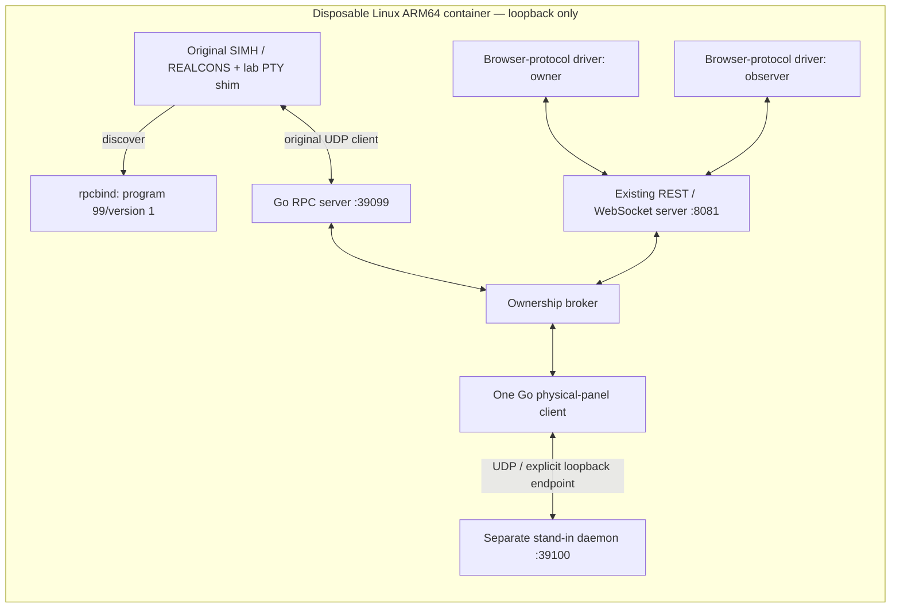
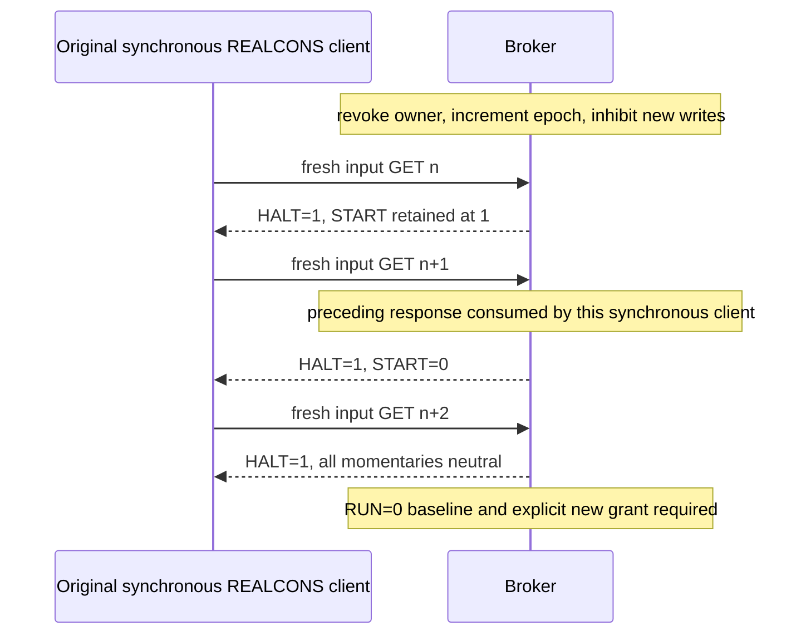

# M4 — physical/virtual coexistence laboratory

This milestone implements and tests a broker against the original REALCONS controller and a compatible simulated physical-panel daemon. It does **not** establish unconditional fail-safe control. The laboratory reproduces a concrete in-flight START-release counterexample. Production integration remains unauthorized and should remain blocked pending a consumer-side safety design.

## Executed topology

The physical stand-in is a separate process with its own input levels and lamp bank. It uses the compatible Go RPC server and tested 29-control PiDP profile; it contains no GPIO or POWER-script behavior. Its explicit port deliberately avoids registering a second program 99/version 1 in the same rpcbind namespace. This is an isolation strategy for the lab, **not a drop-in deployment plan for the original physical daemon**.

The broker registers with actual rpcbind, refuses registration collisions, discovers and validates the stand-in's complete schema, polls physical levels every 20 ms, and forwards changed lamp banks. One REALCONS consumer is permitted, identified by transport plus loopback peer endpoint. A different RPC input/lamp caller is rejected. This gate is not authentication and does not support transparent reconnect/failover. Recovery requires an explicit baseline and, where necessary, restarting/reconnecting the consumer.

`internal/server` now accepts a narrow hub interface. The mock executable still uses its original simulation hub. Only `cmd/realcons-lab` constructs `internal/broker.Adapter`, and that executable refuses non-Linux or non-loopback-only environments. The same bounded WebSocket framing, origins, queues, snapshot coalescing and request limits serve both domains. Browser requests use connection identity, epoch, control revision and increasing IDs; reconnects start as spectators.

The frontend accepts an explicitly marked `realcons-lab` source, labels it as the isolated lab, and uses original lamp outputs rather than synthesizing microaddress/data/mapping indicators. The compact TypeScript/SVG architecture and original standalone checkpoint remain intact. Automated Linux drivers exercise the actual browser WebSocket contract; this milestone does not claim interactive browser rendering against the network-isolated container. No host port is published to make that possible.

## Ownership and handoff implemented

Physical positions, effective input levels, emulator outputs and virtual ownership are separate fields. No OR-merging of switch registers occurs. Every startup is halted and unowned. A grant requires an actual lamp baseline reporting RUN=0, recent REALCONS polling, recent physical input, at least two neutral physical samples, POWER on, LOCK off and physical HALT released. Held momentaries block the grant. The grant itself retains effective HALT; it never starts execution.

Physical ownership forwards subsequent physical changes. Initial mismatching HALT remains asserted until an actual physical latch change, rather than clearing it as an incidental effect of SR movement. During virtual ownership, any detected physical movement revokes virtual control. The browser has a three-second renewable lease in the lab; this intentionally differs from the five-second mock lease. A 350 ms stale physical/consumer deadline faults active ownership. These are laboratory constants, not measured production watchdog limits.

Faults persist after the link returns. The fixture operator must explicitly re-arm, let REALCONS establish a new neutral baseline, and request a grant. Browser disconnect, explicit release, expiry, physical movement or virtual HALT assertion revokes the owner. Virtual HALT is a conservative stop-and-disarm operation in this adapter; the mock hub retains its original behavior.

Virtual momentaries remain asserted across two distinct accepted input GETs, then release on a subsequent GET. Duplicate UDP requests return the cached response and do not advance the pulse or handoff. Raw physical levels cannot recover a complete press/release missed between physical or consumer samples; the tests demonstrate that limitation rather than inventing a deferred action.

## HALT-before-release evidence and its exact limit

For a pending asserted START, quiescence emits:

A following GET is evidence that this pinned synchronous C client progressed beyond the preceding reply. It is not a generic protocol acknowledgment of CPU command completion. The arbiter also requires RUN=0 before granting. Test traces record effective frames, phase and epoch. Unit tests enumerate cancellation before and during the asserted pulse for release, disconnect, expiry, physical change and link fault. Actual REALCONS tests verify delayed polling, browser loss with an assertion reply held in transport, and explicit handoff without a resulting RUN.

**Proved only under the tested assumptions:** after revocation, newly generated quiescence frames never contain an ENABLE + START falling edge, and an explicit new grant remains halted. The consumer is exclusive and synchronous, the schema is the tested profile, and there is no earlier resume-capable reply/command still in flight.

**Counterexample to an absolute guarantee:** the transport can already have built `HALT=0, START=0` following a previously consumed `START=1`. The fixture holds that reply, accepts ownership release, then delivers the old reply. Unmodified REALCONS issues `run 2000` before the next HALT takes effect. A subsequent stopped lamp state does not erase that resume. The harness checks the RUN transition and/or original SIMH command transcript. This is a regression test for a known limitation, not a successful safety claim.

The same class of race applies to a previously delivered CONT or queued SIMH command. No broker-only lease, WebSocket acknowledgment or atomic Go mutex can retract it. A consumer-side epoch/interlock checked when executing run/reset/step commands, with an acknowledged quiescence protocol and independent watchdog, is the next design candidate. That would require a small explicit upstream integration change and a new laboratory test phase. It has not been implemented or authorized for production.

## Fault matrix

| Case | Observed / asserted result |
|---|---|
| Physical owner → virtual owner | Explicit halt/neutral baseline; grant starts halted; physical SR retained separately |
| Competing virtual clients / observer writes | Rejected; observer sees the shared effective state |
| Physical switch movement during virtual lease | Owner revoked, effective HALT asserted, explicit new grant required |
| Held physical START at handoff | Grant rejected until neutral; neutral alone does not grant ownership |
| Consumer paused while virtual START pending | No wall-clock release; pulse remains pending; cancellation fences HALT before neutralization |
| Physical pulse entirely between consumer polls | Edge is lost; no delayed replay is invented |
| Browser closes with START assertion reply held | Owner revoked; assertion arrives, followed by HALT/neutral frames; no RUN in this case |
| Physical RPC process stopped | Timeout/freshness fault; restart of physical samples does not auto-arm |
| Browser lease expires | Halt/disarm; stale writes rejected; explicit reacquisition required |
| Old START-release reply delivered after revocation | **RUN can occur** before subsequent HALT; absolute cancellation guarantee fails |
| Broker killed during RUN | Broker cannot send HALT. Original client reports a receive error; short operator-stop observation is recorded separately. No hard halt deadline or automatic rollback is established |
| Broker restarted | Fresh unowned/HALT baseline. Old browser ownership is not restored; successful consumer reconnection is not assumed |

The original generated client uses a 25-second RPC timeout, and disconnect handling performs further RPC operations. A dead or silent peer may therefore delay recovery and terminal responsiveness. The report records whether an independent PTY stop was acknowledged during the 1.5-second observation; absence of acknowledgment is not evidence of continued instruction execution. Tests clean up the disposable emulator separately.

## Resource and deployment consequences

The lab adds one compiled Go executable containing RPC, broker and embedded frontend. The compatible physical daemon and browser driver are test processes; they are not new production services. No container, rpcbind change, deployment script or hardware operation was installed on the Pi.

Measurements in `m4-report.json` are Linux ARM64 **on the Mac**, under a two-CPU container quota, and cover the broker process alone. “Idle” still includes active REALCONS and physical polling. Active means two browser-protocol viewers and 300 SR updates at 20 Hz, with the CPU fixture halted; this is not a maximum emulator/lamp/terminal workload. RSS and PSS come from `/proc`; CPU is 100%=one core. Acknowledgment timing includes Python-driver IPC plus the Go WebSocket exchange. The five-/fifteen-second samples are not soak or Pi acceptance results.

The original Pi budgets remain acceptance targets. Any exceeded budget must be reported rather than treated as met. The RPC cache is bounded and pruned periodically, and unchanged lamp banks are not repeatedly forwarded. Further optimization should follow a representative 30-minute workload, including running CPU/lamp traffic, slow viewers and terminal data.

## Next safe work

Design and fixture-test a consumer-side interlock for stale/in-flight control commands, specify an independent watchdog and rollback behavior, validate transport recovery and registration lifecycle more deeply, and run prolonged resource tests. Execute a JVM oracle if Java-panel interoperability becomes a requirement. Reconcile physical POWER/LOCK behavior only in a separately authorized later phase. Backup completion does not authorize any Pi access, deployment or production integration.

Final short-run results: idle CPU 2.20% exceeds the <1% target; active CPU 3.27%, mean active RSS 11.57 MiB and p95 driver-inclusive acknowledgment 1.388 ms. These are Mac-hosted Linux measurements, not Raspberry Pi results.
