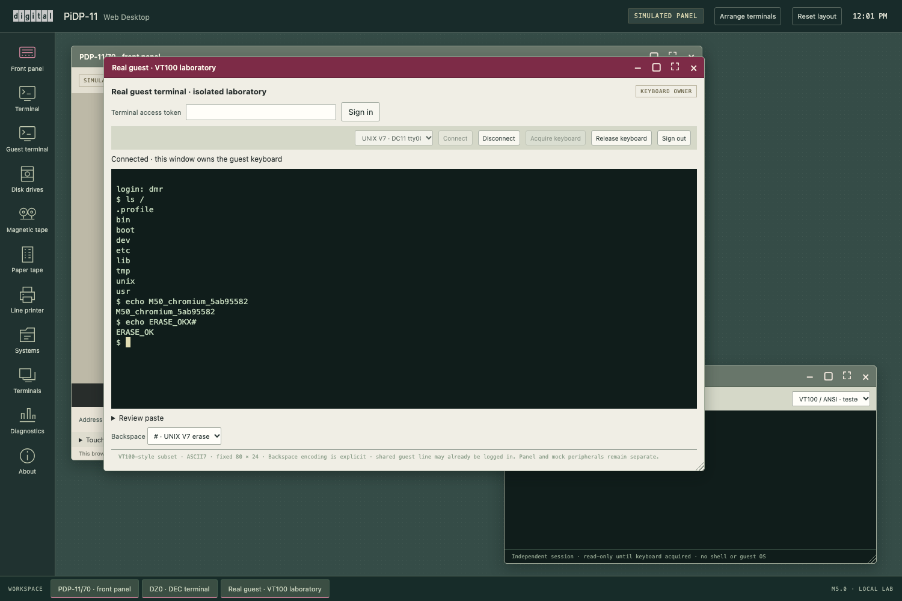
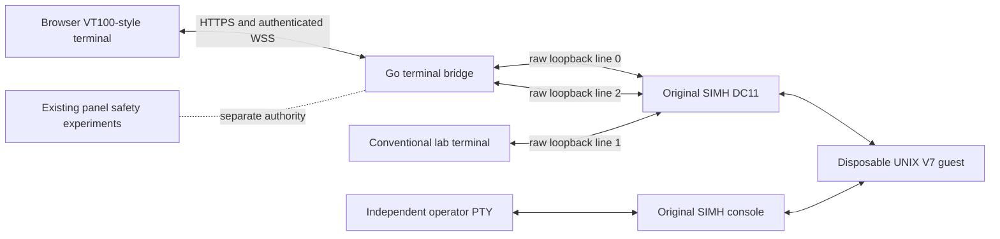
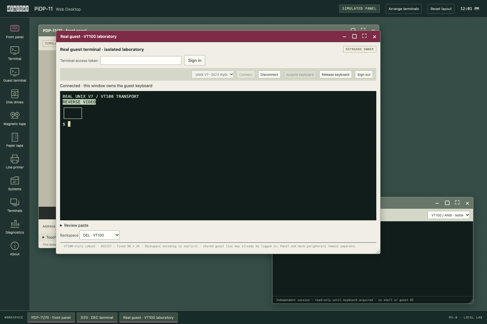

# M5.0 — genuine guest terminals, optional companion architecture

2026-11-18. **Acceptance passed:** the browser executes commands in Research UNIX Seventh Edition under the original pinned SIMH/REALCONS binary. Chromium, Firefox and WebKit each exercised genuine guest input and output, shared observers, independent terminal lines, explicit keyboard handoff, reconnect and guest independence. A fresh disposable disk repeated the complete demonstration using the supplied setup helpers.

This milestone extends the accepted `checkpoint/m4.3.2` (`947697a9680669ee95dd18520322fb24ade49b8c`). It uses the existing Go, TypeScript, HTML5/SVG and xterm.js stack with no new runtime dependency. The ordinary executable, panel and peripherals remain simulated. The separate Linux laboratory entry point enables real guest terminals; it exposes no panel-control or media routes. No Raspberry Pi access, deployment, GPIO operation, original-image modification, autostart, distribution switcher or publication occurred.

## Transport decision and original-software findings

Use **dedicated guest serial lines**, with SIMH owning the virtual serial device and accepting fixed loopback raw TCP connections. Go attaches once per line, drains output independently of browsers, and shares that byte stream through authenticated WebSockets. The browser chooses an endpoint ID, never a host, port, command or device path.

In the laboratory, the host browser's TLS stream crosses a fixed Mac loopback relay and `docker exec` stdio into the network-none container. The relay does not decrypt TLS or accept a target address. This is test infrastructure, not a production component. A future Pi service would serve the embedded assets and connect locally without Docker, Node, a graphical desktop, Java or a database.

| Option investigated | Findings and decision |
|---|---|
| Existing GNU Screen console | The pinned `bin/pdp11control.sh` starts the simulator in a named Screen session. Its stop path quits that session. A browser attaching or sending Screen commands could disturb the operator and reach SIMH's monitor. No Screen takeover or Screen control was implemented. |
| SIMH console redirection / console Telnet | A shared primary console needs explicit operator authority, monitor-escape treatment and a separate lifecycle contract. It cannot provide independent guest logins merely by adding browser viewers. Deferred. |
| SIMH terminal-multiplexer TCP/Telnet | Additional guest lines support independent logins when the guest has the correct driver, device nodes and getty entries. Raw mode avoids Telnet negotiation and IAC transformations for the initial ASCII7 connection. Telnet would need the existing negotiation fixtures promoted into a real adapter, with new integration tests. |
| DC11 | The selected V7 image already enables four DC11 login lines. The original implementation supports per-line listeners. This is the smallest demonstrated path: no SIMH source patch, guest kernel build or installed launcher change. |
| DZ11 / DHU-VH family | Appropriate for other guest configurations; not interchangeable with this V7 image's enabled DC11 driver. Prior RAM-only DZ11 tests are preserved and rerun separately. Additional real guest/driver combinations are future work. |
| Pseudoterminal | Useful for a locally supervised operator console and already used by the lab harness. Owning that PTY does not establish safe multi-user console sharing. The browser never receives this PTY. |
| Physical serial | SIMH can own separate serial endpoints. A future configuration should use stable device identities such as `/dev/serial/by-id/`, exclusive line assignments and no competing Linux getty. No physical serial device was opened or tested. |

Evidence: the [pinned PiDP-11 repository](https://github.com/obsolescence/pidp11/tree/26d20beda0c6b5a1d3a5cb3d7a4dd494e02bff75), particularly `bin/pdp11control.sh`, `src/02.3_simh/4.x+realcons/src/PDP11/pdp11_dc.c` and `sim_tmxr.c`; the inspected public image's `/etc/ttys` and `/dev/tty00`–`tty03`; and the actual tests below. The [Open SIMH V7 guide](https://opensimh.org/research-unix-7-pdp11-45-v2.0.pdf) provides additional multiuser/DC11 context. Its image and instructions are not substituted for our recorded configuration.

## Exact genuine-guest demonstration

The guest is **Research UNIX Seventh Edition**, from Oscar's public `systems.tar.gz`. The source archive and extracted original remain read-only; SIMH attaches an independent writable copy. The only deliberate guest-file addition is `/usr/dmr/m50.vt`, created through the real guest shell to exercise terminal sequences. Normal guest boot/login activity also changes the disposable disk.

| Evidence | Value |
|---|---|
| Upstream source | `26d20beda0c6b5a1d3a5cb3d7a4dd494e02bff75` |
| Original SIMH/REALCONS binary SHA-256 | `f38167163e37dbb9578f33cc58f9740e3a6408829c4e357637b76835864c8237` |
| Public archive SHA-256 | `14bcf83610737c2383ffbfa411ebbd067590705fd1c42caa679d1a5a63f60bd9` |
| Original `systems/unix7/disk0.hp` SHA-256 | `fc04dab1e7f2fbf3ea4b44603ed2c9d6ba15f4f86c702d4a27a1dac725966f39` |
| Configuration | [Exact guest.ini](../../lab/m50/guest.ini): PDP-11/70, 1 MiB, RP06, four DC11 lines; no REALCONS connection |
| Browser line 0 | `v7-dc0` → container loopback port 40100 → guest `tty00` |
| Conventional line 1 | Harness-owned loopback port 40101 → guest `tty01`; never exposed by the Go service |
| Browser line 2 | `v7-dc2` → container loopback port 40102 → guest `tty02` |
| Operator | Original simulator console PTY, independently owned by the existing lab harness |

The boot sequence is `boot`, then `hp(0,0)unix`, followed by Ctrl-D to leave the single-user shell. The public image's `dmr` account was used. No private account or Pi credential is required or included. Three browsers viewed one line while one held its keyboard. A second guest line had its own writer. Each engine ran `ls /`, a fresh unpredictable `echo` challenge and an actual erase-character check. The conventional line and original operator console ran independent commands throughout.

The [recorded acceptance data](m50/acceptance.json) contains actual browser transcripts and conventional-console responses. It is not a replay source. [The acceptance script](../../lab/m50/browser.mjs) uses the real HTTPS/WebSocket service without intercepted responses. Separate browser fixtures are clearly labeled and are not counted as genuine guest evidence.

After the bridge was stopped, both conventional access paths successfully executed guest commands. Restart required fresh authentication and explicit connection/acquisition; the guest was still running. Shutdown was a local operator action: three guest `sync` commands, a simulator interrupt, then `quit`. This is an observed disposable V7 lab shutdown, not a general guest-safe production shutdown guarantee. Browser closure never sends any of those operations.

The laboratory uses an operator PTY, **not a running GNU Screen session**, and no physical serial hardware or guest network login. Screen independence is supported by the selected separation and source inspection, but production Screen/SSH/serial/network continuity still needs authorized validation.

## Terminal ownership, lifecycle and bounds

Each configured endpoint has one persistent guest connection, up to eight browser viewers and one keyboard owner. Separate endpoints have independent owners. Opening, refreshing, signing in or connecting does not acquire a keyboard. All input passes through the endpoint lock with a generation number and increasing per-connection sequence number. Terminal ownership never calls the panel broker.

| Event | Implemented behavior |
|---|---|
| Explicit acquire | Succeeds only for an input-authorized viewer and an available line; a competing request cannot displace the owner. |
| Release / close / disconnect | Revokes that viewer's keyboard. The underlying guest stream remains attached and drains output. No Return, erase, logout or signal is injected. |
| Network interruption | Detected socket closure releases ownership; an otherwise silent writer loses its ten-second lease without renewal. Browser renewals run every two seconds. |
| Reconnect | Explicit only, fresh renderer and no history/input replay; starts read-only. Guest state and unfinished guest input can still exist. |
| Slow observer | A full output queue or unacknowledged-byte limit disconnects that observer. Guest output continues to drain. |
| Guest stream EOF / uncertain write | Revokes ownership and marks the line unavailable. No automatic stream reconnect or input replay. Operator service restart is required. |
| Go restart | Browser sessions and leases vanish. Guest TCP lines disconnect and are reattached on startup; a guest may treat this as hangup or login-session loss. The CPU is not stopped. |
| Credential reload | Local SIGHUP replaces credentials and revokes sessions; invalid replacement disables access. Existing access-gate tests cover revocation; WS checks occur on input/output and a 500 ms timer. |

Limits: four configured endpoints; eight viewers per endpoint; 256 input bytes per message; 4,096 input bytes/second per client; 1,024-byte inbound WS messages; 64 queued outbound frames and 64 KiB unacknowledged output per viewer; 4 KiB guest read chunks; 500 ms socket-write timeout; guest writes bounded by the smaller of 250 ms or remaining keyboard lease. The browser bounds pending renderer output at 64 KiB, outgoing buffered data at approximately 8 KiB plus one bounded frame, and scrollback at 300 lines. The existing access gate caps sessions and login attempts. The lab relay caps simultaneous forwarded connections at 32.

Already delivered bytes cannot be recalled. An unfinished command in the guest's own terminal input buffer can survive a keyboard handoff. The new owner must inspect or deliberately clear that guest line; the service does not silently erase it. This differs from safely discarding an unsent mock command. A refreshed terminal starts with default parser state, while the guest application may still expect different modes; manual redraw/reinitialization may be needed. There is no shared screen-history reconstruction in M5.0.

## VT100-style behavior and actual compatibility limits

The browser uses a fixed **80 × 24**, ASCII7 VT100-style subset. xterm.js renders the stream; it is not claimed to be a complete or cycle-accurate DEC terminal. No NAWS resize or guest `stty` change occurs automatically. Smaller windows scroll the fixed terminal.

Actual guest tests cover login, Return, line feed, command output, clear/home, reverse video and DEC line drawing. Existing renderer tests exercise cursor addressing, margins, scrolling, wrapping, CR/LF, BS/DEL, save/restore and every split point of the test escape sequences. The new adapter fixture verifies split WebSocket sequences, arrow/DEL keyboard bytes, ownership and reconnect. Existing encoder tests cover application cursor/keypad and PF mappings; full-screen historical guest applications have not yet validated every mode. Only the keyboard owner can send terminal query replies.

V7 `stty` reports `erase = '#'; kill = '@'` on this image. A VT100 Backspace normally sends DEL, which this guest treats differently from character erase. The UI therefore offers explicit **DEL**, **BS**, and **# · UNIX V7 erase** choices; the default remains DEL. The genuine test types `echo ERASE_OKX`, uses the selected `#` mapping, and verifies an exact `ERASE_OK` output line. No guest terminal configuration is silently changed. Guest `stty` reports 300 baud; this is not a measured physical serial link speed.

Native clipboard paste is captured for review before xterm receives it. Only one ASCII line of at most 256 characters is accepted, with no CR/LF or other control characters except TAB. The Send button does not append Return. A test caught HTML input normalization removing pasted newlines; validation now occurs before assignment to the input field. This prevents that accidental multiline conversion, but a reviewed command is still a guest command and can have consequences once the user presses Return.

VT52, complete VT220, Tektronix 4010, VT11 graphics, Unicode/wide-character behavior, arbitrary binary protocols, software flow-control interaction and broad application compatibility remain outside the demonstrated scope. Native Safari automation was unavailable under its existing settings, which were not changed. WebKit passing is not a native Safari result.

## Security and deployment boundary

`cmd/terminal-lab` requires Linux, the explicit lab environment flag and exclusively loopback interfaces. Endpoint and credential files must be bounded, owner-only regular files, opened without following symlinks. Only fixed literal loopback endpoints are accepted. TLS 1.3, exact Host/Origin checks, HttpOnly/Secure/SameSite cookies, capability checks, CSRF logout and credential revocation reuse the existing access layer. Tokens never enter URLs or browser storage. Output and keyboard content are not recorded by the service; local test transcripts are kept separately from production logging.

A reader credential cannot acquire a keyboard. An input credential currently covers all configured guest endpoints: per-line user ACLs are future work. Guest login identity is distinct from browser authorization, and viewers may observe an already logged-in guest account. Do not treat the shared fixture credential model as a production account design.

There is no browser command to start a process, choose a TCP address, attach a disk, send a SIMH monitor command or change the front panel. Keyboard input is still powerful inside the guest according to that account's privileges. A trusted operator could misconfigure a loopback address to point at a monitor instead of a guest line; the configuration's `kind` label is not protocol attestation. Production provisioning must establish endpoint identity and process ownership. Connection-level denial-of-service defense and LAN certificate/user provisioning also remain production gates.

The lab certificate is an ephemeral ECDSA P-256 fixture. Automated test contexts bypass trust only for this isolated endpoint; no OS trust store or personal browser setting is changed. An initial Ed25519 fixture encountered a Chromium signature-algorithm failure; the separate compatible certificate fixture resolved it without weakening the Go server's TLS version policy.

## Tests and measurements

The [validation and resource record](m50/validation.json) distinguishes lab measurements from targets. Go race tests pass across all packages; the new endpoint/configuration tests include ownership conflicts, stale generations, ordering, partial writes, stalled writes, rate/size/viewer bounds, output credit, repeated opens/closes, EOF, empty lease expiry, malformed messages, unauthorized origins/endpoints and reader denial. A short configuration fuzz run also passed. All 46 TypeScript tests, the existing reconnect integration test and all 45 Playwright desktop tests passed. The separate genuine-guest script passed in Chromium, Firefox and WebKit, then repeated on a fresh disk. Prior RAM-only DZ11 terminal fixtures were run separately; their output is not presented as guest-login evidence.

The ordinary Mac and static Linux ARM64 binaries build, as does the separate embedded-assets terminal-lab ARM64 executable. Existing panel, printer/spool, media and M0 checkpoint files remain unchanged. Original M4 START-release and consumer-fence evidence is preserved; the full old fault/stress campaigns were not rerun because their control path was not changed.

Short measurements sample **the Go bridge process only**, using Linux `/proc` RSS and CPU ticks (100 Hz, 100% means one core). The work is hosted by OrbStack Linux ARM64 on the Mac, not a Pi. Samples cover no browser, idle observer, active keyboard and a closed browser. Guest execution, relay, browser and container VM cost are excluded. Command latency includes browser automation, lab forwarding and real guest processing; it is not isolated transport latency. See the recorded values and workload in [validation.json](m50/validation.json). These short samples do not establish long-term stability, PSS, peak memory or Pi performance.

| Short sample | RSS start → end | CPU, one core |
|---|---|---|
| No browser, two guest lines attached (10.05 s) | 10.67 → 10.67 MiB | 0.10% |
| One idle read-only browser (10.05 s) | 11.28 → 11.35 MiB | 0.20% |
| Keyboard owner, ten real echo commands (9.77 s) | 11.35 → 12.52 MiB | 0.92% |
| Browser closed, lines still attached (10.05 s) | 12.52 → 12.52 MiB | 0.20% |

The static stripped terminal-lab binary with embedded assets is 7,078,050 bytes (6.75 MiB). Ten full command/display samples took approximately 413–500 ms; their nearest-rank p95 is 500 ms. This includes typing/automation, forwarding, guest processing and output observation, and is not the proposed <100 ms added-transport test. The sample is too small to characterize tail latency reliably.

Retain the Pi 3B+ acceptance targets: ≤24 MiB idle RSS, ≤48 MiB active RSS (≤64 MiB peak), <1% idle and <5% mean active CPU of one core. For terminal integration, target <100 ms p95 added transport latency under an authorized LAN test, separating that from guest response time. Validate two active guest lines, slow observers and reconnects over at least 30 minutes. The existing <3% emulator-throughput regression target remains unproven. Nothing measured here closes a physical-hardware performance gate.

## Oscar's side-by-side proposal and recommendation

| Product mode | Evidence and implications |
|---|---|
| A — Original PiDP-11 | Remains authoritative and independently runnable. No original binaries, service definitions, guest images or control routes are overwritten. |
| B — Original plus optional companion | **Preferred next architecture for guest terminals.** The lab proves that original SIMH can provide independent guest lines without a source patch. A real installation still needs guest-specific line configuration, endpoint isolation, authentication and deliberate provisioning. Passive panel observation is a separate previously studied integration, not implied by terminal success. |
| C — Separately maintained enhanced distribution | Feasible when a feature genuinely needs source changes, such as experiments in consumer-side panel fencing. Maintain separate binaries, configuration, runtime state and writable guest copies. Do not assume two simulators can write the same guest image safely. No switcher is implemented. |

A future distribution switcher would need guest-specific quiescence and verified shutdown, exclusive ownership of disk images and ports, release/reassignment of physical GPIO/serial resources, atomic selection of separate launch configurations, and a tested physical-only rollback. Switching while an old guest or daemon still owns those resources is not safe. Backup completion alone establishes none of those guarantees.

Earlier safety documents use “Mode C” for a remote-panel broker concept. That historical label is **not** the product distribution Mode C above. M5.0 changes neither the consumer-fence experiment nor its unresolved blocked-RPC/watchdog/START-release limits.

Recommended next work is a narrowly reviewed terminal-only production-integration proposal after this report: identify an approved guest and spare terminal line, define authentication/certificates and serial coexistence, then validate lifecycle and resource budgets under separate authorization. A real Pi pilot, remote panel control, broader guest support and real peripheral management remain distinct gates. This milestone makes a genuine browser guest demonstration suitable for review; it does not authorize installation.

## Reproduce or inspect

Follow the [Mac laboratory procedure](M5.0-runbook.md). Private raw evidence lives under ignored `.research/m50/`, `.research/m50-replay/` and `.research/m50-terminal-regression/`; public records contain only selected nonsecret fixture results. Screenshots are captures of the real application and actual guest, without fabricated logins or hardware status. Accepted tags, artwork, source notices and earlier evidence remain intact.
