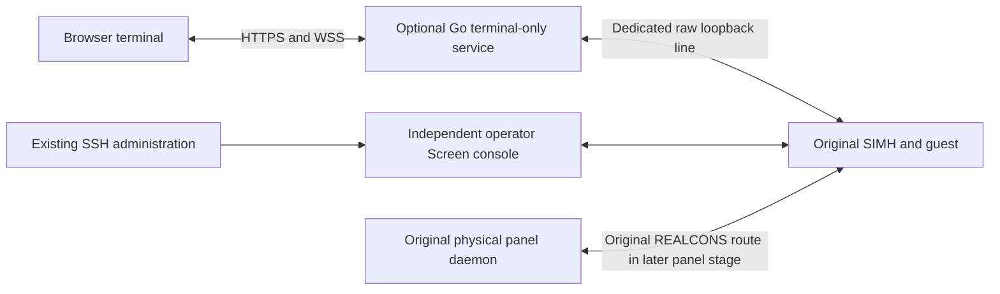

# M5.1 — read-only assessment of the installed PiDP-11

**Later result:** [M5.3](M5.3.md) records the authorized standalone terminal pilot and cleanup. The text below preserves what was known/proposed at M5.1; it is not a claim that the pilot remains unexecuted.

2026-11-18. **Assessment complete; no live integration performed.** The owner authorized read-only SSH inspection for this task. The accepted application checkpoint remains `checkpoint/m5.0`, commit `156ce33d6b42ee4ad7689554c3d85e4883abb907`. No application code or installed Pi configuration was changed.

**Recommendation:** prepare a terminal-only pilot using the installed original ARM64 simulator, a disposable copy of the installed UNIX V7 disk, and one dedicated DC11 line. Keep the ordinary launcher and its Screen console independent. There is good configuration-level evidence for this route, but it is not a drop-in deployment of the M5.0 lab executable. A separate reviewed server entry point and explicit pilot startup are required first.

The [proposed pilot procedure](M5.1-pilot-plan.md) is unexecuted and requires owner approval. It separates the initial standalone guest test from a later original-launcher/physical-panel coexistence test. The physical kit is not yet assembled, so physical preservation cannot be demonstrated now.

## Evidence and scope

The principal inventory was captured at **19:35:20 UTC**, configuration at **19:36:27 UTC**, and follow-up at **19:38:43 UTC** on 18 November 2026. These are short snapshots, not continuous monitoring. The Pi was recently booted: the initial uptime was about 122 seconds. No emulator, Screen session process or panel daemon was present in the inspected process snapshots. None was started by this assessment.

The assessment used the existing SSH alias with noninteractive authentication, a connection timeout, strict existing-host-key checking and host-key updates disabled. No SSH configuration or credentials were changed. Read-only operations included file reads, Git revision/diff inspection with optional locks disabled, process/service/listener information, ELF inspection, hashes and firmware status queries. No `sudo`, SIMH invocation, launcher invocation, Screen attachment, RPC panel query, serial-terminal attachment, GPIO test, mount, guest boot, stress test or network scan was performed.

Raw network addresses, account names, shell configuration and full installed configurations remain in the private ignored `.research/m51/` directory, with a readable `PRIVATE-INVENTORY.md` annex. This report records the technical findings needed for the decision without reproducing those details. The [evidence index](m51/evidence-index.json) identifies the retained captures by hash and their roles; it contains no raw network/account data.

| Evidence | Private source / scope |
|---|---|
| E1 | `inventory.json`: board/OS/kernel, RAM, storage, load, temperature, throttling, source revision, processes, services, listeners and path metadata |
| E2 | `configuration.json`: installed launcher and guest configuration text/hashes, ELF headers/dependencies/symbols, source-file hashes, installed package versions |
| E3 | `followup.json`: official-backup binary comparisons, user-local helper links, startup inspection, device metadata and final status snapshot |
| E4 | `installed-v7-metadata.json`: bounded read-only extraction of selected UNIX V7 filesystem metadata; no mount or guest execution |
| E5 | `lab-v7-metadata.json`: the same extraction from M5.0's verified public base disk for comparison |
| E6 | `installation-evidence-appendix.md`: preserved earlier installation evidence, distinct from the new inspection |

An absent file or inaccessible location is not proof that every possible startup mechanism is absent. Findings below are limited to the inspected system/user service locations, shell startup files, cron configuration, process list and known installation paths. The private captures retain errors instead of substituting assumed values.

## Actual host and resource inventory

| Item | Confirmed finding |
|---|---|
| Hardware | Raspberry Pi 3 Model B Plus Rev 1.3 |
| Userspace | Debian GNU/Linux 13, Trixie; `/etc/os-release` reports 13.7, with Raspberry Pi packages/kernel |
| Kernel / architecture | `6.18.60+rpt-rpi-v8`, AArch64 |
| RAM visible to Linux | 904.9 MiB total; approximately 729.6 MiB available in the initial sample |
| Swap | Approximately 904 MiB configured, zero used in that sample |
| Root filesystem | Approximately 15.62 GiB available; 44% used |
| Load average | 0.18 / 0.15 / 0.06 at the initial sample; not CPU utilization percentages |
| Temperature | 36.5°C initially, 40.8°C at follow-up |
| Throttling flags | `0x0` in both firmware queries |
| Emulator / panel daemon | No running instance found in either inspected process snapshot |
| Startup target | Multi-user/headless target |
| Related services | SSH, NetworkManager and rpcbind active; no PiDP-11 service/autostart found in inspected locations |
| Screen | Package version 4.9.1-3 installed; ordinary launcher/helper scripts retained |

The observed free memory and storage are sufficient to justify a small pilot, not to certify performance. No Web Desktop process ran on this Pi, so there is **no Pi bridge CPU, latency or memory measurement**. M5.0's approximately 10.7–12.5 MiB bridge RSS and 0.1–0.9% of one core came from short Mac-hosted Linux tests. Retain the Pi targets of ≤24 MiB idle RSS, ≤48 MiB active RSS, ≤64 MiB peak, <1% idle CPU and <5% mean active CPU of one core. Guest response time must be separated from added transport latency.

The firmware flags indicate no active or recorded undervoltage/frequency-capping/throttling/soft-temperature condition in these samples. They do not erase earlier recorded events or prove a replacement supply under load. The core-voltage query measures a processor/VideoCore supply domain, **not the micro-USB 5 V input**. Definitions are documented in the [official Raspberry Pi vcgencmd manual](https://github.com/raspberrypi/utils/blob/master/vcgencmd/vcgencmd.1). No governor, temperature limit, firmware, boot or power setting was changed.

The earlier installation evidence records power concerns and substantial soft-temperature limiting during an RT-11/panel-server workload; those are historical results, not this assessment's measurements. The owner is handling the supply separately. Confirm the intended supply/cable arrangement and acceptable temperature/throttling under an explicitly authorized modest workload before accepting a pilot. A cool recent idle boot is insufficient evidence to close that gate.

## Installed source and binaries

The `/opt/pidp11` checkout is at **`26d20beda0c6b5a1d3a5cb3d7a4dd494e02bff75`**, as expected. Git reports changes in the three tracked runtime binaries and the boot-selection file. These are consistent with the documented installation; textual launcher/C-source changes were not reported. Selected terminal-device and multiplexer source files were also hash-compared with the pinned Mac source and matched. Do not reset or clean this deliberately configured installation.

| Installed entry | Resolved source-tree target | SHA-256 |
|---|---|---|
| `bin/client11` | `src/02.3_simh/4.x+realcons/bin-rpi/pdp11_realcons` | `340c3311d2be6a04a5f3cc05c97747f524be58de3ea4d13fec97991a09df454e` |
| `bin/server11` | `src/11_pidp_server/pidp11/bin-rpi/pidp1170_blinkenlightd` | `8d1cd3b97ae0155b1b0874b75a94deaf7530a8727f87464db2d0a2025ccbcf02` |
| `bin/scansw` | `src/11_pidp_server/scanswitch/scansw` | `5c0c05dc885946c5ef324b4e90eb7b42a0c2f20215292831b8b517daa686bb07` |

All three are ARM64 ELF binaries and match both their installed `backup64bit-binaries` copies and the corresponding files in the pinned public source archive. They were inspected, not executed. The simulator is dynamically linked, including libtirpc, libpcap, SDL2, readline, libm and libc dependencies. A future static Go bridge would add no Go-runtime or libc package dependency of its own and need not use those graphical libraries.

The installed simulator's hash differs from the freshly compiled M5.0 lab simulator (`f38167163e37dbb9578f33cc58f9740e3a6408829c4e357637b76835864c8237`). Matching source revision and device symbols support compatibility, but do not establish identical build flags, runtime behavior or a reproducible binary build. Actual installed-binary terminal interoperability remains a pilot test.

The firmware boot command line names a serial console, but the inspected serial device patterns yielded no usable physical serial endpoint. No USB/onboard expansion port was opened or tested. Treat existing console reservations and future adapter identities as an explicit serial-provisioning task; do not assign an assumed `/dev/ttyUSB0` or start Linux getty on a SIMH-owned port.

## Guest terminal availability

Static ELF symbols confirm DCI/DCO, DLI/DLO, DZ and VH device objects in the installed simulator. Source inspection confirms shared TMXR support for line-specific listeners, raw `;notelnet` operation, Telnet and host-serial connections. Raw loopback is the recommended first transport because the existing Go adapter consumes a raw byte stream, not Telnet negotiation. A bare multiplexer port is not equivalent to a dedicated authenticated browser endpoint.

The VH source describes the DH/DHQ family and DHU/DHV programming modes with model-dependent selection. There is no separate `pdp11_dh.c` in this tree; do not infer a specific guest's DH driver compatibility from the family name alone. Later use needs model, register, interrupt and driver verification. Relevant source: [pinned PDP11 devices](https://github.com/obsolescence/pidp11/tree/26d20beda0c6b5a1d3a5cb3d7a4dd494e02bff75/src/02.3_simh/4.x%2Brealcons/src/PDP11) and [TMXR](https://github.com/obsolescence/pidp11/blob/26d20beda0c6b5a1d3a5cb3d7a4dd494e02bff75/src/02.3_simh/4.x%2Brealcons/src/sim_tmxr.c).

| Installed guest profile | Confirmed configuration-level finding | Work needed before an independent browser login |
|---|---|---|
| UNIX V7 — first choice | PDP-11/70, 1 MiB, RP06 disk; DCI enabled with eight lines; no DCI listener attached. Ordinary file connects REALCONS; headless file comments that connection. | A dedicated raw loopback line in a separate pilot configuration. No guest login-file change is presently indicated; validate the installed kernel and login on a copy. |
| RT-11 | PDP-11/70, 4 MiB; DLI configured for two lines, DZ disabled; no extra terminal listener. Local graphical-display enablement is commented. `noidle`/`nothrottle` are present. | Determine the exact monitor and application/handler support for a second terminal. DLI device configuration alone does not prove another interactive login. Do not turn a single-console guest into a multiuser claim. |
| 2.11BSD and 2.11BSD+ | DZ enabled with eight lines, 7-bit settings and a specified vector; DZ listener and host Ethernet attachment commented. Separate ordinary/headless variants exist. | Inspect the actual guest kernel/tty database and getty configuration on a disposable copy, then enable only the chosen line. The host configuration alone does not establish active guest logins or guest networking. |
| RSX-11M+ | DZ enabled with eight lines and explicit CSR/vector; its listener and host Ethernet attachment commented. Main disk attached; optional second disk attachment commented. | Verify generated terminal drivers, CSR/vector agreement, line names and login/terminal tasks. Those guest internals were not read or boot-tested here. |

Other configured selections include IDLED, RSTS, DOS-11, earlier UNIX releases, System III/V, Nankervis collections, Blinky and another RSX profile. Their presence in the selector map is not a new boot or terminal-compatibility result. The exact private boot mapping is retained in E2. No mapping was exercised or changed.

### UNIX V7: stronger evidence without booting

A bounded Python reader opened the installed disk **read-only** and read 11,328 bytes of directory/inode/file data. It did not mount the filesystem, copy the disk, execute guest code or write anything to the image. The reader was first checked against M5.0's known public base image.

The installed `/etc/ttys` and `/etc/rc` bytes match that base. The console and four enabled terminal login entries are present; `/dev/tty00`–`tty03` are character devices with matching device numbers. This makes **DC11 line 0 / guest tty00** a well-supported first candidate. The host config's eight lines should not be confused with eight enabled guest logins. Kernel-file metadata also matches, but its complete contents were not hashed or inspected, so kernel identity and actual driver operation remain unverified.

| M5.0 laboratory | Installed Pi / proposed consequence |
|---|---|
| Newly compiled original source binary | Official prebuilt ARM64 binary; static compatibility evidence, no live test yet |
| Verified public base plus fresh disposable copy | Installed working guest disk may contain prior validation changes; preserve it and create a new independent pilot copy |
| Four configured DC11 lines; three raw listeners | Eight configured lines; no listener. Retain eight in the proposed copy and add only the chosen line initially |
| No REALCONS connection | Ordinary installed config connects REALCONS; headless variant does not. Select the intended scope explicitly |
| Container loopback, fixed stdio relay | Real networked Linux host; a new restricted server entry point and an approved transport/trust plan are needed |
| Independent harness PTY | Retained Screen launcher and helpers; a separately named manual pilot session is proposed |

## Launcher, console and panel coexistence

The ordinary `pdp11control` script creates the named Screen session and runs `pidp11.sh`. The latter chooses a guest through the selection file, writes a temporary command file, starts the original panel daemon and then the simulator. Without an explicit boot argument it invokes the physical switch scanner. Its exit/reboot workflow and daemon cleanup remain unchanged.

The normal guest command file is fixed at `systems/<selected-profile>/boot.ini`. **There is no generic external-configuration argument.** Consequently, an external pilot `.ini` cannot simply be passed through the original launcher unchanged. Also, calling the installed `boot.ini` and appending new settings is not a safe shortcut: its reset/detach sequence can erase earlier settings, and its boot command begins execution before later commands would run.

The owner-local console helper uses a Screen detach/reattach operation. It was read, not invoked, and must not become the browser transport. Original stop paths include Screen termination and broad simulator/daemon process-name kills; they are neither guest-safe shutdown nor narrowly scoped cleanup for a side-by-side experiment.

**First pilot:** run only the original simulator binary in a separately named, manually supervised Screen session, using an explicit copied configuration and disposable disk. Do not start a second panel daemon, call the scanner, alter RPC registration or run the original launcher concurrently during that controlled test. This tests the installed binary's guest terminal path and an independent operator console. It does **not** prove physical-panel coexistence.

**Later Mode B integration:** retain the original launcher/daemon route and add a deliberately selected guest profile with dedicated terminal lines. That would require an approved profile directory and selection-map change, or another specifically reviewed configuration mechanism. It need not require editing launcher source, but it is still a real installation change. Preserve the ordinary profile as the default and preserve every existing mapping. Do not implement a software-distribution switcher.

The Go terminal bridge must never register another panel RPC server, issue panel input reads, attach to Screen, change REALCONS authority or infer CPU halt from a disconnected browser. The unresolved M4 START-release, blocked-RPC and watchdog limitations remain unchanged.

## Proposed optional service architecture

The panel route in this diagram is the intended later coexistence architecture, not a tested M5.1 connection. For the first standalone pilot it is absent. No original access path depends on the Go process.

The current `cmd/terminal-lab` intentionally requires a network-none Linux environment, a lab flag and a fixed loopback origin. The Pi has normal network interfaces, so **the accepted M5.0 binary is intentionally not deployable unchanged**. Do not bypass this by removing the guard or spoofing its environment. Prepare a separately reviewed terminal-only production/pilot entry point that reuses the bounded bridge/authentication/static-assets packages and retains the laboratory guard in its original command.

Use a separate versioned companion directory, private configuration/state directories and an unprivileged process with no GPIO, disk, Screen or RPC privileges. For the first pilot, a private owner-local tree and manually started bridge avoid service/autostart changes. A later installation could use `/opt/pidp11-webdesktop/`, `/etc/pidp11-webdesktop/` and `/var/lib/pidp11-webdesktop/`; these are proposed names, not existing installation claims. Embedded assets keep deployment to one Go executable plus configuration/credentials/certificates. No Node, container, desktop, database or Java runtime is needed on the Pi.

A future optional systemd unit should supervise only the bridge. It must not start/stop the emulator, require it as a lifecycle dependency, invoke the original launcher in pre/post hooks, or remove guest state during uninstall. Keep optional startup disabled for the first pilot. Establish explicit endpoint identity before every attach; guest switching or stream EOF must revoke leases and require deliberate reconnect/restart, not silently connect to a different OS using the same port.

Browser closure should leave the bridge's guest connection intact. Bridge failure will close that guest line and may hang up its login or foreground guest task; it must not kill the simulator or operator console. Input already accepted by the guest cannot be recalled. M5.0 demonstrates these boundaries in the lab, not yet on this binary and host.

## Network and authentication

For the first pilot, prefer loopback-only raw guest and HTTPS endpoints, reached through an explicitly authorized SSH local tunnel. This adds no guest Telnet port or web listener on the LAN. Keep raw guest bytes inside the Pi and reserve other guest lines for independent conventional/physical use. A loopback port is still accessible to other local processes; it is not an authenticated security boundary between hostile users on the host.

Retain TLS 1.3/WSS, exact Host/Origin checking, secure HttpOnly cookies, separate observer/input capabilities, expiring sessions, explicit keyboard leases and bounded queues. Use fresh private credentials and a specifically approved certificate/trust arrangement. Do not distribute the lab's tokens/certificates or globally disable browser certificate validation. The current shared-token design gives access across configured endpoints; per-user/per-line authorization and durable audit requirements need a production decision.

Direct LAN service is a later scope: choose a stable origin, trusted certificate, exact bind addresses, IPv4/IPv6 policy and firewall rules before exposing it. The assessment found ordinary SSH/RPC infrastructure but did not audit the effective firewall rules. An inactive firewall unit does not prove that no filtering exists. No network setting was changed and no endpoint was opened or probed by the assessment.

## Decision and remaining gates

**Go for local preparation of a narrowly scoped pilot proposal; no-go for installation or execution without approval.** The evidence supports UNIX V7/DC11 as the first target, with no identified need for a guest tty-file change. It does not establish installed-binary behavior under live input, physical coexistence, power adequacy under load or production service readiness.

Required gates are: owner approval of exact Pi changes and startup/stop scope; reviewed terminal-only server entry point; private backup/copy/hash plan while the source guest is inactive; explicit endpoint and certificate/authentication provisioning; supply/temperature readiness; an independent recovery console; and a later assembled-hardware check before any physical-panel preservation claim. The [pilot plan](M5.1-pilot-plan.md) lists ordered actions, success criteria and rollback without overwriting guest data.

Only documentation and private evidence were produced on the Mac. Local checks validate evidence hashes, JSON records, links and proposed JSON configuration. Application builds, regression suites, emulators and stress campaigns were not rerun for this assessment. No M5.1 production-acceptance tag is created, and M5.0 remains the accepted application checkpoint.
