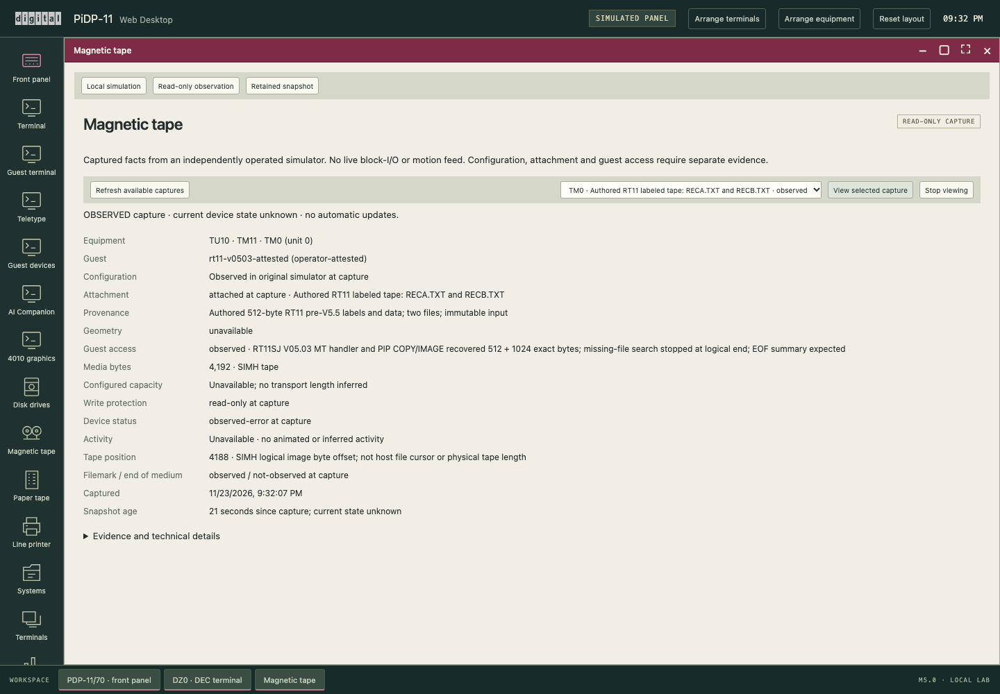
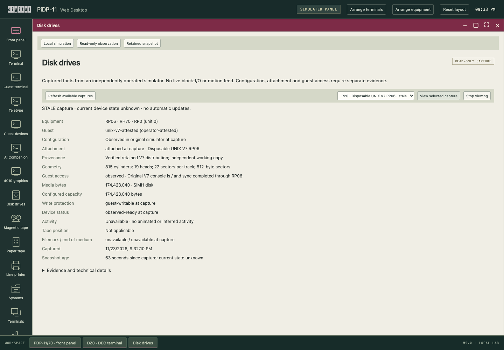

# M5.24 — Genuine guest magnetic tape and broader disk observation

Completed November 23, 2026, local Arizona time (November 24 UTC). Engineering
checkpoint: `73341f9a4a8a9f7b9d1e21360e635c5a95d87fa6`. This is development work,
not owner acceptance, a release or permission to operate physical hardware.

**RT-11SJ V05.03 successfully read two labeled tape files through its MT handler
and PIP, recovering every expected byte.** A fresh UNIX V7 guest also accessed an
RP06 through the original RH70 path. Both genuine results were displayed in the
existing storage windows across Chromium, Firefox and WebKit. Captures remain
read-only historical facts, with current device state explicitly unknown.

## Backup and environment

The required incremental backup of `.research/m523/` completed before development:
`M5.24-incremental-20261124T041941Z` on the owner-selected private NAS. It contains
123 files and seven directories, 42,097,705 logical bytes. The PAX archive is
42,601,472 bytes, SHA-256
`a39b56eca99d76de8c66f11577c6bcb006010c6fb9fb245bf6c744616ebff73d`.
Manifest SHA-256:
`674cb92ac190ab3f8630be4a5b0584fef667a9f8457a86ad85bdff0070617c7a`.
Independent archive readback verified bytes and supported metadata, including modes,
ownership, nanosecond modification times and extended attributes. Creation/change
times were recorded; no full restoration was attempted. Previous backups and source
evidence remain untouched. The private recovery pointer is project-level
`Backups/WebDesktop-M5.24-incremental-20261124T041941Z/backup.json`.
This incremental backup predates M5.24's new evidence.

Two fresh, disposable ARM64 Linux containers ran on the Mac, each with network
none, read-only root, dropped capabilities, no-new-privileges, 128 MiB memory with
equal total memory-swap limit, two CPUs, 128 PIDs and 64 MiB temporary filesystem.
Only its own working-media directory was writable. The original executable was
reverified as SHA-256
`f38167163e37dbb9578f33cc58f9740e3a6408829c4e357637b76835864c8237`.
Retained image identity:
`sha256:564662bf3489f350e39b39ec46751454568689b0d8dd0d24b4527971c2f3836c`.
Original source revision: `26d20beda0c6b5a1d3a5cb3d7a4dd494e02bff75`.
No simulator source modification; the established PTY compatibility shim was reused.
REALCONS remained disconnected. No physical Pi, SSH or GPIO access occurred.

The [runbook](../../lab/m524/README.md) records the selected combinations and rationale
before experiments. [Source hashes](../../lab/m524/results/sources.json) identify
reviewed originals and DEC manuals. Guest disk bases came from already inventoried
legitimate distributions; no replacement historical distribution was downloaded.

## Genuine RT-11 tape result

The [handler inventory and exact workflow](../technical/rt11-magnetic-tape.md)
documents MT/TM11, MS/TS11 and MM/TJU16 mapping, actual installed addresses/vectors,
monitor requirements, label format, utilities and corrected attempts. Only MT was
installed and exercised. The historical utility files are identified by
[exact sizes and SHA-256](../../lab/m524/results/guest-tools.json), not invented
version strings.

An independently authored 4,192-byte SIMH tape used pre-V5.5 512-byte VOL1/HDR1/EOF1
labels, 512-byte data records and documented filemarks. It was attached read-only
and locked before boot. The installed DIR listed RECA.TXT (one block) and RECB.TXT
(two blocks). PIP COPY/IMAGE copied them to fresh READA.TXT and READB.TXT on the
working disk. A separate read-only directory decoder then recovered the actual
guest-written files and compared all bytes, including padding:

| File | Actual length | Exact-byte SHA-256 |
|---|---:|---|
| READA.TXT | 512 bytes | `aebba95d881ce65dbe403a39faa3a1ad53a7326d71ae53bf08eedeadbaeef160` |
| READB.TXT | 1,024 bytes | `7190fb13f6e934d33f6c8c7116f4de82cd1037c06ef3733d609db15bbb633782` |

Tape SHA-256 before and after:
`8841da1560ce50d73165b659fb437c5de7d61fcd484993be2247ff05ffde09bb`.
[Independent verification and every record boundary](../../lab/m524/results/byte-verification-final.json).
This is actual guest utility I/O, not a host-file read presented as guest activity.

The post-copy position was 3,660: the second data filemark had been read. An intentional
missing-file search returned PIP “File not found” and stopped at logical-end offset
4,188, with a further filemark still present in the image. MTS=`040105`, MTC=`160200`
and UST[0]=`040104` preserve expected EOF/error-summary status. Physical tape length,
capacity EOT and read-beyond-image are different claims; M5.24 did not test them.
M5.23's separate CPU experiment retains its earlier end-of-image qualification.
No tape writes, guest INIT, backup/restore or browser positioning occurred.

The independent console remained usable while observation existed and after the
actual observer stopped: TYPE printed the authored text, including both READB blocks.
At the final idle prompt, independent halt/quit exited zero. Byte verification
passed again after shutdown. Raw transcripts and all working media remain private.

This is an actual application capture, not a mockup or intercepted API response.
The expected EOF summary is visible alongside its guest evidence and unknown-current-state label.

## Additional RH70/RP06 disk result

A fresh copy of the retained V7 base booted through the original RP0/RP06 setup.
The single-user guest accepted `ls /` and `sync`; this experiment claims console
filesystem access, not a new browser login test. SHOW RP identified RHA, unit zero,
RP06, SIMH format and write-enabled attachment. The configured 11/70's standard
options select RH70 in the pinned original sources; the
[inventory](../technical/storage-inventory.md#m524-rp06-addition) explains that
source-grounded identification separately from the displayed RHA label.

Geometry is **815 cylinders × 19 heads × 22 sectors × 512 bytes**, or **174,423,040
bytes**, equal to the stored image length. Captured DS[0]=`010700` reports ready,
medium online, drive present and volume valid; ER1[0]=`000000`. Local CS1[0]=`000000`
is not used as a substitute drive-ready test. [Captured evidence](../../lab/m524/results/v7-capture.json).

The exact published working-image hash was
`60f16779eaf3175b700e60b01339f19bd99ef18bd4a596c59b596c6d26b12e2e`.
V7's later normal operation changed its **working** disk; capture-time identity is
not a promise of ongoing immutability. Original base hash stayed
`fc04dab1e7f2fbf3ea4b44603ed2c9d6ba15f4f86c702d4a27a1dac725966f39`.
After the observer stopped, `ls /` still worked. Three completed `sync` commands
preceded independent halt/quit, which exited zero.

The RSX RQ-family working image is 314,880,000 bytes, above the unchanged 256 MiB
collector bound. RP06 was selected for genuine retained guest support and bounded
verification, not appearance. Other RP models, RH11 and units beyond zero remain
unqualified and are rejected.

## Implementation and lifecycle

`internal/storage` and the TypeScript validator now admit the exact RH70/RP06 unit
zero subset. No broader monitor abstraction or new browser mutation route exists.
The disk window can select RL02 or RP06; tape retains its TM11/TU10 subset. Visible
provenance, geometry and locally updated capture age make the evidence easier to
assess without opening technical details. The age timer performs no network polling.

Existing safeguards remain: explicit allowlists, whole-image read-only verification,
8 KiB approval limit, 512-character evidence fields, 256 MiB media limit, four-slot
ceiling, service/revision approvals, new capture generations, 30-second freshness,
explicit revocation, cancellation and empty restart. At most three distinct device
families are now qualified. Retained mode is data only, never authority. The
[capture contract](../technical/storage-observation.md) describes the boundaries.

Both real observers were explicitly revoked, stopped and restarted. Inventories
were empty; each prior capture URL returned 404; terminal lines remained detached.
Opening the storage window caused no automatic request. Both restarted observers
were then stopped before guest shutdown. Original consoles stayed independent.
[RT-11 restart](../../lab/m524/results/rt11-restart-browser.json),
[V7 restart](../../lab/m524/results/v7-restart-browser.json).

## Verification and measurements

Host: Node v26.9.0, npm 11.19.1, Go 1.26.0 darwin/arm64, Python 3.14.7. The original
simulator/observer evidence is ARM64 Linux, distinct from host unit tests.

| Check actually run | Result |
|---|---|
| `go vet ./...` | Passed |
| `go test -race -count=1 ./...` | Passed, 24 packages |
| TypeScript / frontend units | Passed / 106 tests |
| Transport integration / unchanged selection-contract checks | 1 / 9 passed |
| Embedded frontend build | Passed; standalone prototype 596,156 bytes |
| Full Playwright suite | 231 passed; zero skipped, unexpected failures or flakes; 169.68 seconds |
| Actual guest-capture rendering | Six views: two devices × Chromium/Firefox/WebKit; all fields matched |
| Actual observer restarts | Two empty restarts, old URLs retired, no automatic recovery |
| Clean source checkout | Fresh detached `73341f9`, offline npm install, embedded build and native/ARM64 Go command builds; no private inputs |

Fixtures cover wrong controller/unit/model/geometry/capacity, malformed/oversized
metadata, same-path byte replacement, stale approval/generation, expiry/revocation,
blocked readers, delayed response cancellation and replacement-guest retirement.
RP06 fixture/browser cases are distinct from the actual guest captures. Historical
interoperability source and the proposed 0.2 contract were not changed; existing
selection checks were regression tests only. [Test summary](../../lab/m524/results/tests.json).

Genuine captures were imported while the original simulator was independently
paused; the collector hashed the allowlisted image before publication. The guest
then continued. Tape was still fresh in the browser run; RP06 correctly showed stale.
[RT-11 browser evidence](../../lab/m524/results/rt11-browser-results.json) and
[V7 browser evidence](../../lab/m524/results/v7-browser-results.json) record each view.
Click-to-verified-DOM samples ranged **40.98–65.71 ms**, including the Mac lab relay;
this is six samples, not a latency distribution or Pi benchmark.

Each ARM64 observer served 100 authenticated local TLS inventory requests over
about 5.46 seconds. These small metadata measurements ran with an independent guest:

| Sample | Max RSS/HWM | Max descriptors / threads | CPU, one-core fraction | Median / max request | Max response |
|---|---:|---:|---:|---:|---:|
| RT-11 tape observer | 15,708 KiB | 10 / 8 | 1.11% (6 ticks) | 1.19 / 4.41 ms | 1,344 bytes |
| V7 disk observer | 13,792 KiB | 9 / 7 | 0.56% (3 ticks) | 1.05 / 4.00 ms | 1,175 bytes |

CPU counters had 100 ticks/second resolution; these short samples do not establish
steady-state performance. [RT-11 measurements](../../lab/m524/results/rt11-resources.json),
[V7 measurements](../../lab/m524/results/v7-resources.json). This is not block-I/O,
physical Pi, long-duration load or representative 96 MiB containment acceptance.
Future enforced 96 MiB companion/zero-swap requirements are unchanged.

## Corrected attempts and remaining limits

Initial INSTALL MT failed because no handler slot was available; installed HELP,
REMOVE CT and a new INSTALL succeeded. SHOW MT was invalid; SHOW DEVICES supplied
the required evidence. The missing-file result was an intentional negative test.
No guest command with uncertain completion was automatically replayed.

Two manual-download endpoints returned HTTP 403; the public `www.bitsavers.org`
endpoint worked. Text extraction omitted some numeric glyphs, so the relevant label
table was rendered and inspected before media preparation. Existing standalone-build
size/deprecation warnings remain; they did not fail the build. No full-suite test
failed during this milestone. Prior ARM64 exit-139 incidents and V7 plotting timeout
remain unresolved; M5.24 is not a fix for them.

Guest identity, attachment and safe capture still need the independent operator.
Named EXAMINE can notify REALCONS; no production or physical coexistence claim
follows from disconnected lab captures. Tape writing, backup/restore, MS/MM guest
qualification, continuous activity and automatic media changes remain unimplemented.

The [passive activity proposal](../technical/storage-activity-proposal.md) reviews
original debug and FrontPanel paths, their blocking/side-effect limits, a bounded
optional completion-event experiment, generation binding, overhead targets and
crash/gap behavior. It is investigation only. The recommended next equipment milestone
is that narrow disposable-build feasibility test against an unmodified control;
physical hardware and any production instrumentation require separate authorization.

## Preservation and handoff

[Preservation evidence](../../lab/m524/results/preservation.json) confirms both
immutable originals retain their full hash, length, mode and nanosecond mtime.
The RT-11 base SHA-256 remains
`543277ee81fb4c024d19242bf6d6a04c81a257c48fe4cece256a42de3fe8dd98`.
Both owned guest containers exited zero and were removed. Actual observers, relay,
mock service and preview were stopped. All 22 prior containers and seven running
states were preserved. Working disks, raw console output, private provisioning,
failed attempts and original browser captures remain under ignored `.research/m524/`.

The M5.23.1 proposal and existing 0.1 implementation remain byte-identical. Public
source changes contain authored helpers, tests, sanitized results and genuine UI
captures—not guest software/media, credentials, runtime binaries or private records.
Development publication is to `main` only; no new tag or release. Source Alpha 1/2
and accepted checkpoints remain unchanged. [RESUME](../../RESUME.md) is the next-session
handoff; preserved earlier reports remain the authority for their experiments.
