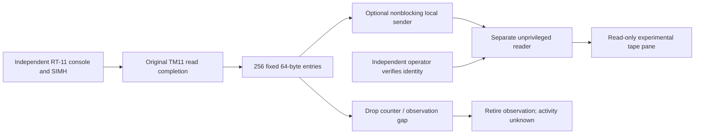
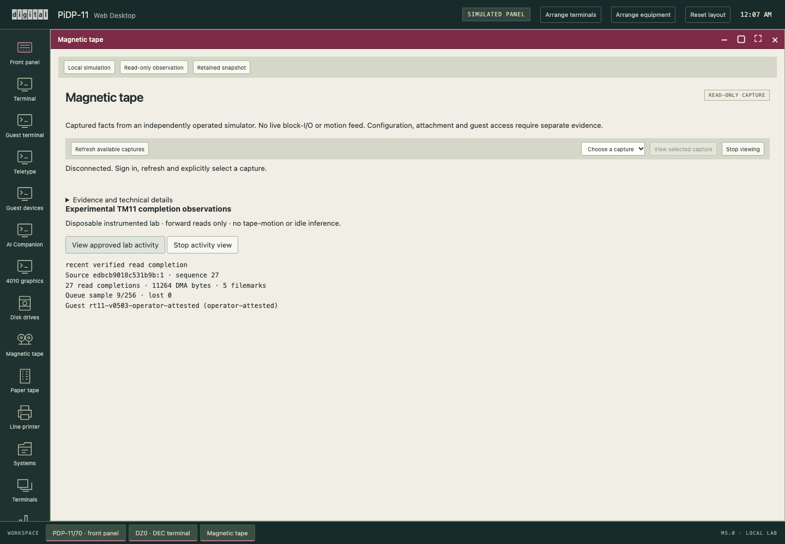

# M5.25 — Passive storage activity feasibility

Completed November 24, 2026. Engineering checkpoint:
`55c6629cabe2af79ea7b050f00394805d523f274`, followed by the active-stream crash
test in `0fc8132`. This is a disposable laboratory experiment,
not owner acceptance, production instrumentation or a new release.

**GO for further bounded TM11 laboratory development; NO-GO for ordinary-build or
physical deployment.** A small optional completion hook preserved the tested RT-11
results, controller status and separately tested interrupts. SIMH continued when the
reader was absent, stopped or killed. Observation failed closed on gaps and identity
changes. However, the separate reader used about 6.5 MiB, exceeding the proposed
1 MiB incremental-memory target. The 1% Pi CPU target remains unmeasured.

The ordinary Web Desktop retains its captured-storage interface. The experiment
lives entirely in [`lab/m525`](../../lab/m525/README.md), with no production import,
new monitor endpoint, remote panel control or browser media operations. Source
Alpha 1/2 and accepted checkpoints remain separate and unchanged.

## Backup, environment and identities

Before instrumentation, the M5.24 private evidence was backed up to the selected
NAS as `M5.25-incremental-20261124T064928Z`: 2,703 files, 339 directories, six
symlinks and 373,080,685 logical bytes. The 384,715,264-byte PAX archive has SHA-256
`c8d438a4c5714bd9ac0652fa903925e74aa3081920cd20a6cde56fb699de7973`;
manifest SHA-256 is
`ed3a168e6a1531d91b8db510d87620bb554e88e35e90543a8ccfe2ff4c7bd6f2`.
Independent archive readback checked every file hash, size, mode, owner, nanosecond
mtime, supported extended attribute and symlink target. Creation/change times were
recorded; a full restore was not attempted. The archive retained 3,048 AppleDouble
metadata entries and no active sockets/special resources. Earlier backups were not
changed. The private project-level recovery pointer is
`Backups/WebDesktop-M5.25-incremental-20261124T064928Z/backup.json`; Git does not back
up this evidence. This incremental backup predates the new M5.25 experiments.

Experiments used fresh ARM64 Linux containers on the Mac, kernel
`7.2.12-orbstack`, GCC Debian `12.2.0-14+deb12u1`, and retained image
`sha256:564662bf3489f350e39b39ec46751454568689b0d8dd0d24b4527971c2f3836c`.
Runtime containers used UID/GID 501:20, network none, read-only root, dropped
capabilities, no-new-privileges, 128 MiB memory with equal memory-swap total,
two CPUs, 128 PIDs and bounded temporary space. Only owned working media were
writable. These are development tools, not deployment dependencies.

Both builds derive from original PiDP source revision
`26d20beda0c6b5a1d3a5cb3d7a4dd494e02bff75`, using the same original `quickmake`
optimization/configuration: `-O2`, C99, empty `NETWORK_OPT`,
`DISPLAY_OPT=-DUSE_DISPLAY` and the established lab libraries. The experiment adds
one C module to the instrumented build. No original installed source or executable
was replaced.

| Artifact | SHA-256 |
|---|---|
| Fresh unmodified control binary | `56c373444d9bc3faf7bf1c3eb4087a43c49b882e42ede8a2cea986cc421d7b79` |
| Qualified instrumented binary | `9766a177fbba5c20e2c36bfdd320338606dba3bd9282336f0fde90065b9fb86e` |
| Final bounded Go reader | `87bf3e60abc10bbdcbec85b95c80adaca36677438877e2044c5e81df7dc620fd` |
| Reader used in genuine browser campaign | `1fcdc320b385f2b850c416c88c818f4e9b6ed9c0eb2103995ad45e8d89102a49` |

[Build identity](../../lab/m525/results/build-identity.json), complete
[control](../../lab/m525/results/control-source-manifest.json) and
[instrumented](../../lab/m525/results/instrumented-source-manifest.json) source
manifests, and the [exact diff](../../lab/m525/experimental.patch) make these
identities reviewable. All 270 control-source files matched the retained original.
The preserved earlier original executable remains unchanged; rebuilding produces
a different executable identity because build metadata/path can differ.
The final reader adds an eight-connection limit after the genuine browser campaign;
it passed a separate fresh genuine enabled run and connection/race tests. The earlier
six-mode reader binary hash was not separately captured. Do not assign the final
reader hash retrospectively to those runs.

## Source review and selected completion path

The [prior proposal](../technical/storage-activity-proposal.md) remains the source
review of RP/RL, `sim_disk.c`, `sim_tape.c`, FrontPanel and remote console. This
experiment selects **TM0/TM11 READ FORWARD**: its synchronous service callback has
clear DMA accounting, original status updates and an established genuine RT-11
MT/PIP workload. RP's `rp_go`, `rp_svc` and `rp_io_complete` span asynchronous stages;
RL/disk and other tape families need their own completion review. No second
controller was instrumented.

In pinned `PDP11/pdp11_tm.c`, scheduling a request is distinct from `tm_svc`
servicing it. The hook runs after original DMA byte-count/address updates,
`tm_set_done` and `tm_updcsta`. It copies the requested count, bytes actually
accounted by the original read path, final MTS/MTC and TM interrupt-request bit.
Normal filemarks can set the controller error summary; zero transferred bytes does
not by itself mean a failed device. Rewind, spacing, writes, immediate rejected
commands and early unattached returns are outside the event subset.

Host file access is neither the controller completion nor browser visibility.
Debug output still formats/writes FILE streams; it is not a bounded feed. FrontPanel
sampling changes collection state, and named EXAMINE can call REALCONS callbacks.
Those mechanisms are not used for unattended observation. Named register captures
in the tests occur only at independently verified halted boundaries, with REALCONS
disconnected. The original [source tree](https://github.com/obsolescence/pidp11/tree/26d20beda0c6b5a1d3a5cb3d7a4dd494e02bff75/src/02.3_simh/4.x%2Brealcons/src)
and the manifests identify the reviewed implementation.

A first candidate called `sim_gtime()`. Source review found that it performs
`UPDATE_SIM_TIME`, mutates scheduler accounting/queue state and takes `AIO_LOCK`.
That candidate was rejected even though its guest bytes matched. The qualified
candidate instead adds a read-only `m525_service_time()` accessor returning
`sim_time`. Original `sim_process_event` accounts simulation time before invoking
the TM service; the synchronous CPU-thread hook copies that already-accounted
value. It does not alter the scheduler. This rationale does not automatically
qualify another controller's asynchronous completion thread.

## Event and observer contract

The fixed ring is **16,384 bytes**. An acquire/release atomic try gate protects slot
publication and copying; a busy gate or full ring drops the newest event instead
of waiting. The internal worker copies at most 32 entries before releasing the
gate. The external consumer never holds it. Loss increments use at most four CAS
attempts; excessive contention or generation/sequence/loss exhaustion marks the
producer faulty rather than wrapping. Native lock-free atomics are required.
Concurrent-producer fixtures exercise the design; actual TM service production
remains on SIMH's CPU thread.

No completion-path allocation, file write or socket operation was added. A host
monotonic-clock read has a real cost. Startup can allocate/get random data; it is
not claimed to be wait-free. The optional worker has a 128 KiB stack and attempts
outgoing nonblocking Unix datagrams every 100 ms, at most 32 events plus a header
(2,112 bytes). Reader absence/send failure loses events, not guest progress.
SIMH gains no listener. Without `PIDP11_M525_ENABLE=1`, no worker/socket/events start;
the instrumented build still contains the disabled hook and accessor call.

Each 64-byte record has a source nonce, controller/unit, attachment generation,
sequence, simulated ticks, host monotonic timestamp, read operation, requested and
completed bytes, original status/command, interrupt flag and loss counter. It
contains no guest payload, arbitrary path or command. This native little-endian
ARM64 laboratory format is not a stable interoperability protocol. Simulated ticks,
host elapsed time and physical tape motion are different quantities.

The reader checks Linux peer credentials against the independently identified PID,
then exact instance/generation, shape, sequence, loss, finite times and byte bounds.
It starts unapproved. Only bounded local stdin accepts an explicit fresh operator
attestation; HTTP cannot approve anything. A fresh reader never inherits approval.
Gaps, corruption, changed identity, exhausted counters, events older than 500 ms or
heartbeats older than 300 ms retire observation. No automatic reconnection occurs.
At most 256 evidence events are retained. The final loopback HTTP server permits
only eight concurrent connections and bounded timeouts; summaries stay below 4 KiB.
State locks are released before network writes.

The reader is trusted code under the same unprivileged lab UID as SIMH, not a
security boundary against malicious same-UID software. PID credentials are not
historical guest identity. Attachment attempts/detaches advance the generation;
a guest transition without an attachment change cannot be detected automatically.
The independent operator must retire observation before such a transition. This is
an unresolved production blocker, not proof of automatic lifecycle safety.

## Genuine guest and independent interrupt comparisons

The guest was **RT-11SJ (S) V05.03**, the original supplied MT.SYS handler and
PIP.SAV/DIR utilities identified by [M5.24 hashes](../../lab/m524/results/guest-tools.json).
TM CSR was 172520, vector 224, with the authored readonly 512-byte-label tape on TM0
and a fresh RL02 working disk. Original console commands were `SHOW CONFIG`,
`REMOVE CT`, `INSTALL MT`, `SHOW DEVICES`, `DIR MT0:`,
`COPY/IMAGE MT0:RECA.TXT SY:READA.TXT`,
`COPY/IMAGE MT0:RECB.TXT SY:READB.TXT`, twenty more `DIR MT0:` operations and
`TYPE READA.TXT` after reader shutdown. Removing unused CT supplies the needed handler
slot; no historical driver was rewritten.

Six fresh modes passed: unmodified control, instrumented/disabled, enabled reader,
reader absent, reader killed, and delayed reader. All recovered the exact expected
512 + 1,024 bytes by independent filesystem extraction. All six **entire final
working disks** had SHA-256
`1c11612c61e538316893bb70ad1dced66386f43d6352568ed3caa6f6e3d8b9c7`.
The readonly tape remained
`8841da1560ce50d73165b659fb437c5de7d61fcd484993be2247ff05ffde09bb`.
After the directory operation rewound to beginning-of-tape, captured status matched
in every mode: MTS `000145`, MTC `060200`, byte/address counts zero, UST `000144`,
position zero. Each accepted guest exited zero. See
[guest comparisons](../../lab/m525/results/guest-comparisons.json) and
[whole-disk identities](../../lab/m525/results/working-media.json).

Enabled observation recorded **135 read completions, 57,344 DMA bytes, 23 filemarks,
sequences 1–135 and zero loss**. All events copied an asserted TM interrupt request;
that bit alone is not proof of interrupt service. A separate authored PDP-11 CPU
program enabled TM interrupts, serviced four through vector 224, and reached R0=4.
Its 44 authored DMA bytes, saved status words and final controller facts were
identical in control/disabled/enabled builds. The
[interrupt differential](../../lab/m525/results/interrupt-differential.json) is a
CPU/device test, distinct from the historical guest utility test.

## Independence and failure results

| Case | Evidence type and observed result |
|---|---|
| No reader | Genuine RT-11 completed; a later unapproved reader reported 135 lost events and accepted none |
| Reader stopped or killed | Genuine console/work continued; the guest-mode kill was between commands; restarted reader stayed unapproved, including through another DIR |
| Reader killed during active completion output | Separate authored original-C CPU stream: kill after three observed reads; all 200 interrupts serviced, clean exit and unchanged input |
| Fresh reapproval | Independent SHOW CONFIG repeated; exact source approved locally; six new events/2,560 bytes accepted after 114 recorded lost events; old history not adopted |
| Delayed reader | Genuine guest finished; resumed observer retired on expired heartbeat |
| Ring full/contention | C fixtures dropped without waiting; loss/fault was explicit; ASan/UBSan passed |
| Multiple producers/consumer | C concurrent fixtures passed; release/acquire ordering used; C ThreadSanitizer not run |
| Malformed/duplicate/out-of-order/source or generation change | Go fixtures retired and returned unknown; no resumed authority |
| Sequence/generation/loss exhaustion | C fixtures marked fault instead of wrapping |
| Media replacement | Actual idle-halt/detach/attach of a different authored readonly tape retired the reader; WebKit displayed retirement; guest was not resumed |
| Guest identity change | Go fixtures reject changed approval on an approved/retired stream; unreported real guest changes remain undetectable |
| Delayed browser replies/disconnect | Three-engine intercepted fixtures reject late repaint; final independent expiry timer clears activity before the next request deadline |

The [active-stream SIGKILL test](../../lab/m525/results/active-crash.json) fills the
otherwise distinct crash-during-output case: it runs an authored PDP-11 instruction
loop, with explicit instruction delays between reads, against authored readonly
tape. The final reader had accepted three genuine completions when killed; the CPU
then reached all 200 serviced interrupts and quit cleanly with input unchanged.
This is CPU/device evidence, not historical guest execution.

The six-mode console checks occurred after the actual reader process stopped.
The browser replacement run is different: after halt/replacement it remained halted
and quit; it does **not** establish a resumed console after that boundary. Its private
raw helper originally retained an incorrect copied boolean; the public sanitized
result and current helper mark that claim false. Original raw evidence is preserved.

REALCONS code and all other controllers remained byte-identical. Tests captured
REALCONS as disconnected; no panel RPC server, physical lamp/switch operation or
connected coexistence comparison occurred. Console independence is demonstrated
for these workloads. Connected REALCONS timing and physical coexistence remain
unqualified. No physical Pi, SSH or GPIO access occurred.

## Measurements and browser presentation

Linux `/proc` CPU counters have 100-Hz resolution. The short intervals below include
mode-specific waits/reader handling; RT-11 spins near one core. They are recorded
CPU usage, **not a valid causal percentage-overhead estimate**. Console timing uses
20 ms read slices, so apparent DIR throughput differences are dominated in part by
harness quantization. No guest device service-latency claim is made.

| Mode | Interval (s) | SIMH CPU ticks | Ending RSS (KiB) | Median DIR return (ms) | DIR commands/s during measured command intervals |
|---|---:|---:|---:|---:|---:|
| Control | 0.930 | 93 | 13,136 | 40.12 | 30.31 |
| Disabled | 0.822 | 82 | 13,332 | 22.01 | 34.59 |
| Enabled | 1.044 | 105 | 13,172 | 21.66 | 38.47 |
| Absent | 0.834 | 84 | 13,176 | 23.94 | 31.59 |
| Killed | 1.053 | 105 | 13,320 | 23.74 | 33.73 |
| Delayed | 1.489 | 149 | 13,156 | 41.92 | 29.55 |

Raw samples include RSS/HWM. The enabled reader reached 6,320 KiB RSS/HWM and one
sampled CPU tick. The final eight-connection reader reached **6,644 KiB RSS/HWM**,
eight threads/eight descriptors and zero ticks in that short interval; zero sampled
ticks is not zero CPU cost. SIMH changed from one thread/seven descriptors to two/eight.
The ring has 256 slots; the enabled campaign's maximum sampled queue at drain was
30, with maximum event-to-reader delay **99.18 ms**. This sampled queue statistic is
not a continuously measured high-water mark. See the
[bounded event record](../../lab/m525/results/qualified-enabled-events.json) and
[final reader run](../../lab/m525/results/final-reader-enabled.json).

The private browser overlay uses the existing Magnetic tape observation window,
with explicit Start/Stop, one sequential request at a time, at most ten updates/s,
200 ms request timeout, identity/sequence/loss validation and unknown rather than
inferred idle. The final viewer also expires recent activity independently of requests
and disconnects a hidden page. Browser timer suspension is not a real-time guarantee.
There is no moving tape animation or media-control route.

| Genuine browser campaign | New-sequence samples | p95 visible-age upper estimate | Observed renders/s |
|---|---:|---:|---:|
| Chromium | 19 | 194.43 ms | 9.38 |
| Firefox | 19 | 173.61 ms | 9.43 |
| WebKit | 20 | 145.38 ms | 9.21 |

These estimates add source event age at reader serialization to the full browser
request duration. They conservatively bound visible age for sampled summaries,
without subtracting clocks on different hosts. They do not measure every event's
first visibility or physical Pi latency. All eligible new-sequence samples were
retained; the pre-work sequence was excluded, not slow samples. Genuine cancellation
was exercised in Chromium/Firefox; actual replacement/retirement in WebKit. The
unused branch booleans in the result JSON are false because those particular checks
were not run in that engine, not because their assertions failed. Synthetic final
cancellation/expiry fixtures ran in all three engines.

[Browser measurements](../../lab/m525/results/browser-results.json) and
[final fixtures](../../lab/m525/results/final-browser-fixtures.json) distinguish
those scopes. The screenshot below is the genuine Chromium campaign, before the
final expiry refinement, not a mock or physical hardware capture. The snapshot UI
above it remains separate; only the explicitly labeled experimental pane shows events.

| Proposed target | M5.25 finding |
|---|---|
| 16 KiB fixed ring, no device-path waits | Implemented and tested; explicit host-clock/atomic cost remains |
| ≤1 MiB incremental activity memory | **Not met by the standalone reader**; possible reuse of an existing Go runtime is unmeasured |
| ≤1% of a Pi 3B+ core | **Unmeasured**; short Mac/ARM64 intervals do not qualify it |
| p95 event-to-view ≤250 ms at ≤10 Hz | Sampled lab summary estimates below target; small campaigns, not every-event or physical acceptance |
| Future enforced 96 MiB companion, zero swap | Unchanged requirement; the 128 MiB whole-lab bound does not replace it |

## Rejected attempts and validation

Failures remain in private `.research/m525/`; none was overwritten or converted into
successful evidence. An initial patch-match assertion stopped before writing/building.
The first complete instrumented candidate used unsafe-for-this-purpose `sim_gtime()`;
its six runs had already completed when it was rejected, and are excluded from
acceptance. Its identity is retained in the build record.

A later control harness mistook a period in a partially echoed TYPE filename for
the RT-11 prompt. That run was stopped/preserved; an anchored line-ending prompt
check was used only with new working copies. A ring-test binary could not execute
on the deliberately noexec `/tmp`; the constraint stayed intact and the test ran
from owned `/work`. Initial Go/TypeScript syntax/name issues were corrected before
qualification. The original browser inline injection was refused by CSP; a separate
same-origin script fixed the harness without weakening CSP.

The first browser latency calculation incorrectly filtered slow samples. A fresh
second campaign retained all eligible samples. Its request counter then included
later lifecycle actions outside the timing interval; that rate was discarded in
favor of the aligned render count. The current driver captures the request count
at the correct boundary. A final review added independent label expiry; its three-
engine fixtures passed separately. It did not rerun the genuine latency campaign
or change the measured simulator/reader binaries. The TypeScript CLI initially
required its explicit `--ignoreConfig` option; compilation then passed.

Validation: Go vet; uncached Go race tests across 25 packages; final observer race
and connection-limit recovery; Linux ARM64 vet/build; strict TypeScript; 106 frontend
unit tests; ordinary frontend build; original-C three-mode interrupt differential;
six genuine guest modes plus recovery/late-reader/final-reader campaigns; an
actual reader SIGKILL during an ongoing 200-read CPU/device stream; C ring
ASan/UBSan/concurrency/overflow tests; three genuine browser engines and three-engine
synthetic cancellation/expiry tests. The ordinary full 231-case browser suite was
not rerun because the ordinary frontend did not change. C ThreadSanitizer was not run.
[Machine-readable test scope](../../lab/m525/results/tests.json).

A fresh detached checkout of `55c6629` passed offline dependency installation,
ordinary embedded frontend/Go application build, uncached reader race tests, Linux
ARM64 reader cross-build and strict lab viewer compilation, with no private inputs
and a clean tracked tree. A separate fresh patch application reproduced all 221 files
in the qualified simulator subtree byte-for-byte and refused repeat application.
Upstream whitespace in unified-patch context is retained intentionally; whitespace
checks exclude only that exact patch file. No original source was reformatted.

## Preservation, handoff and next milestone

All 26 owned M5.25 experiment containers, including rejected attempts, were stopped
and removed after preserving evidence. Accepted guest runs exited zero. Owned
readers, relays and preview/fixture servers stopped. The 22 preexisting containers
and their seven running states were preserved. Original RT-11 and V7 base hashes
and file metadata were rechecked; the RT-11 base remained 10,478,080 bytes with its
recorded mode/mtime and SHA-256
`543277ee81fb4c024d19242bf6d6a04c81a257c48fe4cece256a42de3fe8dd98`.
[Preservation record](../../lab/m525/results/preservation.json). No original media,
SIMH/REALCONS installation, launcher or GPIO logic was modified. Interoperability
0.1 and the M5.23.1 proposed 0.2 contract were unchanged. Published source excludes
guest disks, binaries, credentials and complete private transcripts.

The decision is deliberately narrow: the observed TM11 read path is useful and
bounded enough for continued lab study. It is not a production performance or
security qualification, a general storage feed, automatic guest identity, or an
upstream-approved patch. Further activity work must address reader memory,
representative CPU measurements, authenticated production transport, automatic
or reliably supervised lifecycle retirement, asynchronous controller semantics
and connected REALCONS timing before promotion.

**Recommend serial communications, virtual modems and isolated networking next.**
Inventory original SIMH serial/multiplexer interfaces and each guest's installed
communications tools; select one genuine two-endpoint transfer in disposable media;
prove independent console operation, explicit connection ownership and disconnect
behavior before offering browser controls. Keep it local by default and distinguish
virtual links from physical serial ports or external networks. Broader storage,
physical integration, new releases and outside connections need separate scope.
