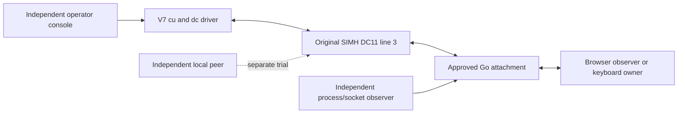

# M5.26 — Genuine serial communications

**Engineering result, November 24, 2026 (records cross into November 25 UTC):**
UNIX V7 exchanged distinct text in both directions through its original `/bin/cu`
and emulated DC11 line 3. An independent Python peer and then Chromium, Firefox
and WebKit received guest output and delivered separately identified input to the
guest's own console. During transfer `cu` occupied the independent guest console; shell responsiveness
was checked after exiting it, not through a simultaneous second login.
The new Communications window uses the existing terminal
bridge, explicit keyboard ownership and approval generations. No physical Pi,
production network or public guest service was accessed.

This qualifies a small ASCII text workflow. It does not qualify binary transfer,
a full virtual modem, guest TCP/IP, hardware flow control or physical deployment.
The [runbook](../../lab/m526/README.md) and [sanitized measurements](../../lab/m526/results/)
separate the genuine runs from browser fixtures. Private console recordings and
working disks remain in `.research/m526/`.

## Preservation and environment

Work started from `a7f6e56558abdd7d265eadbe935b6838f081af67`; the engineering
checkpoint is `ba1e5819a8365e00688a6c3ea2f0222c88d0333f`. Before experiments,
M5.25 evidence was independently reread into the owner-selected NAS backup
`M5.26-incremental-20261125T011230Z`: 1,998 files, 233 directories, 351,968,268
logical bytes; archive 358,692,352 bytes, SHA-256
`c45df8ed270e71710c39fc5bde444d247c7ebbf75256b137423d804e3d3f749b`.
Every file hash and supported metadata matched; no full restore was performed.
The private recovery pointer is recorded in RESUME. Older backups were preserved.

The lab used Mac-hosted OrbStack ARM64 Linux and original SIMH/REALCONS
V4.0-0 from upstream revision `26d20beda0c6b5a1d3a5cb3d7a4dd494e02bff75`.
Executable SHA-256:
`f38167163e37dbb9578f33cc58f9740e3a6408829c4e357637b76835864c8237`.
REALCONS remained disconnected. The container had only loopback, no published
ports, a read-only root, dropped capabilities, no privilege escalation and a
non-root user. The browser used the existing fixed TLS relay through `docker exec`;
this development adapter is not part of deployment.

The first guest-only trials used a 128 MiB lab limit. Before any Go service run,
that same lab was tightened to **96 MiB total memory and zero swap**, including
SIMH, Python and the bridge. The service's `-require-memory-limit` check passed;
`GOMEMLIMIT=72MiB` and `GOMAXPROCS=2` were set. No limit was relaxed to pass a test.

Only a disposable copy of the retained V7 RP06 disk was writable. Original SHA-256
`fc04dab1e7f2fbf3ea4b44603ed2c9d6ba15f4f86c702d4a27a1dac725966f39`, size
174,423,040 bytes, mode and nanosecond modification time matched after shutdown.
The original simulator/source files were read, not modified. M5.25 instrumentation
and accepted interoperability contracts were not changed.

## Authentic interface inventory

These are distinct layers: PDP-11 device registers, a guest driver/application,
a SIMH line endpoint, and the modern host transport. A socket is not a modem or
a guest network stack. Exact inspected source hashes are in
[source-inventory.json](../../lab/m526/results/source-inventory.json).

| Interface in the pinned source | Lines and control behavior | Guest evidence and attachment boundary |
| --- | --- | --- |
| TTI/TTO console | Independent simulator console, not a guest line socket | V7 boot, `cu` invocation and final shell checks used a separately owned PTY. Browser routes never exposed the SIMH monitor. |
| DLI/DLO, KL11/DL11-style | Up to 16 additional interfaces; DATASET supports ring/carrier/CTS, DTR transitions and RTS register state. DLO offers character conversion modes. | No new guest utility qualification on DLI. Requires matching guest driver, CSR/vector and an explicitly selected line. Do not substitute for DCI by renaming metadata. |
| DCI/DCO, DC11 | Up to 16 interfaces; four enabled here. DATASET enabled in original defaults; socket arrival/loss drives emulated carrier/ring/CTS behavior; DTR drop can hang up a line. DCO supports UC/7P/7B/8B conversion. | **Genuine M5.26:** V7 `dc` driver, `/dev/tty03`, original `/bin/cu`, line 3 listening on fixed loopback, independent peer connecting inward. `set dco3 7b` and `notelnet` remove SIMH printable filtering/Telnet negotiation, not guest line processing. |
| DZ, DZ11 multiplexer | Eight lines per mux; pinned default 32 lines, source maximum 32 muxes. Line parameter registers describe speed/parity/character length; DTR/carrier/ring are device semantics. | Retained 2.11BSD DZ login/vi evidence predates M5.26. RSX terminal subsets also predate this work. Their installed outbound communications utilities were not newly qualified. |
| VH, DHU/DHV | Four muxes by default; 16 lines per UNIBUS DHU or eight per QBUS DHV. Source includes DTR/RTS and carrier/DSR/CTS/ring status, DMA and buffering. | This is **not DH11**. No separate DH11 device appeared in this runtime inventory; no VH guest path was qualified here. |
| DMC, DUP, DPV, KDP | Synchronous communications devices appear disabled in the runtime inventory | No guest protocol, peer or end-to-end result qualified. They are not interchangeable with asynchronous `cu`. |

For any new line, an independent operator must first verify the guest's actual
driver, device nodes, register/vector mapping and absence of a competing getty or
application; configure the fixed loopback listener; verify its process/socket
ownership; then issue fresh local approval. Changing a listener, line, simulator
or guest requires retirement and a new approval. No automatic discovery is added.

SIMH's TMXR library also supports Telnet, explicit outgoing connections, serial
ports and modem-bit facilities in suitable device configurations. None authorizes
arbitrary browser dialing. No physical serial port, passthrough modem signals,
parity error injection, hardware handshake or calibrated baud pacing was tested.

## Guest application and exact transfer

V7 booted single-user; getty did not compete for tty03. Its `/etc/ttys` lists
console and tty00–03 as enabled for ordinary multiuser operation. `/bin/cu`,
`stty`, `cat` and `dd` were read-only hashed from the original root filesystem;
see [v7-tools.json](../../lab/m526/results/v7-tools.json).

The initial `/usr` absence was an unmounted filesystem, not proof of missing
software. After the transfer checks, the operator mounted `/dev/rp3` on `/usr`
using the command in this guest's `/etc/rc`, on the working copy only. This made
`/usr/src/cmd/cu.c` and `/usr/sys/dev/dc.c` available for inspection. Final checks
found `/bin/cu`; `/bin/tip`, `/bin/netstat`, `/bin/telnet`, `/etc/ifconfig`, and
`/usr/bin/{cu,tip,uucp,netstat,telnet}` were absent at those exact paths. This is
not an exhaustive inventory of every program in the distribution.

The successful initial guest command was:

```text
cu 0 -l /dev/tty03 -a /dev/null -s 9600
```

The explicit `/dev/null` calling-unit substitution was necessary because
`/dev/cua0` did not exist. It discards the calling-unit write: there is no phone
call, external dial or authentic automatic calling unit. Source inspection showed
that unsupported `9600` falls through to `B300`; later commands used `-s 300`.
The source's ioctl calls and observed echo/canonical behavior require further
review before claiming that its intended raw-line configuration took effect.
There was no physical baud-rate measurement.

| Actual sample | Bytes and transformation | Independent check |
| --- | --- | --- |
| Guest `M526-V7-CU-TO-PEER-735A` plus console Return | Peer received 24 bytes ending LF | Python peer capture SHA-256 `6ee9b9c27e6af11b6b0633465b8024183601f77013cb50a97c58e0523162e7fa` |
| Peer `M526-PEER-TO-V7-CU-91CF` plus CRLF | 25 sent bytes; guest console rendered 26, ending CRCRLF | Original guest console and hex values in [first transfer](../../lab/m526/results/cu-transfer-one.json) |
| Explicit fresh peer connection | 28 guest-to-peer bytes; 27 peer-to-guest bytes, rendered as 28 | Distinct messages/hashes in [reconnect](../../lab/m526/results/cu-reconnect.json) |
| Three actual browsers | Each sent a unique text line and received a different guest-originated line | Independent original console plus captured WS bytes and visible terminal, [results](../../lab/m526/results/browser-results.json) |

Peer input was also echoed back on the serial line. That echo is not the receipt
proof: the original guest console independently showed `cu` printing the distinct
peer text. Browser Return sends CR; in this observed guest state CR alone remained
buffered. **Workstation → Line feed** supplied LF and completed the line. Guest
console Return became LF at the serial peer. No arbitrary binary transparency is
claimed, and a terminal's configured speed does not prove timed transmission.

## Session model and narrow interface

The Communications equipment entry reuses the existing guest terminal window,
authentication, renderer, four-window limit, observer mode and keyboard lease.
It lists only generation-bearing endpoints with a valid provisioned serial
profile. A normal terminal remains usable without such a profile. There is no
host/address entry box and no modem-light animation.



`SerialProfile` carries simulator-instance label, operator-attested guest,
controller, unit, line, guest device, application, peer and framing. The server's
existing configured address remains private; its public endpoint ID identifies the
approved local endpoint. The line's approval generation binds the current
attachment, while epoch/sequence/lease fence individual keyboard ownership.
The initial accepted profile is DC11 unit 0, line 0–15 with matching `/dev/ttyNN`
and ASCII7 raw-socket transport. This validation rejects contradictions; it does
not inspect historical registers or prove all allowed line numbers were tested.
Only line 3 with V7 `cu` has this milestone's new application evidence.

State frames optionally carry cumulative socket bytes received/written, an exact
integer saturation flag, per-viewer outstanding output bytes and a sample time.
These counters include line echoes and any other actual socket data. Written bytes
mean accepted by the host socket, **not consumed by the guest**. Partial failed
writes count only their committed prefix, then retire without replay. Values
saturate at the browser's maximum exact integer. No unbounded sample history is
kept. Carrier, DTR/DSR/CTS/RTS and physical baud are expressly unobserved.

The window requests read-only status once per second. This operation cannot acquire
or renew keyboard ownership. After three seconds without a valid sample, current
transport state becomes unknown; disconnect retains labeled last-known counts
without authority. The existing state/message identifies connection loss, and
operator detach/supervision expiry revokes the actual attachment. Closing a view
is explicitly distinguished from stopping the bridge. Guest identity remains an
operator assertion: an unchanged process/socket does not prove an unchanged OS.

## Modem and isolated-network findings

`lab/m526/modem` is a separate, bounded, modern laboratory personality. It has no
network API. Its 80-byte command buffer recognizes AT, ATE0, ATI, ATH and ATDLOCAL;
LOCAL enters an in-process ASCII echo peer. Other ATD strings produce NO CARRIER,
unknown commands ERROR. Its one-shot test executable connects only to the fixed
loopback DC11 line in a verified network-none environment, with a 60-second
absolute deadline and 16 KiB input limit. It is excluded from ordinary deployment.

A genuine V7 attempt returned OK for AT, then repeated ERROR feedback. The guest
line's observed echo and incomplete raw-mode setup are consistent with a response
loop, but its exact source/binary cause is not proven. The test was stopped; the
peer subsequently reached its deadline. **No successful guest Hayes session or
LOCAL data-mode exchange is claimed.** Host-only unit tests cover LOCAL, rejection
of arbitrary host/phone dial strings, oversized/malformed commands and fresh state.
There is no escape guard timing, speed negotiation, dial routing, BUSY arbitration,
DTR hangup implementation, hardware flow-control qualification, audio or lights.
These require separate device/application evidence before a modem UI.

The pinned original build reports **“no Ethernet”** and `show ethernet` reports
network support unavailable. XQ/XQB (DEQNA/DELQA) and XU/XUB (DEUNA/DELUA) device
models are listed, but no host Ethernet backend is compiled into this binary.
No Ethernet attach or network test was attempted. Serial TCP transport is not
guest TCP/IP, and no DECnet result is claimed.

Retained 2.11BSD records show DZ gettys and network-type pseudo-terminals; they do
not establish a running network stack, matching kernel adapter driver or a usable
outbound serial utility. Existing RSX profiles mention optional Ethernet but do
not establish an installed DECnet configuration. RT-11 remains application-level
terminal I/O and RSTS/E console-only. Those guest networking capabilities remain
explicit inventory gaps, not inferred successes.

A next isolated Ethernet lab needs: (1) a separately identified, reproducibly
built original-source simulator with the required Ethernet backend; (2) a disposable
guest whose installed kernel driver, utilities and protocol configuration are
actually inventoried; (3) a private virtual link confined to a network namespace,
no production interface, host bridge, NAT or default route; (4) two explicit test
addresses and packet-level evidence; and (5) independent console and retirement
checks. This milestone leaves the accepted original executable unchanged. A
configuration claiming a working Ethernet attach with this binary would be false.

## Failure coverage and limits

| Case | Evidence and result |
| --- | --- |
| Wrong controller/line and unbounded labels | New Go/TypeScript tests reject inconsistent profiles; they cannot discover a falsely attested but syntactically valid mapping. |
| Reused endpoint, changed generation, listener replacement, delayed attachment | Existing terminalbridge/terminalservice regression tests retain single-use approvals, replacement retirement and no replay. |
| Stale/unauthorized owner, observer input, revocation, lease expiry | Existing transport/HTTP tests plus new read-only status tests. Status does not extend authority. |
| Partial write, stalled receiver, slow viewer, incomplete transfer | Existing bounded-write/output-credit tests plus new prefix accounting test. Host fixtures, not proof of guest flow control. |
| Peer disconnect and SIGKILL | Genuine independent peer tests: `Lost carrier`; explicit `~.` returned to the guest shell. No automatic return to shell assumed. |
| Browser disconnect/reconnect | Genuine three-engine checks: guest attachment survived; deliberate reconnect was read-only with a fresh display. |
| Bridge stop/restart | Genuine service stop left original SIMH and console usable. Restart had a different service instance and zero attached lines. |
| Stale sample, malicious text label, observer polling | Three-engine intercepted fixtures: stale/unknown display, text-only labels, no arbitrary target, no implicit input. |
| Guest flow control, carrier bits, modem timing | Not qualified. Canonical buffering and echo observed. |
| In-place guest change without socket/process change | Still not independently detectable; stop bridge, retire approval and verify the new guest before attachment. |

Failed attempts are retained: absent `/dev/cua0`; separate `stty`/open-close trials
that caused line hangup; an unsuccessful background `dd` trial; initial newline
assertions that disagreed with actual bytes; a mistaken expectation that carrier
loss exits `cu`; the modem feedback; and a browser CR-only timeout. Completing the
pending browser line sent **only LF**, not a replay of its text. A subsequent
browser harness attempt tried to click a collapsed workstation control; another
encountered that viewer's ownership. Both were closed before the corrected
sequential three-engine run. No failure was converted into a success by silently
resending a guest command.

## Measurements and validation

Service RSS samples were 14,664 KiB and 12,832 KiB. One two-second idle CPU sample
used one 100 Hz tick, about 0.50% of one lab core. The two reported VmHWM snapshots
disagreed in ordering; they are retained without claiming a reliable peak-memory
measurement. At final sampling the process had eight threads and nine descriptors.
The shared 96 MiB cgroup reported zero OOM/max events and zero swap allowance.

One peer-to-console detection upper bound was 455.7 ms. Browser-input-to-console
upper bounds were 931.0 ms, 467.2 ms and 953.4 ms for Chromium, Firefox and WebKit;
these include automation, relay and file polling. They are not wire latency,
p95 figures or physical Pi estimates. The final sampled output credit was zero;
the largest browser sample count was 171 received/98 written bytes. No sustained
throughput or flow-control benchmark was run. Details: [resources](../../lab/m526/results/resources.json).

Validation includes vet, uncached Go race tests, TypeScript checks, 109 frontend
unit tests, production/embedded builds, Python decoder checks, genuine guest and
service-lifecycle trials and three-browser regression. The first full browser
run passed 228 tests; six embedded/fullscreen tests could not connect because the
separate embedded preview had not been started. All nine artifact tests passed on a dedicated local embedded build. The final
communications/guest suite passed 15 cases across three engines, including the
delayed-directory regression. These
fixtures are kept distinct from the three genuine guest runs. Those runs preceded
the final delayed-directory and negative-age guards; the guards were covered by
separate unit/browser checks. Both the tested service and final clean ARM64 build
hashes are retained; only source is published. Clean-checkout and
final preservation results are recorded in [validation.json](../../lab/m526/results/validation.json).

After the independent guest shell answered, three `sync` commands preceded the
independent operator's simulator stop and `quit` (exit 0). Owned peers, bridge,
supervisor, relay, previews and container were closed; the original media stayed
unchanged. Prior containers and checkpoints were preserved. No release, hardware
pilot, website deployment or third-party announcement was made.

## Next milestone

First resolve and test V7 `cu` line settings on a disposable guest: verify its
actual ioctl convention and device state, make echo/canonical behavior explicit,
and establish a received-file checksum plus bounded flow-control cases. Then
qualify the local modem subset, including carrier loss and command/data transitions,
before exposing modem equipment. In parallel, inventory a retained 2.11BSD kernel
and installed tools for a separate no-route Ethernet lab. Keep each transport's
claims and approvals distinct.
