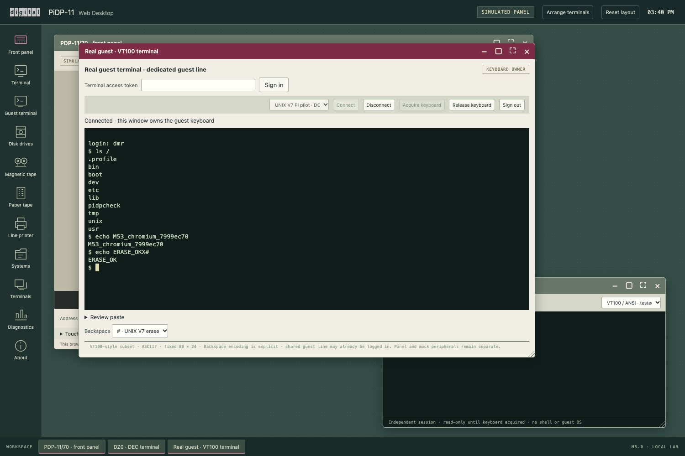

# M5.3 — first actual Pi browser terminal pilot

**2026-11-18 · Passed and shut down cleanly.** Chromium, Firefox and WebKit each ran genuine UNIX V7 commands through the Web Desktop on the actual Raspberry Pi 3B+, using its original installed ARM64 SIMH binary and a disposable working disk. The independent operator console remained usable while browser windows closed and while the bridge stopped/restarted. Original installation files and the original V7 disk were unchanged afterward.

This establishes **standalone installed-binary terminal compatibility**. The kit was unassembled; physical-panel coexistence, original-launcher integration and production deployment were not tested. No panel daemon, REALCONS connection, GPIO integration, service, autostart or boot-selection change was introduced.

*Actual Chromium capture through the SSH tunnel. The command output comes from the Pi-hosted V7 guest. The background front panel and peripherals remain simulated. The desktop's inherited M5.0 / LOCAL LAB footer is a legacy presentation label, not evidence of where this guest runs.*

## Implementation and evidence

The new [`cmd/terminal-pilot`](../../cmd/terminal-pilot/main.go) reuses `internal/terminalbridge`, `internal/access` and embedded browser assets. It accepts exactly one operator-configured endpoint, `unix7-dc0` at `127.0.0.1:40100`, and binds HTTPS only to `127.0.0.1:8445`. Neither address is browser-selectable. The separate `cmd/terminal-lab`, its network-none safeguards, and the bridge/ownership/control implementations were unchanged.

The pilot requires Linux and bounded owner-only regular configuration, credential and TLS files; symlinks and special files are rejected. It uses TLS 1.3, exact origin/Host checks, distinct observer/writer credentials, explicit keyboard leases and the existing bounded queues. It validates provisioning and reserves its listener before attaching to the guest. Connection failure is not retried automatically. Stopping the bridge sends no guest commands.

Only the Go executable and private provisioning files were copied to a new owner-private directory outside `/opt/pidp11`. No Docker, Node, development tools or new packages were installed on the Pi. The browser exposes no SIMH monitor, Screen, process-start/stop, media-management or panel-control API. Local SSH operator tools performed lifecycle actions independently.

| Artifact | Identity |
|---|---|
| Implementation commit | `b8e9b74`, following contributor-readiness `d52f75e` |
| Tested static Linux ARM64 pilot | 7,078,050 bytes; SHA-256 `da39882d97e8dcaaa92a8ca309b850a97663d68c6d1ce1890968910e0bcadfed` |
| Original installed simulator | `/opt/pidp11/bin/client11`; SHA-256 `340c3311d2be6a04a5f3cc05c97747f524be58de3ea4d13fec97991a09df454e` |
| Original upstream source revision | `26d20beda0c6b5a1d3a5cb3d7a4dd494e02bff75` |
| Guest | Installed Research UNIX Seventh Edition, copied while inactive; PDP-11/70, 1 MiB, RP06, eight configured DC11 lines, only line 0 listening |

The binary was built before the implementation commit: its Go build metadata records baseline `d52f75e` with a modified working tree. Those runtime changes became `b8e9b74`. The exact same executable bytes passed the isolated lab and Pi tests; later helper/documentation additions were not compiled into it. This is a measured pilot artifact, not a reproducible-build or stable-release claim.

Public evidence: [validation manifest](m53/validation.json), [genuine lab acceptance](m53/lab-acceptance.json), [genuine Pi acceptance](m53/pi-acceptance.json), [Pi measurements](m53/pi-measurements.json), and [private-evidence hash index](m53/evidence-index.json). Tokens, private host details, full configuration captures, disks and backup images remain outside the repository.

## Mac validation before Pi access

Go vet/race checks, strict TypeScript checking, all **46** TypeScript tests, the **one** transport fixture and all **45** browser regression cases passed. The embedded frontend and static ARM64 pilot built successfully. New pilot tests exercise fixed-endpoint rejection, malformed configuration, private-file handling, separate capabilities and certificate identity/lifetime. The provisioning helper produced private files and refused an existing directory without changing it.

The [M5.3 lab harness](../../lab/m53/README.md) booted a fresh verified public V7 disk in the existing disposable network-none Linux ARM64 environment. The original unmodified simulator served the same single DC11 configuration as the proposed Pi test. All three browser engines passed genuine command, observer, ownership, reconnect and independent-console checks, including bridge restart. The operator then ran three `sync` commands and exited SIMH cleanly.

Mac port 8080 belonged to Apple's existing WebDriver service. It was left alone. The browser artifact tests gained a `PIDP11_TEST_BACKEND` override and used a separately started mock service on port 8081. Accepted screenshots were preserved; new test captures stayed private. The old front-panel safety tests passed, but their unresolved production limitations were not reclassified or retested on hardware.

## Pi readiness, protection and startup

The authorized SSH alias reached the Pi with existing host-key checking; a separate interactive SSH recovery session remained open. Readiness found no emulator, panel daemon or Screen session, no conflicts on the proposed ports, approximately **718 MiB available RAM** and **15.62 GiB free storage**. The host remained headless, running Debian 13 Trixie ARM64 with kernel `6.18.60+rpt-rpi-v8`.

The owner reported a Vilros 5 V / 2.5 A micro-USB supply with inline switch. Initial temperature was **46.2°C**, firmware throttling flags were **0x0**, and accessible kernel records contained no voltage/throttling warnings. A conservative 70°C stop threshold was used for this short pilot; power/thermal settings were never changed. The retained golden compressed backup matched its recorded checksum; prior source-card and decompressed-image digest records also matched. No new card read or restore test was performed.

Before boot, 45 installation files were hashed, including runtime binaries, launchers, selection and guest configuration files. Small source records were copied privately. The inactive installed V7 disk was hashed, copied to a protected base, then copied again to a writable working disk. All three hashes matched and inode identities were distinct. No hard link or original-image attach was used. Temperature after copying was **48.9°C**, still with clear flags.

The original installed simulator started in the explicitly named `pidp11-m53-20261118` Screen session using a new private command file. The unchanged normal launcher was not called. The operator entered `boot`, `hp(0,0)unix`, Ctrl-D and the public image's `dmr` login through that Screen console. A real console echo confirmed access before browser testing. The single DC11 listener was verified as loopback-bound and owned by this simulator.

## Browser acceptance on the actual Pi

The Go service ran unprivileged under the owner's account, with the exact tested binary hash verified before startup. A Mac loopback SSH forward carried HTTPS to Pi loopback. A fresh one-day ECDSA certificate was checked against the explicitly provisioned certificate before the automated browser contexts were opened. Those isolated contexts accepted that temporary certificate; no OS trust store or personal-browser security setting was changed. This does not establish a general browser certificate-provisioning design.

Each browser engine:

1. Authenticated and connected to DC11 `tty00` read-only, then explicitly acquired the keyboard.
2. Executed `ls /` and a fresh unpredictable echo challenge. Acceptance required a separate guest output line, not just input echo.
3. Verified the V7 `#` erase mapping by correcting `ERASE_OKX` to an exact `ERASE_OK` output line.
4. Shared output with two other viewers; observer-only credentials could not acquire input, and a competing writer did not displace the owner.
5. Closed the owning browser, then exercised the independent Screen console and acquired control from another viewer.
6. Disconnected/reconnected to a fresh display without history replay or automatic ownership, and verified refresh did not resume a lease.

A separate stop/restart check detached the browser bridge while the same guest and independent Screen console continued running commands. Restart required fresh browser authentication, connection and acquisition. The browser did not own or attach to Screen. Native Safari was not tested; WebKit is not a substitute for that result.

## Short Pi measurements and power observations

The following samples use Linux process RSS and CPU ticks. **100% CPU means one core.** Bridge and simulator are measured separately; browser, SSH and monitoring overhead are excluded from their process totals. Sampling after the acceptance restart used the new bridge process, so its high-water RSS is not a whole-pilot peak.

| Workload | Duration | Bridge RSS start → end | Bridge CPU | Simulator CPU |
|---|---:|---:|---:|---:|
| No browser | 11.04 s | 10.41 → 10.41 MiB | 0.18% | 2.99% |
| One idle observer | 10.81 s | 11.48 → 11.48 MiB | 0.18% | 3.51% |
| Five harmless echo commands | 4.61 s | 11.50 → 11.90 MiB | 3.91% | 7.81% |
| Browser closed | 11.04 s | 11.90 → 11.90 MiB | 0.18% | 3.08% |

Five command/display samples took **766–782 ms**, including scripted typing, SSH forwarding, guest execution, rendering and polling. This is not added transport latency; five samples do not characterize tail latency. The sampled bridge met the existing ≤24 MiB idle / ≤48 MiB active RSS and <1% idle / <5% mean active single-core CPU targets during these brief windows. The 30-minute sustained workload, <100 ms p95 added-transport target and emulator-throughput regression target remain unverified.

All 33 periodic health samples had clear flags, with temperatures **48.3–51.5°C**. The later shutdown/hash verification snapshot reached **52.1°C**; final cleanup measured **50.5°C**. No active or historical throttling flags appeared in the recorded queries, and the final kernel review found no voltage/throttling warnings. This short result does not erase older undervoltage evidence or certify the supply for assembled hardware and sustained workloads.

## Shutdown and rollback

After browser ownership was released and clients disconnected, the identified pilot bridge received SIGTERM. The independent guest console ran `sync` three times, entered the SIMH monitor through its operator interrupt, and issued `quit`; `Goodbye` and Screen termination were observed. No broad process-name kill, ordinary launcher stop, reboot or power-off was used.

All 45 recorded installation-file hashes/modes, original Git status, and the original V7 disk's full hash and modification time matched their pre-pilot records. The protected base also matched. The stopped working disk was copied to a separately verified read-only after-run archive and retained privately. Temporary Pi writer/observer tokens and the TLS private key were removed after successful shutdown; the inactive pilot binary, configuration, operator tools and evidence remain in the private pilot directory.

The pilot Screen, simulator and bridge exited. The Pi's listening endpoints matched the pre-pilot snapshot. The Mac SSH tunnel and private monitoring harness were closed, and the recovery SSH session remained usable until deliberately exited. No service or automatic startup was installed, and no additional public listener remained.

## Corrections, limitations and next steps

Two operator-tool setup issues were corrected: an initially named `operator.py` shadowed Python's standard module before it could start the guest; it was renamed and invoked in isolated Python mode. The recovery terminal initially lacked Screen's clear-screen capability; `TERM=xterm` was supplied for that attachment only. Neither required a change to the installed simulator or guest image. There were no browser acceptance failures in either the lab or Pi run.

This pilot used one disposable V7 guest and one raw DC11 line. It did not test assembled switches/LEDs, physical serial hardware, original-launcher coexistence, other guests, hostile local users, direct LAN exposure, sustained load, or deliberate live network partitions/slow-observer faults. Existing lease/backpressure/fault unit tests remain relevant but are not presented as new live-Pi fault tests. The owner-local process is not final least-privilege service separation. A bridge failure may still hang up a guest login or application; CPU/console independence does not promise survival of every foreground task.

Next work should review optional original-launcher coexistence and durable provisioning separately, after the physical kit is ready for its own checks. Preserve the default installation and use deliberately selected copied media. Front-panel observation, remote front-panel control, distribution switching and serial hardware remain distinct milestones. The M4 START-release and blocked-RPC safety limitations are unchanged.
