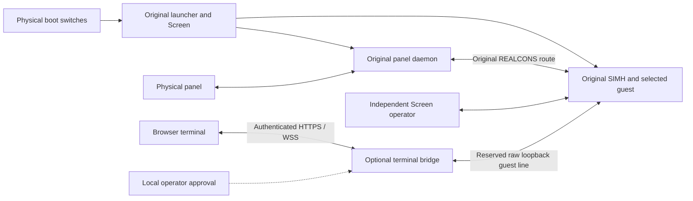

# M5.4 — normal-launcher coexistence preparation

**2026-11-18 · Mac-only preparation, not an integrated Pi acceptance.** Keep Oscar's launcher, Screen console, SIMH/REALCONS and physical panel authoritative. Add a deliberately selected, copied UNIX V7 profile with one reserved guest terminal line only in a separately authorized pilot. An optional bridge may attach to that line; it must never start, stop or select the emulator or guest.

The owner now reports an assembled PiDP-11/70 passing initial LED, switch, HALT/CONT and rotary-encoder tests. The normal launcher read the physical switch register, booted RT-11SJ V05.03, and accepted `DIR` and `SHOW CONFIG`. These are owner-reported results supplied for this milestone. No Pi connection, inspection, hardware test or installation change was performed in M5.4. The physical-only machine remains the fallback.

## Evidence and the change from M5.3

Review used the retained [M5.1 inventory](M5.1.md), [M5.3 report](M5.3.md), local cached original source at revision `26d20beda0c6b5a1d3a5cb3d7a4dd494e02bff75`, and the existing [architecture decisions](../development/DECISIONS.md) and [independent-access decision](../decisions/0004-independent-access.md). Private captures were read locally; no new remote evidence was collected. Historical milestone reports remain unchanged.

| Topic | Accepted M5.3 evidence | Desired integrated experience |
|---|---|---|
| Startup | Independent, manually named Screen pilot; original installed simulator | Original launcher and original Screen session, selected by physical switches |
| Guest storage | Disposable copy outside the installation | Separate opt-in profile with its own disposable disk; original profiles/disks unchanged |
| Physical panel | No panel daemon or REALCONS connection | Existing daemon and REALCONS route continue, without bridge mediation |
| Guest terminal | One raw DC11 line, V7 `tty00`, fixed loopback address | Same proven transport, with reserved line and explicit guest-instance approval |
| Recovery | Operator restarts bridge against a supervised, known guest | Retire attachment on uncertainty; never follow a port into a replacement guest |
| Lifetime | Temporary pilot, stopped and cleaned up | Optional companion whose absence, crash or removal does not disable ordinary operation |
| Acceptance | Genuine V7 in three browser engines; independent console; short Pi measurements | Those checks plus launcher selection, assembled-panel coexistence and guest-change handling |

M5.3 is evidence for the serial transport and installed binary. It is not evidence for the last column.

## Launcher findings and opt-in profile design

The original [`pdp11control.sh`](https://github.com/obsolescence/pidp11/blob/26d20beda0c6b5a1d3a5cb3d7a4dd494e02bff75/bin/pdp11control.sh) passes a supplied selection to `pidp11.sh` inside Screen. [`pidp11.sh`](https://github.com/obsolescence/pidp11/blob/26d20beda0c6b5a1d3a5cb3d7a4dd494e02bff75/bin/pidp11.sh) checks that argument on each launcher restart iteration; otherwise it runs `scansw` again. [`getsel.sh`](https://github.com/obsolescence/pidp11/blob/26d20beda0c6b5a1d3a5cb3d7a4dd494e02bff75/bin/getsel.sh) looks up the selection; the launcher maps the default to IDLED. [`rebootsimh.sh`](https://github.com/obsolescence/pidp11/blob/26d20beda0c6b5a1d3a5cb3d7a4dd494e02bff75/bin/rebootsimh.sh) writes the restart marker consumed by that loop. This is source analysis, not a newly executed launcher test.

The owner's observation follows that source: **`pdp11control start 0000` pins IDLED across launcher restarts; `pdp11control start` leaves selection to the physical switches.** The latter is the intended future physical-selection path. Neither command was executed in M5.4. A bridge must never supply a selection argument, invoke the launcher or edit the temporary SIMH command file. The original stop script includes broad process-name termination and is not a companion cleanup mechanism.

The launcher always enters `systems/<selection>/` and executes its `boot.ini`; it has no external configuration argument. Recommend one new, opt-in profile, provisionally `unix7-web-pilot`, rather than changing the ordinary V7 profile. A future approved installation would add exactly one owner-chosen, verified-unused selection entry. No existing value, default, profile or mapping would change. The cached public source contains only a placeholder selection list; it cannot establish which value is unused on the current machine. M5.1's private installed map is historical evidence, not permission to choose a value now.

Copy the inactive source disk into an independent protected base and writable pilot disk. Retain the original ordinary V7 `boot.ini` structure, CPU/memory/DC11 settings, and **all four REALCONS settings** in the copied profile. Its relative `disk0.hp` attachment then resolves to the copied profile's disk. Insert only the following candidate SIMH configuration line immediately after `set dci lines=8`, before REALCONS connection and `b rp0`:

```text
attach dci line=0,127.0.0.1:40100;notelnet
```

This is a **future configuration fragment**, not an installer or an instruction to change the Pi now. Its transport syntax was exercised by the standalone lab/pilot. M5.1 E2 records the ordinary V7 boot file hash `9a0d63699fcc1ab117fcf9cf35f85c1694719b33f2d8989167f4018e97d7f44b`. A future pilot must compare the then-current file before preparing an exact diff. Calling the existing boot file and appending settings is unsuitable: `detach all`/`reset all` precede a blocking boot, so settings can be erased or applied too late. No startup hook for the Web Desktop belongs in this file.

Reserve DC11 line 0 exclusively for this bridge while attached. Keep the primary console in Screen; use different verified lines for conventional network or physical serial terminals. UNIX V7 is the first candidate because M5.0/M5.3 establish its login behavior. RT-11SJ's successful console commands do not establish a second interactive terminal or multiuser login. Other guests retain their original profiles and require independent driver/login assessment.



Only the normal launcher owns emulator startup. Removing the two browser-side components leaves the original operating path intact. The bridge has no panel RPC client/server, GPIO path, Screen attachment, process-control API or access to guest disks.

## Guest identity and connection lifetime

A port number, configured label, login banner or successful TCP handshake is **not guest identity**. Distinguish a guest instance, its serial-line attachment, a browser subscription, and the keyboard lease. A browser may reconnect to the same still-attached line with a fresh display and no lease. A guest-line loss retires that attachment; browser reconnection cannot create another guest connection.

M5.4 enforces one successful attachment per `Endpoint`, and one connection attempt per `Bridge`. EOF, an uncertain write or explicit close never makes either reusable. Even a failed initial bridge connection requires a new bridge. Repeated `Connect` calls fail before dialing. Late output from a detached reader is discarded under the same lock as detachment. Existing subscribers can receive the disconnected state, but cannot regain input. A fresh bridge owns fresh subscriptions and leases; input and output history are not transferred.

Implementation commit: `2d8766e`. This is a deliberately small backend change in [`bridge.go`](../../internal/terminalbridge/bridge.go), with [lifecycle regression fixtures](../../internal/terminalbridge/lifecycle_test.go). No automatic reconnect, watcher, guest-discovery API or production identity authority was added. M5.3's `terminal-pilot` still connects once on manual process startup. **Do not wrap it in an automatically restarting integrated service:** restarting the process creates a new bridge and currently trusts the operator's endpoint selection again.

| Event | Safe bridge response / detection limit |
|---|---|
| Browser refresh, loss or logout | Release its keyboard lease; leave the guest TCP connection and other viewers intact. Fresh browser connection is read-only and has a fresh parser. Partial commands already in the guest remain there. |
| Keyboard owner changes | Serialize release/acquire under the endpoint lock, advance authority epoch, reject stale input. No guest identity change is inferred. A new human must inspect any partial command or application state. |
| Guest socket EOF/reset or write uncertainty | Clear connection and owner, advance epoch, retire attachment. No retry and no replay. Already committed bytes cannot be recalled. |
| New simulator reuses the same port | Existing bridge cannot redial. New operator approval and a new bridge are required. TCP cannot migrate an established connection into a new listener. |
| Listener replaced while old connection survives | Existing connection may still reach the old guest. Port inspection alone cannot prove a new association. Future identity witness must invalidate on listener/line changes, not just EOF. |
| Another terminal occupies the reserved line | Do not disconnect it, hunt across other lines or retry until free. TCP connect may succeed before SIMH rejects a busy line; connection success is not line ownership. Investigate through the independent operator. |
| Guest reboot/reset inside the same simulator and socket | Not reliably detectable from raw bytes. Process ID, listener and even connection identity can remain unchanged. Revoke the bridge before an intentional change; unexpected changes remain an explicit limitation. |
| HALT, slow polling or quiet guest | Silence does not prove exit or identity loss. No keystroke probes, guest commands or automatic resume. A stale identity witness in a future design should suspend/detach the bridge, not stop SIMH. |
| Bridge crash or restart | Guest line may hang up; CPU and console remain independently owned. Future service starts detached and discards prior approvals. No restoration of keyboard leases or replay. |

The original [`pdp11_dc.c`](https://github.com/obsolescence/pidp11/blob/26d20beda0c6b5a1d3a5cb3d7a4dd494e02bff75/src/02.3_simh/4.x%2Brealcons/src/PDP11/pdp11_dc.c) supports this caution: `dcx_reset`/`dcx_reset_ln` reset device state without unconditionally detaching TMXR, while `dcx_detach` explicitly does so. [`sim_tmxr.c`](https://github.com/obsolescence/pidp11/blob/26d20beda0c6b5a1d3a5cb3d7a4dd494e02bff75/src/02.3_simh/4.x%2Brealcons/src/sim_tmxr.c) manages line-specific listeners, connection polling and busy-line rejection. These are source findings; M5.4 does not claim to have boot-tested every same-process reset or competing-terminal case.

The new original-SIMH lab check also exposed a concrete listener-replacement delay: immediate reattachment after `detach dci` failed with `Address already in use`, while Linux retained the old connection in `TIME_WAIT`. The default TMXR validation bind does not request address reuse (see `sim_master_sock` in the pinned `sim_sock.h` and the validation call in `sim_tmxr.c`). The corrected fixture waits for that old state to disappear before the operator recreates the listener. No SIMH patch, TCP tuning or bridge retry is involved. Treat a failed bind as unavailable; do not hunt for another port or present it as a guest change that completed successfully.

### Toward automatic lifecycle detection

For a later detached-by-default service, use a trusted local, read-only identity witness rather than a port scanner or browser-provided address. A candidate approval record would bind an unpredictable approval identifier created at service startup and a guest generation to the host boot ID, simulator PID plus process start time, executable identity, selected profile/configuration digest, device/line, and listener/established-connection ownership. Keep private host data out of browser labels and public logs. Protect records against stale reuse, symlinks, replacement and unauthorized writers; bound size, freshness and retained generations.

Check process and socket ownership before and after opening the one intended connection, and keep output/input gated until the operator approves the named generation. Missing, ambiguous, stale or changed evidence invalidates approval and closes the guest attachment. A listener conflict must not be resolved by killing a process or issuing SIMH `DISCONNECT`. Do not poll REALCONS to discover a guest.

This is a **design candidate, not implemented attestation**. PID/start time avoids ordinary PID reuse, but polling still has gaps, socket identifiers may be reused, and a process/config hash does not identify a later boot within that process. A file watcher sees only reported events; a crashed or delayed watcher cannot establish continuity. Strict automatic cross-guest guarantees would require an authoritative guest/line generation event at the simulator's transition boundary, checked before input is committed, or an equivalent explicitly reviewed mechanism. That may require a small upstream-supported hook and is outside this milestone. A passive watchdog cannot recall bytes already delivered. Same-UID hostile processes and root also lie outside the current loopback trust model.

The first coexistence pilot therefore remains supervised: confirm the guest through the independent console and listener ownership, attach once, and stop the bridge before intentional boot/profile/device changes. Unexpected connection loss requires a fresh review. Unsupervised switching, including same-process reboot, is not an accepted mode.

## Optional service boundary

The eventual deployment remains one static ARM64 Go executable serving embedded assets, plus private configuration, credentials and certificates. No database, container, Node runtime or additional network service is needed on the Pi. Containers remain disposable Mac development tools.

A future optional service must start **detached**, require a fresh approval after every process start, and supervise only itself. No `ExecStartPre`/`ExecStopPost` launcher calls, emulator `Requires`/`BindsTo`/`PartOf` relationships, Screen actions, signals to SIMH, guest commands, RPC registration or disk writes belong in it. Service failure must not propagate into the normal launcher. The first integrated pilot uses manual start/stop and no installed unit or enablement. Later restart policy may restart an idle, detached web service only; it must never restore a guest attachment from disk.

Use a separate unprivileged identity with private runtime/configuration files and no GPIO, guest-image, Screen-session or emulator-control access. Resolve how that identity obtains the minimal read-only process/socket evidence before claiming privilege separation is complete. Keep raw serial and HTTPS listeners on loopback for the first pilot, with the separately approved SSH tunnel and certificate verification. Durable certificates, rotation, per-line authorization and direct LAN exposure remain separate work. Shutdown closes only owned bridge sockets; it may terminate a guest login or foreground application, even though the emulator keeps running.

## Passive front-panel observation remains separate

The [M4.2 observation experiment](M4.2-observation.md) copies values already processed by REALCONS and publishes bounded, nonblocking snapshots. It does not insert a broker into the original physical path or add another panel-input reader. Retain boot/generation identity, freshness labels and no command capability. Logical lamp values are not direct measurements of physical LEDs.

That publisher is a separate experimental source change, not a feature present in the installed original binary. M5.4 installs none of it. A later observation proposal needs exact source compatibility, overhead measurements and rollback, with failure dropping snapshots rather than affecting physical sampling. No extra RPC `GET` polling, GPIO reads or remote switch controls are authorized. The M4 START-release, blocked-RPC and crash safety limits remain unresolved.

## Validation and next decision

The [validation record](m54/validation.json) identifies actual Mac checks and candidate artifact hashes. Tests cover connection loss, a replacement peer on the exact same loopback port, stale keyboard authority, rejected reuse after close/write failure, caller ownership of rejected sockets, and a deterministic buffered-read/detach race. These use synthetic local peers; they do not authenticate a guest OS. The existing genuine V7 laboratory replay is recorded separately from those fixtures. The [M5.4 harness](../../lab/m54/README.md) adds an original-SIMH listener replacement check and explicit recovery, using disposable public media. It is not a normal-launcher or physical-panel test.

Two laboratory setup failures were retained: Ctrl-E bytes did not deliver a monitor interrupt through the harness PTY, so the private supervisor now uses the same SIGINT mechanism as existing shutdown; the first immediate listener rebind then failed due to the retained socket state described above. Each stopped at its checkpoint, used an independent console for clean shutdown, and was rerun on a fresh disk. Neither changed the original simulator source.

Actual checks passed: `go vet ./...`, `go test -race ./...`, strict TypeScript checking, all 46 TypeScript tests, the transport fixture, frontend embedding and the static ARM64 build. Four new Go lifecycle test functions also passed five repeated race-enabled runs. Genuine V7 acceptance passed in Chromium, Firefox and WebKit using the existing M5.3 harness. The additional Chromium check recreated the original SIMH listener on the same port after a measured 60.546-second socket-release wait, kept the old browser detached, verified a fresh independent-console echo, and required fresh authentication/read-only connection after manual bridge restart. [Browser results](m54/genuine-browser-acceptance.json) and [listener results](m54/lifecycle-acceptance.json) distinguish those runs. Native Safari and the unrelated 45-case mock browser suite were not rerun.

All three disposable lab runs ended with three V7 `sync` operations and observed SIMH `quit`/`Goodbye`. Protected public base disks remained unchanged. The container exited and the Mac relay stopped; screenshots, credentials, working disks and raw operator traces remain private, indexed by [capture hashes](m54/evidence-index.json). The accepted M5.3 binary was hash-verified unchanged. No accepted tag was moved and no M5.4 hardware-acceptance tag was created. The candidate binary's build metadata records the M5.3 baseline with a modified tree; its runtime changes became `2d8766e`, as documented in the validation record.

No new Pi CPU, memory, latency, power or hardware result is claimed. Retain ≤24 MiB idle / ≤48 MiB active / ≤64 MiB peak RSS, <1% idle / <5% mean active CPU of one core, and <100 ms p95 **added** terminal transport latency. M5.3's brief Pi measurements do not replace sustained assembled-machine measurements. The change adds fixed lifecycle flags and no polling loop, history store or dependency; no numerical performance improvement is inferred from that fact.

Review the [reversible coexistence pilot proposal](M5.4-pilot-plan.md) next. It requires separate authorization for concrete Pi changes and execution. Unmodified normal-launcher/physical-panel coexistence, busy-line handling on the actual machine, same-process guest identity, final service privilege separation and sustained performance remain open. M5.4 does not authorize production integration.
