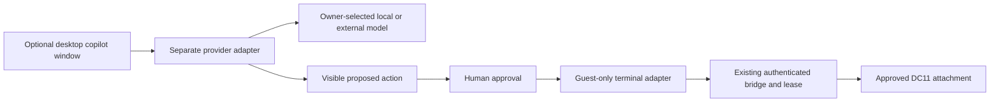

# Community architectures and an optional copilot boundary

Source review on November 19, 2026. These are interoperability observations and proposals, not claims of collaboration or endorsement. No third-party installer, agent, hosted model or community control service was run. No copilot was added to Web Desktop.

## Hacker Replicant and Web Desktop

Rolf Peters' PiDP-11 Hacker Replicant already combines a browser console and assistant. Its configurable console appears beside the chat, and its model tool interface is deliberately small. The reviewed revision is [`6f8a2aca`](https://github.com/rolfpeters-droid/pidp11-hacker-replicant/tree/6f8a2aca7786736e01bdf5ba9b44bf66a7f19349).

| Concern | Hacker Replicant at that revision | Web Desktop today |
|---|---|---|
| Terminal source | Shared operator Screen session; console presentation through a Python web console | Dedicated, explicitly configured raw DC11 guest line; xterm renderer in a desktop window |
| Readback | `screen -X hardcopy` snapshots the existing display | Ordered streaming guest bytes; bounded browser scrollback; no server-side terminal snapshot API |
| Keyboard | `screen -X stuff` types into the shared session | Separate authenticated input capability, explicit acquisition, ten-second lease, sequence/epoch checks and one owner per line |
| Other viewers | Shared console application | Up to eight viewers per line, each with bounded output credit |
| Guest identity | Status inspects Screen presence and a profile path in the launcher's temporary SIMH command file | Operator-configured label, explicit local approval, fresh attachment generation; no automatic identity claim |
| Model integration | Node/Express chat backend plus configurable local/cloud model endpoints | None installed; Go service stays independent of any assistant |
| Presentation | Console iframe alongside chat, visible action events | Compact HTML/TypeScript/SVG desktop; future assistant could be an optional application window |

The [boot API source](https://github.com/rolfpeters-droid/pidp11-hacker-replicant/blob/6f8a2aca7786736e01bdf5ba9b44bf66a7f19349/pidp11-bootapi.py) implements the hardcopy, keystroke and status operations. It runs with access to the Screen session and documents its network-trust assumptions. Its “no shell” tool surface does not make operator-console text guest-only: what receives those characters depends on the current console state. Our dedicated DC11 transport deliberately avoids that ambiguity.

The [chat backend](https://github.com/rolfpeters-droid/pidp11-hacker-replicant/blob/6f8a2aca7786736e01bdf5ba9b44bf66a7f19349/server.js) uses one OpenAI-compatible `/chat/completions` path for both providers. Local defaults point to Ollama; cloud configuration is optional and missing configuration produces an error rather than a silent fallback. Tool access starts off in the UI. When enabled, `send_keys` and `read_screen` are available; actions are reported through server-sent events. The default per-turn allowance is five tool calls, with a separate twenty-iteration loop cap and network deadlines. The caller can supply a positive action limit. These limits regulate agent activity; they are not the same mechanism as a terminal keyboard lease or per-action human approval.

The included [web console](https://github.com/rolfpeters-droid/pidp11-hacker-replicant/blob/6f8a2aca7786736e01bdf5ba9b44bf66a7f19349/webconsole/app.py) attaches a PTY to `screen -x pidp11` and also offers emulator boot/stop operations. That is useful for its integrated operator workflow. Those lifecycle routes would not belong in our optional companion, whose absence must leave Oscar's installation fully usable. Reusing model configuration ideas does not require importing the console or boot implementation. Provider settings are documented in [`.env.example`](https://github.com/rolfpeters-droid/pidp11-hacker-replicant/blob/6f8a2aca7786736e01bdf5ba9b44bf66a7f19349/.env.example).

## Related projects

- **Agent-PDP1**, reviewed at [`ca5c02ff`](https://github.com/obsolescence/agent-pdp1/blob/ca5c02ff50de96593f3ef08cf04388aece96ca44/README.md), separates PDP-1 knowledge material, machine-sharing support and optional Hermes setup. Its tutoring emphasis is relevant to an educational companion. Its described typewriter, display and panel access is specific to that project; it is not authorization or a ready-made safe control adapter for PiDP-11.
- **vt05**, reviewed at [`934fe889`](https://github.com/obsolescence/vt05/tree/934fe8898bd656749b323abbdab62939148cfe3e), is a fork of aap's native terminal project. Its [`terminal.c`](https://github.com/obsolescence/vt05/blob/934fe8898bd656749b323abbdab62939148cfe3e/terminal.c) uses SDL windows, a PTY, byte processing and optional baud-rate pacing. It is a useful terminal-behavior reference, not a drop-in browser service. No README was present in the inspected tree. A future historically specific browser terminal should use explicit parser/keyboard compatibility tests rather than merely applying a VT05-looking skin to VT100 semantics.
- **arpanet**, reviewed at [`78123c77`](https://github.com/obsolescence/arpanet/blob/78123c77b20dadd9b5967b184dbcb4195185eea6/README.md), separates a historical IMP/host simulation from web terminal presentation. Its README describes Python terminal transport and independent host systems, and labels the project work in progress. That separation is compatible with our companion philosophy. Running its orchestration scripts or reaching public historical hosts is outside this review.
- **David's IMSAI 8080esp desktop** documents embedded web serving, WebSocket terminals/display/printer/panel channels and REST disk management. It demonstrates how separate device windows can make a replica enjoyable from an ordinary browser. Our desktop retains that inspiration while keeping simulated peripherals distinct from genuine guest transport and excluding emulator reboot/configuration authority from the installed service. See [The High Nibble's technical overview](https://thehighnibble.com/imsai8080/).

## Proposed adapter — not implemented

Prefer a separately installed copilot process on a capable Mac or another owner-selected host. The 1 GB Pi should not be required to run a model, Node application or agent framework to keep its terminals working. Local Ollama and owner-configured OpenAI-compatible services can share a provider adapter, with model name, endpoint, timeouts and credentials held by that process. Actual model/tool compatibility still requires testing; “OpenAI-compatible” does not guarantee identical behavior.

A first useful version is chat-only, with explicitly shared snippets of terminal output. Sharing display contents with an external provider needs a visible owner choice: guest text may contain private information or malicious instructions. Treat terminal/model text as untrusted data, never as authority to grant tools or change endpoints.

A later guest-only adapter would expose:

1. **Describe attachment:** opaque endpoint ID, service instance, attachment generation, availability and input eligibility. A friendly label is not proof of the guest OS.
2. **Read approved display:** bounded, explicitly shared output with byte/sequence coverage and truncation markers. Web Desktop currently lacks authoritative server-side screen snapshots; define the renderer/parser owner before offering a `read_screen` compatibility operation. Do not quietly substitute a lossy Screen capture for a DC11 stream.
3. **Propose input:** exact visible bytes, including an explicit Return/control-character representation, bound to the attachment generation and an expiring request ID. No arbitrary network address, host command, Screen session or SIMH operation.
4. **Approve and send once:** a human approves that exact proposal, then the adapter acquires the same kind of exclusive keyboard lease as any user. Reject conflicts, expired approval, changed generation or uncertain delivery. Never replay after reconnect. Approval is enforced by the adapter, not merely requested in a prompt.
5. **Revoke:** stopping the copilot, closing the approved interaction, changing guests or losing the lease cancels pending actions. The human must still be able to revoke immediately; no automatic reacquisition.

Suggested bounds are at most one outstanding proposal per interaction, 256 bytes per approved input operation, a small per-turn action cap, bounded readback and existing bridge output/lease limits. These are proposed copilot limits, not new production APIs. Model tools must have no panel, monitor, boot, shutdown, media or host-shell capability. AI-disabled operation remains the ordinary complete desktop.

A compatibility facade for Rolf's `/screen`, `/keys` and `/status` concepts could translate **guest-only** operations after negotiation. It must disclose different semantics, especially asynchronous proposal approval and readback coverage. A plain iframe pointing to an existing full-control application would not enforce our boundaries and would also need deliberate CSP, authentication and origin work; it is not the initial integration plan.

## Questions and possible shared work

Ask Rolf whether a pluggable transport interface, explicit attachment IDs and a pending/approved/expired keystroke result would fit his intended workflow. Clarify hardcopy size/coverage, tool-call cancellation, concurrent users and provider error behavior. Offer a small fake-guest contract suite first, followed by an optional chat-only window, then supervised disposable-guest experiments with per-action approval. Any shared implementation, attribution wording or announcement should follow an actual agreement. No contact was made during this milestone.
