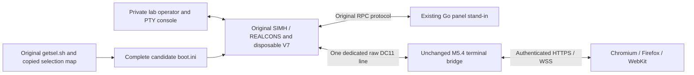

# M5.5 — original-launcher coexistence candidate

**Later physical-pilot status:** the separately authorized [actual Pi run](M5.5-physical-pilot.md) passed V7/browser/physical subtests but failed its IDLED fallback. Recovery verified original media unchanged and rolled back temporary changes. Overall acceptance is blocked; no physical checkpoint tag was created.

**Historical preparation record, 2026-11-19 · Mac preparation only.** The project now has an exact opt-in V7 profile, a proposed unused physical selection, a tested preparation helper, genuine terminal acceptance with original REALCONS active against a simulated panel, and a reviewable physical-Pi pilot/rollback procedure. **The actual launcher, physical panel and browser have not yet been tested together.** No SSH, Pi modification, deployment, service enablement or guest-image change on the Pi occurred.

The owner reports a fully assembled PiDP-11/70 passing initial physical controls and switch-selected RT-11SJ V05.03 operation. M5.3 separately proved a genuine V7 browser terminal on the installed Pi simulator. M5.4 established one-shot guest attachment and a coexistence design. M5.5 connects those findings into an offline candidate; it does not extend their hardware claims.

## Exact candidate and provenance

The candidate retains Oscar's original launcher and simulator. It adds a separate `unix7-web-pilot` profile containing its own writable V7 disk and [this boot.ini](../../lab/m55/boot.ini). The original V7 profile stays untouched. The only configuration difference from the captured installed ordinary V7 boot file is:

```diff
 set dci lines=8
+attach dci line=0,127.0.0.1:40100;notelnet
```

CPU/memory settings, relative RP06 disk attachment, conventional primary console, all four REALCONS settings—including `interval=1`—and the V7 boot sequence are preserved. The profile contains no web-service startup command. A missing browser or failed bridge cannot become a dependency of that file.

The retained M5.1 installed selection map leaves octal **0017** unused. The proposed single addition is [`0017 → unix7-web-pilot`](../../lab/m55/selection-entry.txt), corresponding to SR bits 0–3 asserted. The original unmodified `getsel.sh` resolved it correctly in the isolated lab and still resolved `0000` to IDLED. **No current Pi inventory was taken during this Mac preparation.** The historical map/hash must be revalidated after separate authorization; source drift or a new conflict stops installation rather than overwriting an existing selection.

| Reviewed artifact | SHA-256 |
|---|---|
| Captured original ordinary V7 boot file | `9a0d63699fcc1ab117fcf9cf35f85c1694719b33f2d8989167f4018e97d7f44b` |
| Complete proposed boot file | `3f0b90fc857660a842cfabdbc9030b07c810e4ec67caafa3a2a1f62c32354eb2` |
| Captured installed selection map | `cc340dc0a45aa13255a7818149956eb6713a6ecca3254f016b3449ff9ac391f9` |
| Proposed map, preserving every original byte and appending one row | `2b530561a1a41391d7c05c090fd77f2169b900589ab2729c2f6385bc432c5e3c` |

The [local preparation helper](../../lab/m55/prepare_profile.py) validates bounded captured files and writes a new private review directory. It refuses a changed boot baseline, malformed maps, duplicate numeric aliases, an occupied selection, an already-mapped pilot name, final source symlinks and an existing output directory. It neither reads disks nor installs files nor contacts a machine. Tests cover exact candidate equality, unchanged inputs, permission bounds and refusal paths. Full installed maps and their diffs remain in the owner's ignored `.research/m55/profile-review/` directory; public artifacts contain only the new selection row and nonprivate configuration.

The source baseline is the installed configuration retained in M5.1, not an assertion that every public system-image archive contains byte-identical boot settings. Attribution and provenance are recorded in the [lab README](../../lab/m55/README.md). Original source/binary notices and accepted checkpoints remain intact.

Implementation checkpoint: `32e5fc4`. The tested static ARM64 terminal candidate is identified by SHA-256 `69b609ea7b41f24c61daaeb1a6fa2292782ebc72ead3cf9ccdf53f699598f443`; its size and pre-commit build metadata are recorded in the validation manifest. It reuses the unchanged M5.4 terminal application.

## What the laboratory executes



The network-none Linux ARM64 environment is hosted on the Mac. Its root filesystem is read-only, guest media is a fresh independently writable copy of the verified public V7 base, and no hardware devices or production files are available. Original SIMH executes `do boot.ini` in the candidate directory, just as the launcher's generated command file does after choosing a directory. The existing lab PTY shim supports the independent operator console; no new simulator-source patch was introduced.

This does **not** execute `scansw`, the full launcher, GNU Screen or the original GPIO panel daemon. A direct Go RPC stand-in substitutes for that daemon. Only its initial HALT input is set to a neutral level before boot; browser input never calls the stand-in control endpoint. Readiness requires actual REALCONS input reads and lamp writes. Browser closure, bridge shutdown and bridge crash are then checked against both fresh guest-console output and continuing RPC counters, not just a stale RUN lamp.

## Important laboratory finding and correction

The first full-profile run booted V7 and passed terminal tests, but REALCONS then stopped updating the stand-in. The conventional console retained `RPC: Remote system error`. The earlier fixture's 4096-entry UDP duplicate-reply cache was sized for a 20 ms service interval; the unchanged installed V7 profile specifies 1 ms. At the faster workload the cache filled inside its 35-second retention window and rejected a new call. Original REALCONS disconnected as its source specifies. A previous lamp value still showing RUN was not evidence of continuing panel communication.

The correction is **in the Go laboratory transport only**. `Listen` retains its 4096-entry default. An explicit bounded constructor/flag permits up to 65536 entries, selected only by this fast-profile fixture. The 35-second duplicate window is unchanged, so retransmitted input reads do not consume another switch edge. All configurations now also enforce a 16 MiB request/reply payload budget, reserving room for the maximum reply before dispatch. Full caches reject new calls without executing them; live duplicates are not evicted to make space. Tests verify saturation, duplicate safety, expiry/byte accounting, configuration bounds, more than 4096 consecutive reads, and large-packet memory pressure. Map metadata is additionally bounded by the entry count; the 16 MiB figure is not total process RSS.

No original REALCONS interval, RPC schema, simulated switch interpretation, physical-control behavior or terminal application source was changed to hide the problem. The production pilot executable does not import the lab RPC server. This correction makes the stand-in suitable for the candidate workload; it is not a finding about the installed original panel daemon's cache or performance.

## Validation evidence

See [validation](m55/validation.json), [three-engine genuine guest results](m55/genuine-browser-acceptance.json), [stand-in continuity](m55/independence-acceptance.json), [listener replacement](m55/lifecycle-acceptance.json), and [selection resolution](m55/selection-acceptance.json). Private captures and source identities are indexed separately; tokens, full maps, working disks and raw screenshots remain private.

The final candidate uses the same original simulator and complete profile throughout the acceptance sequence. Genuine V7 commands, a fresh unpredictable echo, erase behavior, three viewers, rejected competing ownership, browser disconnect/reconnect/refresh, and independent console access through bridge restart are exercised in Chromium, Firefox and WebKit. The additional continuity fixture stops the bridge normally and then kills only its precisely identified process; original REALCONS input polls and lamp updates continue, the guest console answers a new echo, and stand-in switch values remain unchanged. The listener-replacement fixture retires the old attachment on DCI detach, waits for the old TCP socket state to clear, recreates the same listener, and verifies no automatic reattachment. Explicit recovery needs fresh authentication and starts read-only.

Go vet/race checks, strict TypeScript checking, the 46 TypeScript tests, the transport fixture, 12 targeted browser regressions, five profile-helper tests, Python/Node syntax checks, frontend embedding and ARM64 builds are recorded in the manifest. The targeted browser cases exercise guest transport, passive reconnection/staleness and shared switch presentation; the unrelated full desktop suite and native Safari are not claimed as rerun. Application panel/control/terminal source remains unchanged from accepted M5.4. Original control-safety regression tests retain their known limitations.

Test setup corrections are retained rather than hidden. Initial rpcbind startup needed the same privilege-drop/child-cleanup container capabilities as the established RPC lab and stopped before guest startup. The first full-profile run exposed the cache limit above. An independence helper's embedded Python needed dedenting before its deliberate crash step; no crash was issued on that failed attempt. A large-packet unit fixture was reduced to 8 KiB payloads to fit the Mac's UDP send limit. One premature listener-test invocation found the bridge still stopped after the failed independence check and exited at TLS verification. The documented replay now explicitly stops at each failed checkpoint. These were local fixture/test issues, not Pi changes.

Both disposable guest runs ended with three V7 `sync` operations and observed SIMH `quit`/`Goodbye`. Protected public bases and distinct writable-file identities were verified. The container, owned Mac TLS relay and test preview exited; accepted M5.3/M5.4 binary hashes and all 11 tag objects remained unchanged. No M5.5 hardware-acceptance tag was created. Retained harness labels still mention earlier milestones; candidate/profile hashes identify this run.

The [replay instructions](../../lab/m55/README.md) use a synthetic selection map for contributors who have no private inventory. The actual preparation/resolver acceptance used the retained installed map. All successful results identify the final candidate bytes; the earlier failed run is preserved separately and is not counted as coexistence acceptance.

## Physical pilot and M5.6 handoff

The [exact proposed Pi procedure](M5.5-pilot-plan.md) records historical baseline hashes, additive files/map changes, media exclusivity, the original no-argument launch, Screen and REALCONS checks, browser lifecycle, guest-safe exit and full rollback. Current hashes and availability still require authorized preflight. It chooses existing diskless IDLED for the switching/fallback demonstration so no second original guest disk needs to be written. The final section is the owner's short physical-panel checklist.

The [M5.6 deployment specification](M5.6-deployment-spec.md) covers one embedded-asset ARM64 executable, optional standalone systemd supervision, authenticated LAN access, detached startup, credentials/certificates, endpoint reporting, safe upgrade/rollback, disablement and uninstall. It deliberately distinguishes the existing manually started pilot—which connects once at startup—from the future detached-by-default service. No unit, installer, autostart or LAN listener was deployed.

At the end of Mac preparation, the remaining limits were substantive: actual assembled-panel/normal-launcher coexistence and busy-line behavior are untested; a guest reboot within the same simulator/socket may remain invisible; the operator must **stop the bridge**, not just close its browser window, before intentional guest changes. Physical serial expansion, durable multiuser/LAN provisioning, authoritative lifecycle witnessing, sustained Pi resource/power measurements and native Safari remain future work. No new Pi performance result is claimed. Existing RSS/CPU/latency targets remain unchanged, and the M4 START-release/blocked-RPC remote-control restrictions remain in force.

M5.5 preparation can be reviewed for the separately authorized supervised pilot. It is not approval to execute that pilot or evidence that physical-panel/browser coexistence has already passed.
