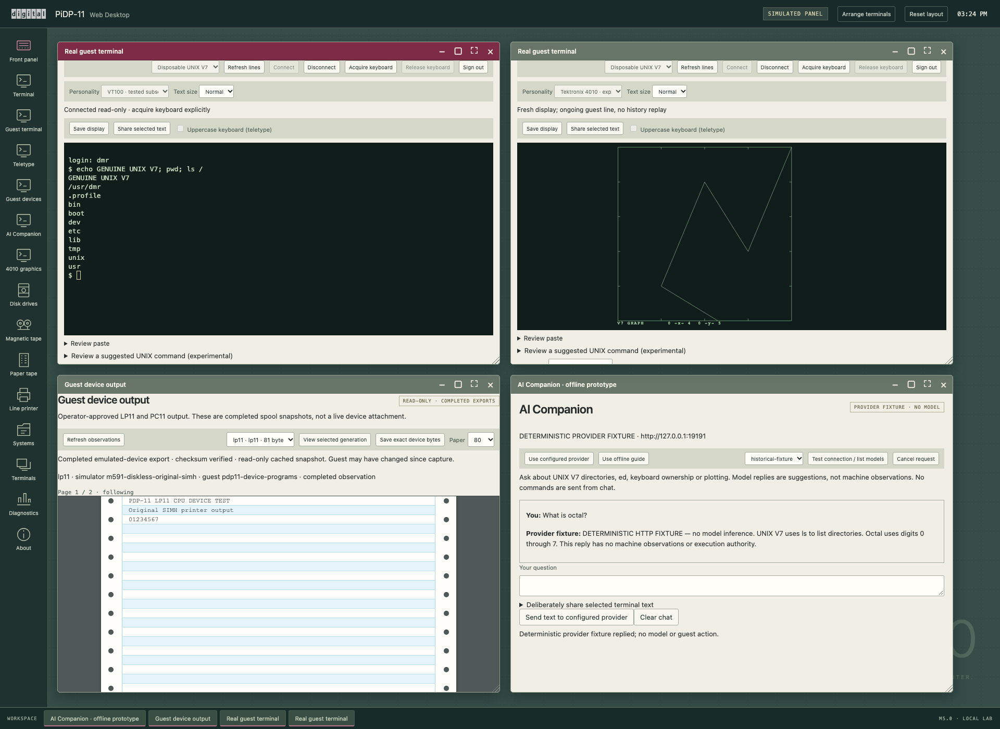
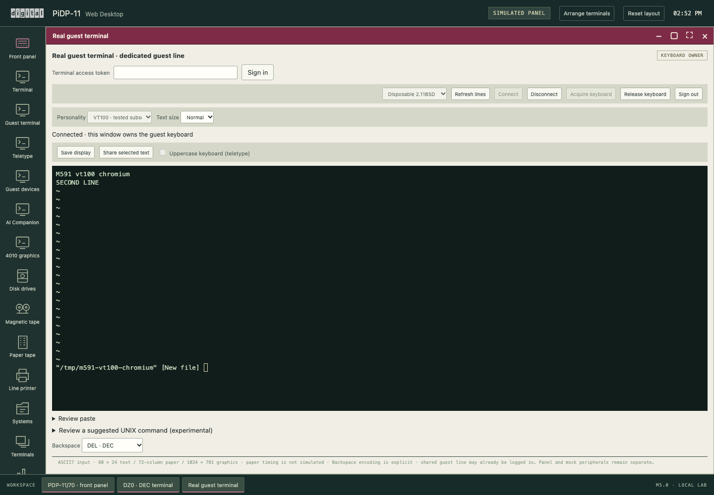

# M5.9.1: completed peripherals, configured companion and historical applications

November 21, 2026. This substantial development increment starts from `c8a3102b03a335594ae4a2cf5edb1819b04ac275`. It is not a stable release, a physical acceptance checkpoint or completion of every proposed feature. Work used the Mac, existing original-SIMH lab image and disposable ARM64 Linux. No physical Pi connection, GPIO, original source edit, production media change, model download or developer correspondence occurred. All eleven accepted tag references are preserved.

## Delivered capabilities

| Area | Implemented and tested | Limit |
|---|---|---|
| LP11 | CPU-executed PDP-11 polling program writes original SIMH printer registers; completed output approved through private control socket, displayed as continuous-form paper and downloaded unchanged | Completed snapshots, not a live tail or OS printer-driver acceptance |
| PC11 | Actual read-only reader → emulated CPU → punch transfer, including eight-bit bytes; same bounded observation service and exact download | No browser attachment, reset or live progress; end-of-tape not tested |
| Companion | Owner-configured Ollama/OpenAI-compatible service routes, allowlisted discovery/model selection, explicit sharing, timeout/cancellation and inert chat UI | Deterministic HTTP acceptance only; configured local Ollama unavailable; no real model conversation |
| Approval | Disabled-by-default three-command UNIX suggestion review, exact Return representation, 30-second single-use ID, attachment/viewer/keyboard binding and existing uncertain-write handling | User selects one of `pwd`, `ls`, `ls /`; no model tool parser or arbitrary command execution. Tested against fake guest only |
| Full-screen application | Genuine 2.11BSD `/usr/ucb/vi`: insert, write, redraw, delete, quit, verify saved file and reconnect read-only | Eight retained personality/browser passes; detailed qualification below |
| V7 / Tektronix | Twelve fresh text-personality cases and a combined text/graphics/device/companion workflow | Existing VT220/4010 subsets, not complete historical terminal conformance |
| Disk/tape status | Typed, bounded read-only observation contract with identity/sequence fences and unknown-field rejection | Fixture contract, not a connected collector or media-control API |
| Desktop | Existing four-terminal support preserved; new device window and deliberate selected-text sharing; saved geometry recognizes all guest windows and companion/device views | No machine state, authority or credentials persisted |
| Packaging | Same static ARM64 executable, authenticated HTTPS, private configuration and detached lifecycle | Candidate only; real Pi and fresh-card installation remain untested here |

The text and plot come from a running disposable V7 guest through original SIMH. The printer is a completed export from a separate diskless PDP-11 CPU program. The companion explicitly displays a deterministic HTTP fixture, not an AI model. No intercepted API/guest data were used for this capture. [Reproduction](../../lab/m591/README.md).

## Actual emulated peripheral output

The pinned original `pdp11_lp.c` and `pdp11_pt.c` supply LP11 and PC11 simulation. The existing V7 investigation did not establish a usable printer driver: the tested media lacked `/dev/lp*` and the expected driver source. The 2.11BSD inventory likewise found no `/dev/lp*`. Rather than pretend a configured simulator device proves an OS driver, the new [device exercise](../../lab/m591/devices.py) executes small polling programs on the emulated PDP-11 CPU. The host deposits instruction words and data, then original SIMH executes them; it does not replace the device output with a fixture file.

LP11 polls CSR `177514` and writes buffer `177516` (octal). PC11 uses reader CSR/buffer `177550`/`177552` and punch CSR/buffer `177554`/`177556`. The reader media is attached read-only. The punch loop waits for completion before HALT; output files are detached before hashing. The script retains emitted octal instruction listings, device position/status, console output and exact bytes privately.

| Export | Result | SHA-256 |
|---|---:|---|
| LP11 | 81 ASCII bytes; three CRs, three LFs, one FF | `056cbc92a013b9c90650e6e73e870cba8a5b130b312935926a381c9123dfdae1` |
| PC11 punch | 24 bytes identical to reader input, including 128 and 255 | `6a86e3d92e3aff9fc10f607180240b577ffff02033ff3dbe5977b16d8b811317` |

Each observation is bounded to 64 KiB, with four configured devices maximum. Publication requires a fresh service instance/device revision, verified completed-file hash and operator-supplied producer identities. Restart retires all exports; an old generation URL cannot follow replacement data. Browser access is read-only and authenticated. The source file remains unchanged. [Configuration, semantics and limitations](../technical/observed-peripherals.md).

## Historical full-screen evidence

The existing authorized archive was verified before extraction. The independent 2.11BSD base has SHA-256 `940608306ccf49b74780d3f6863476a4a5fea27651c9d1cc0a81b5c020dcbb1f`. The first inventory boot was single-user, so `/usr` was not mounted; “vi missing” at that point was not evidence of an absent application. A fresh independent copy booted multiuser, mounted `/usr`, and exposed `/usr/ucb/vi`. The isolated profile selected DZ vector `310`, eight seven-bit DZ lines and one actual bridge connection to tty00. This pooled laboratory listener is **not a production dedicated-line configuration**.

The test set the guest's actual `TERM` before launching vi. It created a distinct disposable file, inserted two lines, wrote it, requested Ctrl-L redraw, deleted the first character, wrote/quit, checked the file with `cat`, released ownership and reconnected read-only.

| Guest TERM / browser personality | Chromium | Firefox | WebKit |
|---|---|---|---|
| VT100 | Passed | Passed | Passed |
| VT52 | Passed | Passed | Passed |
| VT220 subset | Passed | Passed | Result not retained; not counted |

These are real application checks, not a claim that every keyboard sequence, scrolling margin, character set, wrap boundary or identity exchange has been qualified by vi. The separate terminal fixtures cover those implemented subsets. Simultaneous full-screen observers and every application feature remain future acceptance cases. Selecting a browser personality alone never sets the guest's TERM.

## Verification and interruption record

Private evidence remains under `.research/m591/`; public scripts contain no tokens, private host configuration, raw personal captures or guest media. Original archive SHA-256 remained `14bcf83610737c2383ffbfa411ebbd067590705fd1c42caa679d1a5a63f60bd9`; the V7 immutable base remained `fc04dab1e7f2fbf3ea4b44603ed2c9d6ba15f4f86c702d4a27a1dac725966f39`.

The workspace volume disconnected during testing. Source edits, completed peripheral evidence and eight vi results survived; the ninth vi result did not. The first V7 regression was interrupted and its container exited after losing its mounted working directory. BSD was paused, its disk copied after remount, then interrupted/stopped because its old mount remained unavailable. **Neither interrupted run is recorded as a clean guest shutdown.** Both working disks were preserved independently. No repair, disk restoration or overwrite was attempted. A newly verified V7 copy was used for the complete repeat.

The combined demo initially used a serial line whose default `7P` mode filtered graphics controls. It was corrected to use the existing reviewed DCO0 `7B` line for graphics and tty02 for text. A second attempt correctly found no printer observation after the terminal regression restarted the service; explicit publication was repeated after that regression. A provider-UI harness race was corrected to wait for configuration inspection before entering a question. These failed attempts remain in private evidence.

Verification includes Go vet/race tests; TypeScript checking and 62 frontend tests; transport integration; 84 Chromium/Firefox/WebKit desktop cases; twelve fresh V7 personality/engine cases; eight retained vi cases; actual ARM64-service proposal/provider tests in all three engines; and actual completed-device browser download checks. After final cancellation/discovery/layout corrections, the affected 24 browser cases and an additional nine proposal/provider/device cases passed. The exact packaged build repeated all three actual-service fake-guest/provider cases. Test categories remain separate: model and approval peers are fixtures; V7, vi and device instructions are genuine emulator execution.

The installed ARM64 service passed manifest verification, two-version installation, repeat-configuration refusal with unchanged private inputs, fresh-instance/detached restart and prior-session revocation. With the memory controller withheld by a temporary lab slice, it refused before opening HTTPS. Restoring the normal slice restored protected detached operation. OrbStack's known weakening override was counteracted with a lab-only copy of the distributed hardening directives; the package was not weakened. No OS boot configuration or physical Pi setting changed. The exact candidate also passed rollback, forward selection and complete managed removal; [artifact identity and cleanup](M5.9.1-package.md).

## Short resource measurements

Disposable Debian Trixie ARM64, Mac-hosted, 1 GiB memory / two CPU lab allocation; six seconds per synthetic loopback TLS/WebSocket scenario. These are transport measurements, not historical-guest/browser round-trip, physical Pi performance, long-run peaks or one-second CPU p95. The service includes optional configuration but no model inference.

| Scenario | Sampled RSS / peak KiB | Mean CPU, one core | Echo p95 ms |
|---|---:|---:|---:|
| Detached | 9,176 / 9,176 | 0.00% | — |
| Passive observer | 9,864 / 9,864 | 0.00% | — |
| Active terminal | 11,044 / 11,044 | 0.67% | 0.656 |
| Two lines | 13,288 / 13,288 | 1.00% | 0.682 |
| Eight observers | 15,784 / 15,792 | 3.81% | — |
| Lease renewals | 15,804 / 15,804 | 0.17% | — |
| Command bursts | 14,712 / 16,084 | 0.66% | 0.742 |
| Moderate output | 14,832 / 14,832 | 1.50% | — |
| Reconnect | 14,912 / 14,912 | 0.33% | — |

The unchanged targets remain idle RSS≤24 MiB, active≤48 MiB, peak≤64 MiB, idle CPU<1%, representative mean<5%/p95<10%, added terminal latency<100 ms p95 and guest throughput regression<3%. This short lab run does not establish all those targets on the Pi. Kernel `MemoryMax=96M`, zero swap, Go soft limit 72 MiB and 64 tasks remain mandatory; absent enforceable containment is a startup error.

## Remaining work

1. Qualify an actual owner-configured model when available; no automatic downloads or private-cloud use.
2. Extend genuine guest peripheral acceptance to an identified OS driver and completed-job lifecycle. Design append/rotation handling separately before offering continuous spooling.
3. Add a real read-only PC11/disk/tape collector, progress/end-of-tape evidence and explicit media lifecycle; do not generalize the private control socket into a monitor API.
4. Repeat the missing vi/browser case on fresh media, then test simultaneous full-screen observers, additional applications and terminal subsets.
5. Keep the physical switch fault, independent original operation, enforceable Pi memory containment and separately authorized reversible hardware pilot as deployment gates. Nothing in M5.9.1 authorizes contacting or installing on the Pi.

[Architecture decision](../decisions/0007-completed-devices-and-companion.md) · [Companion setup](../getting-started/configured-companion.md) · [Alpha candidate record](M5.9.1-package.md)
