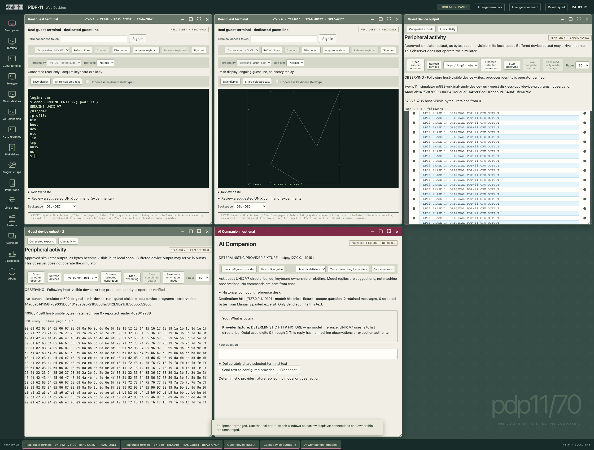
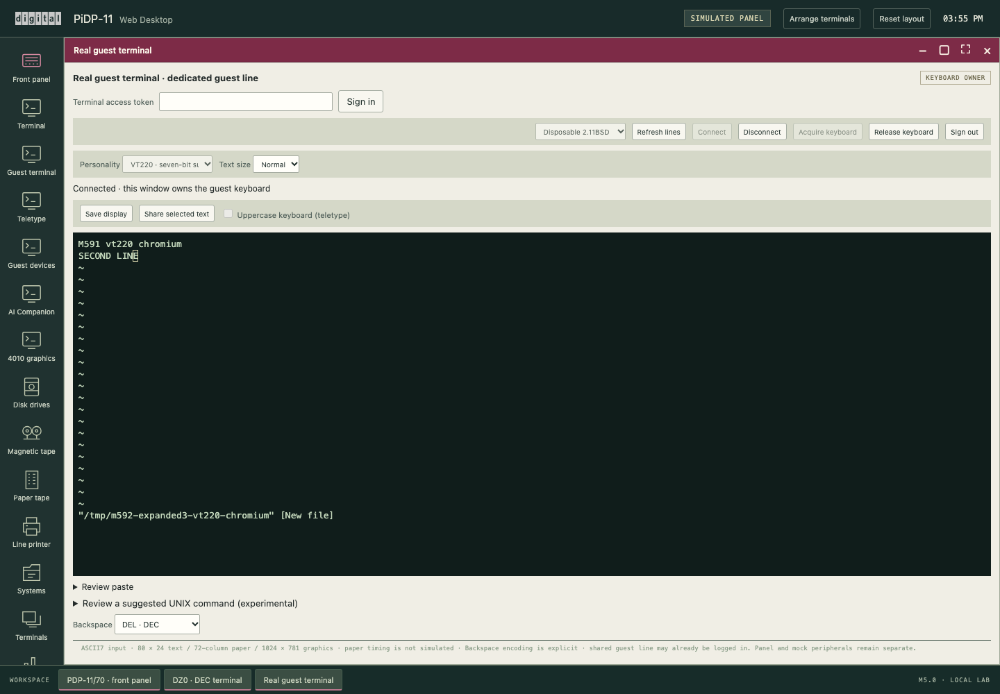

# M5.9.2: live peripherals and an equipment workspace

M5.9.2 adds working, bounded LP11/PC11 observation to the optional desktop, a shared historical reference desk, clearer sharing and command-review information, and an equipment arrangement for multiple terminals and devices. Development began at `6dfecf1`. All work used the Mac and disposable Linux environments. The physical Pi was not contacted; original hardware, software and production media were untouched.

## Implemented behavior

| Area | Implemented and exercised | Boundary |
| --- | --- | --- |
| LP11 | Approved empty spool, ordered chunks, continuous-form paper, CR/LF/form feeds, explicit completion and verified download | Original SIMH CPU program; not a UNIX printer-driver claim |
| PC11 | Genuine reader/punch transfers, reported reader position/EOF, exact binary download and verified read-only reader snapshot | Reader progress is local-supervisor evidence; no browser attachment or reset |
| Observation | Four allowlisted devices, per-generation identity, five-second producer lease, bounded buffers, retirement and explicit loss | Lab supervisor, not a production identity oracle |
| Companion | Shared curated references for V7, RT-11, RSX, BSD, octal/assembly and peripherals; selected reference included only with explicit Send | Existing configured local model endpoint was unreachable; real-model acceptance remains pending |
| Sharing | Visible provider/model, source, selected-byte count and retained-message scope; UTF-8 request limits | No automatic terminal upload |
| Proposals | Exact bytes, terminal/generation label, visible expiration and cancellation | Disabled by default; only `pwd`, `ls`, `ls /` plus Return; no autonomous execution |
| Workspace | Five simultaneous equipment windows, two device observers, terminal ownership in titles/taskbar, desktop tiling and tablet task switching | Saved layouts preserve geometry, not authority or connections |

[Observation contract](../technical/observed-peripherals.md) · [Architecture decision](../decisions/0008-live-device-observation.md) · [Companion setup](../getting-started/configured-companion.md).

## Genuine device and guest evidence

Original unmodified SIMH runs a diskless PDP-11/70 program against LP11 and PC11 registers. A second original SIMH instance runs disposable UNIX V7 for the text and graphics windows. These are deliberately named separate producers; the image does not imply V7 generated the printer job.

Three explicit CPU phases print a repeated ASCII listing with CR/LF and a form feed and transfer successive 4,096-byte portions of a 12,288-byte tape containing all byte values. The observer is approved before the first write, follows the attached spool during phases one and two, and completes only after original devices detach and full-file comparisons pass. A final PC11 read verifies the original reader's EOF/error CSR bit. Octal instruction listings, original monitor output, POS/CSR results and downloaded bytes are retained privately. All three engines observed genuine activity; the retained completed-job checks then passed exact LP11, punch and reader-image downloads in Chromium, Firefox and WebKit. The actual outputs were:

| File | Bytes | SHA-256 |
| --- | ---: | --- |
| LP11 | 20,205 | `3b678f8bc63114fca6c70059c1e3f78dd41f0070a0386302666e0d050d33299b` |
| PC11 punch and reader | 12,288 each | `8dec5fb0de8a0b457c0cf7be559e4ef488e9cf39d5ddb0ff7464b23372ab21fa` |

Original PC11 reported decimal POS `12288` and octal CSR `100000` after the extra EOF read. No expected-data fixture was substituted for device output.

*Chromium, phase one: real V7 text and Tektronix vectors, 6,735 host-visible LP11 bytes and 4,096 PC11 bytes, with both observers still active. The optional companion is explicitly a deterministic provider fixture. This is a real application capture, not a mockup.*

Fresh verified disposable 2.11BSD media completed the previously missing VT220/WebKit case. The expanded VT220 procedure then passed Chromium, Firefox and WebKit: login/TERM, vi insert/edit/save/redraw/reopen/readback/quit; an independent read-only observer; explicit keyboard handoff and continued editing; read-only reconnect; and paging 40 numbered lines with `/usr/ucb/more`. Guest inventory also found games, but finding a binary is not gameplay qualification. Alternate character sets, every wrap boundary, all keyboard modes and every historical application are not newly certified by these vi/more cases. Existing terminal regressions remain the applicable evidence for their covered behavior.

*Actual disposable BSD editor during the expanded Chromium run. The retained M591 text is a test string; the file path identifies this fresh M592 run. This capture used the earlier M5.9.2 build before equipment tiling was added.*

## Verification and interruptions

- Go vet and full race tests; TypeScript check/build and 62 frontend unit tests; transport adapter integration test.
- All 96 browser cases passed across Chromium, Firefox and WebKit, including live chunks/completion/loss, reference/sharing scope, layouts and expired command approval.
- All 12 genuine V7 text cases passed (VT100, VT52, VT220 and teletype across three engines). The equipment run separately exercises genuine V7 Tektronix graphics.
- Actual ARM64 service browser checks passed command approval and configured fixture discovery/chat in all three engines. Restart changed instance, revoked sessions and remained detached. Withholding the memory controller refused startup before HTTPS; protected operation was restored afterward.

Failures were preserved rather than silently counted as passes. A BSD test selector matched both mock and real terminal rows; it was narrowed to the real guest viewport and repeated using fresh test filenames. A V7 harness response could be read while being written: the Python harness now publishes atomically, and the client waits for the same request ID without resending guest input. The full V7 regression then passed. An ARM64 test initially used an old fixture credential and correctly received 401; the harness now takes the explicit current evidence directory. The first equipment run used the wrong CSS class in a window-count assertion after successful device phase one; the corrected run reused that phase's retained actual output without replaying CPU input. Download automation also encountered overlapping equipment windows; explicitly restoring the target through the taskbar resolved it. Completed genuine output was then downloaded and compared in every engine without replaying any device phase.

## Resource and safety limits

The mandatory 96-MiB systemd memory limit, zero swap, 72-MiB Go soft limit and disabled-by-default service remain. No resource budget was raised. During a separate 40.06-second actual V7/device browser workflow, 41 service-process samples measured 14.89 MiB peak RSS and 0.65% of one core; emulator and browser CPU were excluded. A short nine-scenario ARM64 synthetic transport run measured 8.8–14.5 MiB sampled RSS, about 0.17% of one core idle, and a maximum 4.15% in the eight-observer case. Measured active-input echo p95 was 0.80–0.89 ms. Each scenario lasted six seconds. These are Apple-hosted Linux measurements, not Raspberry Pi measurements or long-duration guarantees.

The follower holds at most four 64-KiB tails and four optional 64-KiB reader snapshots; jobs stop at 1 MiB. A browser retains 64 KiB per observer, displays bounded paper and never creates an unbounded output queue. Source and browser polling are 200 ms each; stdio buffering, scheduling and storage delays remain additional latency. Near-real-time means host-visible output, not simulated mechanical timing.

See the [candidate record](M5.9.2-package.md) for exact-source package verification and cleanup. Both installation paths remain unchanged: validate Oscar's independent installation first, then optionally add the companion. No clean-card installation or physical deployment was replayed.

## Remaining work

Real-model acceptance remains pending because the existing owner-configured loopback Ollama endpoint was unreachable. No model or runtime was started, installed or downloaded, and no remote private provider was contacted. Deterministic fixtures prove transport and interaction contracts, not answer quality.

The follower cannot detect every same-inode rewrite between polls or independently identify a guest inside a live simulator. Production use needs an independently reviewed supervisor and explicit lifecycle coordination. It does not expose disk/tape mounting, printer control, GPIO, REALCONS control or guest switching. OS printer-driver qualification remains separate. Full completion download is limited by the retained tail; a longer completed job offers only the clearly marked partial tail.

The recommended next increment is M5.9.3: qualify an owner-approved existing model, test additional historical applications and strengthen independent producer identity/retirement under storage and process faults. Physical deployment remains separately authorized and gated by hardware repair and enforceable memory containment. No stable release or new accepted hardware checkpoint is created here.

## Cleanup and evidence locations

The device producer quit after verified completion. The V7 harness stopped the actual bridge, executed three guest syncs through its independent console and quit original SIMH with `Goodbye`. BSD had already completed the corresponding bridge-stop/sync/quit procedure. All modified disposable disks and failure transcripts remain private; no working disk replaced a base image.

The immutable public archive retained SHA-256 `14bcf83610737c2383ffbfa411ebbd067590705fd1c42caa679d1a5a63f60bd9`; both fresh V7 bases retained `fc04dab1e7f2fbf3ea4b44603ed2c9d6ba15f4f86c702d4a27a1dac725966f39`; the BSD base retained `940608306ccf49b74780d3f6863476a4a5fea27651c9d1cc0a81b5c020dcbb1f`. These are verified laboratory inputs, not private production media.

Private `.research/m592/` contains `go-final.txt`, `units-final.txt`, `integration.txt`, `browser-all.txt`, `v7-regression.txt`, `bsd-expanded-three.txt`, `equipment-download-failure.txt`, `equipment-completed.txt`, `live-resource.json`, `transportbench.json`, lifecycle/memory logs and final hashes. The `equipment-live` subdirectory retains program listings, original simulator logs, byte outputs and per-engine JSON; `bsd` retains fresh application evidence. Public reproducibility instructions are in [lab/m592](../../lab/m592/README.md). Credentials, private captures and guest images are excluded from Git and packages.
