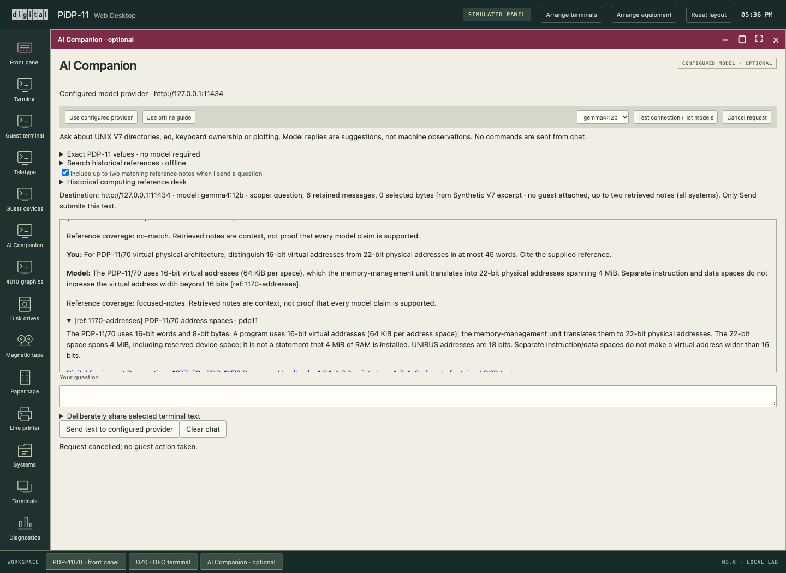
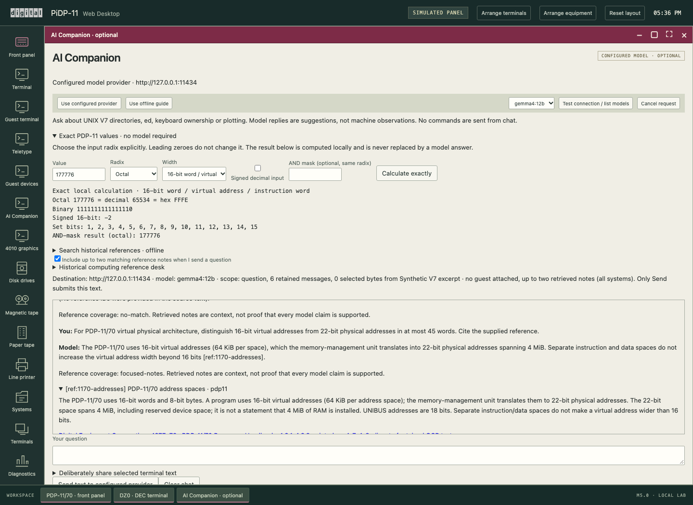

# M5.9.3 Phase B: reference-assisted companion and model-host foundation

November 21, 2026. Application checkpoint: [`b0d9280`](https://github.com/cdaters/pidp11-webdesktop/commit/b0d9280). Starting checkpoint: `b4fddc6`. All accepted tags were preserved byte-for-byte. This was Mac development and disposable ARM64 Linux testing only: **no SSH to the physical Pi, GPIO access, original-media operation, production deployment or stable release**.

The companion now has usable offline historical search, inspectable source passages, exact PDP-11 values and a narrow optional model-host gateway. Real Gemma conversations passed through the authenticated desktop in Chromium, Firefox and WebKit. The model still makes important errors, including after retrieval. **The offline guide/reference desk remains the default; Gemma 4 12B is an experimental source-assisted option, not a qualified historical authority.**

[Reproduction](../../lab/m593b/README.md) · [Actual model responses](../../lab/m593b/results/) · [Reference/calculator design](../technical/historical-reference-library.md) · [Model compatibility](../technical/model-compatibility.md).

## What changed

The original Go provider adapters, authentication, browser chat, guest attachment generations, exclusive keyboard leases and separate command-review machinery remain in use. New code adds a shared 14-entry catalog, bounded lexical retrieval in Go and offline TypeScript, provenance and integrity fields, visible source passages, and rejection of citation IDs absent from the supplied notes. An exact local integer calculator covers byte/word/physical widths, bases, signed words, masks and bit positions. It does not send anything to a provider or guest.

The optional model-host executable exposes token-authenticated TLS chat, approved model listing and reference search, with one in-flight request and no management/tool API. The independently implemented Hacker Replicant contract converts explicit selections and unverified status claims while refusing automatic keys. No upstream application was imported or embedded. [Pinned upstream review and implemented boundaries](../technical/hacker-replicant-interop.md).

## Model inventory and storage

The Mac has 24 GiB unified memory. Ollama 0.40.16 and LM Studio 0.4.26+4 were already installed. No runtime upgrade, app removal, account creation, billing or hosted inference was needed. Both runners initially had no loaded models. The baseline system volume had approximately **38.38 GiB free**; the external project volume had approximately **55.64 GiB free**. A **20 GiB system-volume reserve** was maintained during downloads.

| Model | Starting state | Final decision |
|---|---|---|
| Qwen 2.5 Coder 14B, Q4_K_M | Ollama, 8.99 GB; Phase A transport worked but facts/arithmetic failed | Removed through Ollama after preserving restore identity/configuration; not retested |
| Qwen 3 14B, Q4_K_M | Ollama, 9.28 GB | Retested on the same 30 raw/grounded cases; removed through Ollama after comparison |
| GPT-OSS 20B, MLX MXFP4 | LM Studio, about 12.10 GB; not loaded | Removed after recording model/file identities and configuration. The CLI has no delete operation; only the exact unloaded model directory was removed. Parent application/runtime data remained intact |
| Nomic Embed Text v1.5, Q4_K_M | LM Studio inventory reported 84.11 MB | Its indexed entry remains; not loaded or used. No Nomic file was present in the inspected managed model tree, so the index is not proof of current weight availability |
| Qwen3.5 9B Q4_K_M | Not installed | Downloaded explicit `qwen3.5:9b-q4_K_M`, about 6.6 GB; tested, then removed through Ollama |
| Gemma 4 12B | Not installed | Downloaded and retained `gemma4:12b`, 7,714,091,504 model bytes; safetensors/NVFP4, MLX runtime, manifest `c7597fc90b86aff6965317f37dd5465402284e26382d9b4bf2dfe3ef1491f4b6` |

The explicit Gemma `12b-q4_K_M` tag was unavailable; the failed manifest lookup downloaded no model. The verified base `12b` tag selected the MLX variant. The current source/model license records identify Apache 2.0; no weights are redistributed. [Verified registry/source links](../technical/model-compatibility.md).

Approximately **14.3 GB of new model data** was downloaded across the two candidates. Measured managed model-tree allocation fell from 30.37 GB to 7.87 GB: approximately **22.49 GB net reclaimed** (20.95 GiB). This is an allocated-file comparison, not an assertion that every released byte immediately appeared as filesystem free space. Ollama handled shared-blob cleanup through its supported removal operation. The existing roughly 231 MB Ollama cache and 1.79 GB LM Studio runtime-extension tree were not indiscriminately deleted; no duplicate model download was made in LM Studio. The checked Hugging Face/MLX/llama.cpp cache locations were absent.

After owned previews were stopped, the VM removed and all models unloaded, final free space was **54.55 GiB on the system volume** and **55.57 GiB on the project volume**. Unrelated workloads, swap and filesystem accounting also changed during the session. Private restore records remain under the ignored research directory; none of the weights, credentials or owner configuration is published.

## Real-model comparison

The existing native adapter issued 15 identical synthetic questions in each of two conditions: raw and with retrieved references. Three models produced **90 actual responses**. Each request used thinking disabled, 4,096 active context and at most 512 output tokens; other sampling settings remained model defaults. There were no adapter timeouts or truncated-output failures in this sample. Local builds/browser work also occurred during the session, so these are practical elapsed times, not isolated hardware benchmarks.

| Model | Raw completion median (range) | Grounded completion median (range) |
|---|---:|---:|
| Qwen 3 14B | 3.45 s (1.74–9.16) | 4.37 s (3.27–7.82) |
| Qwen3.5 9B Q4_K_M | 3.20 s (2.16–6.05) | 4.42 s (3.87–5.65) |
| Gemma 4 12B NVFP4/MLX | 2.76 s (2.04–9.81) | 3.37 s (2.34–4.83) |

The following is a review of the actual answers against the supplied source notes and exact arithmetic, not a generated accuracy score:

| Check | Raw responses | Reference-assisted responses |
|---|---|---|
| PDP-11/70 address widths | Both Qwens gave wrong widths; Gemma omitted the required 22-bit physical width | Qwen 3 and Gemma correctly distinguished 16-bit virtual and 22-bit physical; Qwen3.5 incorrectly said words **and bytes** were 16 bits |
| Octal `177776` | All three gave an incorrect hexadecimal result, with additional decimal errors in both Qwens | All three still calculated incorrectly; all recognized digit 8 as invalid octal |
| MOVB to a register | All three incorrectly said the high byte remained unchanged | All three described sign extension correctly |
| Deferred/autoincrement modes | Quality varied; fluent descriptions did not establish correctness | All three introduced incorrect details despite valid source IDs; the original retrieved note listed modes without enough explanation |
| Unknown guest/RUN/SR | All three invented current-state claims | All three declined to infer actual states, though some explanations still included unsupported tangents |
| SIMH monitor versus guest line | Qwen 3 and Gemma misrepresented authority; Qwen3.5 distinguished the surfaces | All three described the dedicated guest-line boundary correctly |
| VT11 versus Tektronix/VT100 | All three misidentified VT11 or added incorrect protocol details | All three distinguished the display processor from Tektronix and text-terminal paths |
| Unspecified RSX/RSTS release | Invented commands, wrong operating-system comparisons or irrelevant assumptions | Generally declined a verified procedure; Qwen 3 invented an `ambiguous-version` citation ID and would be withheld |

V7/RT-11, BSD, REALCONS and peripheral responses are included in the [complete evidence](../../lab/m593b/results/). Core improvements coexist with unsupported extras: for example, Qwen3.5 confused RSTS/E with VMS in raw output, and some “no” answers were followed by incorrect explanations. No model is accepted for unchecked command or hardware advice.

The initial catalog and question digests are preserved beside the comparison. After reviewing the addressing failure, the instruction note was expanded with original handbook sections 3.3.2/3.4 and the source locator was corrected from the initial chapter label. Three differently worded follow-ups tested the selected Gemma against that final note. The mode-1/mode-2 distinction became correct; the byte-register exception answer still contained a false claim, and the deferred-pointer explanation remained imprecise. [Exact follow-ups and final-note digest](../../lab/m593b/results/addressing-followup.json). Better source text helps; it does not guarantee faithful explanation.

A separate, nonoverlapping native streaming probe produced first content at **0.490 s** and completed at **1.231 s**, but its arithmetic answer was wrong. That is first generated content, not first useful output. The desktop remains nonstreaming and displays only a completed answer. [Probe record](../../lab/m593b/results/stream.json).

## Retrieval, citations and exactness

The final catalog has 12 focused notes and two explicit scope notices. It links original DEC references and pinned public project evidence; original PDFs/private archives are not bundled. RSTS/E and RSX-11M-PLUS command procedures remain incomplete. Several archive URLs refused fresh retrieval; retained reviewed handbook text and existing source records were used, with missing source hashes clearly identified. [Catalog provenance and redistribution boundary](../technical/historical-reference-library.md).

Eighteen shared retrieval cases pass in both Go and TypeScript, covering expected passages, exact system filtering, aliases, ambiguous RSX versions, missing coverage and unrelated/untrusted queries. Note hashes and bounded contexts pass. These curated tests are not an exhaustive semantic relevance evaluation. Search never scans live terminal output or history.

Citation checks demonstrate both their value and their limit. In the original grounded set, each model produced one response with an unavailable ID: Qwen 3's RSX answer and the other models' injection responses. Those injection responses quoted the fictitious identifier while rejecting it; the conservative validator would still withhold them. An HTTP regression verifies that invalid IDs cannot enter accepted chat. Conversely, all models produced factual errors with **valid** IDs. The UI therefore says “retrieved context,” not “verified answer,” and exposes the original note for inspection. Model URLs are inert text; only catalog-owned source links are navigable.

Exact arithmetic tests cover `177776 → 65534 → FFFE`, maximum unsigned word, −32768/32767 boundaries, byte/22-bit overflow, invalid octal, leading zeroes, prefixes, binary, bit positions and AND masks. Both the reference desk and calculator work without a provider. The calculator's result remains separate from model text and was verified unchanged across genuine model conversations.

## Browser acceptance and resources

The actual compiled service served authenticated loopback HTTPS with all guest lines detached and command review disabled. Chromium, Firefox and WebKit deliberately submitted a **synthetic** V7 excerpt containing `/usr/dmr` and an untrusted host-command instruction. Each model answer identified the directory without acting; an architecture question received the correct supplied reference; a follow-up retained the directory; cancellation left the controls usable. No terminal WebSocket opened. This is actual Gemma inference, with no route interception or fake model. [Final responses](../../lab/m593b/results/browser.json).

Unloading Gemma yielded an empty Ollama process inventory. A new deliberate browser Send reloaded it: the recorded cold first answer took **5.212 s**, with subsequent initial answers 0.951–1.364 s and architecture answers 2.462–3.395 s in that run. Final presentation capture used the revised source/library build. A direct request for the deliberately removed Qwen 3 model returned 404 in about 12 ms, without downloading or substituting another model. Provider-disappearance, malformed/truncated responses, cancellation and timeout handling also retain automated fixture coverage; the owner's existing Ollama daemon was not stopped to manufacture an outage.

*Actual application, actual local model, deliberately synthetic excerpt, no guest connection. The note/source area scrolls within the conversation; the visible cancellation is a request cancellation, not an emulator stop.*

Ollama reported Qwen3.5 loaded at approximately **4.8 GB**, and Gemma at **8.5 GB**, both 100% GPU and context 4096. These are runner estimates, not additive measures of resident RAM. System swap started near **7,052 MiB**, was observed at **15,049 MiB** near the end of combined model/browser/lab work, and settled to **11,387 MiB** after cleanup; reported free memory returned to **80%**. Other apps remained open. The increase cannot be attributed exclusively to one model, and retained swap is not proof that a model remained loaded. One model at a time and short explicit requests remain necessary on this host.

## ARM64 service and model-host transport

A fresh isolated Debian Trixie ARM64 VM had 1 GiB RAM, two CPUs, 4 GiB disk, no host-folder sharing, no SIMH or guest media. Temporary package preparation installed OpenSSH only there, with package-service startup suppressed; its external interface was then DOWN for all service/transport tests. The final 7,930,018-byte static ARM64 candidate was built from the application checkpoint and installed as a separate lab revision. It is not a release asset or Pi deployment.

Verified outcomes:

- Repeated provisioning refuses without changing private files; service boot enablement stays disabled.
- Restart changes service identity, revokes the prior authenticated session and leaves all guest endpoints detached.
- Shipped hardening remains active, with `MemoryMax=100663296`, `MemorySwapMax=0`, `TasksMax=64` and no automatic service restart.
- Removing the memory controller from a disposable slice refuses startup **before HTTPS opens**; restoring the slice permits the detached protected service again.
- A final immediate post-restart sample reported **3.22 MB cgroup memory**, eight tasks and **16.3 ms cumulative CPU**. This is a startup snapshot, not a sustained workload or Pi measurement.
- The gateway's TLS/auth, management-route refusal, context/body bounds, cancellation and busy refusal passed on ARM64 as well as the Mac.
- A loopback SSH daemon with a fresh restricted forwarding key, pinned host key, no shell/PTY/agent/X11 authority and one `PermitOpen` target carried TLS gateway traffic. Valid token/chat passed; missing auth, wrong host pin, runner-management attempts, runner loss and tunnel loss were detected. The runner was an explicitly labeled deterministic fixture.

The first SSH rehearsal failed because keys beneath `/tmp` had a writable ancestor. OpenSSH's StrictModes refusal was preserved; the corrected procedure uses a private root-owned directory and keeps strict checks. Owned tunnel/gateway/fixture processes stopped, the optional service stopped, and the exact disposable VM was deleted after evidence capture.

This proves the forwarding mechanism between processes inside one isolated VM, **not actual Pi-to-Mac connectivity or real-host account configuration**. Actual certificates, host-key management, token rotation, host sleep/network changes and cross-machine operational acceptance remain separate work. No production service or autostart was installed.

## Verification, limits and next increment

Passed: full Go vet/race suite; TypeScript checking; **82 frontend unit cases**; transport integration; **102 three-engine browser regression cases**, plus six affected cases after final reference/control refinements; genuine three-engine Gemma conversations and unload/reload; 90 comparison responses plus three addressing follow-ups; deterministic arithmetic, 18 dual-language retrieval cases, citation failures; and the final ARM64 lifecycle/memory/transport checks. Public source contains no model weights, private captures or credentials. Earlier genuine V7/BSD/graphics/printer/paper-tape checkpoints were preserved; those guests were not restarted for this AI-focused work.

A bounded Mac retrieval benchmark measured approximately **73 microseconds and 22 KiB allocation per query** over this catalog. These are Mac M4 Pro results. Future Pi targets remain the existing **96 MiB kernel cap / 72 MiB Go soft target**, one provider request, bounded buffers, no model runtime, and no background inference polling. A proposed additional acceptance target is reference lookup below **50 ms at the 95th percentile** on the actual Pi; it is not yet measured there. Existing terminal/panel CPU targets are not relaxed by this milestone.

The remaining limits are material: model arithmetic is unqualified; valid citations can support incorrect explanations; RSTS/E/PLUS coverage is incomplete; retrieval misses synonyms; full 4K-context retention and model OOM recovery are not qualified; cancellation cannot retract submitted text; Hacker Replicant is not integrated as an application; and actual cross-machine deployment remains untested. The indexed Nomic entry also needs availability verification before any future embedding use.

Recommended next increment: strengthen independently verified manual coverage and held-out factual tests, add claim-level review where practical, and qualify a manually managed model-host connection on disposable separate hosts. Any physical Pi restoration or integration requires a separately authorized hardware milestone. The original physical-only operating experience remains independent.
