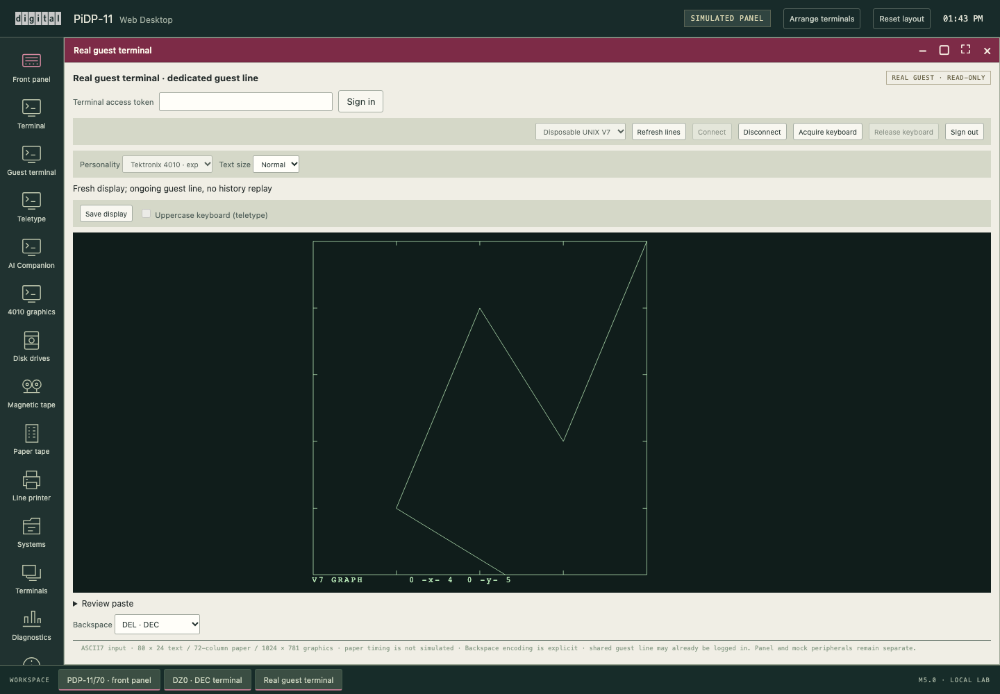
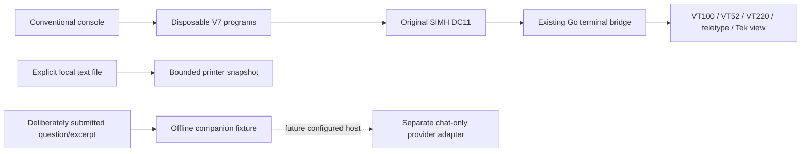

# M5.9 development checkpoint: terminals, graphics and optional applications

November 21, 2026. This is the **first M5.9 implementation increment**, not completion of every requested feature or a physical deployment acceptance. It starts from `db1b4e63de45b29bdd3e0b43e3c45286c2f6b34f`. All eleven accepted checkpoint tags remain unchanged. Work ran on the Mac and disposable ARM64 Linux; the disassembled Pi was not contacted. No original simulator source, production media, boot setting or physical control was changed.

## What is implemented and what was proved

| Area | Delivered behavior and evidence | Remaining boundary |
|---|---|---|
| VT100 / VT52 | Existing personalities retained; genuine V7 commands and original `hangman` passed in Chromium, Firefox and WebKit | `hangman` is line-oriented; no historical full-screen application was qualified |
| VT220 | Separate incremental control adapter, identification, editing/function keys, incoming C1 normalization and explicit seven-bit reply policy; genuine V7 commands and `hangman` in three engines | Initial subset, not complete VT220 conformance; supplemental character sets, downloadable characters, selective erase, 132 columns and eight-bit replies unqualified/unsupported |
| Teletype | ASR-33-inspired 72-column paper, uppercase display, separate CR/LF, backspace, bounded export and optional uppercase keyboard; actual V7 commands in three engines | No mechanical speed, sound, automatic baud pacing or exact overstrike ink; lowercase keyboard remains available for V7 |
| Tektronix | Shared bounded SVG renderer; compressed coordinates, incremental movement, line styles, alpha/graphics transitions, GIN fixture and local SVG hardcopy | Genuine V7 `graph` and `plot -Ttek` rendered 22 vectors in each engine; GIN remains fixture-tested, 4014 low bits are downsampled, not full 4014 support |
| Desktop | Up to four guest windows within the existing fourteen-window limit; shared existing authentication/line ownership; teletype and optional companion launchers | Existing layout, accessibility and mobile behavior retained; no physical panel integration |
| Line printer | Explicit local ASCII snapshot import, up to 16 KiB per job within the existing bounded queue; form feeds and raw text preserved | Actual V7 `pr` output captured through the independent console and imported manually. **No live LPT connection**; tested media lacked `/dev/lp*` and `/usr/src/sys/dev/lp.c` |
| AI Companion | Useful deterministic local guide chat, deliberate pasted excerpt, cancellation/clear and inert rendering | No model connected. Separate tested Go adapters for Ollama/native and OpenAI-compatible APIs are not wired into the service |
| Service/package | Read-only readiness helper, versioned candidate archive, checksums and compatibility metadata; ARM64 install, credentials, lifecycle and missing-memory refusal tests | No stable release or actual Pi deployment; no fresh-card Oscar installation claim |
| VT11, disk/tape, paper tape | Existing source investigation and simulated equipment preserved | No new VT11 hook, device attachment authority or real media controls in this increment |



The screenshot is a real, read-only guest stream from disposable V7 through original SIMH. The graph data were five explicitly created points. The background panel is still simulated. [Other captures and provenance](../screenshots/README.md#m59-development-captures).

## Architecture and significant findings

The existing Go service still owns authentication, attachment generations, exclusive keyboard leases and bounded transport. Browser personalities own only the interpretation of a connection's bytes. Reconnection starts fresh display/parser state without keyboard authority. Terminal identification and GIN replies require the current keyboard lease. Four windows do not create four independent keyboards on the same line.



The genuine plotting test initially produced no vectors. Source inspection and raw serial evidence showed that SIMH's default DCO `7P` mode filters control bytes including FF, GS and US. The isolated M5.9 profile selects `set dco0 7b` before boot. This preserves seven-bit graphics controls without changing original C. V7's `tek` program also emits 4014 extra coordinate bits and incremental label positioning; the parser now accepts that stream at its existing ten-bit resolution. This is a laboratory profile, not a proposed change to every guest line.

The shared terminal service cannot identify an OS solely from a reused TCP port. Its unchanged explicit attachment/revision rules and stop-bridge-before-guest-change requirement still apply. Changing terminal personality does not configure the guest OS or SIMH line mode.

The AI window is deliberately a deterministic fixture, not simulated intelligence presented as a connected model. A separately tested Go library distinguishes native Ollama from OpenAI-compatible request/response shapes, bounds calls and refuses redirects, partial responses and tool requests. No model service or private credential was used. The command-proposal validator is a **future review contract only**: it checks exact input, expiry, endpoint, generation, connection and ownership, but does not implement human approval consumption or execute commands. [Companion boundaries](../technical/companion-applications.md).

## Verification record

Private evidence is retained in `.research/m59/`; tokens, private configurations, raw guest captures and writable disks are excluded from Git and archives. Reproduction entry points are in [lab/m59](../../lab/m59/README.md).

- `go vet ./...` and `go test -race ./...` passed, including the new provider adapters. TypeScript checking, 59 frontend unit tests, transport integration and the embedded application build passed.
- The broad three-engine browser run had 66 passes and six failures because its mock artifact server was absent. With the intended mock server started, all nine artifact cases passed. The new companion and printer-import tests then passed in all three engines (six cases). This is a corrected test-environment failure, not a claim that the first run was green. The final focused terminal/graphics/companion/printer run passed 24 cases across the three engines; the installation-guide fixture/syntax suite passed 48 tests.
- Genuine V7 terminal acceptance passed twelve personality/engine combinations: VT100, VT52, VT220 and ASR-33 presentation in Chromium, Firefox and WebKit. Each exercised commands, independent console access, stale attachment rejection and detached service restart. `hangman` was exercised in the nine DEC-personality cases. The initial ASR assertion expected lowercase `login:`; the harness was corrected to recognize the intentionally uppercase display, and all three ASR cases passed.
- Genuine `graph | plot -Ttek` output passed all three engines after correcting the isolated DCO mode; the first filtered-output failure is preserved. A later Chromium capture repeated the real plot, without intercepted routes. GIN, malformed graphics, split sequences and hardcopy use explicit fixtures, not a claim of guest GIN acceptance.
- Real systemd tests in a disposable Debian Trixie ARM64 machine passed package checksums, private configuration refusal on repeat setup, both credential roles, wrong-credential rejection, explicit attachment, EOF, origin rejection, crash/restart revocation and independent peer operation. OrbStack's known type-wide override required a lab-only override to restore the package's intended hardening; production settings were not weakened.
- Read-only preflight rejected an absent original installation. It passed against clearly identified executable/map stubs without executing them or changing their hashes. This is **structural validation**, not a fresh installation of Oscar's software. Temporarily withholding the memory controller in an isolated slice caused refusal before HTTPS opened; restored protection allowed detached startup. No boot configuration changed.
- The three disposable V7 sessions were shut down through the existing harness: bridge stopped first, three guest `sync` commands, owned simulator interrupted and `quit`. All three immutable base copies retained SHA-256 `fc04dab1e7f2fbf3ea4b44603ed2c9d6ba15f4f86c702d4a27a1dac725966f39`. Writable experimental disks and evidence were retained privately.

### Short ARM64 measurements

[Machine-readable measurements](M5.9-performance.json). Nine eight-second scenarios used synthetic loopback TLS/WebSocket peers in the Mac-hosted ARM64 VM. CPU 100% represents one core; RSS measures the service process, not the whole control group or browser. Echo times exclude historical guest execution and browser rendering. These short samples do not qualify sustained Pi performance.

| Scenario | CPU, one core | Highest observed RSS | Echo p95 |
|---|---:|---:|---:|
| Detached idle | 0.25% | 8.6 MiB | — |
| Active terminal | 0.75% | 10.0 MiB | 0.84 ms |
| Two lines | 1.00% | 12.4 MiB | 0.79 ms |
| Eight observers | 4.22% | 15.1 MiB | — |
| Command bursts | 0.62% | 15.3 MiB | 0.86 ms |
| Moderate output | 1.37% | 15.2 MiB | — |

The unchanged Pi targets remain authoritative: [resource targets](../roadmap.md#performance-targets). Do not compare these values directly with M5.6 as proof of an optimization: duration, host load and allocator history differ. The 96 MiB kernel cap and 72 MiB Go soft target remain separate from the active RSS target.

## Next increment and deployment gates

1. Qualify a historically appropriate full-screen program from authorized media, then expand terminal behavior against its real requirements.
2. Design a narrow, generation-bound printer output observer. Establish the actual guest driver/device first; the manual snapshot importer grants no media attachment or simulator commands. Paper-tape and disk/tape observation need the same explicit identity and capability work.
3. Wire an owner-configured, host-side chat adapter only after authentication, endpoint policy and deliberate text-sharing UI are reviewed. Add a one-use human approval state machine before any optional guest input; the current validator is not that state machine.
4. Prototype VT11 output observation separately, keeping display instruction execution and interrupts in SIMH. No hook was added here.
5. After switch repair, separately authorize physical diagnosis and memory-controller readiness. The assessed Pi's disabled memory controller still blocks protected service startup. [Two setup paths](../getting-started/installation-paths.md) preserve original physical operation as the prerequisite and fallback.

No new accepted milestone tag or stable GitHub release is created for this development increment. Candidate archives identify their exact committed source and are tested separately from the physical machine.

## Final candidate and cleanup verification

Candidate `m5.9-preview.1` was built from source commit `ed72b4ff07a6e11838cf7d19e4726685e4032e54`. The archive is `pidp11-webdesktop-m5.9-preview.1-linux-arm64.tar.gz` (about 2.9 MB), with SHA-256:

```text
327efb8390323bd7ace6a7d0977cca0e31ee61fd9db9361b65322aa5ef2bffc7
```

The exact archive and all thirteen package-manifest entries verified inside disposable ARM64 Linux. Installing it as a third rehearsal version preserved the private configuration hash. Manual startup remained detached with `MemoryMax=100663296` and zero swap. The installed application authenticated and showed no guest connection in Chromium, Firefox and WebKit, without route interception.

The existing lifecycle test then selected both earlier rehearsal versions, verified detached restart, disabled/stopped the unit and completely removed the companion, private configuration and dedicated account. The known lab-only hardening override was removed; no original-installation fixture remained. The disposable VM was deleted after evidence capture. All owned Mac relays/mock/preview processes were stopped, and the guest container had already exited cleanly. Unrelated review containers were left alone.

The archive/checksum are retained locally under `.research/m59/release-preview-1/`; reproducible packaging and source are published, but **no hosted binary release is published**. Its bundled release notes match its source commit; this subsequent documentation section records final artifact qualification. All eleven prior checkpoint-tag references matched their recorded starting values. No new acceptance tag was created.
