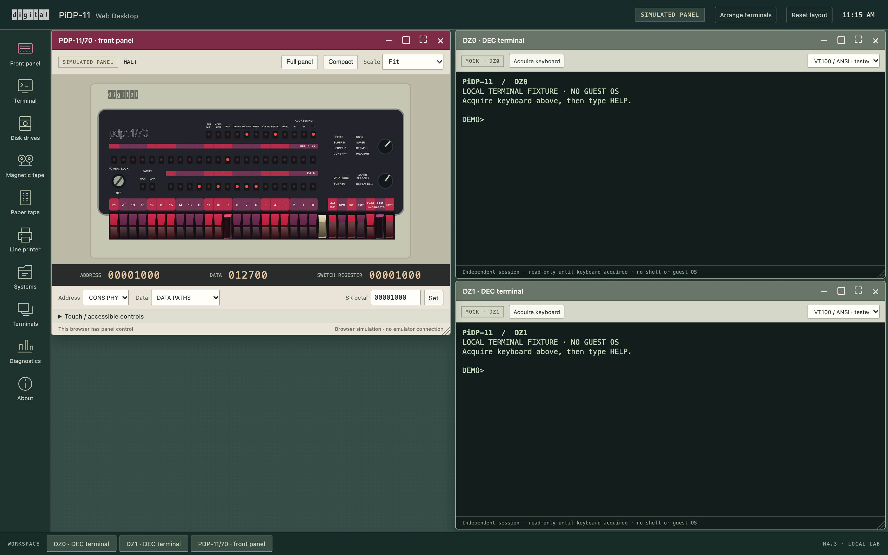
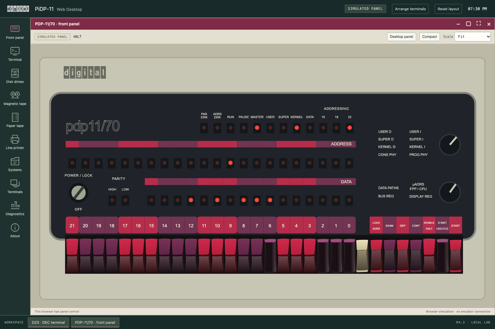
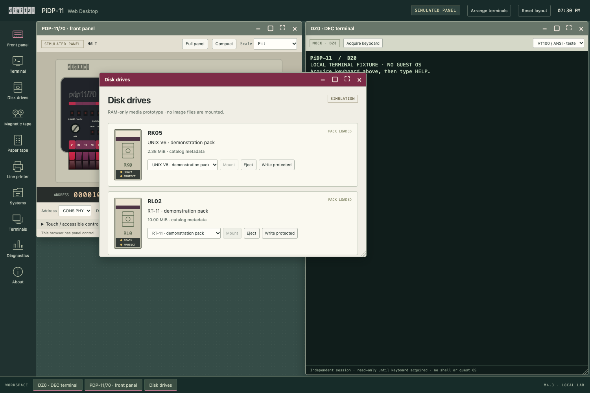
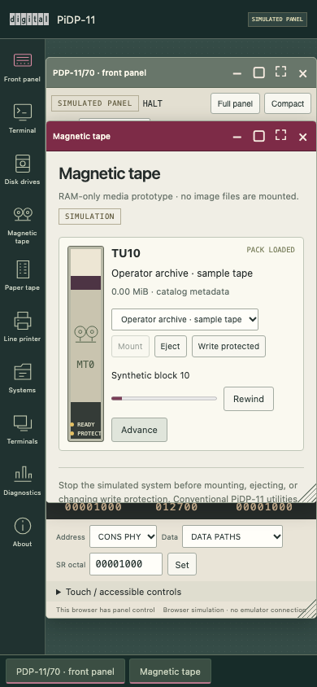
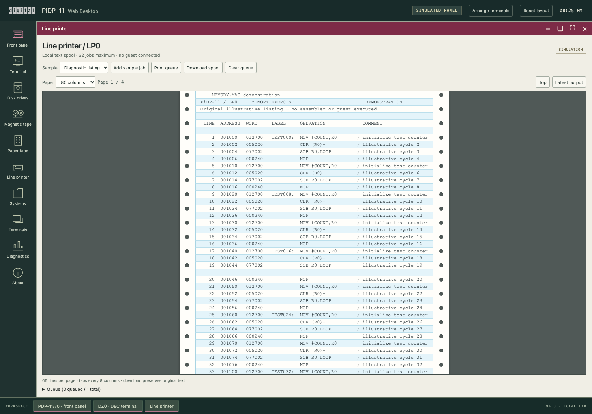
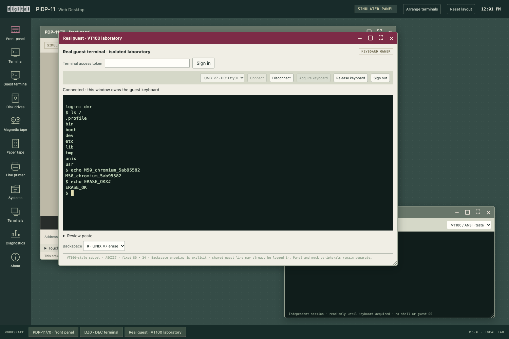
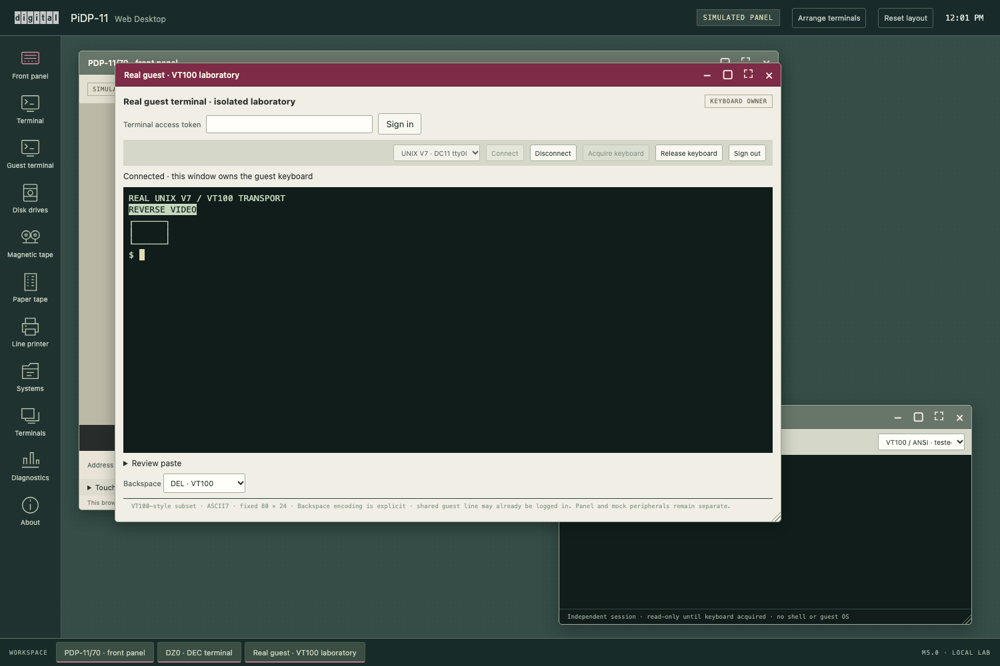
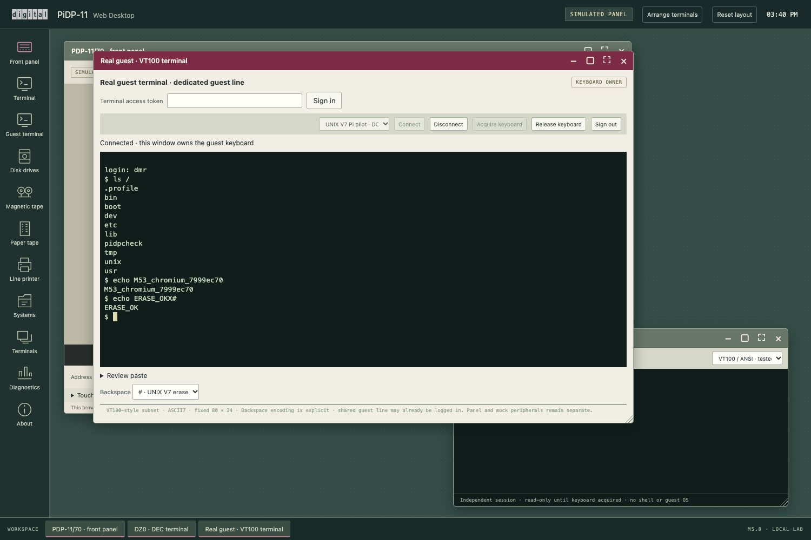

# Real application screenshots

These are existing captures of the actual application, not stock images or generated mockups. Their milestone labels matter: older captures preserve the appearance tested at that checkpoint. No screenshot here establishes a live physical-Pi deployment.

## Desktop and full panel

*M4.3: simulated SVG panel and two mock terminal sessions.*

*M4.3.1: full panel presentation with original SVG paddle artwork; simulated state.*

## Disks and tape

*M4.3.1: simulated disk mounting/write-protection workflows. No guest disk image is attached.*

*M4.3: TU10-style simulated tape application on a narrow screen. Its transport advances synthetic blocks.*

## Continuous-form printer

*M4.3.2: bounded continuous-form paper viewer, still a simulated spool. [Printer behavior and evidence](../printer-m432.md).*

## Genuine UNIX V7

*M5.0: genuine UNIX V7 input/output through the authenticated Go bridge in the isolated Mac-hosted Linux lab. The guest emitted the clear/home, reverse-video and line-drawing sequence shown above. [Reproduction and limitations](../lab/M5.0.md).*

## Actual Pi terminal pilot — M5.3

Actual Chromium capture through the SSH tunnel to the Pi-hosted V7 guest. Panel/peripheral windows remain simulated; the inherited footer is not a hardware-status indicator. See the [M5.3 evidence and cleanup](../lab/M5.3.md).
