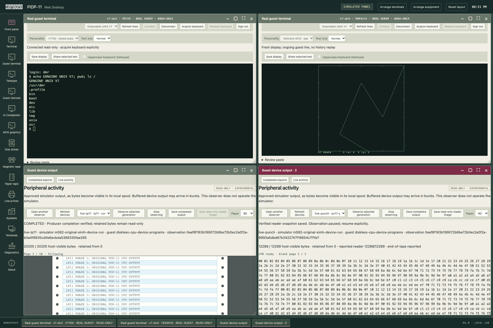
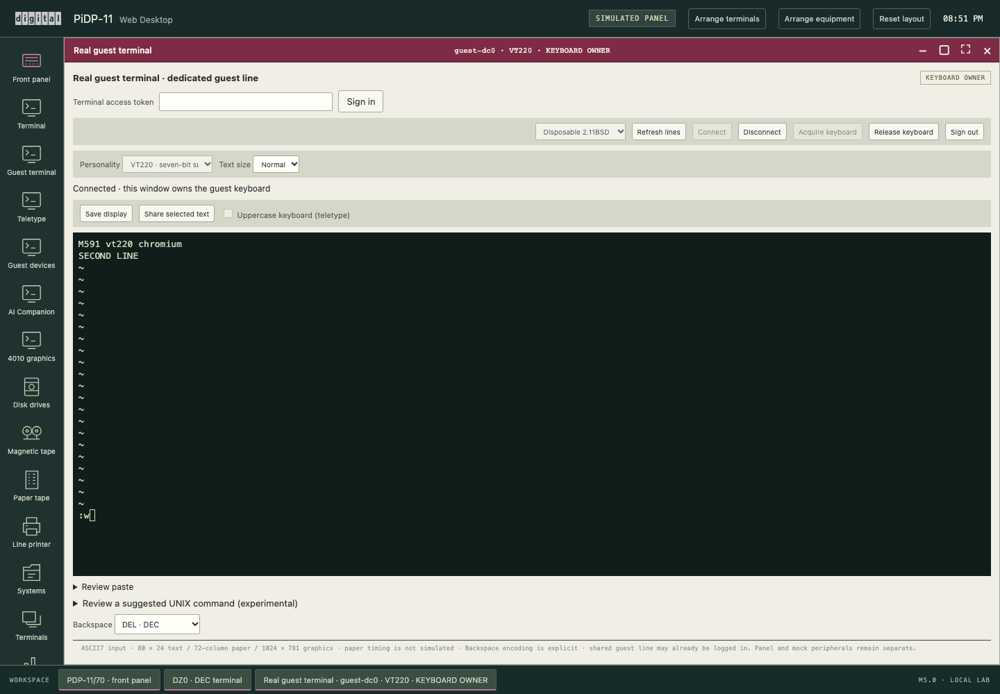
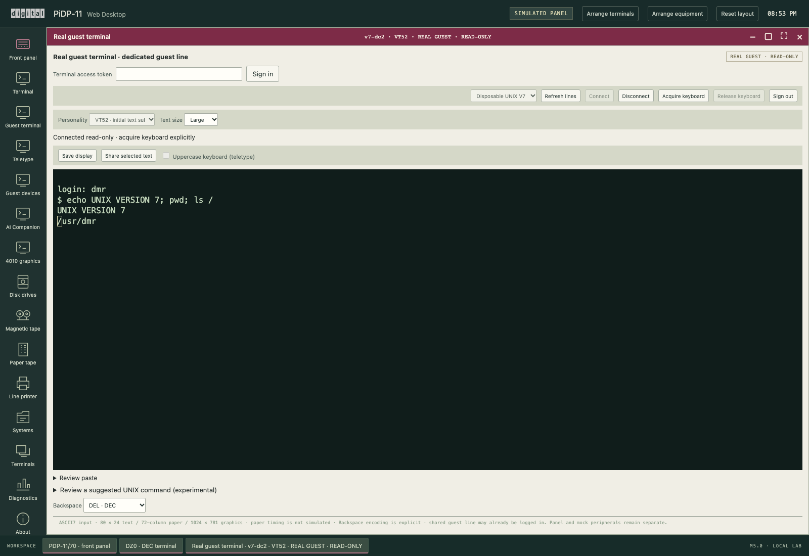
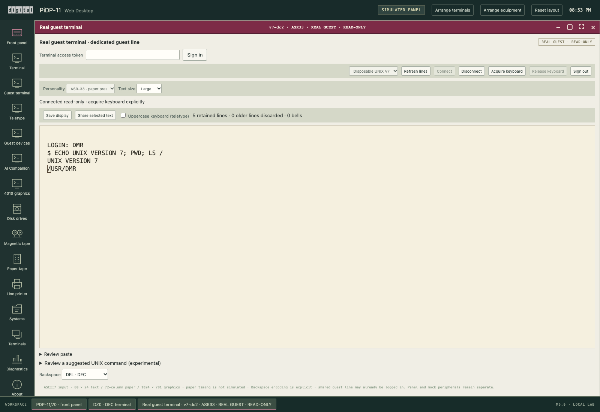
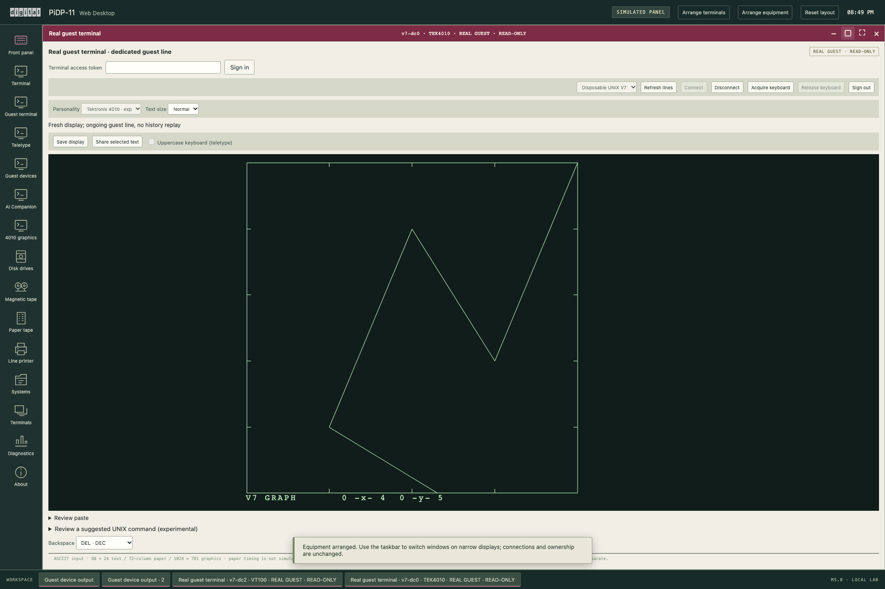
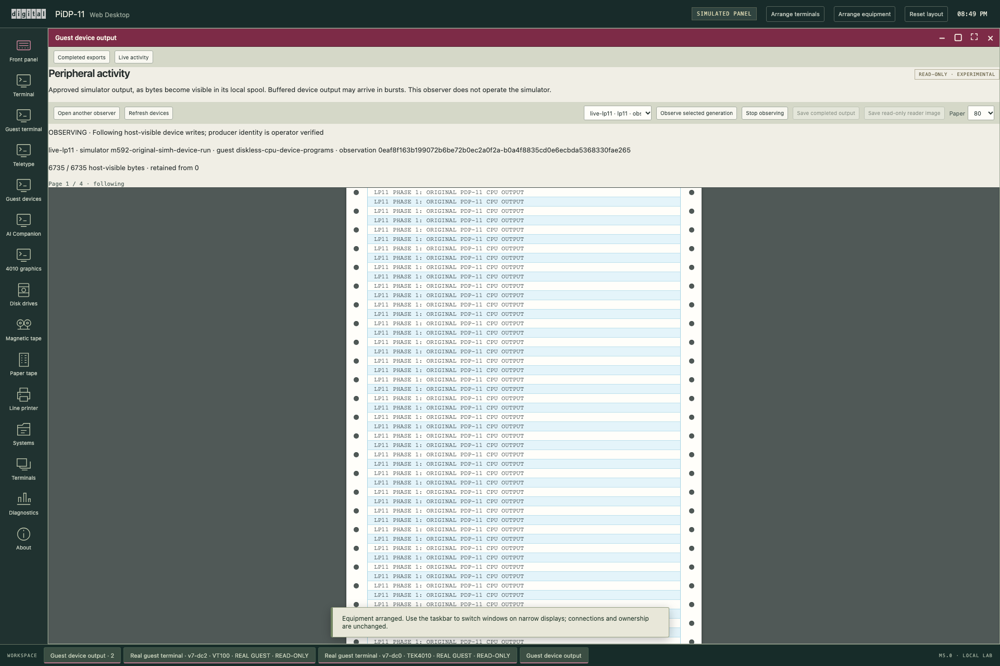
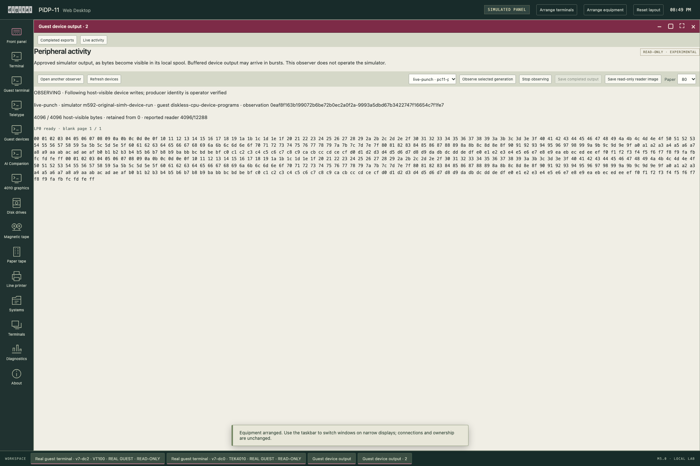

# Actual application gallery

These images show the real application. Eight fresh M5.10 Chromium captures use disposable V7/2.11BSD guests and original emulated devices on the Mac; four Phase D captures preserve the actual offline/model/app evidence. No image establishes a current physical Pi deployment.

Open any image for full resolution. Captures retain their original dimensions; fresh PNGs received lossless compression only. [Machine-readable dimensions, hashes, captions and provenance](m510/provenance.json) · [M5.10 procedure and results](../lab/M5.10.md) · [Historical archive](ARCHIVE.md).

## The equipment desk

*Fresh Chromium capture. V7 supplies terminal and vector output; a separate diskless original SIMH CPU program drives the devices. Completed output is read-only. No model or physical Pi is connected.*

## Historical guests and terminal personalities

*Fresh V7 guest commands over the authenticated bridge, captured read-only after releasing the keyboard.*

*Fresh original SIMH/disposable 2.11BSD capture. The retained M591 string is a test identifier from the reused editor harness. Insert, save, redraw, delete, quit, readback and read-only reconnect passed.*

*Fresh Chromium capture of V7 text. Historical subset, not complete VT52 conformance.*

*Fresh ASR-33-inspired 72-column presentation; captured while command output was arriving. Mechanical timing and physical teletype behavior are not emulated.*

## Graphics and emulated devices

*Fresh genuine graph | plot -Ttek output over a dedicated V7 guest line. No intercepted graphics fixture; genuine GIN remains unqualified.*

*Fresh observation during phase 1 of the diskless CPU/device test. The original LP11 registers produced the bytes. This is not an operating-system printer-driver demonstration.*

*Fresh original PC11 reader/punch exercise. Three phases later completed 12,288 bytes with exact download verification; the capture itself shows the live first phase.*

## Reference desk and optional AI

*Preserved Phase D capture: actual offline reference search, inspectable RSTS/E passage and deterministic MOVB fact. Panel and mock terminal are simulations; no model is required.*

*Preserved Phase D actual model conversation, with source inspection and the limited claim-review control. Sharing uses a labeled synthetic excerpt, not a live guest. The review panel is collapsed in this capture; it is not proof of whole-answer verification.*

*Preserved Phase D capture. The calculator computes 177776 octal = 65534 decimal = FFFE hex locally. Model prose remains a separate unverified explanation.*

## Hacker Replicant laboratory interoperability

*Preserved Phase D laboratory capture of Rolf Peters’ independently authored application with our explicit optional patch. Actual model traffic, separate login and synthetic selection/revoke workflow; no live console, supported full integration or endorsement.*

## Reading the evidence

The inherited M5.0 footer is a UI version label, not a hardware-status indicator. Public disposable-guest paths and test identifiers are not private host paths. Session tokens and private configuration are absent. Older captures remain unchanged and retain their original qualifications.

Gemma is experimental. Phase D found factual errors and missed contradictions; the claim-review control checks only recognized fragments. [Measured limits](../lab/M5.9.3-D.md). Source passages are original project summaries with links, not redistributed manuals. [Credits](../../ACKNOWLEDGMENTS.md) and [third-party notices](../../THIRD_PARTY_NOTICES.md) apply throughout.

## Earlier captures

The [M5.9 development captures](ARCHIVE.md#m59-development-captures) and all earlier images remain preserved in the historical index.
