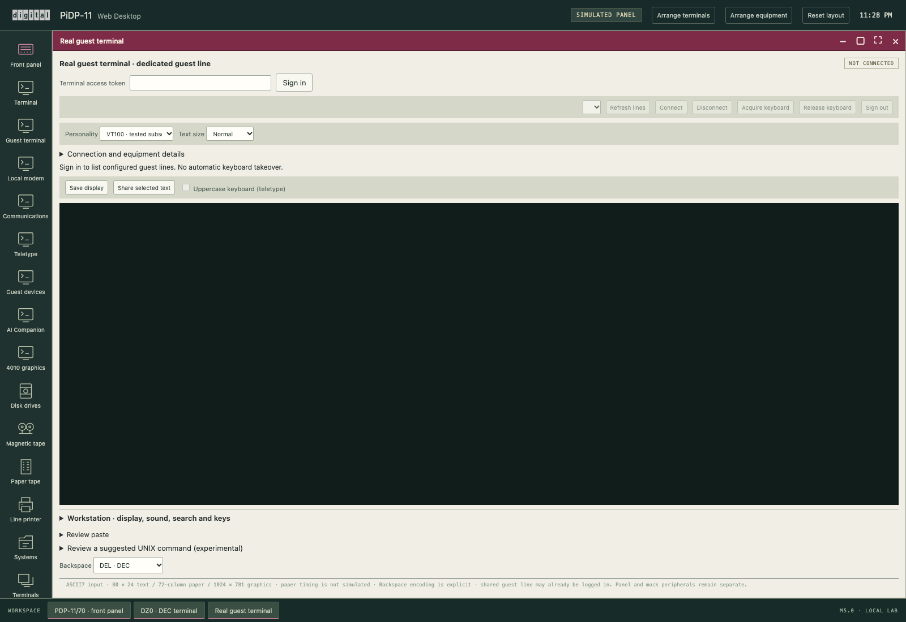
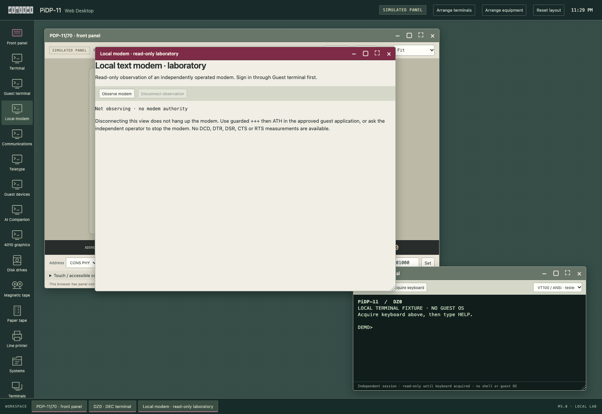
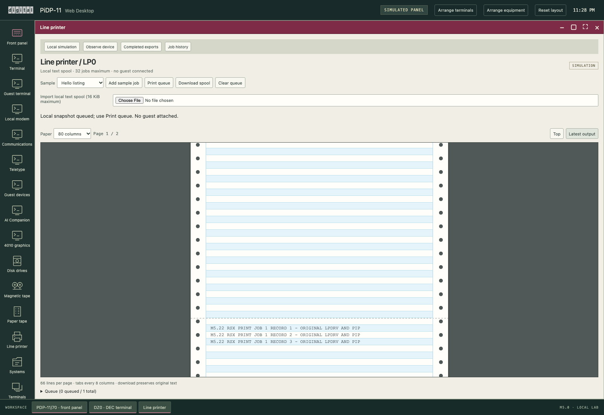
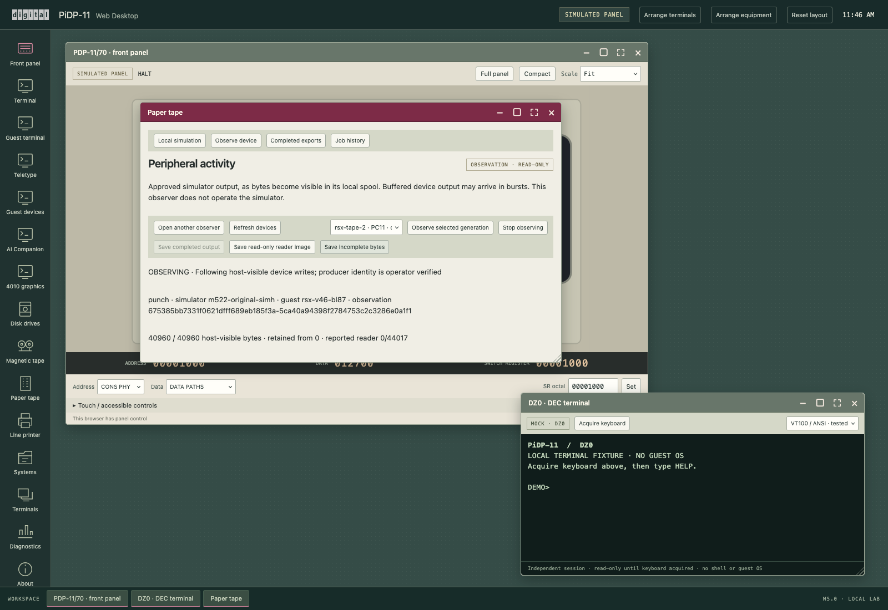
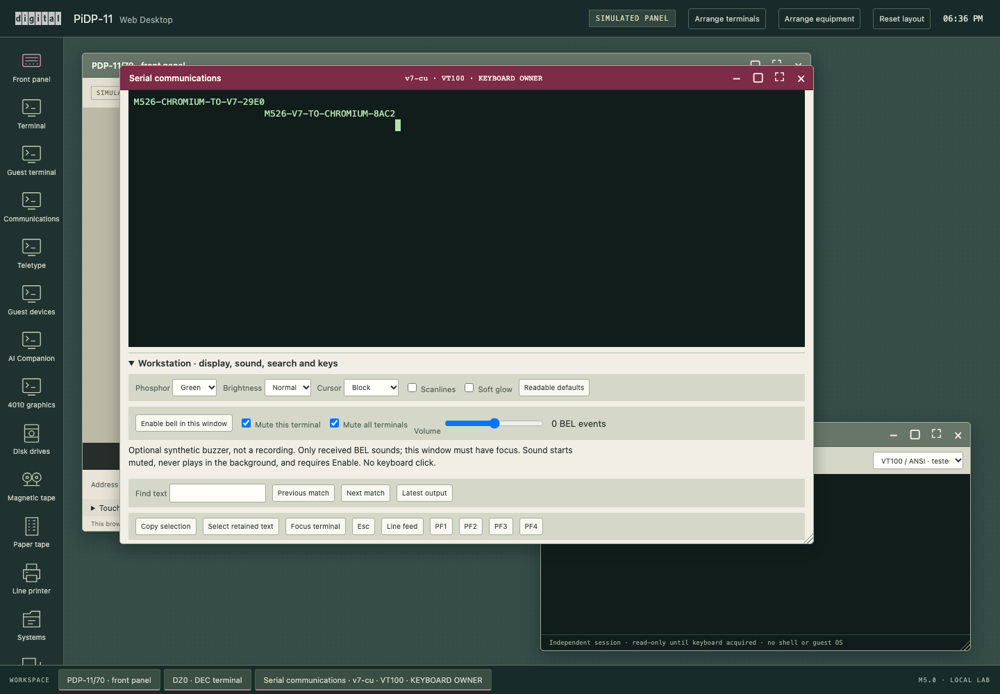
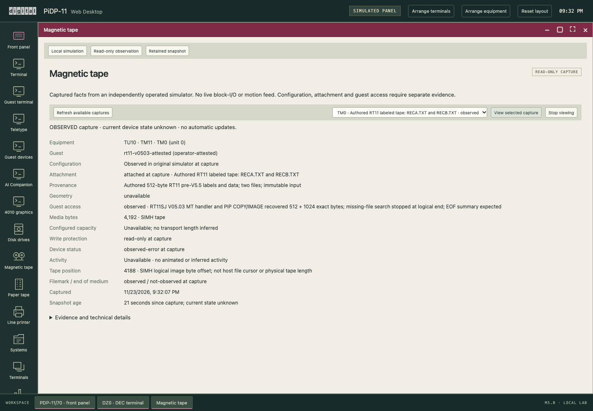
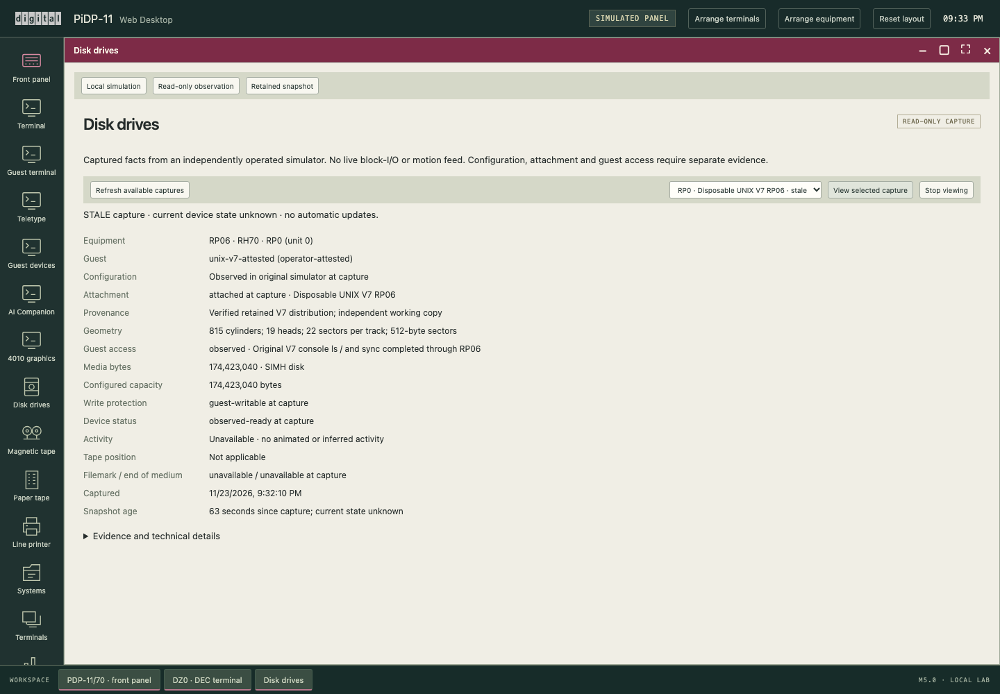
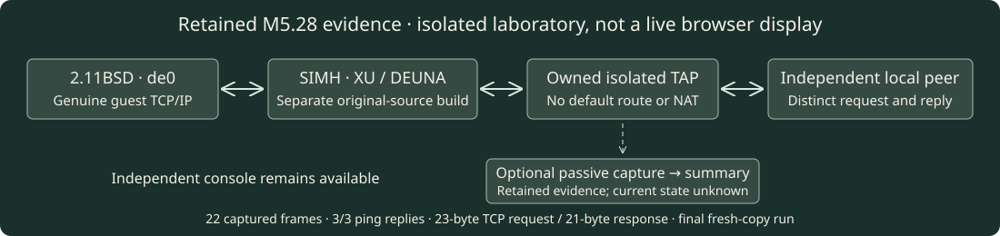

# Current views and preserved laboratory evidence

M5.29 refreshes the gallery without restarting guests or inventing live equipment.
New captures show the actual application at `b7b485f129d2b689c9f78a95df099f29024f198b`;
only documentation was changing during capture. Chromium, 1× pixels, no API or
WebSocket interception. [Hashes, dimensions and provenance](provenance.json).
The original images remain unchanged in their earlier locations.

## Current terminal and modem interfaces

*Fresh M5.29 view: no token, guest or keyboard owner. The unchanged
[M5.10 V7 and BSD captures](../README.md#historical-guests-and-terminal-personalities)
show actual guest work, with their original evidence and dates.*

*Fresh M5.29 view: read-only and not observing. This is not a new CONNECT or carrier
test. [M5.27](../../lab/M5.27.md) supplies the genuine V7 command/data/hangup and
text-file evidence. The surrounding ordinary panel and terminal are simulations.*

## Retained genuine printer output in the current viewer

*Fresh M5.29 capture of the unchanged 172-byte M5.22 RSX LPDRV/PIP spool imported
through the actual local text-import control. No guest is attached. The simulation
viewer renders retained text; it is not a live printer connection. The original
leading form feed accounts for the blank paper before the three listing lines.
The spool hash is in the provenance file; the guest proof is [M5.22](../../lab/M5.22.md).*

## Genuine paper-tape and serial captures, preserved as recorded

*Original M5.22 Chromium capture during genuine RSX punch output: 40,960 observed
bytes at this instant, not a completed-transfer claim. Background equipment is
simulated. Completion and exact download results are in the milestone report.*

*Original M5.26 cu/DC11 exchange with distinct peer text and current-at-that-time
workstation controls. This is a historical session, not a presently connected
modem or guest. No credential or private console content is visible.*

For these two older images, an exact capture-time working-tree revision was not
recorded. The manifest identifies that gap and the later qualification commits;
it does not invent a capture commit. New M5.29 captures have an exact application
revision. Retained images do not silently inherit current-main qualification.

## Storage: capture age is part of the picture

*Unchanged actual M5.24 captured-observation view. The error/end condition belongs
to the tested missing-file search at the time of capture; it is not current drive
health. No animated tape motion or live I/O is inferred.*

*Unchanged actual M5.24 view with geometry, provenance and explicitly stale data.
[Guest evidence and limits](../../lab/M5.24.md).*

## Ethernet: retained evidence, not a fictional network window

*Authored explanatory SVG, not a screenshot. It represents the actual isolated
BSD/DEUNA/TAP/peer experiment. The final fresh-copy run captured 22 frames and
three matching ping replies, then completed a 23-byte request and distinctive
21-byte TCP response. [M5.28 results](../../lab/M5.28.md). Ordinary builds have no
live networking-equipment window.*

All images are Craig Daters / RetroRealm application captures or original diagram
work; existing artwork and historical names retain the [project notices](../../../THIRD_PARTY_NOTICES.md).
Physical photos, M5.3 Pi evidence, M5.10/11 guest captures and Phase D model captures
remain in the [historical gallery](../README.md), with their original qualifications.
