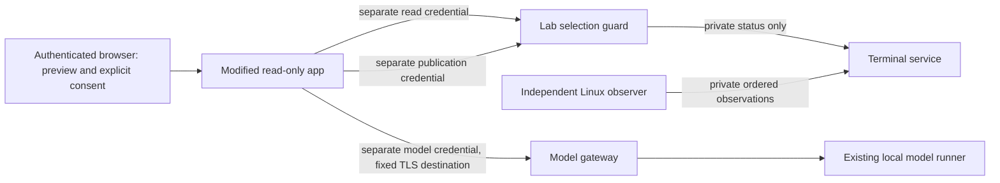

# Hacker Replicant review packet — M5.12

This packet is for a qualified independent reviewer. It is an implementation and
test record by the same development agent, **not independent expert approval**.
No maintainer was contacted. There is no claimed collaboration or endorsement.
The integration remains disabled by default and laboratory-qualified.

## Trust and authority

The pinned upstream application is Rolf Peters' Hacker Replicant at
`6f8a2aca7786736e01bdf5ba9b44bf66a7f19349`. The explicit read-only preparation
module replaces its machine-control path. It does not give the app an operator
console, simulator monitor, shell, GPIO, panel-control or keyboard-injection route.

Browser login, adapter reads, adapter publication and model access use distinct
credentials. Private files, loopback listeners, TLS, exact origins and bounded
request bodies protect these boundaries. This is not a public multi-tenant
service. A compromised authenticated local administrator is outside its boundary.

## Consent and source identity

The user previews selected text, sees its destination and explicitly approves
sharing for at most 30 seconds. A question must request that exact receipt.
Repeated identical text receives a new receipt. Another page cannot substitute
its newer approval for an earlier question. The lab guard requires the approved
SIMH lifetime, supervised endpoint proof, service instance, attachment revision,
and exactly the original sole viewer membership. A second observer or replacement
view invalidates that narrow sharing approval; terminal observation itself can
still support multiple viewers.

The guard does not identify the guest OS. The operator epoch remains an
attestation. The [supervision contract](../technical/supervised-guest-identity.md)
explains the surviving-process/stream limitation and required manual guest-change
procedure. This guard is not installed by the production package.

## New reproduced publication race

Before the M5.12 correction, the app could fetch status for one page, another page could revoke
consent, and the first page's delayed HTTP publication could arrive afterward and
be accepted. M5.11 already fenced a callback delayed *inside* publication, but
that did not cover requests delayed before reaching the adapter. The fence begins with that adapter status observation,
not a browser click timestamp. A request that first obtains fresh status after
revocation is treated as a new explicit consent request; revocation is not a
permanent ban on future user-approved publication. This boundary needs review
before stronger cross-device consent guarantees are claimed.

Status now carries an adapter-instance/revision publication epoch, captured before
the source callback. HTTP publication must supply that epoch. Publication checks
it both before and after the source callback. Revocation advances the revision;
adapter restart changes its instance. Missing or stale epochs are refused rather
than retried. The modified app forwards the observed epoch. Old app/adapter
combinations fail closed for sharing until updated together.

## Revocation, retention and failures

Revocation prevents subsequent selection fetches/publications with stale authority.
Source loss, expiry or changed generations also refuse new selected-text requests.
This does **not** recall bytes already submitted to a model or erase a response
already held by the browser. There is an unavoidable boundary between final
authorization and network transmission; do not promise atomic recall across it.

Selections and adapter receipts are bounded, in-memory state. Browser chat state
and any operator-enabled logs or model-runner retention are separate concerns;
review their deployment settings. Private laboratory transcripts include guest
text and are excluded from public packages. The integration performs no automatic
terminal scraping or background submission.

The app bounds in-flight chat and cancels an outstanding provider request when its
client closes. A busy request is refused rather than queued indefinitely. Model
failure returns an explicit error; no alternate provider is selected. A gateway
restart requires a new user request and does not restore old sharing consent.

## Reproducible review targets

From the Mac repository shell:

1. Run `go test -race ./internal/replicant ./internal/terminalservice
   ./internal/terminalbridge ./internal/modelhost` (as one shell command).
2. Run `npm run test:replicant`. The five isolated cases include delayed
   publication across revocation, two-page receipt boundaries, request
   cancellation, slot recovery and provider failure.
3. Follow the [M5.12 laboratory runbook](../../lab/m512/README.md) for genuine
   V7 selection, the supervised guard and the pinned modified application.
   `sharing-browser.mjs` exercises actual local Gemma output, expiry, revocation,
   cross-page substitution, source disconnection and same-count view replacement.
4. Review the [public result summaries](../../lab/m512/results/) and the
   [engineering report](../lab/M5.12.md), keeping fixture and genuine evidence
   separate. Private credentials and guest media are not supplied.

Review the authorization linearization points, cancellation/resource ownership,
source-view invalidation, stale socket/process handling, and retention disclosure.
Remaining blockers include authoritative guest identification, production observer
privileges, multi-user deployment, independent review and physical acceptance.
Rolf's interest, if any, does not change those requirements.
