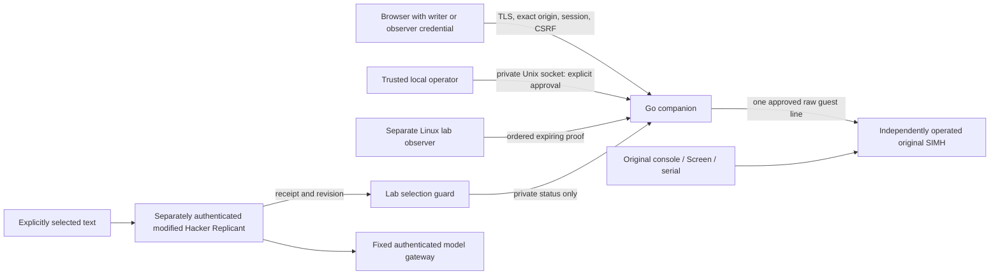

# M5.13 external security review packet

This is a reproducible review submission prepared by the implementation author,
not independent security acceptance. Scope: local source demonstration and owned,
isolated guest laboratories. Internet exposure, multi-tenant operation, unattended
OS discovery and physical deployment are outside the qualified scope.

## Trust boundaries



The operator chooses and independently verifies the guest and dedicated line.
The Go manager trusts local assertions; the observer measures process/socket
identity. **Neither proves which OS runs inside an unchanged process and stream.**
Stop the actual observer and bridge before intentional guest changes. Labels,
prompts, hashes, pidfds and AI statements do not replace that requirement.

A writer may request a keyboard lease, while an observer can receive authorized
text but cannot type. The browser cannot attach a new guest or choose an arbitrary
network destination. Simulator startup, shutdown, disks, Screen and GPIO have no
route through this service. The optional three-command proposal experiment remains
disabled by default and separately fenced by approval and current keyboard ownership.

## Claim-to-test map

Paths are repository-relative. Run the named Go packages with `go test -race`;
tests reside alongside the named implementation. Tests establish the stated
invariant under their fixtures, not a complete adversarial audit.

| Implementation | Reproduction / exact test | Invariant | Limit |
| --- | --- | --- | --- |
| `internal/access/access.go` | `TestIndependentCapabilitiesCSRFAndExpiry`, `TestMalformedOriginCredentialsAndBounds` | Independent capabilities, exact origin and CSRF; expiry and bounded credentials | Operator provisioning and TLS trust remain external |
| `internal/access/secure_test.go` / access gate | `TestSecureOriginCookiesRevocationAndAudit`, `TestSlowLoginDoesNotHoldSessionLock` | Secure cookies, revocation, no credential text in audit; slow login does not hold session lock | Browser/host compromise and already delivered text cannot be undone |
| `internal/terminalservice/lifecycle.go` | `TestDetachedAndGenerationFences`, `TestDetachDuringDial`, `TestGuestEOFRetiresAndConsumesApproval` | Detached startup; stale instance/revision and late dial cannot regain attachment | Manual approval is operator attestation |
| `internal/terminalservice/supervision.go` | `TestSupervisionRequiresConnectedSocketVerification`, `TestSupervisionExpiryPermanentlyRetiresOldEndpoint`, `TestSupervisionExpiresWhileDialBlocked` | Unpublished initial verification; expired proofs retire permanently | Scheduling dependent; no hard real-time CPU-stop promise |
| Same + `control.go` | `TestConcurrentRenewalHasOnlyOneWinner`, `TestMalformedRenewalCannotConsumeOrPublishApproval` | Exact next sequence; one winner; malformed request changes no authority | Trusted local observer may lie |
| `lab/m512/supervisor.py` | `python3 lab/m512/supervisor_test.py` in isolated Linux: four real child/socket tests | Exited pidfd, other-process listener, listener replacement and changed executable refused | PID-path reuse is modeled, not actual kernel PID recycling; same-process OS changes undetectable |
| `internal/terminalbridge/bridge.go` | `TestOwnershipOrderingExpiryAndNoReplay`, `TestLeaseExpiresWithoutInjectingBytes`, `TestHTTPAuthorizationAndDisconnect` | No inherited keyboard authority or replay; unauthorized clients receive no guest text | Bytes already sent to guest cannot be recalled |
| `internal/terminalbridge/lifecycle_test.go` | `TestReplacementListenerRequiresFreshBridge`, `TestDetachedReaderCannotPublishBufferedOutput` | Reused endpoint and stale reader cannot publish into successor | Does not detect OS replacement on the surviving stream |
| `internal/terminalbridge/observation_test.go` | `TestObservationDistinguishesSameCountReplacement` | New viewer changes membership identity even when count stays one | Sole-view guard is lab policy, not terminal's normal multi-view policy |
| `internal/terminalbridge/bridge.go`, `terminalservice/listener.go` | `TestBoundsAndMalformedInput`, `TestInputRateLimitAndRecovery`, `TestStalledWriteIsBoundedAndNeverReplayed`, `TestListenerBoundsAndReleases` | Bounded inputs, credits, writes and connections; refusal/release rather than unlimited queues | Resource tests do not prove resistance to all host-level exhaustion |
| `internal/replicant/http.go`, `sharing.go` | `TestRevokeFencesPendingPublication`, `TestRevokeFencesPublicationPreparedBeforeHTTPRequest`, `TestConcurrentPublicationsConsumeOneEpoch` | Revocation fences callback/HTTP delays; one shared epoch permits one concurrent publication | Epoch begins at adapter status observation, not browser click; a newly observed epoch allows new explicit consent |
| Same + `integrations/hacker-replicant/read-only.mjs` | `TestSelectionReceiptChangesOnEveryPublication`, `TestSharingMalformedRequestsCannotReplaceSelection`; `npm run test:replicant` | Exact receipt binds selected excerpt; malformed requests and cross-page substitution refused | Final check and transmission are not an atomic cross-process transaction |
| `internal/modelhost/gateway.go` | `TestAuthenticatedTLSAndNoManagement`, `TestCancellationAndBusyDoNotQueue`, `TestGatewayQuotationAndDurableAttribution` | Separate credential, fixed model, no runner management/tools; cancellation, one slot, visible attribution | Model prose remains fallible; server-side runner retention is operator-controlled |
| `internal/companion/service.go`, `attribution.go` | `TestConfiguredChatHTTP`, `TestQuotationCannotBorrowParaphraseAuthority`, `TestEveryModelAnswerCarriesSourceStatus` | Unsupported marked quotations withheld; all delivered prose carries source-status text | Heuristic misses unusual quote syntax; unconditional notice remains; no semantic truth certificate |
| `internal/peripheral/follow.go`, `store.go` | `TestFollowRetiresOnUnsafeProducerChanges`, `TestFollowingRevokesOnSameSizeWriteAndCompletionMismatch`, `TestTruncateRegrowBetweenPollsRetiresObservedBytes`, `TestClosedFollowerCannotReopenOrRestart`, `TestEmptyExportAndObserverIsolation` | Read-only bounded files, generations, retained-byte comparison, completion digest; closure permanent | Does not authenticate discarded history or defeat malicious parent-directory mutation |
| `internal/terminalservice/config.go`, `control.go` | `TestPrivateInputsAndControlSocket`, `TestControlRejectsForeignOwner`, `TestPrivateFileRejectsForeignOwner` | No special/symlink private files; bounded size; config owner root/service; control directory strictly service-owned | Trusted parent hierarchy required; root remains trusted; no atomic pathname defense against malicious ancestor owners |
| `internal/memoryguard/check.go`, `packaging/pidp11-webdesktop.service` | `TestContainmentEvidence`; retained M5.12 actual systemd controller-loss rehearsal | Installed service refuses missing/excessive kernel memory/swap limits before listeners | Go soft memory target alone is insufficient; assessed physical Pi still blocked |

M5.13 runs the full Go race suite, modified-app route cases and real Linux observer
cases. The foreign-owner regression first failed on unchanged M5.12 code: root
could create a control socket in UID 65534's mode-0700 directory. The directory
owner could then replace that pathname. The fix requires the service's effective
UID, and the real ARM64 `chown` tests pass. See
[owner result](../../lab/m513/results/control-owner-arm64.txt) and
[Linux observer result](../../lab/m513/results/linux-supervisor.txt).

## Reproduction without hardware

From a clean developer checkout with the documented Go/Node tools:

```sh
go vet ./...
go test -race ./...
npm ci
npm run test:replicant
```

For ownership checks, compile `GOOS=linux GOARCH=arm64 CGO_ENABLED=0 go test -c
-o /absolute/private/terminalservice.test ./internal/terminalservice` in the Mac
shell. Run that test binary as root **only in disposable Linux** with
`-test.run 'TestControlRejectsForeignOwner|TestPrivateFileRejectsForeignOwner|TestPrivateInputsAndControlSocket' -test.v`.
It changes ownership only inside its new temporary directories. Mac/non-root
runs deliberately skip the two ownership-mutation tests. The full race suite
and root ARM64 run are separate evidence categories.

Follow [the M5.13 lab guide](../../lab/m513/README.md) for genuine guests, media
checks, conventional access and shutdown. Prior protected installation/crash/
rollback evidence remains identified as M5.12; do not present it as a new physical
test or as proof of the unknown guest OS.

## Data retention and reviewer questions

Tokens and private configuration stay outside source packages. Requests are bounded,
selection state expires in memory, and ordinary logs omit terminal text. Browser
chat history, explicit downloads, optional operator captures and inference-runner
retention are separate data stores. Revocation stops future authorized access;
it cannot recall a model request or erase material already received.

Please examine the authorization linearization points, filesystem parent trust,
credential/group provisioning, process-exec/descriptor inheritance cases, observer
privileges, origin/session handling, resource exhaustion, excerpt retention and
cancellation after transmission. Check that no documentation confuses process
identity with guest identity. No independent reviewer has yet signed off; feedback
would inform a later revision, not retroactively certify this packet.
