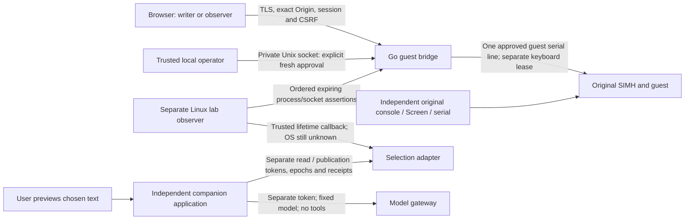

# M5.16 external security review entry point

**Independent review is pending.** This package was prepared by the implementation
workflow. It asks an outside engineer to challenge specific promises; passing its
checks is not an audit certificate or physical deployment approval.

## Scope and exact target

Review tree: `87bc750543154f65489f91413ce33ceda0b6f6e5`. The
[fixed source tree](https://github.com/cdaters/pidp11-webdesktop/tree/87bc750543154f65489f91413ce33ceda0b6f6e5)
contains the reviewer environment, 21-invariant manifest, 47 named Go cases,
independent client, actual TLS probe and browser-UI fixture.

Production Go/browser behavior is unchanged in M5.16. The integrated selection
modules retain the M5.15 behavior at `c39647975fbf573e14c8bd4a16b8f017df3597b9`;
the Go runtime remains byte-identical to M5.14. The public M5.13 archive is older
and unchanged. Later documentation/evidence commits do not change this review tree.

Qualified audience: a trusted operator's local demonstration or controlled guest
laboratory. Internet exposure, hostile local administrators, multi-tenant service,
physical Pi deployment and automatic OS identification are outside this assurance.
Application authorization and historical guest correctness are separate claims.

## Read this boundary first



The browser cannot choose an arbitrary address or attach a guest. An observer
cannot acquire keyboard authority. The service owns neither SIMH's process nor
its media, original console or GPIO. It never starts, stops or switches a guest.
The optional three-command suggestion experiment stays disabled by default and
requires a separate one-use approval and current keyboard lease.

The operator must identify the guest and dedicated terminal line independently.
A Linux process ID, executable hash, socket inode, accepted connection and browser
membership revision can establish a particular lifetime, **not the guest OS**.
An OS change within the same surviving stream can be invisible. Stop the actual
bridge and observer before intentional changes, then verify and approve afresh.
No disconnect or expired lease proves that a CPU has stopped.

## Promises, tests and invalidating assumptions

The [human-readable invariant reference](m516/invariants.md) supplies, for every
assertion: promise, pinned source/test links, exact command, evidence class,
remaining limit and invalidating assumption. The [machine-readable version](m516/invariants.json)
is checked by the reproducible runner. Start with these groups:

| Boundary | Invariant IDs to inspect |
|---|---|
| Login, capabilities, sessions and private diagnostics | authentication, sessions, private-diagnostics |
| Attachment, ownership, proof ordering and expiration | attachment, verification, ordered-renewal, viewer-membership |
| Keyboard, no replay and resource ownership | keyboard, replacement, bounded-transport, listeners |
| Local filesystem/operator authority | private-files, local-control, provisioning |
| Selected text, consent and independent model service | epochs, receipts, model-gateway, tutor-attribution |
| Read-only peripheral output and containment | peripheral-retirement, peripheral-closure, memory |

Additional cross-process checks are deliberately distinct:

- [Independent JS client](../../integrations/selection-contract/client.mjs): nine
  fixture cases validate version/authority refusal, fixed HTTPS destinations,
  separate credentials, immutable preview, exact receipts, cancellation and bounds.
  An honest preview/consent UI is a caller obligation; a Boolean cannot prove a click.
- [Actual Go/Node TLS probe](../../integrations/selection-contract/tls-probe.mjs):
  checks the real adapter, two authenticated callers, identical-text replacement,
  global revoke, epochs, restart and forbidden control routes. Expiry and browser
  lifetime loss are injected callbacks, not independent OS observations.
- [Linux observer](../../lab/m512/supervisor.py) and its four real child/socket
  tests cover process exit, modeled PID-path reuse, listener replacement,
  other-process ownership and exec identity. Kernel PID recycling is not claimed.
  A trusted observer can lie; privileges and inherited-descriptor cases need review.
- [Optional UI fixture](../../lab/m516/selection-ui.mjs) executes the actual UI
  script in three engines and checks receipt removal and history-reset events.
  It does not run the upstream app or prove that every page erases delivered text.
  Six route fixtures cover malformed chat, receipt substitution and late replies.

## Reproduce without a Pi, guest disk or model

In a fresh Mac/developer shell with Git, Go 1.25+ and Node 22.18+:

```sh
git clone https://github.com/cdaters/pidp11-webdesktop.git pidp11-review
cd pidp11-review
git checkout --detach 87bc750543154f65489f91413ce33ceda0b6f6e5
npm ci
python3 lab/m516/review_checks.py
python3 lab/m516/review_checks.py --run --output "$PWD/.research/review-results"
PIDP11_CONTRACT_TLS_TEST=1 go test -race -count=1 ./internal/replicant -v
```

The output directory must be new. The runner validates 21 claims/47 test names
before execution and stops on a failed check. Mac runs skip the two foreign-owner
mutation cases; use the separate Linux step below. `-count=1` matters: Go's test
cache does not track the Node probe's transitive source imports. A cached result
is not evidence that a changed probe ran.

For browser UI evidence, install the existing Playwright engines if necessary,
then run `node lab/m516/selection-ui.mjs /absolute/new/private-result.json`.
HTTP responses and clock advancement in that test are labeled fixtures.

The [M5.16 runbook](../../lab/m516/README.md#linux-review-without-simh)
provides a small Python-only Linux image and exact root/capability-restricted
commands for the real process/socket and ownership checks. It downloads tools
at image-build time, uses no network at test time, and contains no simulator or
media. QEMU and genuine guests are optional deeper evidence, not review prerequisites.

## Known failures to challenge again

| Found in | Failure and correction | Current regression anchor |
|---|---|---|
| M5.11 | Delayed identity callback restored revoked selection; second page substituted text | epochs, receipts; route receipt test |
| M5.11 | Null chat element threw; closed follower reopened; truncate/regrow masqueraded as append | optional route suite; peripheral-closure / retirement |
| M5.12 | Publication delayed before HTTP crossed revocation | status-to-publication epoch test |
| M5.13 | Root bound a control socket in another UID's private directory | private-files; real Linux owner check |
| M5.13 | Citation/paraphrase presented as primary-source quotation | tutor-attribution; generated prose remains fallible |
| M5.14 | Handled provisioning failure left partial private configuration | provisioning; not crash-atomic cleanup |
| M5.15 | Caller changed the consent preview during an await; cancelled model reply arrived late | independent-client snapshot and optional-route cancellation tests |
| M5.16 | Restricted root could not inspect a foreign-owned test directory; test misreported socket creation | Test now requires owner refusal, restores only the test directory and verifies absence |

The original provisioning exit-139 events and plotting timeout remain unresolved.
The [M5.16 report](../lab/M5.16.md) retains failed attempts and distinguishes actual
Linux observations from synthetic failures and successful guest regressions.

## Reviewer checklist and retained-data limits

1. Confirm the pinned tree and reproduce an expected refusal as well as success.
   Look for a missing test or an assertion that passes for the wrong reason.
2. Trace authorization through the final write/read: session, attachment generation,
   keyboard lease, input sequence, publication epoch and exact receipt.
3. Challenge concurrent revoke/renew/replace, delayed reads, process exec and
   listener inheritance. Identify where callbacks run outside locks.
4. Inspect control-directory ancestors, credential provisioning and observer
   privileges. Root and trusted parents are assumptions, not defeated attackers.
5. Check resource bounds and actual controller enforcement. The installed service
   requires 96 MiB hard memory/zero swap; a 72 MiB Go target is insufficient alone.
6. Trace every retained text copy. Revocation cannot recall downloads, sent model
   requests, another page's history or runner retention. Ordinary logs omit guest
   text; explicit private lab captures deliberately do not. Never submit those raw
   captures, tokens, private addresses or disks in a public review issue.
7. Report the exact revision, reproduced behavior, threat assumptions, severity,
   minimal private evidence and proposed correction. Mark untested claims clearly.

The packet is ready for Craig to share. No reviewer approval, upstream agreement,
maintainer contact, new release or physical acceptance has occurred.
