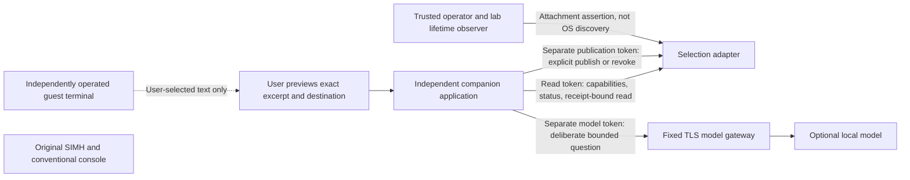

# M5.15 interoperability review packet

Prepared for owner-directed discussion with Rolf Peters. **No upstream approval,
maintainer contact or independent professional audit has occurred.** Both projects
remain independently installed, authenticated and operated. This packet concerns
selected text, not GNU Screen or an emulator console.

## Exact review target

Application/integration source: `c39647975fbf573e14c8bd4a16b8f017df3597b9`.
The two implementation commits are `77d53af` (preview snapshot and real TLS
conformance) and `c396479` (late-response cancellation). The Go production adapter
is unchanged from M5.14. Laboratory/documentation commits that follow do not
change this contract implementation.

Review these files at that revision:

- [Independent client](../../integrations/selection-contract/client.mjs) and
  [client tests](../../integrations/selection-contract/client.test.mjs).
- [Go adapter](../../internal/replicant/http.go),
  [publication boundary](../../internal/replicant/sharing.go), and
  [real TLS qualification](../../internal/replicant/client_integration_test.go)
  with its [Node probe](../../integrations/selection-contract/tls-probe.mjs).
- [Optional integration module](../../integrations/hacker-replicant/read-only.mjs)
  and [route tests](../../integrations/hacker-replicant/read-only.test.mjs).

The latter module belongs to Web Desktop's existing experiment; M5.15 changed no
upstream checkout. The [M5.13 packet](hacker-replicant-interoperability.md) preserves
the original patch inventory and upstream pin. These relative links follow the
current checkout; use the exact revision above for a fixed review target.

## Trust boundary



There is no control edge to the original simulator. No Screen hardcopy, monitor,
shell, panel, automatic keyboard injection or guest-switch route exists in this
selection adapter. Browser login is another independent credential; a model never
receives the publication token. Fixed HTTPS destinations and certificate trust
are provisioned deliberately, without private-service discovery or redirects.

## Proposed wire exchange

The [0.1 draft](selection-contract-draft.md) is the complete specification, with
capabilities and JSON examples. A minimal exchange is:

1. Authenticate `GET /api/pidp11/capabilities`; require `0.1-draft`, the consent
   capabilities and only `selected-text-only` authority. Unsupported versions or
   machine-control authority fail closed without a legacy fallback.
2. Preview the excerpt. The client copies and validates its primitive fields
   **before awaiting negotiation**. Later UI/caller edits cannot replace the
   approved text. Read status for the current publication epoch.
3. Publish with the separate writer credential:

   ```json
   {
     "publication_epoch": "example-instance:1",
     "consent": true,
     "selection": {
       "endpoint": "example-line",
       "generation": "example-attachment",
       "simulator_generation": "operator-process-assertion",
       "viewer_revision": 1,
       "text": "Deliberately reviewed excerpt"
     }
   }
   ```

   HTTP 204 returns a 32-hex-character `X-Selection-ID`. Epochs and receipts are
   identifiers, not credentials. Only one publication consumes a given epoch.
4. Read `/api/pidp11/screen` with that exact receipt header and the read token.
   The response includes the same receipt, selected `text` and `expires_unix_ms`.
   The caller rechecks receipt, size, expiry and cancellation before use.
5. DELETE the selection with the writer credential to revoke. Expiry, identity
   loss and adapter restart retire old readback/publication authority.

## Invariants and evidence

| Boundary | Reproducible evidence | Important limit |
|---|---|---|
| Version, capabilities, forbidden authority, fixed origin | Nine client cases | Fixtures test negotiation and redirect policy; this is not upstream adoption |
| Separate read/write auth, Origin refusal, no control routes | Go-to-Node trusted TLS test | Local single-user adapter, not an Internet or multi-tenant design |
| Exact preview | Mutation during negotiation failed before `77d53af`, passes after | Caller must still show an honest preview and obtain consent |
| Epoch, receipt substitution, concurrent publication | Real HTTP publications plus deterministic Go race cases | One selection slot; concurrent pages can retire one another's selection |
| Expiry, browser-lifetime loss, restart | TLS test with expired timestamp and controlled lifetime callback | Expiry is forced in this test; callback changes simulate observer input |
| Cancellation, delayed response, provider failure | Independent client body-cancellation case; six optional-app route cases; gateway cancellation/busy tests | Cannot recall data already submitted to a provider |
| Malformed/oversized requests | Client preflight and actual Go HTTP decoder tests | 4 KiB text limit plus 6 KiB whole publication JSON bound; escaping can reach the wire bound first |
| Unknown identity | Status asserts `os:null`, `running:null`, `cpu_running:"unknown"` | An accepted process/line assertion does not discover the guest OS |

The legacy read route still permits a missing receipt header for the earlier
modified-app experiment, whose consumer checks the returned receipt. The new
client always sends the header. Identity checking and subsequent model submission
are not atomic. A guest change inside the same surviving stream may remain
invisible; stop the actual bridge and observer before intentional changes.
Absolute expiry checks can refuse valid text if clocks disagree. Already delivered
text/history cannot be recalled. Cancellation is checked after completed response
reads as well as passed to the transport; a provider may nevertheless continue
work after cancellation. No UI or protocol can promise erasure by that provider.

## Repeatable checks

In a Mac development shell, from the exact source revision with Go 1.25+ and Node
22.18+ installed:

```sh
npm ci
npm run test:selection-contract
npm run test:replicant
PIDP11_CONTRACT_TLS_TEST=1 go test -race ./internal/replicant -v
go test -race ./internal/modelhost ./internal/companion
```

The TLS case launches an ephemeral loopback Go server and a separate Node process,
trusting only its generated test certificate through `NODE_EXTRA_CA_CERTS`. Its
`/test/` fault controls exist only in `_test.go`, never in the production server.
The same checks passed in a clean clone. No guest, real model, private credential,
upstream checkout or Pi is required. Model gateway tests use deterministic
providers; prior genuine app/model sharing remains the M5.12 record.

## Minimum upstream discussion

No upstream change is required to review this standalone contract. If Rolf wants
native compatibility, the proposed minimum is an optional read-only provider
entry point with fixed endpoint/credential configuration, explicit selection
preview/receipt state and cancellation. It must bypass original operator-console
and tool routes while leaving normal independent operation available.

Decide together whether a new selected-text route should make receipt headers
mandatory, where independent credentials belong, which history-clearing and
multi-page consent semantics are useful, and whether the version/capability
schema fits upstream. Do not promise a permanent fork, supported integration or
an upstream patch before that discussion. The [M5.15 report](../lab/M5.15.md)
records measured results and unresolved deployment gates.
