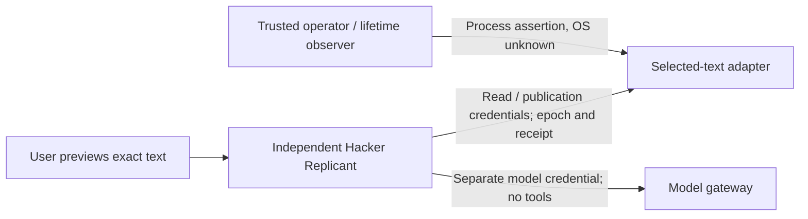

# Selected-text interoperability: a short handoff for Rolf

Prepared for Craig to share privately. Rolf has expressed interest in comparing
notes; **the protocol is not approved or implemented upstream**. Nothing has been
sent, and neither project needs to merge its authentication or lifecycle.

## The proposal

Web Desktop reserves an explicitly approved guest serial line, leaving the original
operator console independent. An optional companion can receive a short excerpt
that the user previews and approves. It receives no Screen snapshot, monitor,
keyboard, shell, panel or guest-switch authority. Model access is a separate
fixed HTTPS service with a separate credential.



Review tree: [`87bc750`](https://github.com/cdaters/pidp11-webdesktop/tree/87bc750543154f65489f91413ce33ceda0b6f6e5).
The [client](https://github.com/cdaters/pidp11-webdesktop/blob/87bc750543154f65489f91413ce33ceda0b6f6e5/integrations/selection-contract/client.mjs),
[Go adapter](https://github.com/cdaters/pidp11-webdesktop/blob/87bc750543154f65489f91413ce33ceda0b6f6e5/internal/replicant/http.go)
and [TLS probe](https://github.com/cdaters/pidp11-webdesktop/blob/87bc750543154f65489f91413ce33ceda0b6f6e5/integrations/selection-contract/tls-probe.mjs)
are entirely in our repository. No upstream edit or permanent fork is proposed.

## Minimal existing exchange (0.1 draft)

1. Read authenticated `/api/pidp11/capabilities`; require `0.1-draft`, the consent
   capabilities and only `selected-text-only` authority. No fallback/discovery.
2. Preview the excerpt; snapshot it before awaiting status. Obtain the current
   `publication_epoch` from `/api/pidp11/status`.
3. POST `/api/pidp11/selection` with the distinct publication token:

   ```json
   {"consent":true,"publication_epoch":"example:1","selection":{
     "endpoint":"guest-line","generation":"attachment","simulator_generation":"operator-assertion",
     "viewer_revision":1,"text":"Explicitly reviewed excerpt"}}
   ```

   Success: `204`, with unpredictable `X-Selection-ID: <32 hex characters>`.
4. GET `/api/pidp11/screen` using the read token and exact receipt header. Response
   includes `selection_id`, `text` and `expires_unix_ms`; verify all before use.
5. DELETE `/api/pidp11/selection` using the publication token to revoke.

The [complete draft](selection-contract-draft.md) defines errors and bounds:
4 KiB selected text, 6 KiB publication JSON, 30-second lifetime, no retries.
Fixed HTTPS destinations, Origin refusal and separate credentials remain required.

## Route and history recommendation

For a future negotiated version, prefer **`/selected-text` with a mandatory exact
receipt**. The current `/screen` name is misleading and its absent-header legacy
compatibility is weaker. This is a proposal only: no route/version change was
implemented, and existing experiments remain compatible. A future opt-in version
must advertise the mandatory-receipt rule; it must not silently downgrade.

There is one shared selection slot. A second publication retires the first receipt;
any authorized publisher can revoke that slot. A page clears its local receipt and
signals a history reset on revoke/expiry, but another page can retain already
received text. Revocation cannot recall submitted model requests. Process/socket
identity does not establish the OS; an unchanged stream may conceal a guest change.

## Reproduce and decide

At the pinned tree, after `npm ci`:

```sh
npm run test:selection-contract
npm run test:replicant
PIDP11_CONTRACT_TLS_TEST=1 go test -race -count=1 ./internal/replicant -v
```

Nine client cases, six module cases and actual Go/Node TLS passed. UI/history-event
checks use fixtures; no fresh upstream-app/model acceptance or independent audit
is claimed. Five questions for discussion:

1. Would an optional read-only provider interface fit upstream?
2. Should a new version require `/selected-text` and receipt headers everywhere?
3. Which application should hold the separate publication credential and consent UI?
4. Is one shared slot/global revoke useful, or is page-scoped publication needed?
5. What history-clearing guarantees should be promised across pages and providers?
