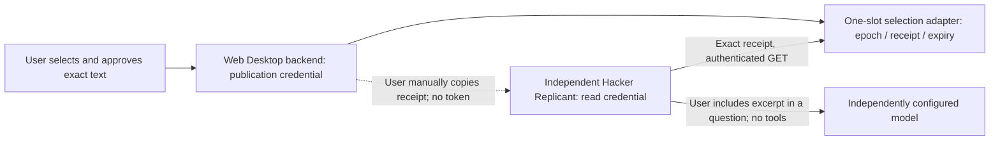

# Selected-text provider — review handoff for Rolf

Rolf, thank you for reviewing the earlier proposal. Craig has relayed your support
for an optional read-only provider, a dedicated receipt-required `/selected-text`
interface, Web Desktop-owned publication and consent, one shared slot, and local
receipt/history reset with honest retention limits. This packet incorporates those
five directions. **The following 0.2 interface is proposed, not implemented or
accepted upstream.** It asks for technical feedback, not an adapter-maintenance or
pull-request commitment. Craig will decide whether to send it; no message was sent
as part of this work.

Web Desktop's browser receives neither service credential. It previews exact text
and destination; its backend publishes only the approved immutable snapshot.
Hacker Replicant keeps its own authentication and normal modes. The optional
consumer is off by default and grants no console, keyboard, monitor, shell or panel
access. Your existing `read_screen` obtains a full GNU Screen hardcopy; selected
text is deliberately smaller and must never fall back to that tool.

## Proposed exchange

1. Explicitly enabled server-side clients negotiate
   `GET /api/pidp11/v0.2/capabilities`, requiring `0.2-proposed`, mandatory receipt,
   Desktop-owned publication and only `selected-text-only` authority.
2. Desktop's backend uses its publisher credential to obtain an epoch and source
   identity from `GET /api/pidp11/v0.2/status` **before the final consent preview**.
   After approval, `POST /api/pidp11/v0.2/selection` carries that epoch, consent,
   fixed consumer ID and frozen `{endpoint,generation,simulator_generation,
   viewer_revision,text}`. Proposed success: 201 with random `selection_id`,
   absolute `expires_unix_ms`, consumer ID and matching `X-Selection-ID` header.
3. The user explicitly copies a receipt-only envelope from Desktop and pastes it
   into separately signed-in Hacker Replicant. No URL, automatic clipboard read,
   CORS, `postMessage` or credential transfer. Pasting alone does nothing.
4. On Load approved excerpt, Hacker Replicant's backend uses its **read** credential
   plus mandatory `X-Selection-ID` at
   `GET /api/pidp11/v0.2/selected-text`. Verify returned receipt, audience, fields,
   text and expiry. Show the excerpt; include it only in a deliberately selected
   question, rechecking the same receipt before use. No automatic model call.
5. Desktop globally revokes with `DELETE /api/pidp11/v0.2/selection` (204). Replacement
   retires the previous receipt; expiry and lost attachment also refuse further
   reads. Hacker Replicant's local Clear selection does not need or obtain a writer
   token. A receipt without independent read authentication cannot retrieve text.

Limits remain **4 KiB UTF-8 text / 30 seconds maximum**, one shared slot. Bounded
publication JSON is 6 KiB; responses 8 KiB; adapter calls five seconds, no retries
or redirects. Missing/malformed receipt: 400; stale/wrong/expired receipt: 409;
authentication: 401; wrong credential role/origin: 403. Errors contain no excerpt.
The [full proposal](selection-contract-0.2-proposal.md) defines exact roles,
capabilities, envelopes, source-view fences and failure responses.

## Lifecycle and compatibility

Each application cancels pending work, clears its receipt/include state and signals
a local history reset on observed revoke/expiry. A late response cannot restore
consent. This is not a cross-origin event bus: remote revoke is noticed on the next
explicit read or expiry. Previously delivered text, another page's history and a
submitted model request cannot be recalled. Future model history must not silently
carry expired selected context. Expiry never terminates a guest.

Guest OS identity remains operator-attested; surviving process/socket identity is
not proof of the OS. Restart/reconnect never restores approval. The original
console and simulator remain independent. The current 0.1 experiment and its legacy
`/api/pidp11/screen` are unchanged. A separately authorized migration should select
an exclusive 0.2 profile so the legacy absent-header path cannot expose the new
slot. There is no implicit upgrade or native-upstream compatibility claim.

## Code map and next steps

Existing Web Desktop code at reviewed revision `845f885` (all links pinned):

- [Terminal selection](https://github.com/cdaters/pidp11-webdesktop/blob/845f88512e317e74b3ec12fbad6ff008dc260e7b/src/guest-terminal.ts) and [local sharing](https://github.com/cdaters/pidp11-webdesktop/blob/845f88512e317e74b3ec12fbad6ff008dc260e7b/src/terminal-sharing.ts): currently feed the internal Companion, not an external publisher.
- [Adapter state/read routes](https://github.com/cdaters/pidp11-webdesktop/blob/845f88512e317e74b3ec12fbad6ff008dc260e7b/internal/replicant/http.go) and [separate writer boundary](https://github.com/cdaters/pidp11-webdesktop/blob/845f88512e317e74b3ec12fbad6ff008dc260e7b/internal/replicant/sharing.go): existing epoch, receipt and expiry foundation.
- [Independent 0.1 client](https://github.com/cdaters/pidp11-webdesktop/blob/845f88512e317e74b3ec12fbad6ff008dc260e7b/integrations/selection-contract/client.mjs) and [TLS qualification](https://github.com/cdaters/pidp11-webdesktop/blob/845f88512e317e74b3ec12fbad6ff008dc260e7b/internal/replicant/client_integration_test.go): reusable foundations, not new-version results.
- [Experimental modified-app module](https://github.com/cdaters/pidp11-webdesktop/blob/845f88512e317e74b3ec12fbad6ff008dc260e7b/integrations/hacker-replicant/read-only.mjs): currently holds both adapter credentials; this is the major custody change, not a native upstream implementation.

Suggested sequence: review wire/handoff choices; separately authorize adapter and
Desktop changes; qualify synthetic conformance; add a native consumer only if you
choose; then qualify actual application interoperability before migration. The
[change inventory](M5.23.1-interoperability-review.md) and
[conformance plan](selection-contract-0.2-conformance.md) cover failure paths.

Three questions remain: Does the versioned route/schema and exclusive migration
profile fit? Is manual receipt import useful within the existing 30-second bound?
Where would the optional consumer and local history reset fit your UI/session
lifecycle? No response is required to preserve either application's normal use.
