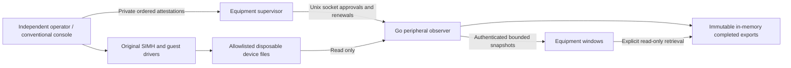

# Independently supervised equipment sessions

M5.21 extends the existing bounded peripheral observer with an optional local
supervisor. This is an isolated-Linux laboratory implementation, not an installed
service or a remote SIMH controller. [Measured results](../lab/M5.21.md) distinguish
genuine guest behavior from fixture tests.

There is no browser-to-monitor or supervisor-to-monitor arrow. The lab's separate
private operator harness can pause/inspect/close devices; neither the Go supervisor
nor browser has that capability. The original console and simulator remain usable
when either optional process ends.

## Identity and authority

Private configuration names at most four existing observer/export slots. The Go
supervisor checks a specific simulator PID, process start tick, executable SHA-256
at startup, and executable inode/size/mtime on subsequent probes. This reduces
accidental process replacement; it does **not** discover the running operating
system, device attachment or whether the CPU is safe. The independent operator
attests those facts. A changed guest within the same simulator would require stopping
supervision and fresh explicit approval; automatic guest-change detection is absent.

Each supervisor has a random owner identity. Each job has an explicit name and a
fresh observation generation. Every later approval includes the exact owner and
generation plus the observer instance/revision. Old owners cannot detach, renew or
complete replacement sessions. A new supervisor cannot adopt an existing active
session. The observer service's instance is pinned; service replacement rejects
renewal before any mutation. Reusing a slot retires its prior live generation.
A rejected replacement preserves the old retained data.

Private stdin accepts ordered JSON lines, at most 2,048 bytes, with strict sequence
numbers and known fields. Only begin, progress, guest-returned, drained, closed,
complete and detach are operator commands; renewals are internal. The implementation
also accepts a manually supplied renew through the same trusted private boundary.
No command supplies a host path, arbitrary monitor text or a guest lifecycle action.
The Unix socket and operator pipe are trusted local boundaries, not adversarial
multi-user authorization. Operator statements are not cryptographic device proofs.

## Completion is a sequence of different facts

| Phase | Independent evidence required | Consumer check |
|---|---|---|
| Observing | Correct guest/device, approved producer and fresh empty spool | Open regular allowlisted file, new generation; readonly paired reader matches pinned hash |
| Guest returned | Historical utility returned and conventional-console task inspection | Ordered operator attestation; no automatic completion |
| Drained | Paused original device is ready/no error, utility inactive, exact device POS recorded | Monotonic produced length within the 1 MiB job bound |
| Closed | Independent operator closed the idle device, flushing original SIMH output | Open spool size equals the independently reported device length |
| Completed | Full closed-file checksum independently verified | All bytes read and digest/length agree; publish bounded immutable export |

Neither a prompt, reader EOF, idle timer nor file inactivity proves completion.
A dishonest or mistaken trusted operator can mis-attest a close; this implementation
cannot eliminate that risk. A failed export publication can leave the live observer
completed while no new export exists. It is reported as a failure, with no automatic
retry. Inspect retained evidence before a fresh explicit decision.

The original SIMH buffers host output. A device may have produced more bytes than
are visible in its file. M5.21's live reader position remains the last operator
report, not an inferred continuously sampled register; EOF is separately attested.

## Failure and retention

Renewal runs once per second with bounded two-second local HTTP timeouts. The
consumer independently expires approval five seconds after the last accepted
renewal, observed on its 200 ms poll. EOF, signal, malformed input, uncertain HTTP
reply, changed producer or observer restart stops the supervisor without replay.
An already accepted request may have changed state before a response is lost;
inspect it rather than guessing or repeating. No failure sends a signal to SIMH.
Slow reads and truncated/replaced files retain existing observer rejection rules.

On expiry, the live generation becomes disconnected and stops consuming new bytes.
Previously retained bytes remain explicitly incomplete. Browser close or Stop
observing cancels only that browser's requests; it does not retire producer authority
or stop the device. Reopening never restores observation automatically. Expired or
replaced generations cannot reconnect silently. Cached text is labeled as cached.

Four slots bound live observations and their current completed exports. A live slot retains a 64 KiB tail of at most a 1 MiB job;
each response carries at most 8 KiB. Reader and completed-export snapshots each
have a 64 KiB ceiling. A completed export is copied in memory and survives changes
to its live spool, until explicit replacement in that export slot or service exit.
This is not a durable print queue or unlimited archive. A service restart loses
RAM history and requires new approvals; private spool files remain operator-owned.
M5.22 separately retains eight terminal job records across slot reuse and provides
explicit private save/data-only recovery. Unsaved history still disappears on exit.
See the [history contract](equipment-history.md) and [guided operator procedure](equipment-operator.md).
Save important records before eviction or service exit.

## Reader selection: qualified subset only

`GET /api/v1/device-media` uses the existing authenticated device-read capability.
It lists up to four operator-configured reader entries: name, format, provenance,
size, SHA-256, readonly status and observation generation. It opens bounded regular
files read-only, verifies their contents and refuses changed/writable copies as
verified media. Filesystem paths never reach the browser. The view uses inert text.

The catalog is a snapshot, not proof of attachment or readiness. The user gives its
name/checksum to the independent operator. That operator must establish an inactive
reader, inspect the actual guest/device, attach the intended readonly file and
verify its identity before approving a fresh session. M5.21 executes this boundary
in its private lab harness. There is **no browser mounting or media-write endpoint**,
no automatic swap on EOF, and no claim that path permissions alone prevent a trusted
host owner from changing a file. Automated safe media selection remains unqualified.

## Source and tests

- `cmd/equipment-supervisor` enforces Linux/network-none lab startup and producer checks.
- `internal/equipmentsession` owns the local request/renewal loop and its cancellation.
- `internal/peripheral/session.go` owns phase/catalog validation under the existing follower lock.
- `src/live-devices.ts` binds job/owner/device identity and ordered phases; `src/reader-catalog.ts` owns explicit retrieval and disposal.
- Go tests cover completion order, wrong lengths, immutable exports, replacement,
  stale authority, lost producer and observer restart. Browser tests cover changed
  identity, backward phases, cancelled catalog replies and cached state.

Legacy followers without `session` configuration retain their prior API. The
supervised configuration does not silently strengthen legacy operator approvals.
Before production, require a separately reviewed operator workflow, representative
resource/latency measurements and the enforced **96 MiB companion / zero-swap** gate.
The 128 MiB whole-guest lab container is not proof of that companion-only limit.
