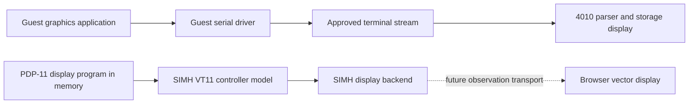
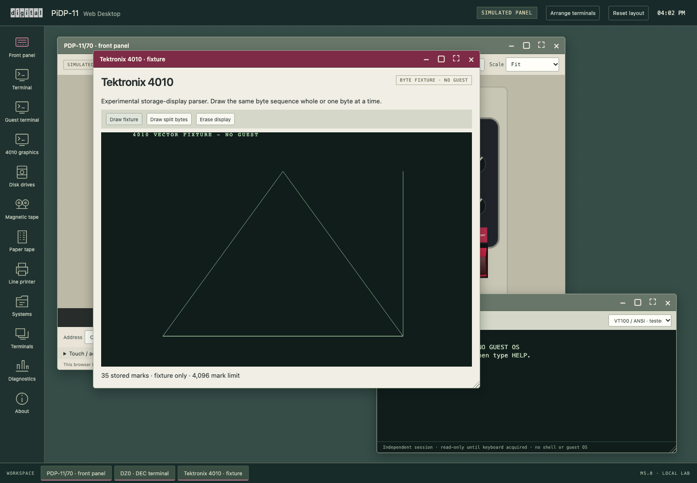

# Two different graphics paths

A Tektronix 4010 is a serial terminal. A DEC VT11 is a PDP-11 display processor driving a vector display such as the VR14. A terminal byte stream cannot substitute for the VT11's memory bus, registers, interrupts or light pen.

## 4010 fixture and guest presentation

Open **4010 graphics** on the desktop. **Draw fixture** and **Draw split bytes** feed the same deterministic sequence; **Erase display** clears it. No guest or network connection is involved. `Tek4010` accepts incremental seven-bit input, GS graph mode, US alpha mode and ESC FF erase. Full High-Y, Low-Y, High-X, Low-X addresses produce ten-bit coordinates. The first coordinate after GS moves without drawing. Stored marks remain until erase. The SVG maps the lower-left coordinate origin into a 1024×781 viewport and clips coordinates above the visible area.

The [Tektronix 4010/4010-1 User's Manual, 070-1225-00](https://w140.com/tekwiki/images/c/c2/070-1225-00.pdf), section 3 and figures 3-1–3-3, supplies the encoding and manual coordinate example used by the tests. Alpha rendering uses approximate 14-unit spacing and 22-unit line advance. M5.9 adds compressed addresses after an initial complete coordinate, incremental pen movement, line styles and GIN. The first coordinate after GS moves without drawing. The original V7 tek driver's extra 4014 low-bit byte is accepted and downsampled to ten-bit display resolution; this is not full 4014 emulation. Alpha glyphs, dual margins, storage-tube appearance, timing and font modes remain approximate or unsupported. CR leaves graphics mode. Malformed input faults the parser until explicit reset.

Storage remains bounded to 4,096 combined line/text marks and 64 KiB per input chunk, with at most four pending coordinate bytes. The SVG is built from inert elements and text nodes. **Save display** downloads the current SVG without fetching files or sending guest commands. Fixture and guest views share this renderer.

**Guest terminal → Tektronix 4010** uses the existing approved serial stream and keyboard lease. GIN requests show a crosshair; an explicit pointer click sends a five-byte coordinate response only for the current connected keyboard owner. Observers remain silent. Pointer-based GIN currently has no equivalent keyboard coordinate selection, and genuine guest GIN acceptance is still pending. Reconnect starts a fresh storage display; no earlier graphics are replayed.

Original V7 `graph` and `plot -Ttek` produced a real 22-vector plot in Chromium, Firefox and WebKit. The isolated profile sets DCO0 to `7B` because SIMH's default `7P` filters graphics controls. Original simulator source is unchanged. [Evidence and capture](../lab/M5.9.md) distinguish this genuine plot from the retained M5.6 fixture below. Parser/reference research also used [XTerm's control-sequence reference](https://invisible-island.net/xterm/ctlseqs/ctlseqs.html); no XTerm source was copied into the parser.

*Actual application capture, not a guest graphics session. The background panel and mock terminal remain simulated.*

## VT11 source findings and recommendation

The inspected source is Oscar's unchanged pinned [`26d20be`](https://github.com/obsolescence/pidp11/tree/26d20beda0c6b5a1d3a5cb3d7a4dd494e02bff75), under `src/02.3_simh/4.x+realcons/src/`:

- `PDP11/pdp11_vt.c` registers VT only with `USE_DISPLAY`. Its register reads/writes delegate to the VT11 model; `vt_svc` schedules `vt11_cycle`. `vt_fetch` reads PDP-11 memory with `Map_ReadW`, including Unibus mapping, and reports failed fetches to the controller. Separate callbacks assert display interrupts.
- `display/vt11.c` decodes the display program and emits display points with intensity. It also depends on light-pen interaction. The browser must not duplicate instruction execution.
- `display/display.c` models display points and aging. `display/sim_ws.c` is a local window-system backend, **not WebSocket code**; it uses simulator video/input facilities. No supported browser vector-stream API was identified in this path. The lab's quickmake includes `USE_DISPLAY`; this does not prove a usable graphics driver or guest application was exercised.

Prefer an optional, narrowly scoped display-output observation hook or display backend, discussed upstream first. Keep device execution and interrupts in SIMH. A future transport needs a simulator generation, viewport/scale, intensity/aging semantics, bounded batches, sequence numbers and explicit loss/reset handling. Point output may be much larger than vector instructions; measure before choosing point batches, vector events or bounded raster frames. Browser disappearance must never block the CPU. Reset on generation change; never show old phosphor as current state.

Begin output-only. Light-pen input changes emulator-visible state and requires its own explicit authority, geometry, timing and coexistence design. BlinkenBone panel RPC and the raw guest terminal bridge do not provide that authority. No simulator patch, graphics hook, VT11 transport or graphics guest has been implemented or tested in M5.6.

## M5.12 scope check

The same unchanged source paths were rechecked: `vt_svc` calls `vt11_cycle`,
`vt_fetch` reads mapped PDP-11 memory, the display model emits intensity-bearing
points, and `sim_ws.c` uses the local video/input API. No existing browser vector
transport was found. The original execution/interrupt model should remain intact.
A future output-only backend experiment should bound pending display batches,
include simulator generations and sequence/reset messages, and drop/reset a slow
observer instead of delaying the CPU. Measure point volume before choosing a wire
format; light-pen input is a separate authority problem. No VT11 rendering experiment
or graphics application acceptance was performed in M5.12. The examined RT-11
multiterminal option excludes VT11/VS60, so it cannot silently double as that test.
