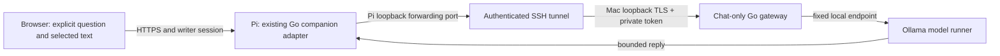

# A private model host for the optional companion

The Pi serves the desktop and the small Go provider adapter; a separately chosen Mac runs inference. Neither machine needs to operate the other machine's emulator. The application works when the model host is off. Phase B implements a narrow gateway and tests a restricted SSH/TLS forwarding path inside disposable ARM64 Linux. Actual Pi-to-Mac deployment, model-host SSH setup and account configuration remain for later owner review; no physical Pi was contacted.



`127.0.0.1` always refers to the machine making the connection. The tested Mac development service called its own loopback Ollama. A future Pi service cannot reach the Mac by using that same address without a deliberately established forwarding path.

For a single owner, a manually started SSH local forward is a simple reversible option. Keep the runner bound to Mac loopback and use an owner-managed SSH host alias with pinned host-key verification and a dedicated authentication key. On the model host, a restricted account/key should allow forwarding only to the chosen loopback API port, without shell, PTY, agent forwarding, X11 or general destination access. The isolated rehearsal tested an independently generated restricted key, pinned host key, no PTY/shell/agent/X11 access, and PermitOpen to one loopback gateway port. Actual Mac account and SSH settings still require host-specific review.

An illustrative command in a **future, separately authorized Pi Linux shell** is:

```sh
ssh -N -T -o ExitOnForwardFailure=yes -o ServerAliveInterval=30 \
  -o ServerAliveCountMax=2 \
  -L 127.0.0.1:11435:127.0.0.1:11436 MODEL_HOST_ALIAS
```

This is a placeholder, not the owner's Pi alias. The future Go configuration would use `kind: "openai-compatible"`, `https://127.0.0.1:11435/v1/chat/completions`, `/v1/models` and a private `token_file`. The model gateway converts this bounded request through the existing native Ollama adapter. Its certificate must be trusted by the service host and valid for the forwarded endpoint identity. Do not disable TLS verification in a deployment. SSH encrypts and authenticates the tunnel; TLS plus the gateway token also protect against accidental forwarding to another local listener.

The tested gateway uses native Ollama with thinking disabled, 4,096 active context and 512 output tokens. It does not require a model runtime on the Pi. Existing owner-configured OpenAI-compatible providers remain supported directly by Web Desktop; the new gateway's runner side is deliberately native Ollama only.
The tunnel should start manually after verifying the intended host and idle runner. It must never start or stop SIMH, Oscar's launcher, GPIO or a guest. If the tunnel fails, a model request fails within the existing bounded deadline; the app does not retry a prompt automatically or switch providers. Explicitly reconnect only after confirming the destination. Closing an owned tunnel affects the companion model path, not the original machine. No autostart is proposed for this increment.

Loopback is a host boundary, not per-user authentication. The implemented gateway requires a private bearer token and rejects browser Origin headers, unknown routes, tools, unapproved model names, streaming and excess input. Its only interfaces are `/v1/chat/completions`, `/v1/models` and `/v1/references`. It does not forward arbitrary paths and cannot download, delete or create a model. One provider request runs at a time, with no queue, replay or automatic fallback. The gateway listener itself requires a literal loopback address and TLS. Forward this restricted port, not the whole Ollama administrative API.

Build on the **Mac model host** with `go build -o model-gateway ./cmd/model-gateway`. Provision a host-appropriate certificate/key and independently random 32–128-character token in a private regular 0600 file. The command requires explicit `-cert`, `-key`, `-token-file` and `-model` flags; its default listen address is `127.0.0.1:11436`. Supply only an already installed model. The executable never starts or installs a runner. This is an optional manual model-host tool, not part of the Pi service package or an enabled background service. Never put tokens on a browser command line, in URLs, Git or screenshots.
LM Studio offers [native API-token authentication](https://lmstudio.ai/docs/developer/core/authentication); enabling it changes owner settings and requires separate review. A private `token_file` in the existing Go configuration can hold a provider token. Keep keys/tokens out of browser assets, URLs, Git and screenshots. Do not turn on permissive CORS to connect the browser directly to a runner: the authenticated Go adapter already provides the intended same-origin boundary.

Transport authentication does not grant the model execution authority. Only deliberately selected terminal text is sent. Treat any excerpt as untrusted data; no model response creates a keyboard lease or bypasses guest/endpoint generation checks. Existing three-command review stays disabled by default, single-use and human approved. The model has no host shell, SIMH monitor, panel, boot/shutdown or media interface. No runner belongs on the 1-GB Pi as a mandatory dependency.

The [Phase B lab](../../lab/m593b/README.md) verified the forwarding mechanism between processes in one network-isolated ARM64 VM: pinned-host refusal, certificate validation, token enforcement, fixed destination, runner-management refusal, runner loss, tunnel loss and cleanup. It used a clearly labeled provider fixture. Go tests separately exercised cancellation and concurrent-request refusal. This is not an actual cross-machine Mac/Pi acceptance test. Before deployment, review the real host account, certificate trust, private-port ownership, credential rotation and removal. No guest, physical control or emulator depends on this path.

## Phase C separate-network evidence and owner-host guidance

The [Phase C lab](../lab/M5.9.3-C.md) validates the production Go gateway and provider adapter across two distinct ARM64 Linux network/PID namespaces. The model ran on the Mac through a temporary reverse SSH forward; the client used a separate restricted local forward. TLS identity/root checks, SSH pinning, token authentication, fixed model, explicit recovery, timeout, concurrent refusal and cancellation were exercised. Containers share a kernel and physical computer; this is stronger isolation than Phase B's single-VM process test, but not a two-physical-host deployment.

For a future owner-managed Mac, Linux workstation or home server, keep inference on that capable host and bind its native runner to loopback. Manually start the narrow TLS gateway there with one approved model and a private token file. Arrange a dedicated SSH account/key restricted to the gateway's loopback destination; prohibit shell/agent/X11 forwarding and pin its host key. Give the client the expected TLS trust material and gateway token through private configuration. The endpoint hostname must match the certificate identity even when forwarded. Verify wrong pins/credentials fail before sending any selected text.

The Mac reverse forward in this lab is an isolation device, not a requirement for a normally administered inference host. Do not copy generated lab keys or certificates into a deployment. No public runner port, model-download API, hosted fallback, permanent Mac SSH service or automatic guest attachment is required. After a failure, restore the intended endpoint explicitly and submit a new request; do not retry an uncertain chat or switch models silently. Ordinary desktop terminals/peripherals remain independent of AI availability.

Actual physical-host account provisioning, certificates, firewall policy and service administration still need a separately scoped rehearsal. This paragraph is deployment guidance, not evidence that those platforms have all been administered and tested.
