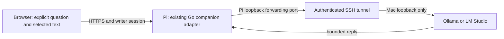

# A private model host for the optional companion

The Pi serves the desktop and the small Go provider adapter; a separately chosen Mac runs inference. Neither machine needs to operate the other machine's emulator. The application works when the model host is off. This is a **design for later owner review**, not a deployed tunnel, enabled SSH service or Pi configuration change.



`127.0.0.1` always refers to the machine making the connection. The tested Mac development service called its own loopback Ollama. A future Pi service cannot reach the Mac by using that same address without a deliberately established forwarding path.

For a single owner, a manually started SSH local forward is a simple reversible option. Keep the runner bound to Mac loopback and use an owner-managed SSH host alias with pinned host-key verification and a dedicated authentication key. On the model host, a restricted account/key should allow forwarding only to the chosen loopback API port, without shell, PTY, agent forwarding, X11 or general destination access. Exact account and OpenSSH restrictions need separate review on that host; they were not configured or tested here.

An illustrative command in a **future, separately authorized Pi Linux shell** is:

```sh
ssh -N -T -o ExitOnForwardFailure=yes -o ServerAliveInterval=30 \
  -o ServerAliveCountMax=2 \
  -L 127.0.0.1:11435:127.0.0.1:11434 MODEL_HOST_ALIAS
```

This is a placeholder, not the owner's existing Pi alias and not an instruction executed during Phase A. The Pi Go configuration would deliberately use `http://127.0.0.1:11435/api/chat` and `/api/tags`. SSH authenticates the remote host/client and encrypts the cross-machine portion. Both ends remain loopback; no Ollama listener opens on the LAN. For LM Studio, forward its separately reviewed port and use `/v1/chat/completions` plus `/v1/models`. The existing OpenAI-compatible adapter handles that dialect; reasoning settings must be qualified per model.

The tunnel should start manually after verifying the intended host and idle runner. It must never start or stop SIMH, Oscar's launcher, GPIO or a guest. If the tunnel fails, a model request fails within the existing bounded deadline; the app does not retry a prompt automatically or switch providers. Explicitly reconnect only after confirming the destination. Closing an owned tunnel affects the companion model path, not the original machine. No autostart is proposed for this increment.

Loopback is a host boundary, not per-user authentication. Other local users with access to the forwarded port could reach the runner, and forwarding the whole Ollama port also exposes its administrative APIs to holders of the forwarding credential. For a shared/untrusted multiuser host, require an authenticated host-side reverse proxy that exposes only model discovery and chat, rejects download/create/delete/tool routes, restricts model IDs, bounds bodies/timeouts/concurrency and uses owner-managed TLS or a restricted private tunnel. Do not expose a generic runner API publicly. That additional proxy is a future implementation/acceptance task, not something this phase silently installed.

LM Studio offers [native API-token authentication](https://lmstudio.ai/docs/developer/core/authentication); enabling it changes owner settings and requires separate review. A private `token_file` in the existing Go configuration can hold a provider token. Keep keys/tokens out of browser assets, URLs, Git and screenshots. Do not turn on permissive CORS to connect the browser directly to a runner: the authenticated Go adapter already provides the intended same-origin boundary.

Transport authentication does not grant the model execution authority. Only deliberately selected terminal text is sent. Treat any excerpt as untrusted data; no model response creates a keyboard lease or bypasses guest/endpoint generation checks. Existing three-command review stays disabled by default, single-use and human approved. The model has no host shell, SIMH monitor, panel, boot/shutdown or media interface. No runner belongs on the 1-GB Pi as a mandatory dependency.

Before live deployment, verify host-key/account restrictions, local-port ownership, unauthorized-access refusal, tunnel loss, wrong destination, bounded failures, credential rotation and complete removal on disposable hosts. Those cross-host transport checks remain pending; Phase A proved local-loopback model acceptance only.
