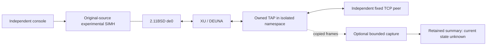

# Retained Ethernet observations

[M5.28](../lab/M5.28.md) demonstrates actual 2.11BSD TCP/IP using an independently
built original SIMH and isolated TAP. The ordinary desktop has no new network
control or live networking-equipment window. The safe first observation interface
is an [offline, bounded capture summary](../../lab/m528/observation.py).

Nothing routes from the namespace to the host LAN or Internet. Capture is outside
the mandatory data path. The separate Go companion has no authority to configure
routes, attach a controller, start/stop the guest or connect to an arbitrary peer.

An observation records a random capture generation, Linux namespace/interface
index, operator-attested guest instance, configured controller/interface/MAC,
private topology and retained packet counts. The expected identity must match
before reading a selected capture. Reused IP, MAC, TAP name or PID is insufficient.
A changed identity retires the old selection; no replay, automatic reattachment or
current link status is inferred. Guest identity remains an operator statement,
not a fact proven by Ethernet packets. A same-process guest change cannot be
reliably detected from this evidence alone.

The parser bounds file size, frame count and record sizes, checks IPv4/ICMP/TCP
checksums, accounts for matching echo pairs and preserves sequence-numbered TCP
payload segments. Duplicate requests consume one reply each. Invalid/truncated
PCAP fails; malformed network frames are counted. Fragmented IPv4, full TCP stream
reassembly, PCAPNG and arbitrary protocols are outside the implemented subset.
Capture itself is not a guarantee against kernel packet drops.

Current-state fields always remain unknown for retained data. TCP peer receipt
and guest console output supply the separate application-level evidence. No live
browser indicator may be built merely by treating a capture's timestamp or a host
interface counter as proof of the guest's current state.

A future production observer requires separate review of privilege separation,
identity/lifecycle attestation, drop accounting, effective resource limits and
failure behavior. This lab's root/NET_RAW collector is not an approved companion
service. No browser control, DECnet, Internet access or physical deployment is
qualified by this milestone.
