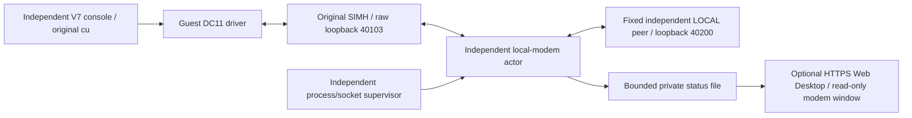

# Local modem contract

M5.27 qualifies a modern, bounded Hayes-style text personality against original
UNIX V7 cu and DC11 line 3. It is optional laboratory equipment, disabled unless
an independent operator starts and approves it. It is not a historical modem
emulator, telephone service, general proxy or guest lifecycle controller.

All guest transport stays within one network-none Linux namespace. The executable
refuses other interface inventories and requires enforced 96 MiB/zero-swap memory
containment. The lab environment marker is an additional check, not a security
boundary by itself. Only the conventional console launches cu. Neither the modem
nor the browser starts, stops, switches or configures SIMH.

## Protocol and bounds

| Input or condition | Result |
| --- | --- |
| `AT` + CR | `OK` |
| `ATE0` / `ATE1` + CR | Disable/enable command echo; `OK` |
| `ATI` + CR | Modern personality identification; `OK` |
| `ATDLOCAL` + CR | Actual fixed-peer connection attempt; `CONNECT` only on success, otherwise `NO CARRIER` |
| Unknown command | `ERROR` |
| Any other `ATD` destination | `NO CARRIER`; no lookup or network attempt |
| Guarded `+++` | One-second pre-silence, three pluses within one second, one-second post-silence; `OK`, online command mode |
| Ordinary or failed-guard pluses | Literal data, subject to the same bounds |
| `ATH` + CR in command mode | Close peer; `OK`; repeated hangup remains `OK` |
| Peer EOF/crash | `NO CARRIER`, command mode, no redial |
| Guest/approval/ownership loss or uncertain write | Retire attachment; no replay or automatic reattachment |

Default echo is **off**, a deliberate modern choice for the observed V7 line.
Commands terminate only on CR; LF is ignored in command mode. BS/DEL edit within
an 80-byte command buffer. Overflow discards until CR, then returns one ERROR.
Data rejects high-bit bytes and limits each line to 256 bytes between LF. These
bounds protect the inspected cu reader's fixed 600-byte line buffer; they do not
qualify every ASCII control character. Only the reported printable text/CR/LF
subset has genuine transfer evidence. NUL/all-byte transparency is unqualified.

Each of the four directions is capped at 64 KiB per attachment, including modem
responses and commands. A peer read is at most 256 bytes; its queue has eight
entries. Dial and peer writes have 250 ms deadlines. Existing terminal bridge
input-rate, queue, credit, lease and write deadlines still apply. A partial write
counts its committed prefix and retires; it is never replayed. The 2 MiB optional
private trace stops the process at its bound. No transcript is retained by the
ordinary status API. A configured trace is diagnostic evidence, not an audit log
for unrestricted conversations.

There is no BUSY qualification, flow-control negotiation, ATO, phone-number grammar,
S-register set, arbitrary destination, automatic retry or binary transfer protocol.
Online command mode retains the peer; incoming peer text may still reach cu and
interleave with command replies. To resume data, hang up and explicitly dial again.
Do not send arbitrary control-rich peer content to historical cu: it has receive
file-diversion and other escape behavior. This is a trusted local laboratory peer.

## Authority and lifecycle

The actor uses the existing terminal Manager and Endpoint. A special one-line
constructor reserves one bounded output subscriber before the first socket read,
so startup AT bytes are not lost during process/socket verification. The actor
cannot obtain that subscriber until verification succeeds. It must then acquire
an ordinary input lease; reservation grants no keyboard authority. It checks the
current generation before I/O and renews ownership, while the independent supervisor
renews the separate one-second process/socket lease. Queued pre-acquisition state
frames are ignored only when their epoch is older than the actual acquired epoch.

Retirement closes guest and peer sockets and joins owned readers. Startup generates
a new instance and begins detached. An old proof or reused TCP port cannot restore
it. A guest OS change within the same process and socket remains undetectable;
the operator must stop the actual modem before changing the guest and verify a
fresh identity. A browser close has no such effect and is not sufficient.

## Read-only equipment observation

The optional service configuration field `modem_status` names one absolute private
status file provisioned by the operator. `GET /api/v1/modem` requires the existing
terminal-observe capability. The file reader refuses links, special files,
wrong ownership/permissions and content above 16 KiB. Strict decoding validates
the qualified profile, modes, counters and timestamps. A sample older than three
seconds or more than one second in the future is unavailable. Paths and private
byte traces are never returned. There is no POST, dial, hangup, shell or attachment
operation on this route.

The Local modem window begins disconnected. Explicit observation polls every
750 ms with a two-second request deadline and a 16 KiB streamed response bound.
It pins the first observed generation. Replacement, stale data, malformed state,
HTTP failure or close retires observation; explicit new observation is required.
The browser clock and lab/service clock must be sufficiently aligned for this
freshness contract. A failed request clears the displayed connected claim.

“Disconnect observation” stops only this view. The window explains that actual
hangup uses cu's guarded escape and ATH, or the independent operator. It cannot
revoke a modem session it does not own. Mode/result are modem-personality facts;
socket counts prove host transport, not application consumption. No DCD, DTR,
DSR, CTS, RTS, physical baud timing or CPU-running state is invented.

The status file is replaced atomically every 100 ms, with no history database.
Use a bounded runtime filesystem in any future deployment design. This milestone
adds no service installation. A future combined companion deployment must keep
both optional processes within the intended aggregate enforced memory budget;
two independently configured limits are not proof of that aggregate constraint.
