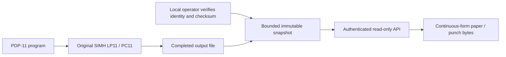

# Observing emulated-device output

M5.21 adds optional [equipment-session ownership and staged completion](equipment-sessions.md)
to these existing interfaces, plus a read-only reader catalog. The [genuine report](../lab/M5.21.md)
records live RSX punching, sequential jobs and real supervisor expiry. Legacy followers
retain their prior API; the new supervisor does not operate SIMH or mount media.

The **Line printer** and **Paper tape** windows offer explicit **Local simulation**,
**Observe device** and **Completed exports** modes. The older **Guest devices**
window remains available. Observation reads actual allowlisted original-SIMH output
through the optional Go service; local simulation is a separate browser model.
[M5.20](../lab/M5.20.md) verified RSX PIP/LPDRV printing and PIP/PRDRV/PPDRV tape copy,
as well as a separate full-byte CPU/device transfer. This does not qualify the
supplied V7/BSD printer drivers or authorize browser media attachment.

## What crosses the boundary



Private configuration allows up to four fixed absolute export paths. Each publication is limited to 65,536 bytes. The service refuses a final-path symbolic link, special file, oversized file, changed length/time or checksum mismatch. Reserve the containing directory for the operator; the allowlist is not a defense against an administrator changing parent directories. The service needs read permission only. Do not point it at original guest media or a file still being written.

The local control socket accepts `GET /devices/status`, `POST /devices/publish` and `POST /devices/retract`. It shares the existing private Unix socket; these routes do not exist on public HTTPS. Publication consumes the current device revision, even if validation fails. Payload fields are:

```json
{
  "instance": "copy-from-fresh-local-status",
  "id": "lp11",
  "revision": 0,
  "simulator_generation": "verified-simulator-run-1",
  "guest_generation": "verified-guest-run-1",
  "sha256": "verified-completed-file-sha256",
  "completed_and_verified": true
}
```

The example is a schema illustration, not a ready-to-execute approval. Identities must be 1–80 letters, digits, dots, underscores or hyphens and begin with a letter/digit. They describe the producer observed by the operator. They do not prove which guest is currently running.

## Operator procedure

Use a **Linux administrator shell on a separately authorized host**. In the isolated lab, use [the fixed publisher](../../lab/m591/publish.py) only after the device test has passed.

1. Stop the companion before changing its private configuration. Add `device_exports`, for example `[{"id":"lp11","kind":"lp11","path":"/var/lib/pidp11-webdesktop-exports/completed.lp"}]`. Supported kinds are `lp11` and `pc11-punch`. Keep the directory and configuration operator-owned. This documentation does not authorize creating a production service or changing simulator profiles.
2. Start the companion manually. All terminal lines remain detached and all device observations offline. Verify the existing protected service checks pass.
3. Independently verify the producer, guest and output completion. Close/detach the simulator output through its conventional operator interface before hashing it; never through a browser monitor endpoint. Preserve the source bytes. Compute SHA-256 with `sha256sum` in the Linux shell.
4. Read fresh local status using `curl --unix-socket /run/pidp11-webdesktop/control.sock http://local/devices/status`. Create a private approval JSON file with that instance/revision, verified identities and checksum. Review it, then submit with `curl --fail --unix-socket /run/pidp11-webdesktop/control.sock -H 'Content-Type: application/json' --data-binary @approval.json http://local/devices/publish`.
5. In the browser, sign in through Guest terminal, open **Line printer** or **Paper tape**, choose **Completed exports**, then **Refresh observations**, select the device and choose **View selected generation**. Confirm its producer labels and checksum-verified status. Writer and observer credentials both permit observation; neither permits publication.
6. **Save exact device bytes** downloads the original snapshot. Multiple observers can independently read it. Selecting another device clears the old display; an unavailable or retired generation requires a fresh explicit selection. Restart clears all publications. Retraction uses the fresh instance/id/revision with `/devices/retract`.

Stop at a failed publication and inspect the producer and file. Do not retry using an old approval or relabel an uncertain file as a new guest. Already downloaded or displayed snapshots cannot be remotely erased; the UI identifies them as cached completed observations.

## Paper and media limits

LP11 output must be ASCII7. The device view applies CR as carriage return, LF as a new row, FF as a new form and BS as a backstep. The latest glyph occupies an overprinted cell; this is not physical ink simulation. Partial final lines are visible. Paper offers 80/132 columns without changing downloads. The existing simulated printer keeps its previous normalization behavior. M5.20 adds retained incomplete byte/text downloads with generation and byte-range
labels. They preserve available evidence, not a promise of a complete job. A new
producer always requires explicit selection. Switching equipment modes cancels the
old observer and any pending local paper-tape import.

PC11 preserves all eight bits; its display is limited to 512 bytes while the bounded download remains complete. Empty exports are valid.

`media-observation.ts` defines a separate read-only status contract for PC11 reader/punch, RK05, RL02 and TM11. It validates media type, access mode, position/length, sequence and simulator/guest generation, rejects unknown fields, and refuses implicit generation replacement. This is fixture-tested schema work, **not a running collector**. No remote mount, reset or disk/tape activity integration is delivered. M5.9.2 adds the separate LP11/PC11 follower below, including explicitly reported reader EOF.

## Live activity: laboratory contract

[Decision 0008](../decisions/0008-live-device-observation.md) explains identities, limits and failure assumptions. The [M5.9.2 harness](../../lab/m592/README.md) is the tested route; it is not an unattended production collector.

A private optional `device_followers` array names up to four entries, for example:

```json
[{"id":"live-lp11","kind":"lp11","path":"/reserved/lab/empty-spool"},
 {"id":"live-punch","kind":"pc11-punch","path":"/reserved/lab/empty-punch","reader_path":"/reserved/lab/reader.bin"}]
```

Paths must be absolute, operator-owned local regular files. Only `lp11` and `pc11-punch` are supported; an optional reader snapshot pairs with the punch. No default follower is installed. Changing private configuration requires stopping the companion first and independently reviewing compatibility and file permissions.

The private Unix socket has `/streams/status` and POST operations `/streams/follow`, `/streams/renew`, `/streams/progress`, `/streams/complete`, `/streams/detach`. Approval fields are `instance`, `id`, `revision`, `simulator_generation`, `guest_generation`, `producer_verified`; progress adds `reader_bytes` and `reader_eof`, initial paired-reader approval adds `reader_sha256`, and completion adds `sha256`. Use fresh status for every operation; revisions are single-use even on validation failure. These routes are not public HTTPS APIs.

1. Before producer output begins, independently verify the producer and fresh empty spool. Approve following locally with its identities. A paired reader requires its independently computed SHA-256. An old nonempty spool is refused, including after service restart.
2. The independent supervisor must renew within five seconds only while it can still attest the same producer. On uncertainty, stop renewing and detach. The browser cannot renew or replace this authority.
3. In the browser, sign in, open **Guest devices → Live activity**, refresh, select the approved generation and choose **Observe selected generation**. **Open another observer** provides a second independent device view. Refresh never silently selects a new producer.
4. Original SIMH writes its files normally. The follower reads 8-KiB chunks on a 200-ms poll and retains 64 KiB per device. PC11 status reports independently observed reader position; it is not guessed from punch output. Slow viewers stop on a missing offset and require explicit review of the retained tail. Network failure stops polling without automatic reconnection.
5. After the independent operator verifies producer flush/close, compare the entire file and submit completion with its SHA-256. Inactivity alone never completes a job. A complete retained job enables **Save completed output**; an omitted prefix produces **Save retained tail (partial)** instead. Reader download verifies a bounded immutable snapshot and pauses polling until explicit resumption.
6. Stop observing or close the window to cancel its pending request/timer. Detach locally on producer shutdown; service shutdown closes all follower descriptors. Cached bytes may remain visible with stale-state labeling. A new producer needs a new empty spool approval and explicit browser selection.

The job bound is 1 MiB and reader snapshots are limited to 64 KiB. High-bit LP11 output, changed identity, observed shrink/rewrite, removed spool, expired approval or a wrong completion hash retire observation. Parent-directory replacement, rewrites wholly outside the retained window and incorrect supervisor attestations remain limitations. M5.11 detects changed bytes in the retained window even after same-inode truncate/regrow between polls. No browser action opens arbitrary files, writes media, attaches devices or controls SIMH.

## M5.11 shutdown and rewrite hardening

Closing a follower is permanent: a late private request cannot reopen its file after polling has stopped. Before accepting another append, the follower rereads and compares the currently retained 64-KiB window. This detects the demonstrated same-inode truncate/regrow rewrite; older discarded bytes are not continuously checked. The final full-file hash, private parent-directory ownership and trustworthy producer supervision remain necessary. The bounded read costs are measured in [M5.11](../lab/M5.11.md), including genuine completed downloads after producer exit.
