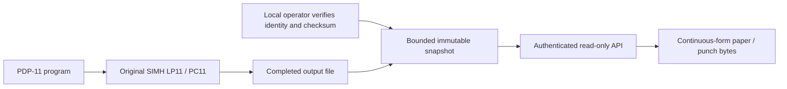

# Observing completed emulated-device output

The **Guest devices** window displays completed LP11 printer and PC11 punch output through the optional Go service. It is separate from the simulated Line printer and Paper tape applications. M5.9.1 verified actual PDP-11 CPU instructions writing the original simulator's device registers; this is not a claim that the supplied UNIX V7 kernel has a printer driver.

## What crosses the boundary



Private configuration allows up to four fixed absolute export paths. Each publication is limited to 65,536 bytes. The service refuses a final-path symbolic link, special file, oversized file, changed length/time or checksum mismatch. Reserve the containing directory for the operator; the allowlist is not a defense against an administrator changing parent directories. The service needs read permission only. Do not point it at original guest media or a file still being written.

The local control socket accepts `GET /devices/status`, `POST /devices/publish` and `POST /devices/retract`. It shares the existing private Unix socket; these routes do not exist on public HTTPS. Publication consumes the current device revision, even if validation fails. Payload fields are:

```json
{
  "instance": "copy-from-fresh-local-status",
  "id": "lp11",
  "revision": 0,
  "simulator_generation": "verified-simulator-run-1",
  "guest_generation": "verified-guest-run-1",
  "sha256": "verified-completed-file-sha256",
  "completed_and_verified": true
}
```

The example is a schema illustration, not a ready-to-execute approval. Identities must be 1–80 letters, digits, dots, underscores or hyphens and begin with a letter/digit. They describe the producer observed by the operator. They do not prove which guest is currently running.

## Operator procedure

Use a **Linux administrator shell on a separately authorized host**. In the isolated lab, use [the fixed publisher](../../lab/m591/publish.py) only after the device test has passed.

1. Stop the companion before changing its private configuration. Add `device_exports`, for example `[{"id":"lp11","kind":"lp11","path":"/var/lib/pidp11-webdesktop-exports/completed.lp"}]`. Supported kinds are `lp11` and `pc11-punch`. Keep the directory and configuration operator-owned. This documentation does not authorize creating a production service or changing simulator profiles.
2. Start the companion manually. All terminal lines remain detached and all device observations offline. Verify the existing protected service checks pass.
3. Independently verify the producer, guest and output completion. Close/detach the simulator output through its conventional operator interface before hashing it; never through a browser monitor endpoint. Preserve the source bytes. Compute SHA-256 with `sha256sum` in the Linux shell.
4. Read fresh local status using `curl --unix-socket /run/pidp11-webdesktop/control.sock http://local/devices/status`. Create a private approval JSON file with that instance/revision, verified identities and checksum. Review it, then submit with `curl --fail --unix-socket /run/pidp11-webdesktop/control.sock -H 'Content-Type: application/json' --data-binary @approval.json http://local/devices/publish`.
5. In the browser, sign in through Guest terminal, open **Guest devices**, choose **Refresh observations**, select the device and choose **View selected generation**. Confirm its producer labels and checksum-verified status. Writer and observer credentials both permit observation; neither permits publication.
6. **Save exact device bytes** downloads the original snapshot. Multiple observers can independently read it. Selecting another device clears the old display; an unavailable or retired generation requires a fresh explicit selection. Restart clears all publications. Retraction uses the fresh instance/id/revision with `/devices/retract`.

Stop at a failed publication and inspect the producer and file. Do not retry using an old approval or relabel an uncertain file as a new guest. Already downloaded or displayed snapshots cannot be remotely erased; the UI identifies them as cached completed observations.

## Paper and media limits

LP11 output must be ASCII7. The device view applies CR as carriage return, LF as a new row, FF as a new form and BS as a backstep. The latest glyph occupies an overprinted cell; this is not physical ink simulation. Partial final lines are visible. Paper offers 80/132 columns without changing downloads. The existing simulated printer keeps its previous normalization behavior. PC11 preserves all eight bits; its display is limited to 512 bytes while the bounded download remains complete. Empty exports are valid.

`media-observation.ts` defines a separate read-only status contract for PC11 reader/punch, RK05, RL02 and TM11. It validates media type, access mode, position/length, sequence and simulator/guest generation, rejects unknown fields, and refuses implicit generation replacement. This is fixture-tested schema work, **not a running collector**. No remote mount, reset, end-of-tape detection or disk/tape activity integration is delivered yet.
