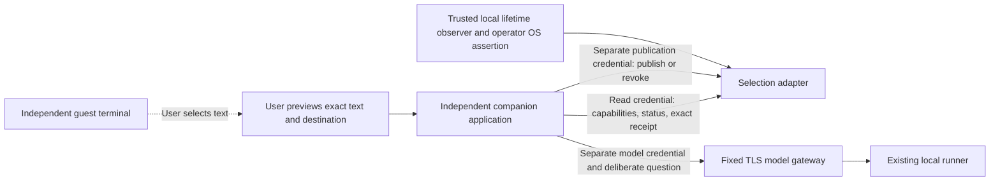

# Explicit selection interoperability: 0.1 draft

This is a proposal for discussion with Rolf Peters, independent author of
[Hacker Replicant](https://github.com/rolfpeters-droid/pidp11-hacker-replicant).
It is not an upstream agreement, supported plugin or production interface.
The existing modified-application experiment pins upstream revision
`6f8a2aca7786736e01bdf5ba9b44bf66a7f19349`; its four-file patch inventory and
genuine M5.12 evidence remain in [the interoperability packet](hacker-replicant-interoperability.md).
M5.14's new client is entirely outside that upstream tree.

M5.15 adds a [fixed-revision review packet and qualification map](M5.15-interoperability-review.md). The client now snapshots and validates the preview before its first asynchronous operation and rechecks cancellation after reading a response. The draft version is unchanged; this corrects implementation behavior rather than extending authority.

M5.16 supplies a [concise review handoff](M5.16-hacker-replicant-handoff.md) and
fresh uncached TLS checks for multiple authenticated callers. `/selected-text`
with a mandatory receipt is recommended for a future negotiated version only;
no new route/version is implemented and the legacy experiment is preserved.

## Smallest useful boundary

Keep both applications independently installed, authenticated and stopped/started.
An optional read-only provider supplies deliberately selected text, never a Screen
snapshot, monitor, keyboard or process-control endpoint. Model/reference access
uses a separately configured gateway and credential. No discovery or fallback to
an operator console is permitted.



The adapter has one selection slot for a single-user laboratory. It is not a
multi-tenant system. The application owns preview, per-question inclusion,
cancellation and history handling; the adapter owns expiry, epochs and receipts.
Opening the optional application transfers no terminal data or credential.

## Authentication and negotiation

The caller configures an exact HTTPS origin, trusts its certificate and holds
distinct read and publication bearer tokens server-side. Browser-origin requests
are refused. Redirects, arbitrary destinations and automatic retries are refused.
The example identifiers below are fixtures, not credentials or observed guests.

`GET /api/pidp11/capabilities`, authenticated with the read token, returns:

```json
{
  "protocol": "pidp11-explicit-selection",
  "version": "0.1-draft",
  "capabilities": ["publication-epoch", "receipt-bound-read", "explicit-revoke", "expiry", "unknown-os"],
  "authority": ["selected-text-only"],
  "maximum_selection_bytes": 4096,
  "maximum_lifetime_seconds": 30
}
```

The prototype requires this exact draft version, all five capabilities and the
single stated authority. Missing/unknown versions or added control authority
refuse sharing; there is no downgrade to legacy console APIs. Extra informational
capabilities may be ignored, but required consent semantics cannot be omitted.
Revocation remains callable when negotiation fails. Existing experimental clients
are unchanged; the capability route does not certify their behavior.

## Publication, exact read and revocation

1. Preview the exact excerpt and destination and obtain deliberate user approval.
   No API scrapes the terminal. Negotiate before a new publish/read workflow.
2. Read `GET /api/pidp11/status` with the read credential. The existing response
   includes `publication_epoch`, `attachment`, `attachment_confirmed`, `os:null`,
   `running:null` and `cpu_running:"unknown"`. Confirmation describes an accepted
   attachment assertion, not OS or CPU observation.
3. Publish with the separate credential using `POST /api/pidp11/selection`:

   ```json
   {
     "publication_epoch": "example-instance:1",
     "consent": true,
     "selection": {
       "endpoint": "example-line",
       "generation": "example-attachment",
       "simulator_generation": "example-process-assertion",
       "viewer_revision": 2,
       "text": "deliberately selected fixture text"
     }
   }
   ```

   Success is HTTP 204 with an unpredictable 32-hex-character `X-Selection-ID`.
   The complete status-to-publication workflow is fenced by the epoch. One
   concurrent publisher wins; revocation/replacement/restart retires old epochs.
4. A later explicit question must name that receipt. Send
   `GET /api/pidp11/screen` with the read credential and `X-Selection-ID` header.
   Despite the legacy route name, this reads only the selected excerpt.
   A mismatched receipt receives 409 before any excerpt is returned. The JSON
   includes `selection_id`, `text`, endpoint/generation/viewer fields, explanatory
   `semantics`, and `expires_unix_ms`. Consumers independently verify the exact
   receipt, size and expiry before including text in a model request.
5. `DELETE /api/pidp11/selection`, with the publication credential, clears the
   selection and advances the epoch; success is 204. `/api/pidp11/keys` refuses.

Unauthorized reads receive 401; origin/publication authorization failures receive
403; malformed bounded publications receive 400; stale identity/epoch/receipt or
expiry receives 409. Errors do not echo excerpts or credentials. Status/receipt
values are identifiers, not substitute authentication secrets.

The legacy `/screen` route still accepts a missing receipt header for the prior
modified-app experiment, which checks the returned receipt itself. The new draft
client always supplies the header. Native upstream adoption should decide whether
to reserve a new route that requires it unconditionally.

## Model and reference interface

The separately configured authenticated TLS gateway offers `GET /v1/models`,
`GET /v1/references?q=…&system=…` and nonstreaming `POST /v1/chat/completions`.
There are no tool/model-management routes. The configured model is fixed, context
is bounded, and only one inference is in flight, without a queue or retry.
Read, publication, model and browser-login credentials remain distinct.
Generated prose carries the M5.13 source-status qualification; it is not verified
primary-source wording or a certificate of historical correctness.

## Guarantees and limits

Selections expire after at most 30 seconds; reads do not extend their lifetime.
Identity loss invalidates readback. The epoch begins when the application reads
adapter status, not at the user's click timestamp. Final identity checking and
network submission are not atomic. Revocation/cancellation cannot recall bytes
already submitted to a runner, which may continue briefly or retain them.

Process/listener/socket/view identities do not establish guest OS identity. An OS
switch on an unchanged surviving stream may be invisible. Stop the actual bridge
and observer before an intentional guest change and independently approve the new
instance. The lab observer remains outside production packaging.

The draft client uses a five-second bound per adapter request, an 8-KiB response
limit and 4-KiB selected-text limit. It propagates caller cancellation and never
retries. Its local expiry check assumes reasonably synchronized clocks and can
refuse a still-valid selection when clocks differ; the server remains the
authoritative expiry boundary. A provider response received before the caller
observes cancellation cannot be recalled.

## Prototype and conformance

[`client.mjs`](../../integrations/selection-contract/client.mjs) is an opt-in
server-side client library. It creates no listener, contacts no service until an
explicit operation and has no model/terminal authority. It is not registered in
the desktop or Hacker Replicant. The new metadata and exact-receipt check reuse
our existing authenticated selection adapter.

From the Mac development shell:

```sh
npm run test:selection-contract
go test -race ./internal/replicant
npm run test:replicant
```

Nine client conformance cases cover version/capability refusal, preview/credential
separation, publication epoch, exact receipt, substitution/expiry, revocation,
cancellation (including late bodies), preview mutation, malformed input, oversized replies and fixed destinations. An opt-in Go-to-Node test additionally exercises actual trusted TLS. Go HTTP tests cover the
actual adapter's authenticated metadata and receipt-before-text behavior; existing
race tests cover delayed revocation and one-winner publication. Client transport
fixtures are not a real upstream application, model or guest acceptance test.

## Decisions for Rolf

- Would a native read-only provider entry point fit upstream better than optional
  route interception? Which direct console/tool routes would it explicitly deny?
- Should selected-text routes use new names instead of the legacy `/screen` path,
  with receipt headers mandatory for every consumer?
- Where should fixed providers and distinct credentials be configured, keeping
  application lifecycle and authentication independent?
- Are this epoch/receipt exchange and explicit unknown/attested identity useful,
  or is a different versioned interface preferable?
- Which cancellation, history-clearing and multi-page consent semantics should be
  shared, and which conformance cases would be useful upstream?

No upstream change, issue, pull request or maintainer message was made. Feedback
should precede any promise of supported compatibility or permanent fork maintenance.
